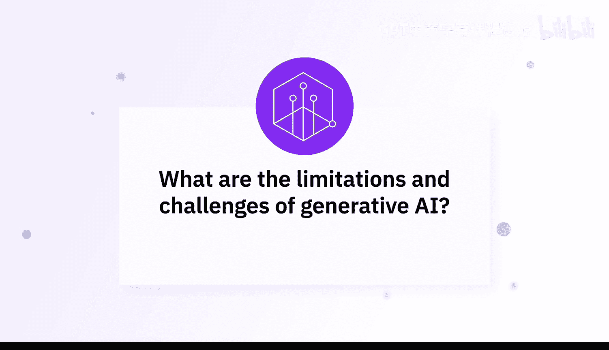
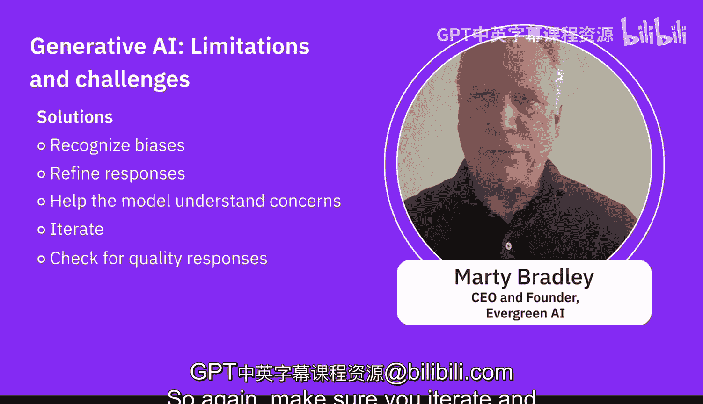
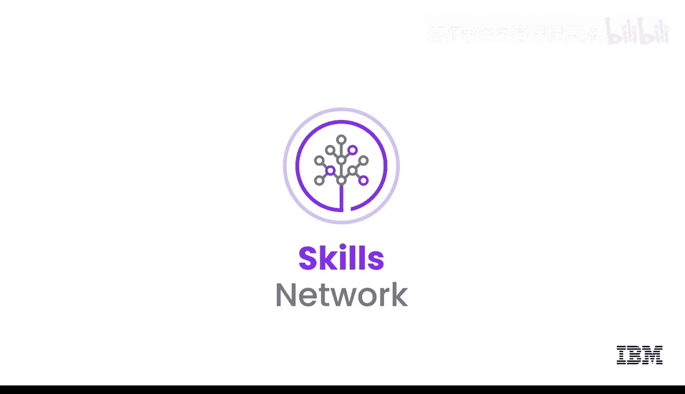

# IBM《生成式AI基础（五课全）｜Generative AI Fundamentals》中英字幕 p52 10_01_09_专家观点：生成式AI的局限性与挑战.zh_en [BV11XSYBfEje_p52]

Hello and welcome to this expertt Viewpoints video。

 Let's listen to what artificial intelligence or AI experts have to say about the limitations and challenges of generative AI。

Gener AI faces several limitations challenges， including data quality。

 computational costs and ethical concerns from a data quality standpoint， generative models。

 they require a large amount of data。 So if you have poor data coming in。

 the output is going to be poor。 Now the thing is that the anecdote is that it's been trained on the internet and there are more and more specific information being trained into the model。

 The other ways that you can do things is with the newer models， you can use the upload a file。

 So if you have things that are very specific tier type of work。

 it's an insurance organization and you have insurance standards。

 upload those as part of your chat and type of data and responses you could back will be better。

So generative AIs biggest issue currently is the EI hallucination part with generative AI is very susceptible。

What happens is that the mandate of generator AI is to you know， generate an output with respect。

To the question that is asked， but in certain context because it is a synthetic material creation software。

 if you are asking it to quote factsacts and figures or if you' are asking it to you know create some context in terms of a practical solution or a practical occurrence that might have happened。

 but generative AI is found to be susceptible to is creating outputs which are pause and which did not really happen this particularly is called AI hallucination and often their responses and their terms and conditions usually come with a disclaimer that the model is still susceptible to AI hallucination。

So ethical and legal considerations is something that we should really care about when using this generative AI technology because there will be some ethical and legal concerns using the output of these models and some of the issues related to privacy ownership misuse of the generated content addressing these concerns requires us to have some ethical guidelines in place to be able to have responsible deployment of these models and we had IBM have offered a platform called Wasonx。

govern， which helps addressing some of the concerns about。eththical issues。

 putting some rules and regulation and compliance， risk management of these models and is' in progress。

And do not trust the output without getting confirmation from other sources。

And this is something that even still the models are struggling the things are improving， but yeah。

 there still is margin。Now the computational costs can get higher if you're running the later models。

 the costs per token， so basically the words you send in and the words that come back gets higher and higher right so you have to be careful you want to monitor that as more and more gets used。

 those prices will come down just like with the newer models， they're pretty inexpensive。

 but you don't have to watch it， especially if you're doing a lot of repetitive tasks。

And some of the ways that we can tackle this is to have model pruning。

 quantization and knowledge distillation because training and deploying and maintaining these large language model is very resource intensive。

 also it's very important to have some platforms and optimize a process in place and leveraging hardware accelerators to train these models such as GPU and GPUs and efficient runtime environments such as server computing and edge devices for the deployment of these models。

Again， it's trained on data on the internet and based on the way that it interpreted the information where there was brought in。

 there could be biases based on demographics， so just be careful when you look at your responses。

 have it refine it for if there are any ethical concerns if you feel like it's leaning towards being a little sexist or not then basically help it understand and it'll rework the information and then some of the models they can they work like black boxes。

 so when you get a response， you don't always know why， so again。

 make sure you iterate and you check for quality responses。

。

