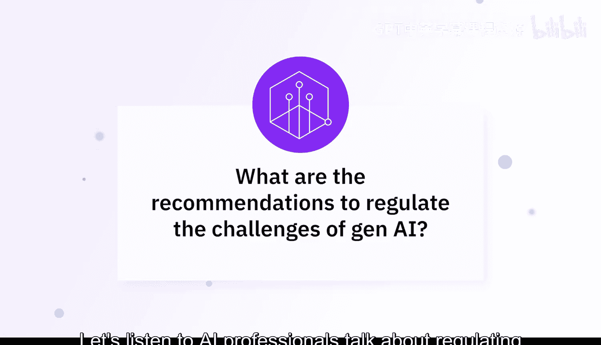
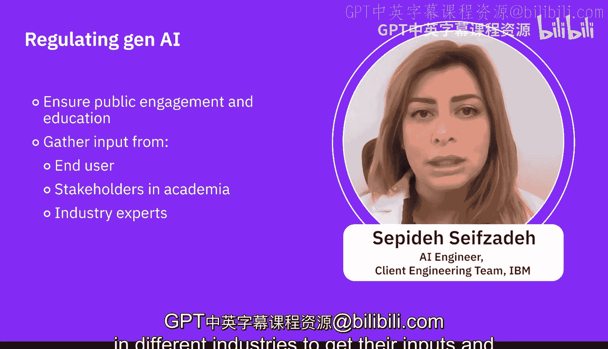

# IBM《生成式AI基础（五课全）｜Generative AI Fundamentals》中英字幕 p53 11_01_10_专家观点：生成式AI监管挑战.zh_en [BV11XSYBfEje_p53]

Hello and welcome to this expert viewpoint video， Let's listen to AI professionals talk about regulating the challenges posed by generative AI。

A specific regulations can address the challenges posed by generative AI setting clear guidelines and standards for ethical use。

 accountability， transparency， effective regulation can help mitigate risks related to bias。

 misinformation， privacy misuse， promote transparency， their I concerns for these software companies。

 but if data is coming out， we need to know that it's not used copyrighted data。

 enhance data privacy and then basically just continue to encourage research and collaboration。

 the foster collaboration between academia， industry and a government to advance AI research。Firstly。

 regulation strikes a delicate balance between innovation and accountability。

 ensuring creativity while upholding standards lawmakers must craft adaptable regulations for the evolving AI landscape ethical guidelines and transparent or crucial clear standards and transparent decision making build trust and safeguard against misuseefs lawmakers must prioritize frameworks enforcing ethical AI practice privacy production is vital strict ruless on data usage and user concerned establish robust privacy productions。

 safeguarding individuals right， regular audits are essential for compliance。

There needs to be company policies which are enforced by the governments。

 and there also needs to be a lot of more stress on job creation rather than job automation。

So in terms of creating better skills， better knowledge and know how and how to employ these techniques to the best possible usage。

That should be the key lawmakers need to consider that creative jobs and creative skills need to be a part more of the training and skill process。

 other than simply you know creating testing engineers because those things are going to get automated。

So definitely AI regulation can play a crucial role in addressing the challenges that is brought by generative AI by providing an establishing the ethical guidelines。

 standards and legal frameworks to govern the development。

 deployment and usage of these generative AI models。

 especially in sensitive domains such as content generation deep fake and personalized recommendation。

 data privacy and security is also very important because by putting more strong data privacy and security regulation。

 it will avoid the misuse of the individual data set。

 so some steps and solutions can be data and anonymization， content mechanism。

 data protection and safeguards， we should establish a mechanism for content verification and detection。

 and take down。With penalties for maliciaious and creating the harmful content。

So one of the solutions for this is actually to have a sandbox and testing platform before putting the disgenerative AI model out there。

 we have to have it tested in a controlled condition and environment to minimize the potential risk that it will provide for the end user and society and it will also enable the regulators to observe and assess the impact of this technology before we putting it out there for actual employment。

It's also very important for having the public engagement and education we have to engage with all the end users。

 stakeholders in academia， in different industries to get their inputs and build the consensus about AI regulation。

。

