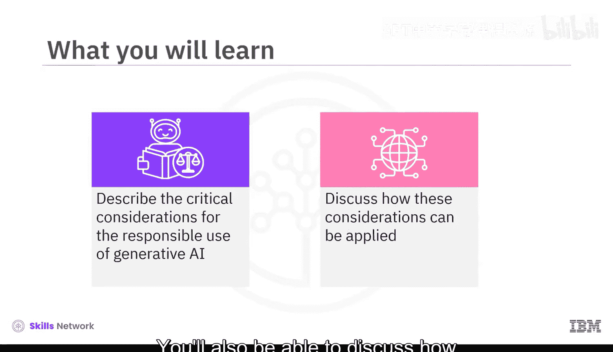
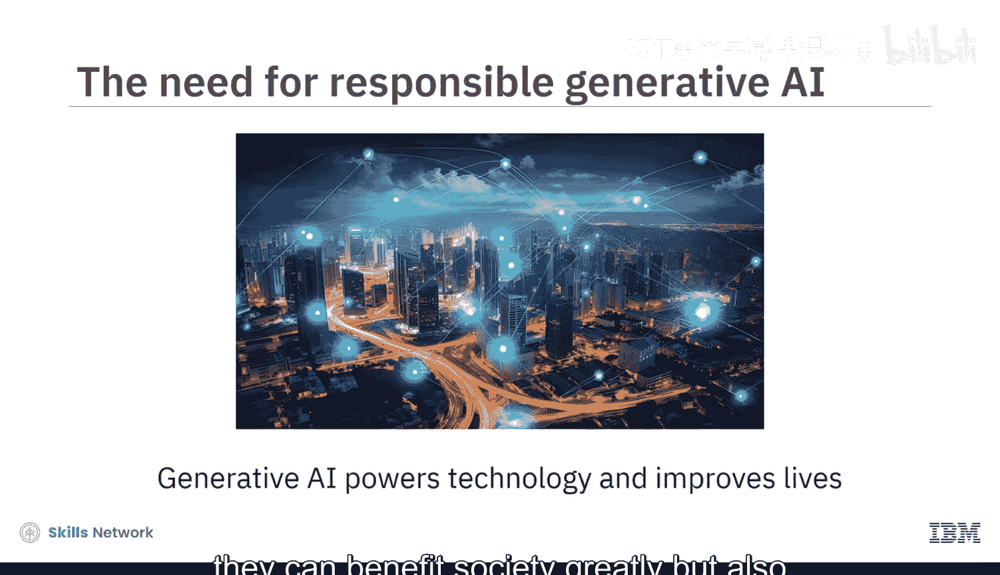
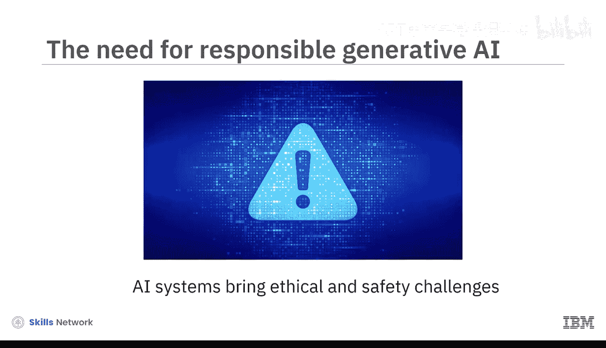
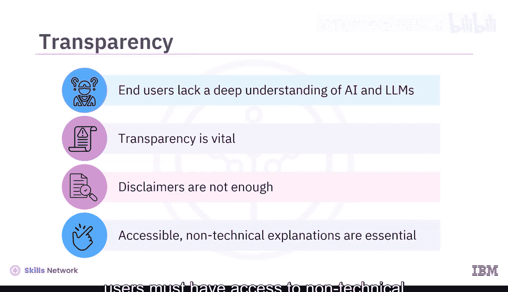
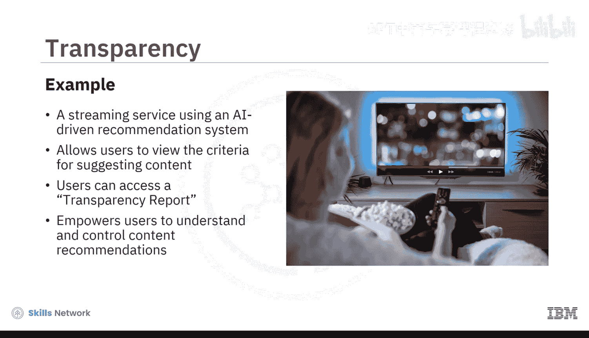
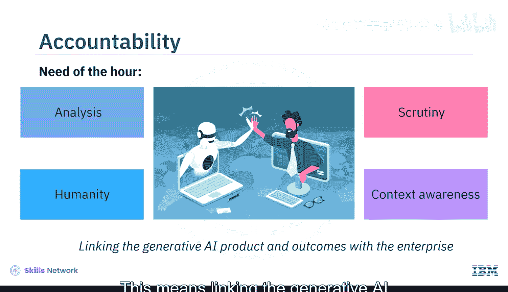
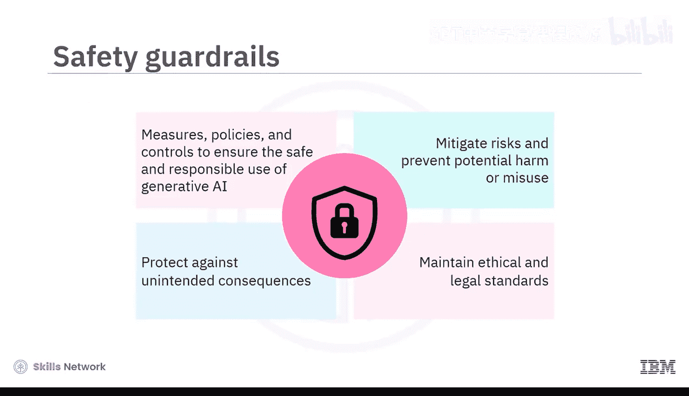
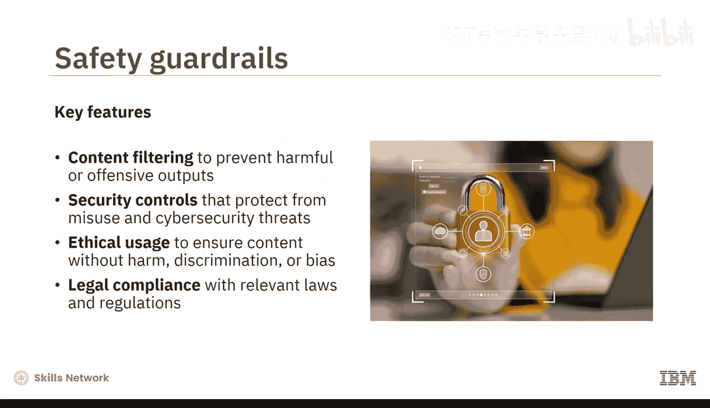
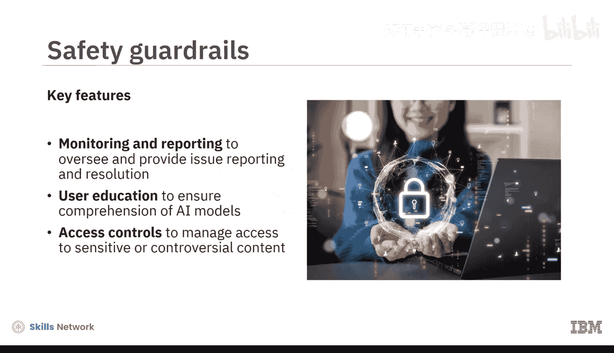
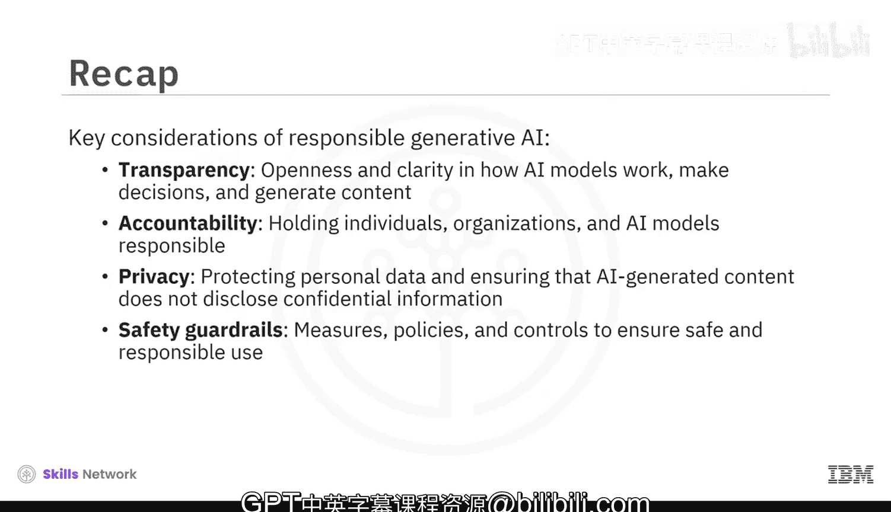

# IBM《生成式AI基础（五课全）｜Generative AI Fundamentals》中英字幕 p54 12_02_01_负责任生成式AI的考量因素.zh_en [BV11XSYBfEje_p54]

Welcome to Considers for Repons generative AI After watching this video。

 you'll be able to describe the critical considerations for the responsible use of generative AI。

 you'll also be able to discuss how these considerations can be applied。

Billions of people use generative AI powered technology to improve their lives as AI systems become increasingly capable。

 they can benefit society greatly but also bring ethical and safety challenges。

 ensuring that generative AI operates responsibly is essential to harness its potential while minimizing risks and ensuring it benefits all humanity how do we ensure that generative AI is used responsibly by implementing four vital considerations。

 transparency， accountability， privacy and safety guardrails。

 let's take a closer look at each Transpar ingenrative AI refers to the openness and clarity in how AI models work make decisions and generate content。

Alllowing users to understand and trust the technology and users often lack a deep understanding of AI in large language models or LLMs That is why transparency cannot be achieved only through disclaimers regarding potential inaccuracies in generative AI models to ensure transparency and ethical decision making users must have access to non-technical explanations of geneative AI It limits。

 capabilities and risks Let's look at an example， a streaming service using an AI drivenn recommendations system lets users view the suggestion criteria Use can access a transparency report that explains how the recommendations were generated including factors like user history。

 content relevance and diversity This transparency empowers users to understand and control their content recommendations better Accountability in generative AI means holding individuals。

 organizations and AI models responsible for the ethical and legal consequences of their AI drivenrin actions and decisions as generative AI becomes better able。

To mimic human creativity， we must carefully consider the human side of this equation。

 because unlike a human， an AI model does not possess autonomy or intent。

 it cannot be held accountable in any meaningful sense。

 Everyone will be impacted by generative AI in one way or another。 from outsource labor to layoffs。

 changing professional roles and even potentially legal issues。

 Since we cannot know the consequences that may result from the mass adoption of generative AI。

 We need analysis， scrutiny， context awareness and humanity at the center of all AI endeavors。

 This means linking the generative AI product and its outcomes with its creator， the enterprise。

 Here's an example that illustrates the role of accountability and responsible。

 generative AI A news agency uses a content generation AI tool to produce articles。

 If the generative AI tool generates an article that is factually incorrect or biased and the article goes to print who should be held responsible for this error。

 the news agency a tool and agency uses AI in this example doesn't absolve the agency from being accountable。

For the quality and integrity of the articles it publishes。

Privacy in generative AI involves safeguarding personal data and ensuring that AI generated content does not disclose sensitive or confidential information without using privacy preserving algorithms during training。

 generative AI models become vulnerable to privacy risks geneative AI can inadvertently generate content that violates personal information as it learns from large databases that often contain sensitive data without explicit consent LLms are particularly at risk as they can memorize and associate sensitive data leading to privacy breaches The acceptance of generative AI apps has raised privacy concerns as sometimes responses andadvertently include sensitive data further integrating unveted generative AI apps into business systems can cause compliance violations Let's look at an example an AI powered chatbot is used for customer support when responding to inquiries。

 it occasionally generates responses that inadvertently reveal a customer's personal information such as contact details or purchase history。

Pivacy Lase is a concern as the chatbot's responses should protect customer data。

The final consideration is the use of safety guardrails safetyfe guardrails and generative AI are measures。

 policies and controls to ensure the safe and responsible use of generative AI models these guardrails aim to mitigate risks and prevent potential harm or misuse that help maintain ethical and legal standards and protect against unintended consequences。

 some critical aspects of safety guardrails and generative AI include content filtering。

 which refers to implementing filters to prevent harmful or offensive outputs。

 security controls that protect generative AI models from misuse and potential cybersecurity threats。

 ethical usage to ensure AI generates content without harm discrimination or bias。

 legal compliance to comply with relevant laws and regulations。

 including data protection and intellectual property rights。

 monitoring and reporting to continuously oversee AI model behavior and provide issue reporting and resolution mechanisms。

 user education to ensure comprehension of AI model capabilities， limitations。

And their own responsibilities and usage access controls to manage access to AI models。

 particularly in contexts where sensitive or controversial content may be generated to control usage and potential risks In this video you learned that as the role of generative AI in making our lives better increases one must also consider how to use it responsibly There are certain key considerations toward this The first is transparency which refers to the openness and clarity in how AI models work make decisions and generate content then there's accountability。

 which means holding individuals， organizations and AI models responsible for this ethical and legal consequences of their AI drivenriven actions and decisions The third consideration is privacy which refers to protecting personal data and ensuring that AI generatedrated content does not disclose sensitive or confidential information Finally you learned about the importance of safety guardrails and generative AI which are measures。

 policies and controls put in place to ensure the safe and responsible use of gene。

Of AI models。

