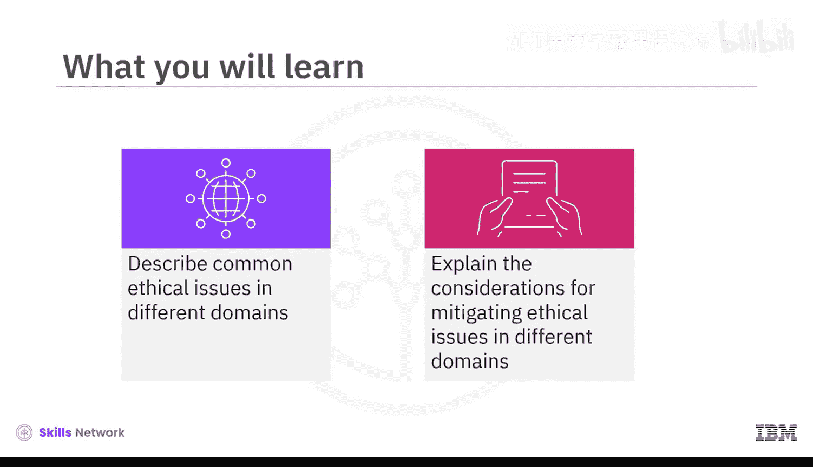
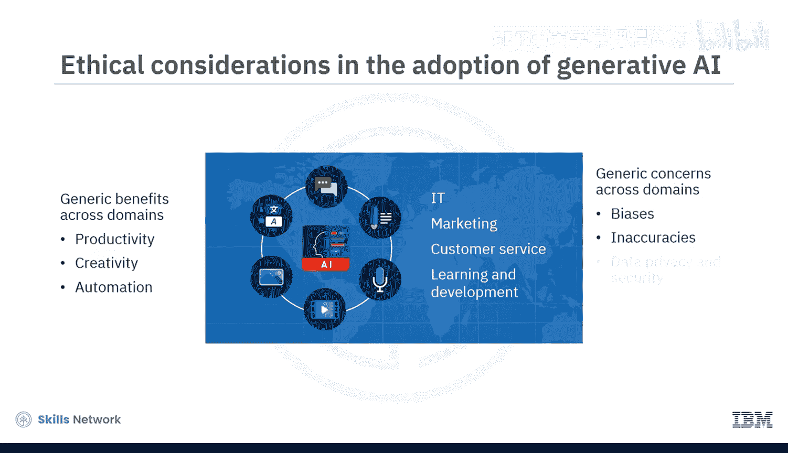
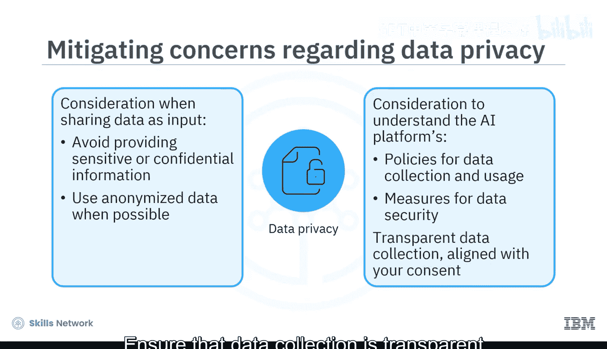
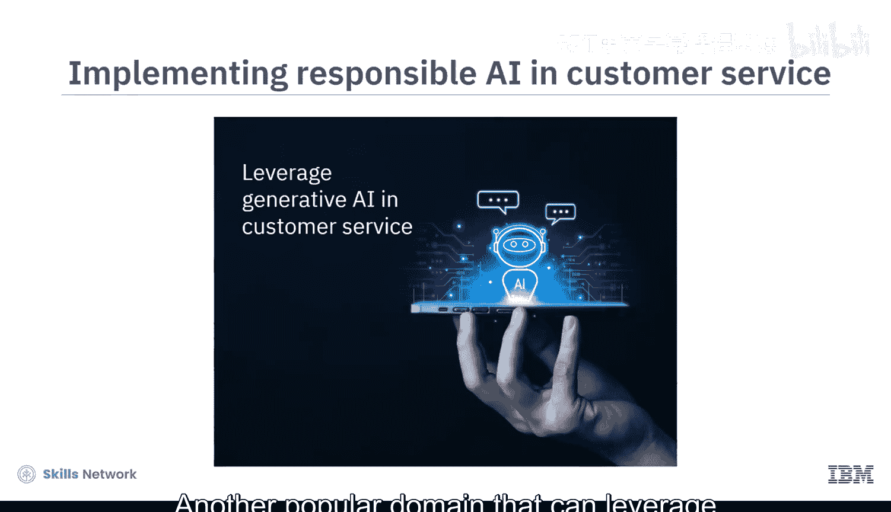
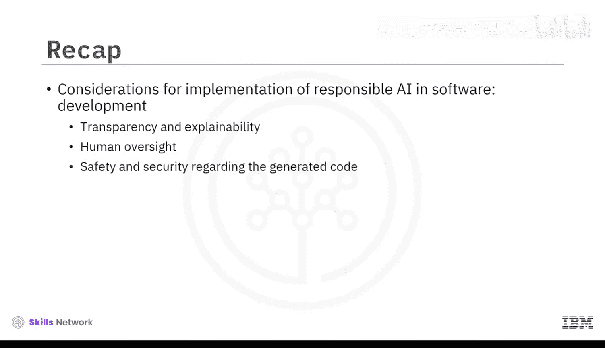

# IBM《生成式AI基础（五课全）｜Generative AI Fundamentals》中英字幕 p55 13_02_02_跨领域实施负责任生成式AI.zh_en [BV11XSYBfEje_p55]

Welcome to implementing responsible generative AI across domains After watching this video。

 you'll be able to describe common ethical issues in different domains and explain the considerations for mitigating ethical issues in different domains。

 generative AI has created new opportunities for professionals across different domains such as IT。

 marketing， customer service， learning and development and others organizations in different domains adopting generative AI experience。

 enhance their productivity， creativity and task automation。

However， there are also concerns regarding biases， inaccuracies， data privacy， security。

 and copyright infringement。

Any organization or professional leveraging generative AI has to consider the ethical implications of generative AI and take responsibility for navigating the concerns associated with the use of generative AI。

 Let's explore the ethical implications of generative AI in a few domains that are broadly using generative AI。

 a potential and widespread use of generative AI as content creation。

 Prof in different domains and industries， including marketing。

 human resources learning and development。 So documentation and entertainment use generative AI for content creation。

 The major ethical concerns surrounding the usage of generative AI for content creation。

 including content accuracy。 Con authenticity， Co infringement and data security。

 generative AI may produce inaccurate， inconsistent or hallucinated content to mitigate the concerns regarding content accuracy。

 Professionals must verify and validate the content they generate using generative AI systems。

 and correct any errors or inconsistencies。 Many generative tools。

 including chat G encourage users to review the gene information。

The content generated by generative AI can be plagiarized with no clear citations。 In addition。

 the AI tool may cite fake or nonexistent sources。 There is a risk of professionals using deceptive AI generated content。

 resulting in tarnishing the credibility of their work or the reputation of their organization For example。

 a lawyer may unwittingly cite fake cases based on their research through a generative AI tool to mitigate the concerns regarding content authenticity Or can consider including a step of human review to assess and authenticate AI generated content before its implementation。

 They can also consider using other AI or thirdpart tools or systems to verify the authenticity of content produced by generative AI Now。

 let's analyze the concerns regarding copyright infringement。

 AI development organizations may use copyrighted material from other organizations to train the AI models。

 For example， Getty images suited stability AI for using its image library to train its AI image generated model If an AI model is trained on copyrighted material There's a risk that the generated content。

May replicate copyrighted work， so professionals using generative AI should ensure the originality of the generated text。

 images， videos， or any other assets。If the generative AI tool produces content based on specific sources。

 consider providing appropriate attribution to the original creators as per their terms and conditions。

Professionals must also ensure that the data prompted to the AI tool that is the input content is not copyrighted material。

 using copyrighted material as input without permission could lead to legal issues。

 Under ownership and rights for input and generated content is crucial some AI tools and services assign ownership and legal responsibility of the content to the users as seen in open AI's terms of use however。

 other tools may claim ownership or impose specific terms on content usage as AI tools tend to store or use the data you feed as a prompt。

 it's crucial to be mindful of data privacy concerns associated with its use organizations or professionals should avoid providing any sensitive or confidential information as input to the generative AI tools use anonymize data when possible to minimize the risk of personal identification Another important consideration is to understand the AI platform policies regarding data retention。

 usage and sharing understand how the generative AI platform collects and utilizes your data Inquire about the platform's data security measures。

sure that data collection is transparent and aligned with your consent。

Another popular domain that can leverage generative AI is customer service。

 let's try to understand the ethical considerations to ensure responsible AI and customer service。

Firstly， clearly communicate to customers when they are interacting with a generative AI chatbot instead of a human transparencypar builds trust and helps manage customer expectations。

 Also continuously monitor the generative AI system's performance and impact on customer interactions。

 It is important to safeguard customer data and ensure compliance with relevant privacy regulations。

Further， it's crucial to empower customers with control。

 allowing them to easily switch to human assistance， see clarifications or escalate concerns。

 Let's explore a few considerations and implications that developers or software engineers must evaluate when using generative AI in their work。

 Firstly， ensure that the code generated by generative AI is transparent and understandable。

 According， include inline comments in the code， include a step of human review and comprehension of the generated code regarding the safety and security of the generated code。

 It's important to implement rigorous testing and validation procedures。

 verify that the generated code does not introduce vulnerabilities。

 bugs or security risks that could harm users or systems。

 While generative AI demonstrates great capabilities for use in different domains and industries。

 It also poses numerous ethical challenges。 According。

 organizations should adopt relevant best practices and considerations to leverage the power of generative AI ethically。

 It's crucial to provide training to employees regarding the ethical implications， potential risks。

And limitations of generative AI Further， organizations can consider using their own individually trained AI models to avoid bias and hallucinations and to ensure the protection of the organization and consumer data。

 It's crucial for organizations to comply with relevant laws governing data protection。

 privacy and AI usage Also， employees should be educated on the guidelines regarding the usage of AI tools in AI generated content。

 Let's summarize in this video you learned about the common ethical concerns regarding the use of generative AI and different domains。

 The major ethical concerns around the usage of generative AI for content creation include content authenticity。

 copyright infringement and data security。 organizations and professionals should consider relevant considerations to mitigate these issues。

 To implement responsible AI and customer service。 organizations should consider implications regarding transparency。

 monitoring and control for customers to implement responsible AI and software development。

 Consider implications regarding the transparency and explainability， human。

ite and safety and security regarding the generated code。

。