# IBM《生成式AI基础（五课全）｜Generative AI Fundamentals》中英字幕 p56 14_02_03_主要参与者的AI伦理视角.zh_en [BV11XSYBfEje_p56]

Welcome to AI Ethics perspective of key Players After watching this video you'll be able to identify the open ethical standards and principles established by key players like IBM。

 Google， Open AI and Microsoft for responsible AI development you'll also be able to evaluate and compare the practical strategies employed by the key players to actively pursue and implement their respective AI principles as generative AI models become integral to various aspects of business and society。

 ethical considerations become paramount Open ethical standards provide a transparent framework that guides the development。

 deployment and utilization of these models ensuring responsible and fair practices Let's discuss how key players like IBM。

 Google， Open AI and Microsoft have established a set of principles to promote responsible and ethical development and usage of Gen AI。

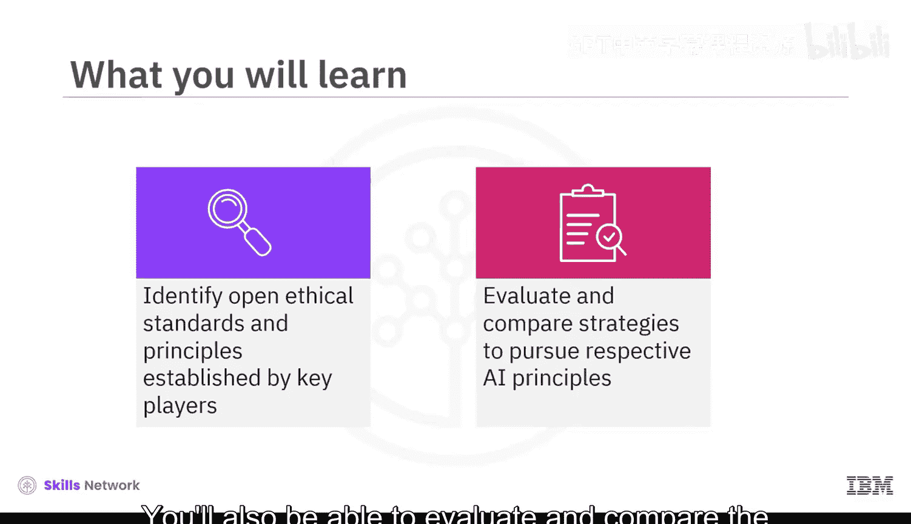

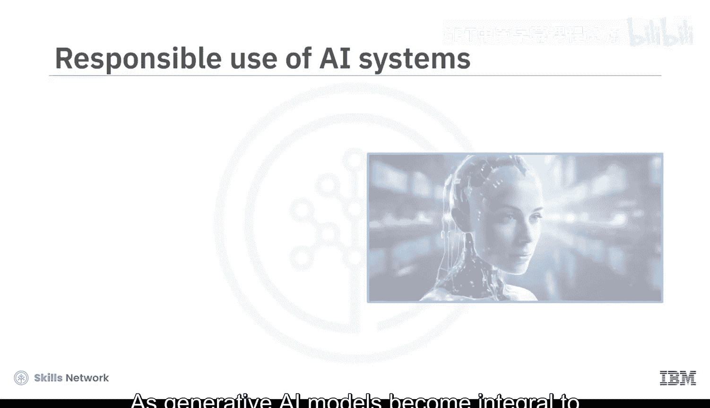

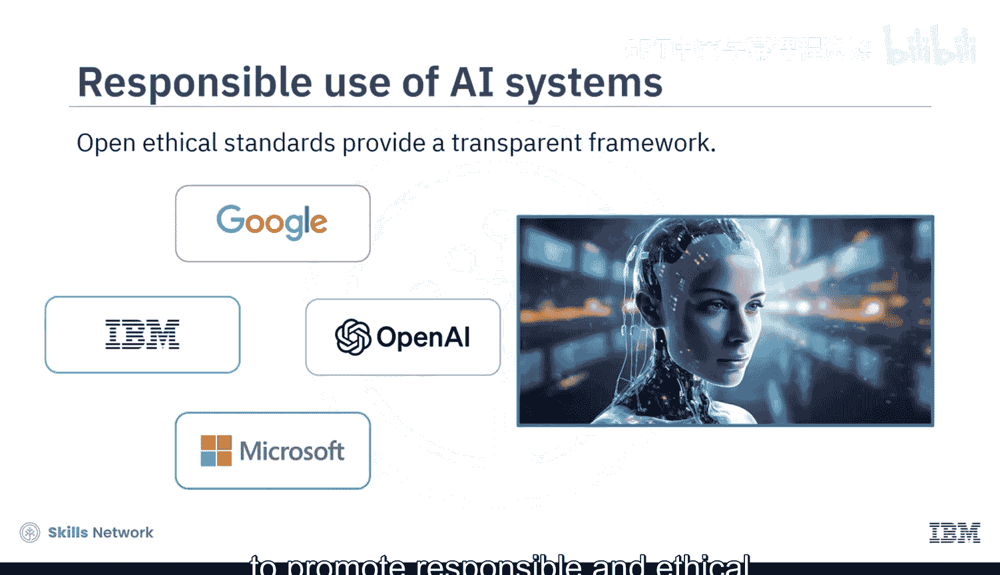

To start with IBM has created the following guidelines for the responsible use of AI technologies。

 explainability， an AI system must clearly explain the factors influencing the recommendations behind its algorithms。

 which are relevant to various stakeholders with various objectives fairness this means an AI system treats everyone or every group of individuals fairly When calibrated in the right manner。

 AI can assist humans in making fairer choices， countering human biases and promoting inclusivity。

 Robness AI powered systems must be actively defended from adversarial attacks。

 minimizing security risks and enabling confidence in system outcomes Trans to reinforce trust。

 users must be able to see how the service works， E its functionality and comprehend its strengths and limitations。

 privacy AI systems must prioritize and safeguard consumers privacy and data rights。

 and provide explicit assurances to users about how their data will be used and protected。

 IBM offers its customers' products and services for responsible。

 transparent and ethical AI workflow IBM Wa。

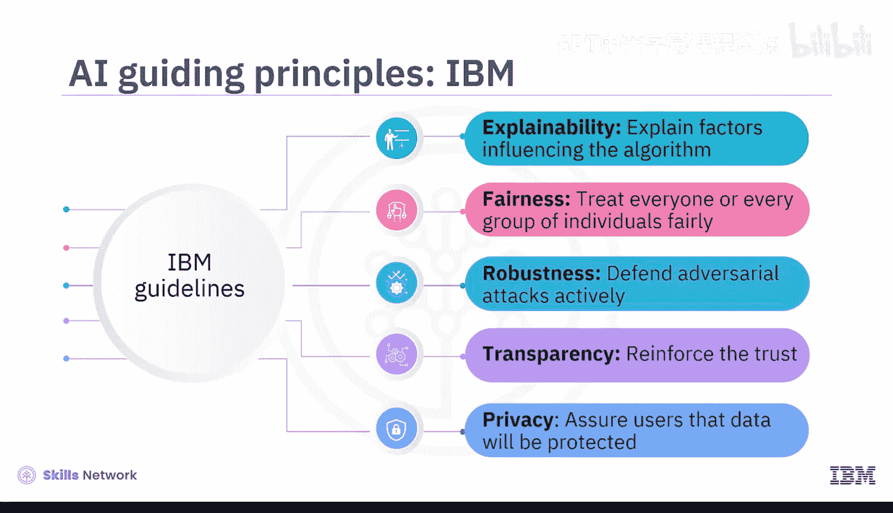

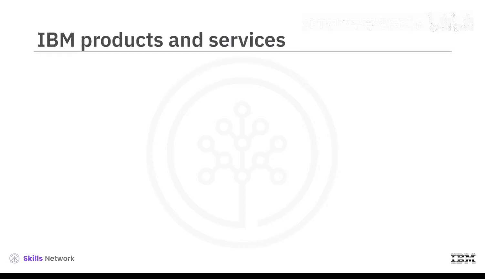

governance is a cost effectiveff platform enhancing an organization's risk mitigation abilities。

 regulatory compliance and ethical management for AI activities even for models developed using thirdpart tools。

 IBM Watsons studio enables the development of advanced machine learning models using both notebooks and codefree tools。

 factating the infusion of AI into business operations moving forward。

 Google encompasses the following guiding principles Social benefit AI must contribute to the well-being of society and avoid creating or reinforcing unfair bias Sa and design AI systems should prioritize safety and security and refrain from causing harm Acability to people AI systems should be accountable to people and should be designed in a way that allows for transparency and oversight privacycentric design AI systems must safeguard user privacy refraining the model from harmful or unfair data practices Pri aligned use AI technology should only be made available for uses that are consistent with these principles Now let's explore how Google。

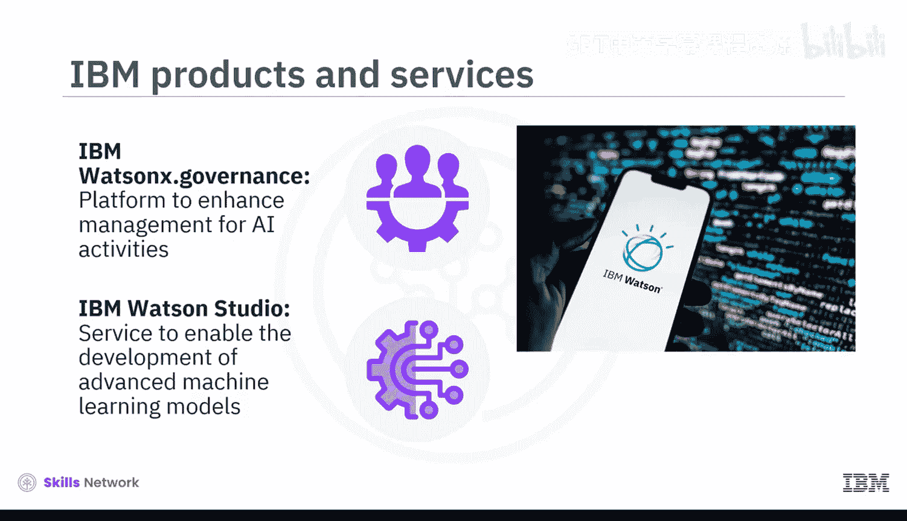

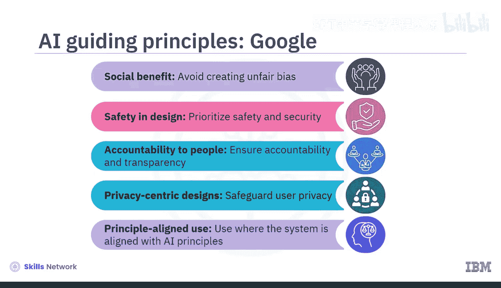

actly pursuing the objectives outlined in its AI principles Google has developed various tools to assist developers and users in recognizing and addressing bias in generative AI models help users understand the decisionmaking process within generative AI systems Saguard the privacy of user data and prevent the misuse of Gen AI models fairness turnaround is designed to aid developers in identifying and eliminating biases from these models Explainable AI is designed to elucidate how Gen AI models make predictions differential privacy is a method that enables the collection and analysis of data without compromising the privacy of individual users and safety net is designed to identify and prevent malicious uses of Gen AI models Open AIs safety guidelines constitute a framework of principles and practices formulated to guarantee secure and advantageous utilization of Gen AI technologies These guidelines are based on the company's belief that Gen AI has great potential to benefit society but it's important to develop and use it in a way that's responsible。

 safe and aligned with human。

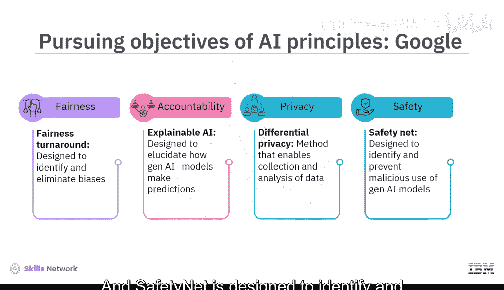

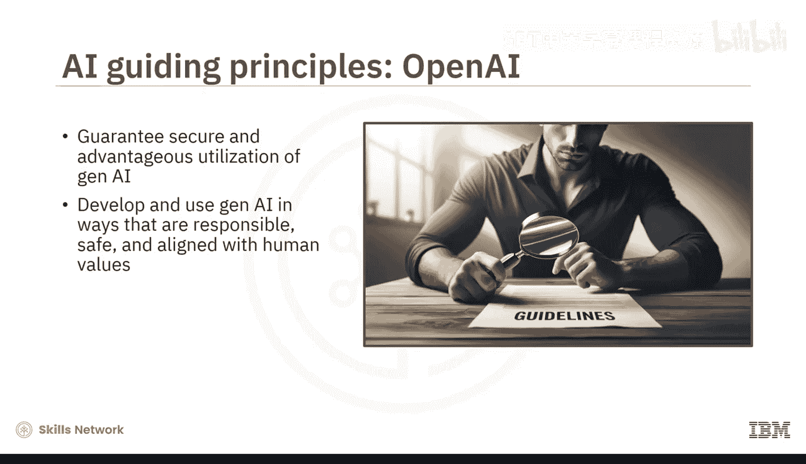

ValueThese guidelines cover a wide range of topics， including alignmentign research。

 Open AI is dedicated to aligning Gen AI with human values。

And the company heavily investing in research to develop Gen AI systems that are safe。

 reliable and beneficial misuse prevention Open AI is actively working to prevent the misuse of generative AI technologies by developing tools that can detect and prevent the creation of malicious AI systems the company has developed a tool called GT classifier that can be used to detect text generated by an AI system transparency Open AI is committed to transparency and research and development they openly publish research papers and code allowing others to review and build upon their work This ensures ethical and transparent research practices collaboration open AI emphasizes collaboration for the safe and beneficial development of AI The companies actively engaged in collaborations with other researchers。

 policymakers and organizations Open AI is a member of a partnership on AI which is a group of companies and organizations working together to promote the safe and beneficial development of AI Microsoft has been at the forefront of AI development for many years and is dedicated to use。

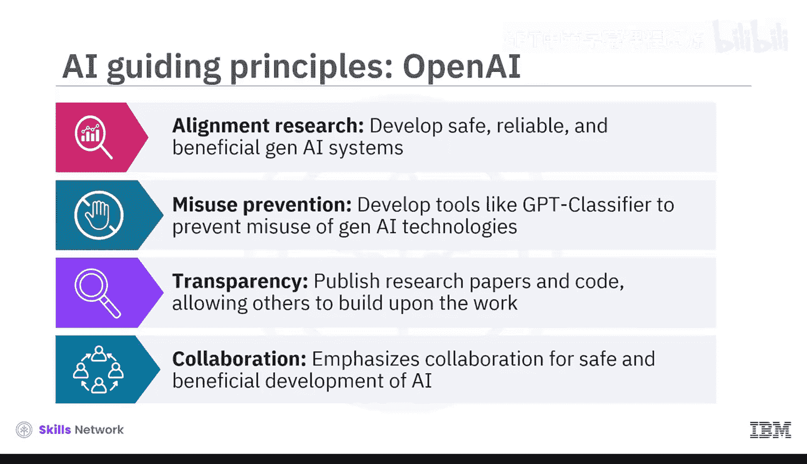

AI ethically and responsibly let's see how Microsoft is actively pursuing the objectives outlined in the guiding principles fairness AI should be designed and used in a way that is fair and unbiased Microsoft has developed a tool called fairness checklists that can help developers identify potential sources of bias in their AI models Re and safety AI systems should be reliable and safe and should not be used in a way that could cause harm Sa analysis is a tool that can help developers identify and mitigate potential safety risks in their AI models privacy and security AI systems should be designed to safeguard both user privacy and security a technique called differential privacy can be used to collect and analyze data without compromising user privacy Inclusiveness AI systems should be designed and employed in a manner that is accessible and inclusive for everyone Inclusive design toolkit has been developed to help developers design AI systems that are accessible to people with disabilities Trans AI systems should be transparent and easy to understand。

Openly publishes its AI ethics principles and AI bias mitigation toolkit。

Accountability AI systems should be accountable and those who develop and use them should take responsibility for their impacts。

 Explainable AI is a tool developed to help users understand how AI models make predictions。

 In this video you gained insights into the ethical standards and principles established by major industry players such as IBM。

 Google， Open AI and Microsoft for responsible AI development you explored the key principles including explainability。

 fairness， robustness， Trans and privacy and discussed the strategies and tools employed by each company to actively implement these principles in the development and usage of generative AI models The video emphasized the increasing importance of ethical considerations as generative AI becomes integral to various aspects of business and society There are specific guidelines and tools developed by IBM。

 Google Open AI and Microsoft showcasing their commitment to responsible and ethical AI practices。

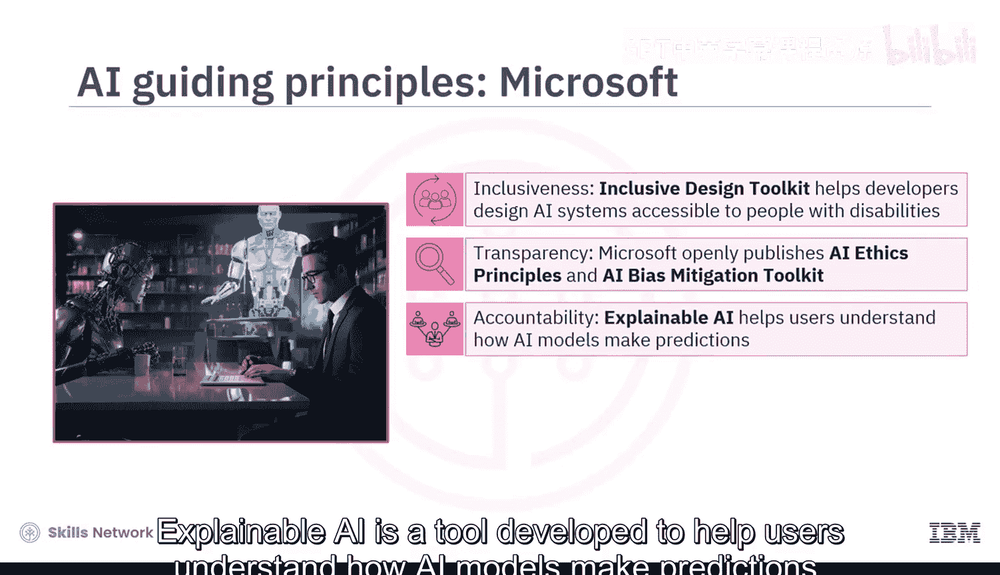

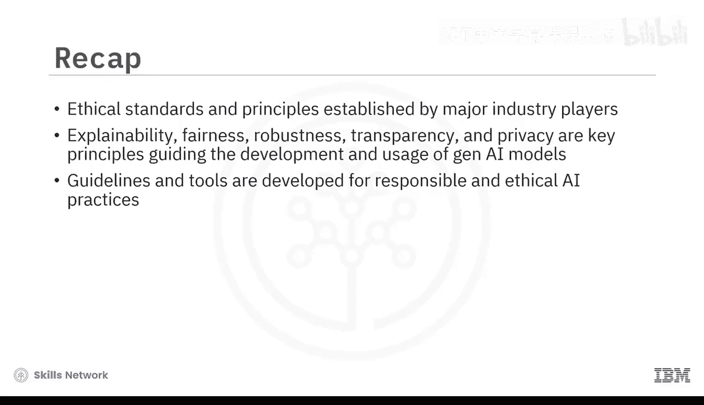