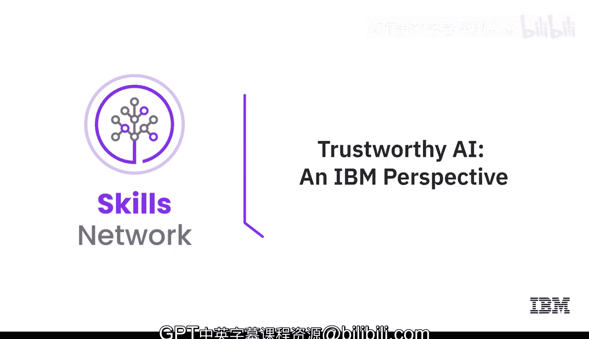
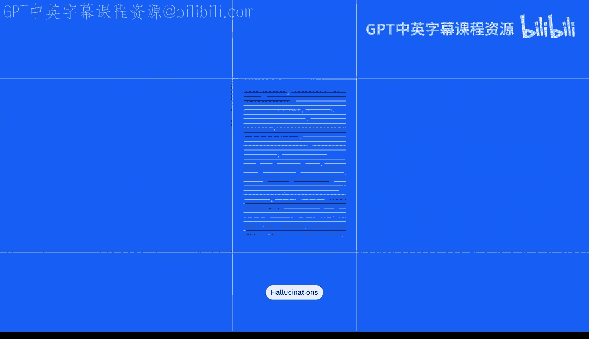
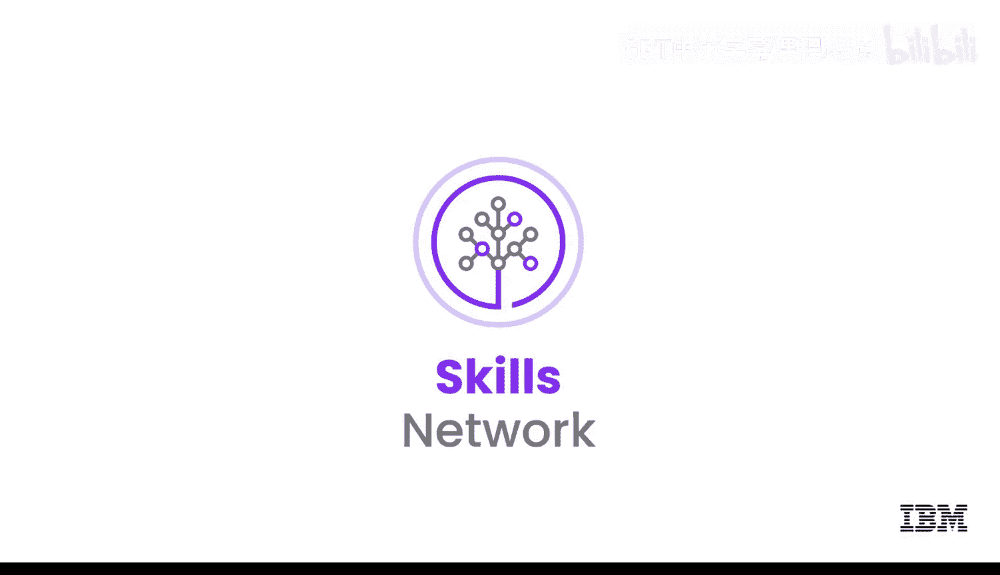

# IBM《生成式AI基础（五课全）｜Generative AI Fundamentals》中英字幕 p57 15_02_04_可信AI：IBM视角.zh_en [BV11XSYBfEje_p57]

Hello and welcome to AI Academy My name is Kate Sol。

 I'm a business strategy Se manager at IBM research in the MIT IBM Watson AI Lab。

 and this is my colleague， distinguished research scientist Kush Vsni Kush is an AI researcher with a focus on trustworthy AI。

Kush， I'm really excited we get to have this conversation today I've been working with clients in thinking about trustworthy AI from a business perspective for a while now。

 but I know you've been innovating in trustworthy AI from a research perspective for a number of years when it comes to AI。

 I think you and I can both agree trust is the number one important thing Yeah。

 it has to be if we don't have that trust in those models there have billions of parameters andre really huge but until we have that trust we can't really get the benefit of that AI in enterprises Now you have quite a few accomplishments to your name in this space right you've published hundreds of papers。

 you have algorithms that are working in labs around the world。

 you're a sought after speaker right and I say this to emphasize that you have a big footprint in this space。

 a public footprint in this space and given your public accomplishments I thought it might be interesting。

I asked some consumer chatbots to learn a little bit more about some of the work that you're doing in trustworthy AI that sounds like a fun thing to do So you published a book on trustworthy machine learning Yep that's absolutely correct You were named an elevate fellow by the government of Ontario。

 Canada I've never heard of that fellowship You're a cofounder of the Mach learning for Good Social Foundation that's almost right so I did found the IBM Science for Social Good I so we're close You've created many open source toolkis So we created the 360 toolkits around AI fairness 360 AI explainplainability 360 and some others You have a PhD in Elect and Comp engineering from the University of Illinois at Urbana Champaign I went to MIT。

Sosh， what's going on with these chatbot responses here。

 some of these are right and some of them are complete fiction。

What's going on So I would call that hallucination and so that means that these AI systems they'll make some things up。

 they'll make associations that aren't exactly correct and I think that's what happened in our last example So it kind of created this association that didn't exactly exist Go it I think everyone is feeling the pressure of operationalizing generative AI as fast as possible but when companies hear about AI hallucinating or other toxic behaviors like bullying or gaslighting and there's other concerns around generative AI and copyright infringements or the revealing of personal or private information and it makes companies concerned and nervous and even fearful about adopting generative AI in the organization Yeah and what we have to remember is that AI is not a race it's a journey we have to be careful and as anything that we want to get into enterprise AI it has to have these principles of trust and transparency throughout。

We have to slow down， put in all of these governance suspects。

 make sure that we're putting in safeguards， guard drillils， and just doing the right thing。

I know you and your team have worked on this for a while right how have the risks changed with the advent of generative AI compared to the risks we were seeing before with traditional machine learning Yeah so predictive machine learning generative AI and they're kind of two sides of the same coin so a lot of the techniques are very similar but there are differences so the hallucination that you mentioned the leakage of private information。

 the bullying all of those are new risks that we haven't seen before。

 we still have a lot of other risks as well that kind of carry over but the difference mainly is around the solutions how do we address these issues and a lot of the reason we can't apply the same techniques from before is because of the huge data that we're dealing with now just humongous humongous data sets Yeah can you talk a little bit more about that specifically so when we have these huge volumes of data how does that impact our ability to trust a model。

Yeah， the data is so huge， we can put in data governance techniques。

 we can ensure that certain sites are not scraped， that certain filtering is done and so forth。

 but it's beyond the ability of any individual human or a team of humans to even read through every single piece of content。

 so that's where the challenge comes from。Now let's take a step back for a second and talk about trust as a concept When I talk to clients about trust most of the time their minds jump straight to accuracy。

 thinking about quality and can they trust the model in the use case that they're trying to deploy it in how do you define trust Yeah so I think the starting point is that so the quality。

 the accuracy， just the general performance of these models because without that nothing else follows but that's just the starting point right so there's all sorts of other considerations whether it's reliability and robustness or fairness。

 can we as humans understand how the model is working。

 can we understand the entire process of how it came together can we ensure that the models these AI systems are working for our benefit not doing something else I think a valid criticism of AI in general including generative AI is that it can be a bit of a black box？

🎼す？Can you speak a little bit more about transparency as a dimension of trustworthy AI Transpar says it Oh I mean already right so we think of these AI systems。

 they' black boxes in some capacity and what we need is more openness we need to shed light on them and what transparency allows us to do is kind of understand what's going on from beginning to end so an analogy to that is let's say you're at a restaurant and it has an open concept kitchen you can see all the ingredients before they're chopped up you can see what the chef is doing and all of that gives you confidence that there's just general goodness happening and the same thing applies to AI systems if we can know where the data came from what sort of processing steps were performed。

 what sort of testing was done， what sort of auditing was done。

 all of that together gives us the understanding of what's going on。Now Kush。

 you and your team have also spent a lot of time thinking about fairness Can you speak a little bit more about that Yeah。

 fairness is a topic I'm really passionate about and in the traditional machine learning sense we talked about fairness for like hiring algorithms for lending algorithms。

 these sort of things but when we move to the generative AI world。

 things are a little bit different so the thing that we're most concerned about is stereotyping and other toxicity because it's the most vulnerable members of society that suffer the most when the systems are actually doing things in a harmful way and this is one of the areas where I feel like generative AI and machine learning have a lot in common at the end of the day if they're trained on biased data。

 they're going to create biased outputs and generative AI for better or worse is trained on human creative data and humans have conscious and unconscious biases and the data that they create can reflect that Yeah absolutely。

And it's the algorithms that just amplify all of those societal and cognitive biases as well So with all these risks and considerations around trust。

 how can clients adopt generative AI， in a safe， responsible and ethical way Yeah I think the only word I need to say is governance and AI governance really starts at the beginning。

 what is the intended use of these systems that we're creating， where is the data coming from。

 where is it sourced， how are we processing it， putting in all these different checks and balances and doing all of the testing in deployment as well can we continuously monitor how they're performing and step in if they go beyond those card drilllls absolutelyute I think you put it really well when the stakes are high。

 you need to be able to trust but have that trust validated and verified。

And not just trust for trust's sake。Okay， it's time to wrap up thank you so much Kush and for everyone else thank you for watching this episode of AI Academy please join us again for future episodes as we unpack some of the most important topics in AI for business。

