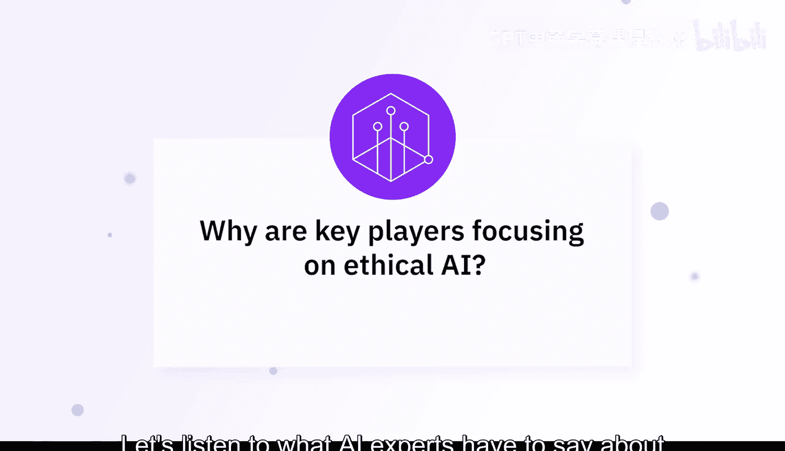
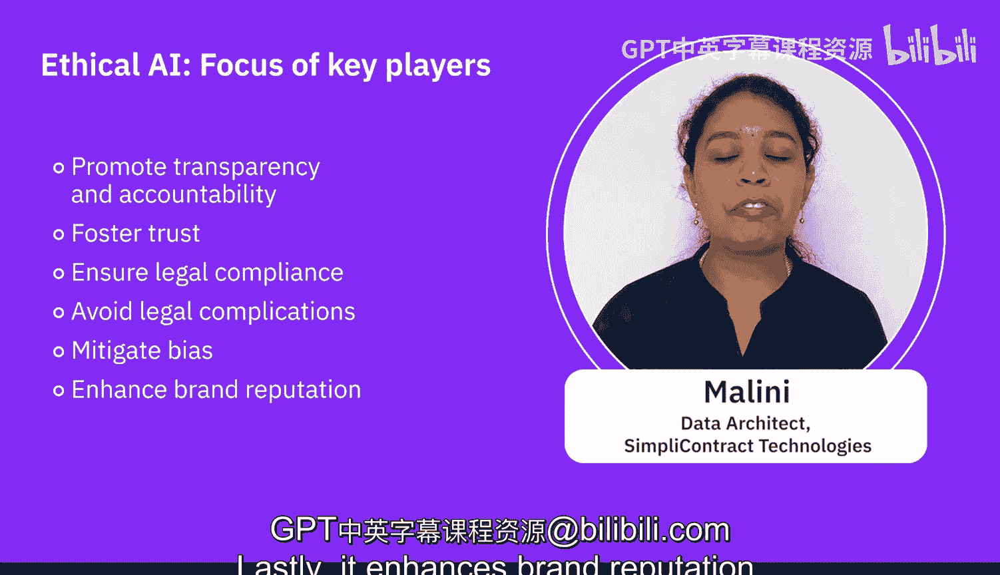

# IBM《生成式AI基础（五课全）｜Generative AI Fundamentals》中英字幕 p58 16_02_06_专家观点：理解主要参与者的AI伦理关注点.zh_en [BV11XSYBfEje_p58]

Hello and welcome to this expert viewpoints video。 Let's listen to what AI experts have to say about the emphasis on ethical AI by key players。

😊。

So some key players are in the industry are focusing on ethical AI for several critical reasons and they go to all of the pieces that we've talked about there's public trust and acceptance。

 regulatory compliance， bias and fairness， reputation management。

 long-term sustainability and innovation andresponsibilities we want to build maintain public trust and we can do this by providing transparency so people can see where their responses are coming from so as governments or regulatory bodies introduce new and more stringent laws and guidelines for AI。

 companies need to prioritize integrating those into their practices in their own governance model。

And from a bias and fairness perspective， EI helps address issues related to bias and fairness。

 so they ensure that the AI systems don't perpetuate or exacerbate existing inequalities。

As ethical AI is one of the key importances of the application of AI in general。

 one of the most important reasons is that irresponsible and unethical use of artificial intelligence is nothing short of a you know。

Weapon。And what happens is that when you talk in terms of data privacy。

 when you talk in terms of you know。Unethical use of information that is available for our people。

Creating false images， creating unnecessary and synthetic data， fake muses。

With all kinds of authenticity in place， but again。

 big power that the society gets with such you know。

 bad usage of such good tools is something that needs to be taken into account very seriously。Well。

 let's explore why key players prioritize ethical AI。 Firstly。

 it's about social impact and responsibility。 These players understand the influence a technologiess well on society and feel a moral obligation to ensure they benefit everyone positively。

 Secondly， building trust and confidence among users is far out。

Some of the reasons as why most of the big key players are focusing on ethical AI is the social and ethical responsibility that they have to develop and deploy these AI technology that can benefit the society while minimizing the harm to the society and to individuals also they are willing and maintaining the trust with their users。

 customers and stakeholders by investing in this ethical AI and also it helps them to do the risk management。

 so ethical AI help mitigate the risk associated with unintended consequences， biases。

 discrimination， privacy breaches and other ethical issues that it actually may harm the company itself or its end users Also there is a higher chance of talent。

Tction and retention because usually top talent is willing to work for the organization that have priority on ethical values and social impact。

 and it will help and enhance the employee satisfaction and foster the positive organization culture。

And ethics。And ethical usage and the knowledge of such the know how of how to use these technologies ethically and what you will be responsible for。

Is of great concern to protect the creators of these technologies and the users of these technologies so this is and should be one of the primary focuses of all people who are using these techniques。

 these technologies and the people who are building these technologies to be very clear about the kind of capabilities you want to give to the system and be very careful about how to use them in a proper way。

The most important part is customer satisfaction and loyalty because ethical AI practices contribute to customer satisfaction and loyalty by ensuring that products and services are developed and delivered in a responsible and trustworthy manner。

Also， the public perception and brand image because ethical AI can shape public perception and how the customers。

 investors， regulators and broader community can trust that organization on demonstrating ethical leadership and the social responsibility that they provide to the whole community。

Companies that prioritize ethical AI are better positioned to manage their reputations。

 avoiding scandals related to misuse or unethical behavior enhances their brand image。

 and then long term sustainability， ethical AI practices contribute to the long term sustainability of AI technologies by considering the broader societal impact。

 companies can create a more robust and enduring AI solutions。

Innovation and responsibility should be focusing on the ethical AI that encourages responsible innovation companies can explore new technology frontiers while ensuring that their advancements benefits society and don't cause any harm。

By prioritizing ethical AI， transparency and accountability are promoted。

 which are crucial for fostering trust in AI systems。 Moreoverover。

 it is driven by regulatory compliance to avoid legal complications， Additionally。

 ethical AI mitigates biasers and unintent consequences， fostering fairness。 Lastly。

 it enhances grand reputation reflecting positively on companies。

