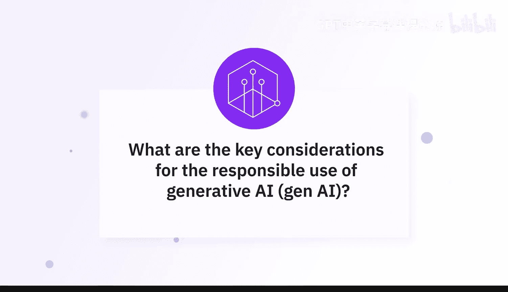
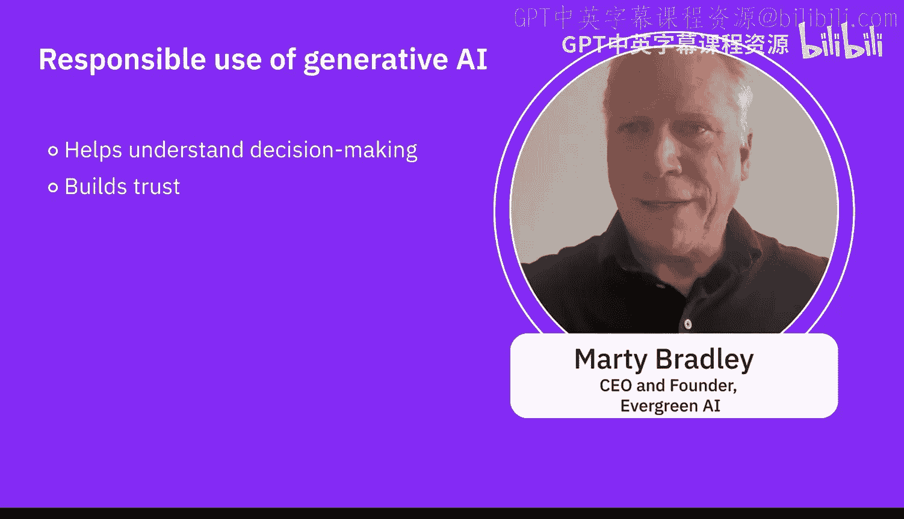
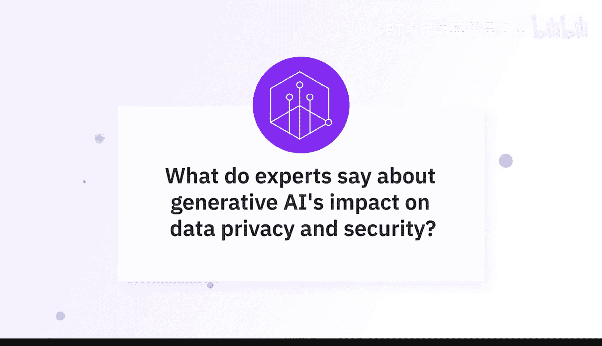
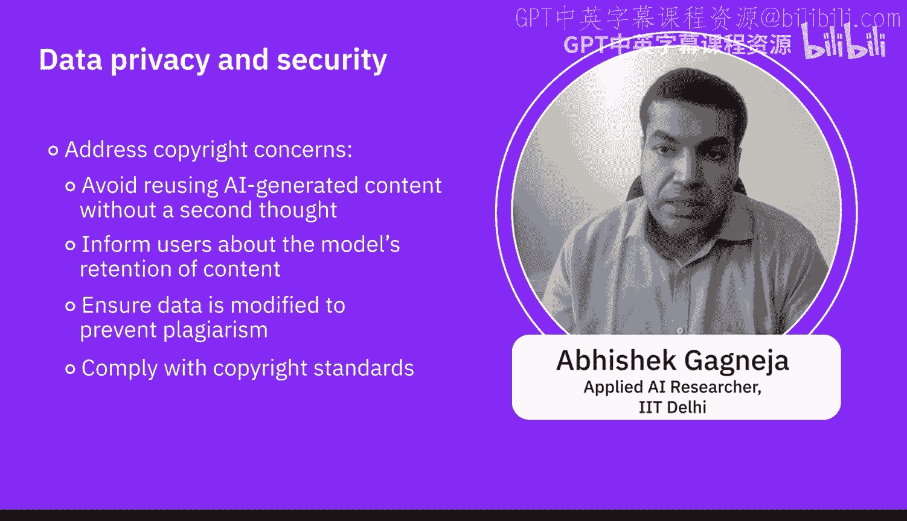

# IBM《生成式AI基础（五课全）｜Generative AI Fundamentals》中英字幕 p59 17_02_07_专家观点：负责任使用生成式AI的关键考量.zh_en [BV11XSYBfEje_p59]

Hello and welcome to this expert viewpoint video。😊。

Let's begin by hearing AI professionals share their insights on the responsible use of generative AI。

Right now， I think one of the most important things you can do to ensure that your generative AI is you know acting responsibly。

 creating outputs that are good， ethical， correct， not breaking any laws， so on and so forth。

 is implement guardrails， which means never let your generative AI。

Respond to someone or send out information that you don't want it to send so you have guardrails after the generative AI generates something。

 you make sure is this good， does this follow our company's guidelines。

 is it swearing is it hate speech so on and so forth and if the guardrails detect that you simply。

Knll it out and cancel out the transaction。Some of the recommendation and consideration in order for us to make sure that we are using a responsible generative AI is to use some ethical guidelines and principles when developing。

 deploying and using this technology and consider fairness， transparency， accountability。

 privacy and respect for human rights， there should be transparency about the whole life cycle of developing these models and these models should provide clear explanation of the behavior。

 their limitations and potential biases that they may have。

When we talk about generative AI technology， it is the responsibility of every provider of such features to be very clear and very descriptive about the considerations that they are keeping while creating these models。

So if your model is susceptible to hallucinations。Those hallucinations need to be reported that the model is susceptible to such issues。

If your model is particularly trained on a specific set of people or opinions from a specific set of people。

 it needs to be told that this model was trained with such information such that the biasness and the fairness of these models is taken into account。

AI systems should be designed with ethical considerations in mind ensuring that they do not perpetrate and amplify biases。

 developers should incorporate fairness in accountability and transparency into the life cycle this helps us understand how decisions are made and builds trust in the technology because we know how it's generating the output we can make changes to help the output be less bias。

Next， let's listen to what the experts have to say about generative AI and data privacy and security。

It's very important to safeguard the data privacy and security through the whole AI life cycle and make sure that there is no misuse of any individual personal information。

 we can deploy some of the techniques such as data anonyization， encryption， access control。

 some of the security audits to make sure that we protect the sensitive information。

We want to protect privacy of individuals whose data is being used in the training models。

 we want to implement robust data and anomization techniques and secure data storage and practices to prevent unauthorized access and misuse。

Regulation in governments is important to adhere to relevantlete laws and regulations governing AI use and then human oversight right we maintain human oversight over AI generated outputs to ensure its accuracy and appropriateness。

 this is especially important and sensitive areas such as healthcare finance and legal services。

 and there needs to be responsible innovation， encourage responsible innovation and by continuously assessing societal impact and of the AI technologies because what we want to be able to do is engage with the stakeholders including ethics。

 policymakers and the public and to address concerns to incorporate in diverse perspectives。

Other than that， for example， there is a copyright issue that is quite relevant that people are using。

Models like charge GPT etc to create content that is reused as it is without you know giving it a second thought and there comes copyright issues along with that so those copyright issues need to be addressed they need to be told that are the model particularly the model will be retaining this information and will be susceptible to plagiarism checks。

 modify the word data correctly modify the data appropriately。

。