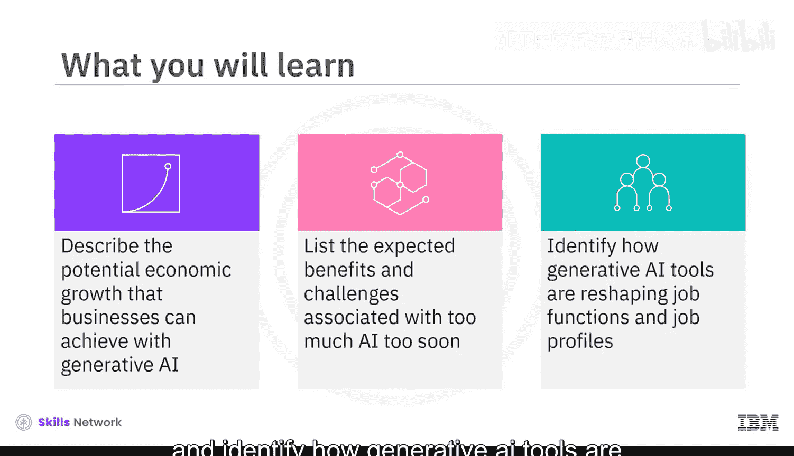
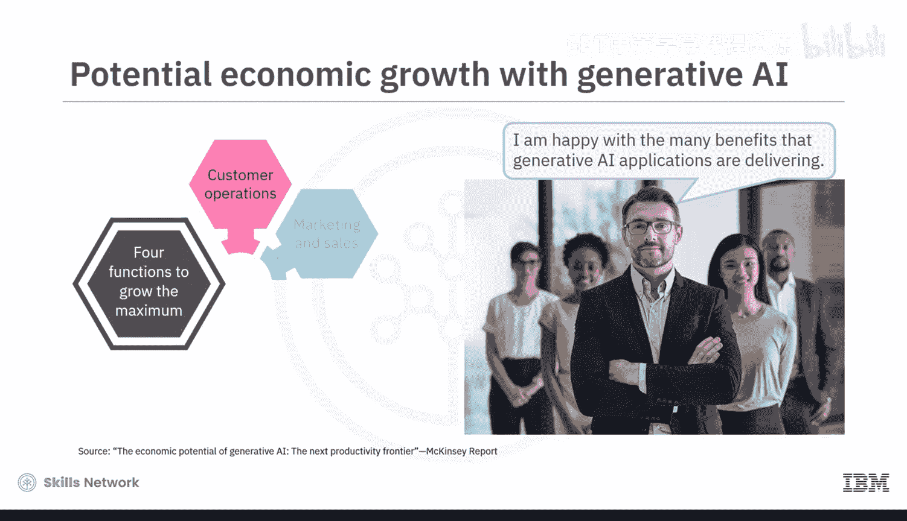
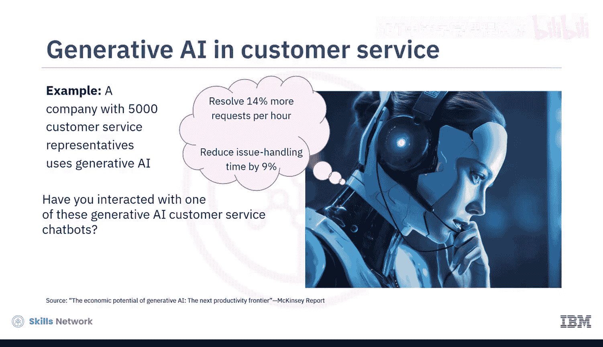
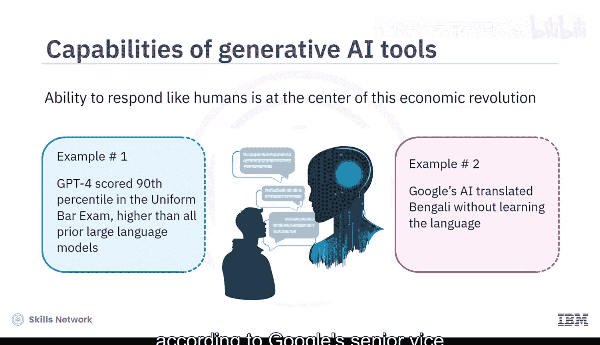
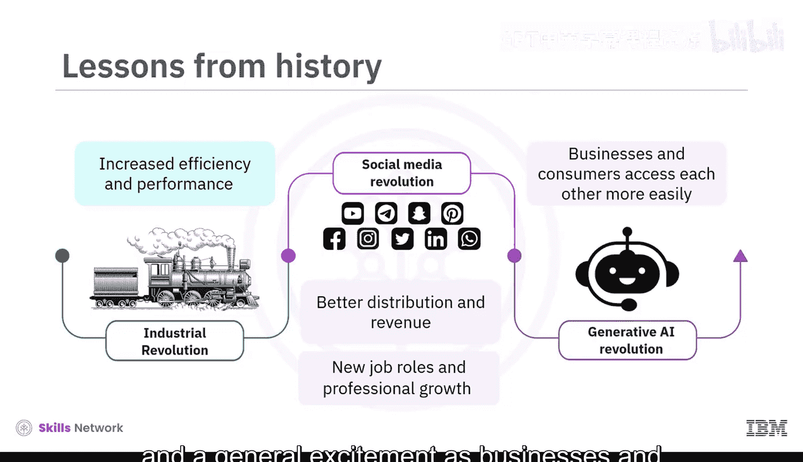
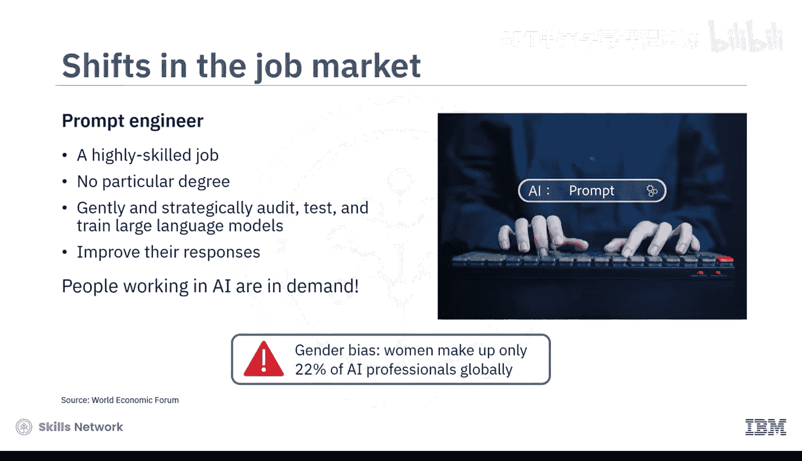
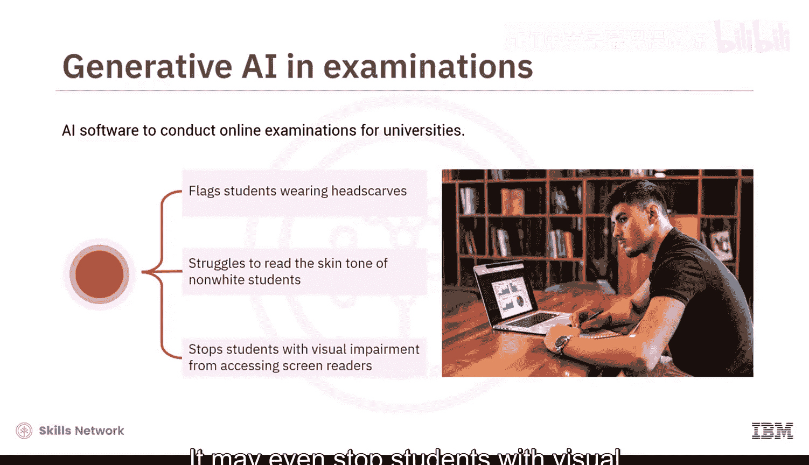
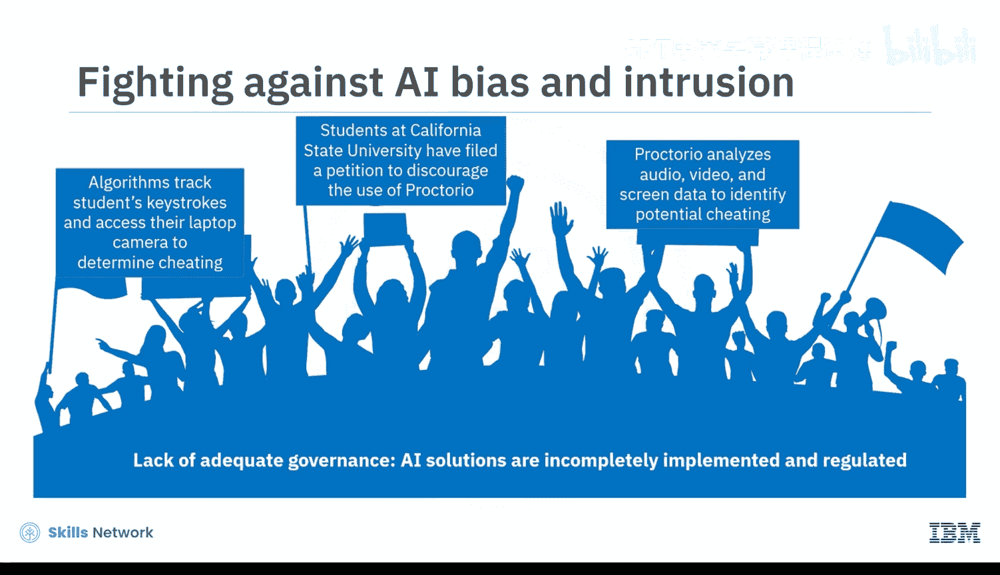
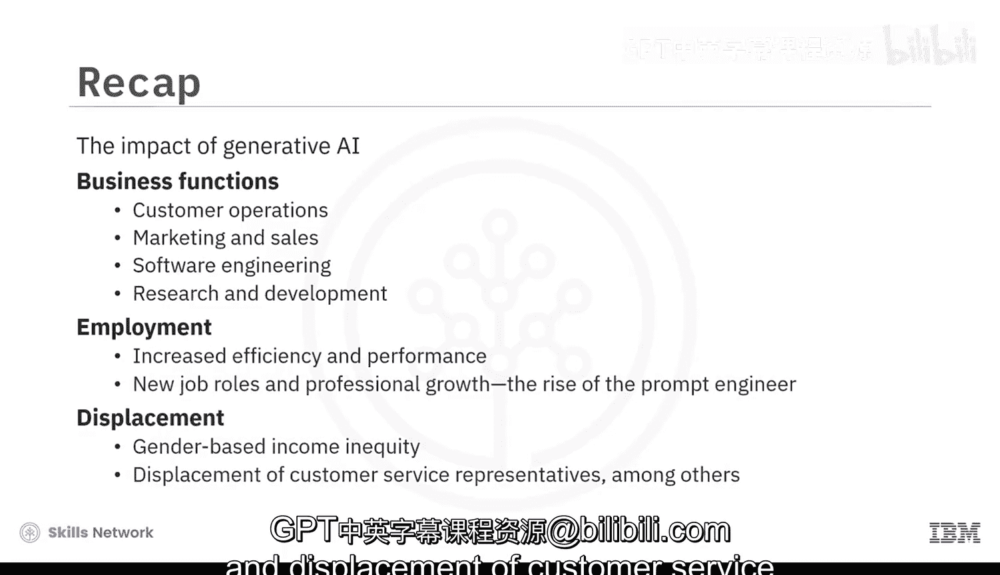

# IBM《生成式AI基础（五课全）｜Generative AI Fundamentals》中英字幕 p60 18_02_01_生成式AI的经济影响.zh_en [BV11XSYBfEje_p60]

Welcome to the economic implications of generative AI After watching this video。

 you'll be able to describe the potential economic growth that businesses can achieve with generative AI。

 list the expected benefits and challenges associated with too much AI too soon。

 and identify how generative AI tools are reshaping job functions and job profiles。

Businesses are happy with the many benefits that generative AI applications are delivering。

 According to a McKinsey report， four functions are poised to grow the maximum with assistance from generative AI。

 customer operations， marketing and sales， software， engineering and research and development。

In one example， a company with 5，000 customer service representatives uses generative AI for handling customer complaints。

 they are able to resolve 14% more requests per hour and reduce their issue handling time by 9%。

Maybe you've interacted with one of these generative AI customer service chatbots it's tough to know whether you're talking to a machine or a human。

 but truth be told today's chatbots are able to give prompt resolutions。

The ability of generative AI tools to respond like humans is at the center of this economic revolution。

 Here are two examples。 In a landmark moment， G 4 scored 90th percentile when taking the uniform bar exam。

 exceeding the score of all prior large language models。 Google's AI translated Benggali。

 without ever learning the language， According to Google's senior vice president for technology and society。

No doubt the economic impact of generative AI is being felt across the world。

 Goldman Sachs research predicts that in 10 years time， generative AI could result in a 7%。

 almost $7 trillion increase in global GDP and a 1 and/ half percentage increase in productivity。

 Is such economic growth beneficial for everyone。History has shown that each time the world discovers a powerful technology。

 such as the steam engine that drove the industrial revolution or the internet that is driving the social media revolution。

 and the foundation models driving the generative AI revolution we see increased efficiency and performance。

 new job roles and professional growth， better distribution and revenue。

 and a general excitement as businesses and consumers access each other more easily。

The job market is seeing dramatic shifts； the rise of the prompt engineer is one such surprise。

 a highly skilled job requiring a person with no particular degree to gently and strategically audit。

 test and train large language models so that they improve their responses and in general。

 people working in AI are much in demand。However， there is an existing gender bias here。

 as according to the World Economic Forum， women make up only 22% of AI professionals globally。

For the non AI workforce， Goldman Sachs expects approximately 300 million full time jobs to be partially automated by generative AI。

 According to a human resources analytics firm， these are the jobs performed typically by women including but not limited to office secretary or administrator。

 human resources manager， teacher， writer， and customer service representative。Historically。

 jobs lost have been replaced with new jobs， did you know that 60% of today's workers are employed in occupations that didn't exist in 1940。

 so it's possible that those who will be displaced will innovate and create new opportunities。

 but job seekers today need to be aware your future role in the workplace may also be determined by AI as algorithm starts screening resumes。

Today most companies use AI driven hiring software to vet resumes and applications when you send out yours。

 ensure to include the keywords that the algorithm is looking for those taking tests to earn their degrees must also contend with AI filters。

 unfortunately some filters are coming across as controversial as algorithms are often trained on limited biased and unverified data。

For example， AI software used to conduct online examinations for universities has been known to flag students wearing headscarves or struggle to read skin tone of non-white students while screening test takers。

 it may even stop students with visual impairment from accessing screen readers。

Furthermore， these algorithms are trained to attack students keystrokes and or access their laptop camera to determine if they're cheating For instance。

 students at California State University have filed a petition to discourage the use of proctorio。

 which analyzes audio and video recordings and screen monitoring to identify potential cheating behavior this is partly due to lack of adequate governance as AI solutions are being implemented in a hurry and therefore are incompetently implemented and regulated。

With a strong desire for economic growth， many industries are leveraging generative AI to increase their reach and revenue。

 the global workforce is cleverly certifying themselves to become relevant in an AI first economy。

Will a possible fallout of too much AI too soon include widening the income gap along gender lines。

 that's something to think about。In this video， you explore the impact of generative AI and the global economy。

 Custom operations， marketing and sales， software， engineering and research and development will feel an immediate impact。

 The economy will benefit from increased efficiency and performance。

 new job roles and professional growth， such as the rise of the prompt engineer。

We can also expect to see gender based income inequity and displacement of customer service representatives among others。

。