# IBM《生成式AI基础（五课全）｜Generative AI Fundamentals》中英字幕 p61 19_02_02_生成式AI的社会影响.zh_en [BV11XSYBfEje_p61]

Welcome to the social implications of generative AI After watching this video。

 you'll be able to describe how generative AI can benefit society and social wellbeing。

 identify the emerging challenges associated with the widespread use of generative AI and explore solutions to balance the benefits versus risks of using generative AI to start with what do we mean by social implications。

 We mean the impact that generative AI has or can have on society and its wellbe beyond indicators such as productivity。

 economic growth， Pro and return on investment。 Social impact considers indicators such as advocacy。

 inclusion， health care and the environment。 All of which contribute to a well structured equitable society。

 advocacy is all about outreach and generative AI tools can help governments。

 Intergovernmental institutions， nongovernmental organizations and civil society。

 access and analyze data faster。 forecast scenarios to list preventive actions and prepare creative and compelling advocacy material。

 by using generative A。😊。

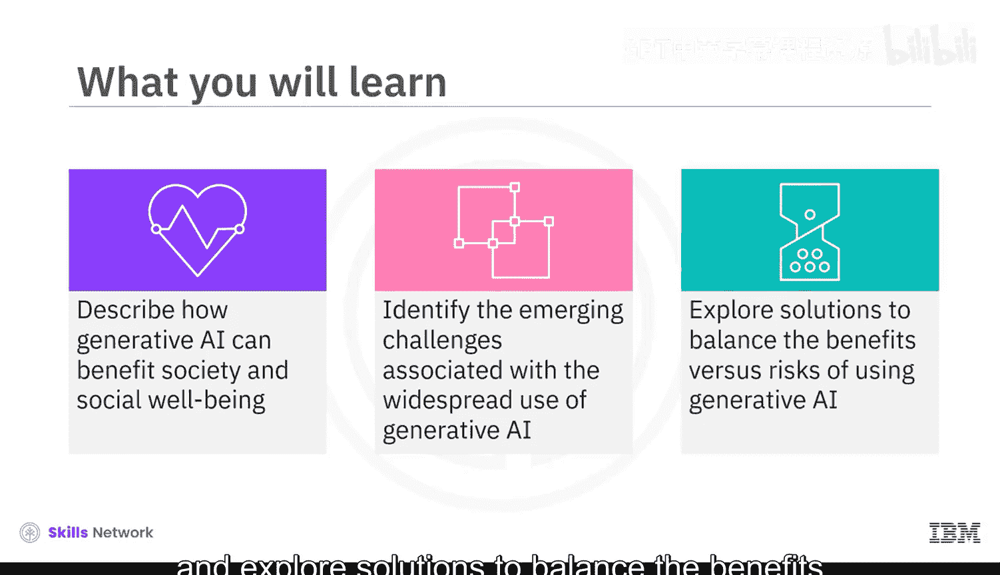

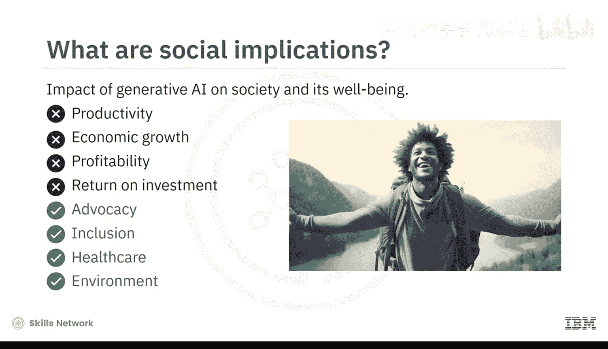

We will see an increase in international collaboration leading to increased debate and discussions。

 but can all people access and use generative AI equally？

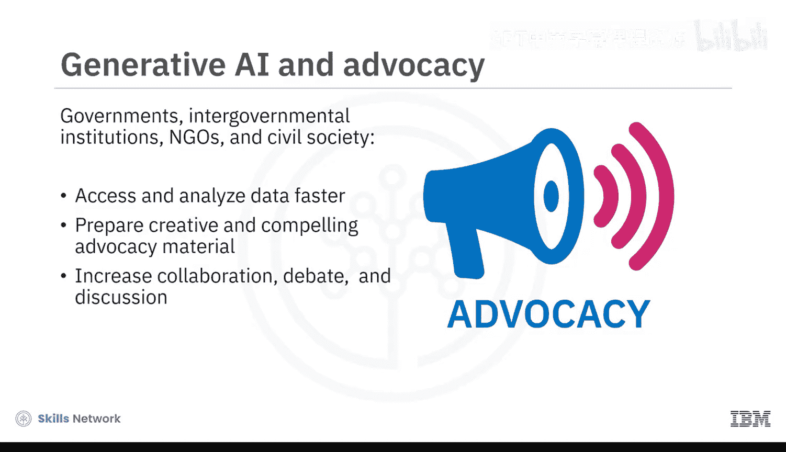

According to the United Nations， an estimated 37% of the world's population or 2。

9 billion people still do not have internet access as of 2021。

 This concept is known as digital exclusion， and 96% of these digitally excluded people live in developing countries。

 This means that the population that is slow to adopt generative AI will get further economically displaced and socially marginalized advocates and lawmakers need to work to include them as soon as possible before generative AI further widens the gap in performance and qualifications。

 societies over centuries have struggled with social inclusion to create a world in which all feel represented and not discriminated against because of their gender。

 ethnicity， race， disability or sexual orientation because generative AI tools or multimodal They allow people the opportunity to learn and communicate and customized and preferred formats。

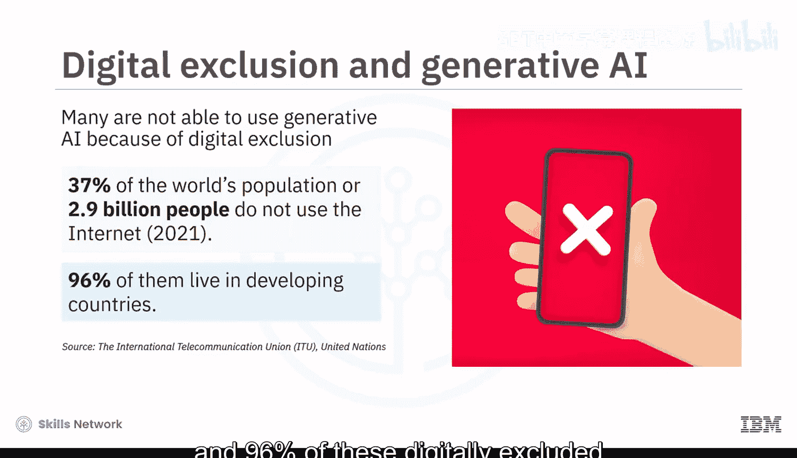

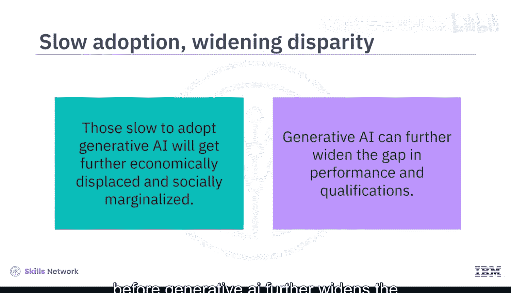

Easy translations into multiple languages， quick text to speech conversion。

 AI voices for increased anonymity and the creation of AI portraits。

 These are some of the generative capabilities that can help people represent themselves and feel more included。

 More people are thinking along these lines。 The Massachusetts Institute of Technology gave grants to 27 finalists to explore generative AI's impact on democracy。

 education， sustainability， communications and more， Think about this。

 How will this technology impact our climate， the environment， our music and our literature。

 What about health care， generative AI has had a very positive impact on health care。

 We see expedited medical research and drug discovery。

 early detection and diagnosis with improved clinical decision making。

 increaseded capacity to manage health care worker shortages and access to personalized health information and services。

 However， one concern has emerged。 The data on which generative AI systems are trained has inherent racial and gender bias。

 And this affects clinical decision making。 Here's one example。😊。

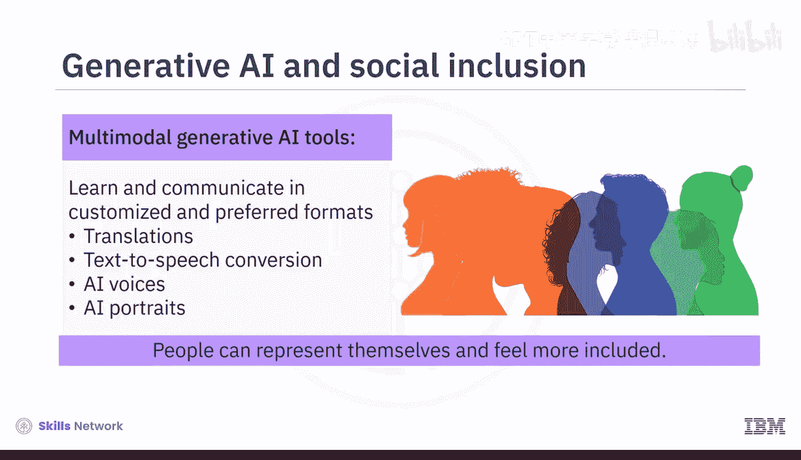

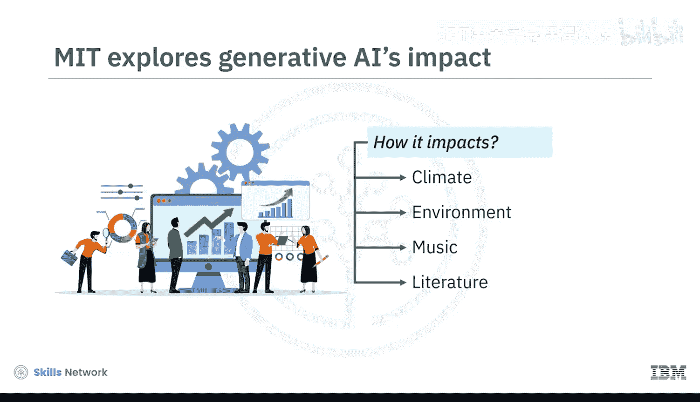

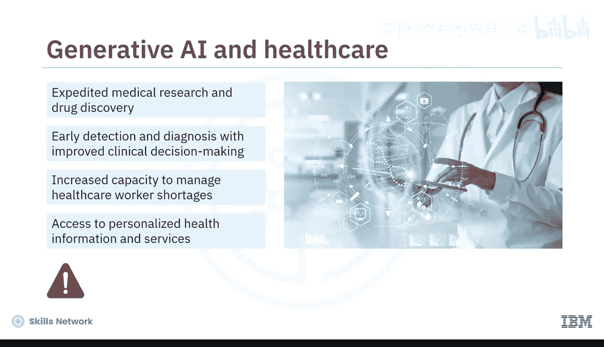

In 2019， the American Civil Liberties Union flagged that AI algorithms were misinterpreting patient data。

 which LED to false assumptions that Africanamer patients need less care as compared to white patients for the same set of symptoms。

 To correct this error， the algorithm was restructured to focus on a patient's symptoms rather than historical records of patient treatments。

 The question that emerges here is， how can we continually increase the diversity and accuracy of training data。

 Another concern related to health care is the possible emotional isolation that comes with excessive consumption of online content。

 In May 2023， the US Department of Health and human services officially stated that the lack of social connection may increase susceptibility to viruses and respiratory illness。

 According to the US surgeonon general， Loneliness has become an epidemic and represents an urgent public health concern。

 Two interesting questions that emerge。 As generative AI makes people more digitally dependent and selfsuffic will it lead to increased loneliness or congenrative AI tools such as chat GT help people cope with。

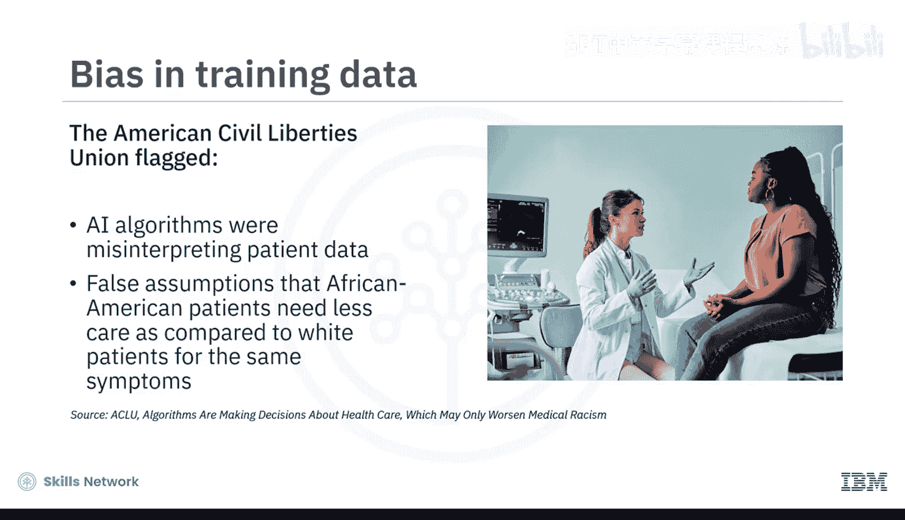

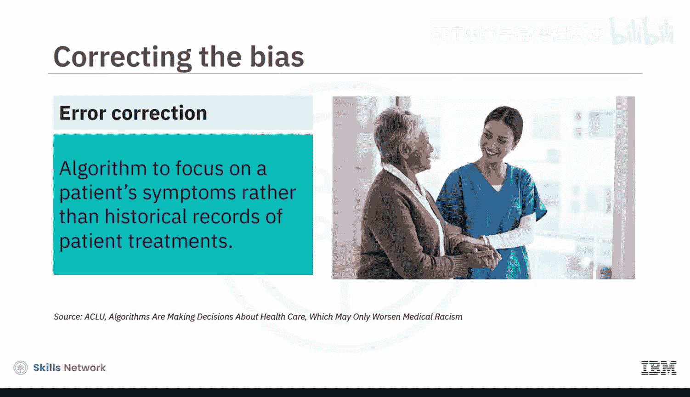

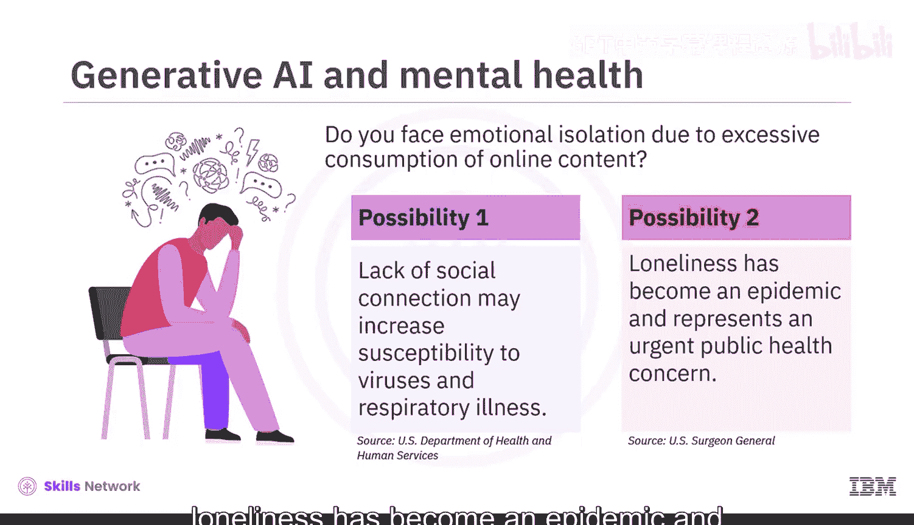

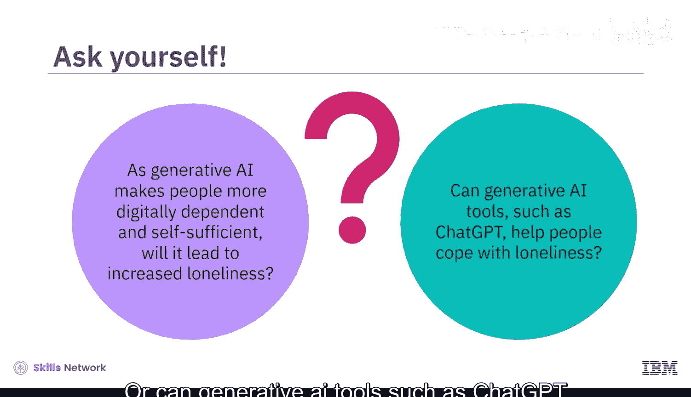

What about the environmental impact of generative AI Foundation models such as G 4， Cha G。

 Dolly2 midjoney， stable diffusion， Lambda and Bert require a large amount of hardware and cloud space and use rare minerals。

 As they process a large amount of data。 the hardware needs to be replaced often。

 generating ewaste more frequently， Given this large carbon footprint。

 generative AI is not a friend of the environment。 According to the Harvard business review。

 organizations can take steps to make these systems greener。

 such as fine tuning existing models for downstream tasks， rather than building models from scratch。

 evaluating the energy sources of cloud providers or data centers。

 and using generative AI only when needed， responsible use of generative AI always comes first in this video。

 you explored the impact of generative AI and society。 specifically its contribution to advocacy。

 inclusion， health care and the environment， Ben include increased advocacy and inclusion。

 better health systems and services and chatbots。

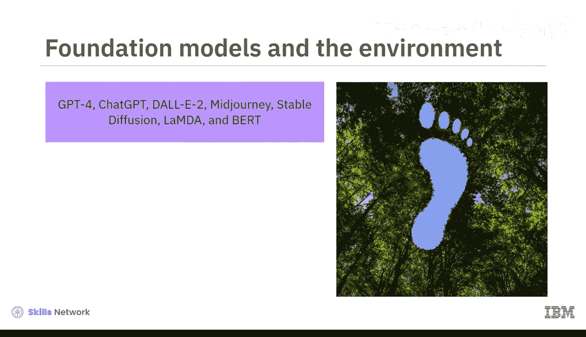

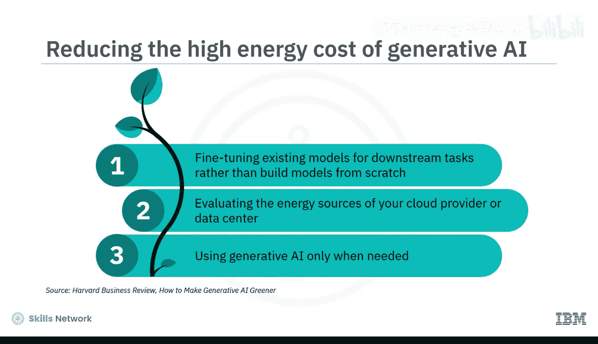

Loneliness。Challenges include digital exclusion， biased algorithms， digital dependency。

 induced loneliness and a sizable carbon footprint。

 We must take steps to use generative AI tools responsibly to maximize the benefits and mitigate the associated risks。

