# IBM《生成式AI基础（五课全）｜Generative AI Fundamentals》中英字幕 p62 20_02_03_生成式AI重塑劳动力格局.zh_en [BV11XSYBfEje_p62]

Welcome to the video， a reimagined workforce with generative AI。After watching this video。

 you'll be able to understand how generative AI impacts knowledge workers。

 identifying an organization's biggest challenge to workforce readiness in the context of generative AI and list steps organizations can take to ensure workforce transformation。

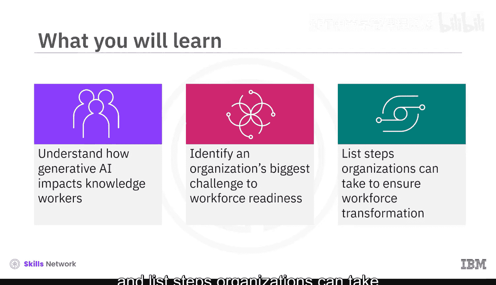

At a global level， generative AI is helping automate many business functions such as marketing and sales。

 customer service， legal， procurement， operations， and research and development。

Gartner predicts that the AI software market will reach nearly $134。8 billion by 2025。

 This means that more organizations will increasingly rely on large language models for basic and repetitive tasks。

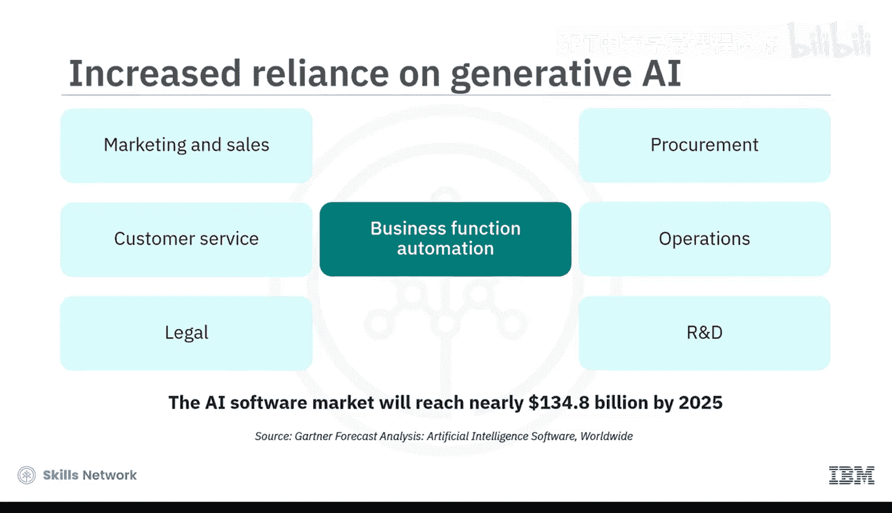

But do they have the right people to work with this technology at the heart of the generative AI revolution is the knowledge worker。

 just as AI revolutionize the role of factory workers。

 generative AI is revolutionizing the role of knowledge workers。 Therefore。

 workforce considerations are critical to successful generative AI adoption。

 if organizations want to derive maximum value from their AI investments。

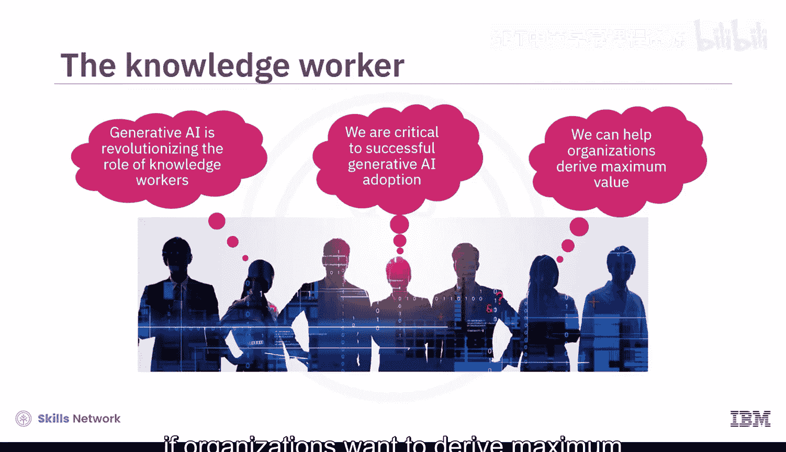

According to the International Labour Organization。

 generative AI is more likely to augment rather than destroy jobs， itll automate some tasks。

 not an entire role。 This is because generative AI has limited ethical and emotional intelligence and therefore cannot make intricate context dependent decisions like humans While generative AI automates routine and analytical tasks。

 human expertise is still needed to make nuanced and complex decisions When only certain functions are automated。

 this is known as partial automation。

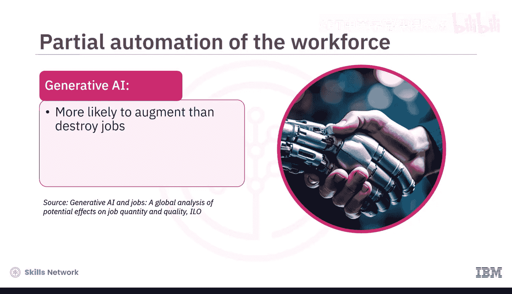

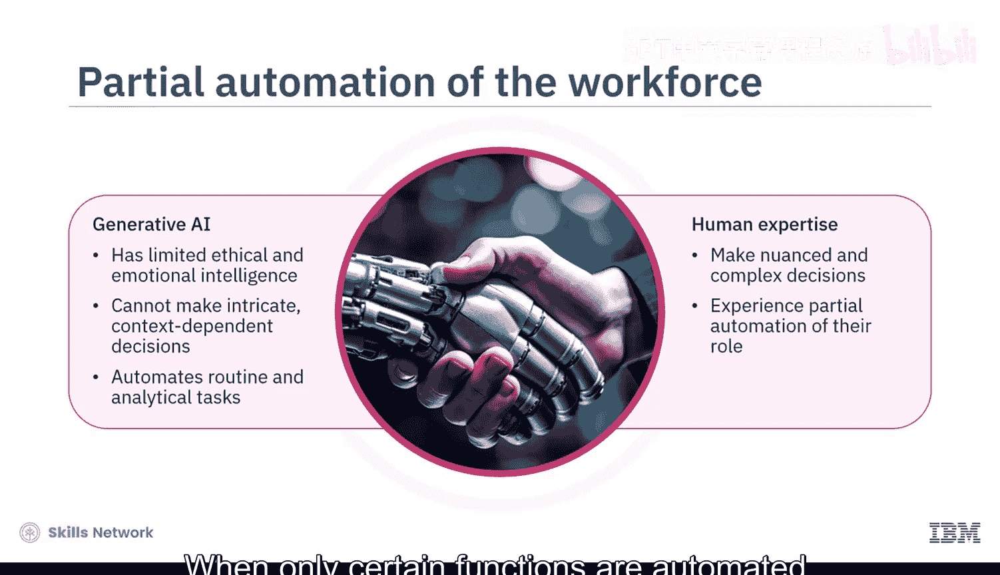

Let's explore the impact of partial automation with a few examples。 Mish。

 he's an accountant with the multinational firm。 generative AI will help him automate processes such as data entry。

 bookkeeping and reconciliations。 He can query algorithms to generate financial reports and use AI driven anomaly detection software to detect fraud in the system。

 However， his input is still needed to interpret reports， analyze complex financial data。

 interactact with clients and provide personalized advice。

Is every action marked as fraud in the AI system a compliance preach。

 he'll need to apply his ethical judgment to decide this。

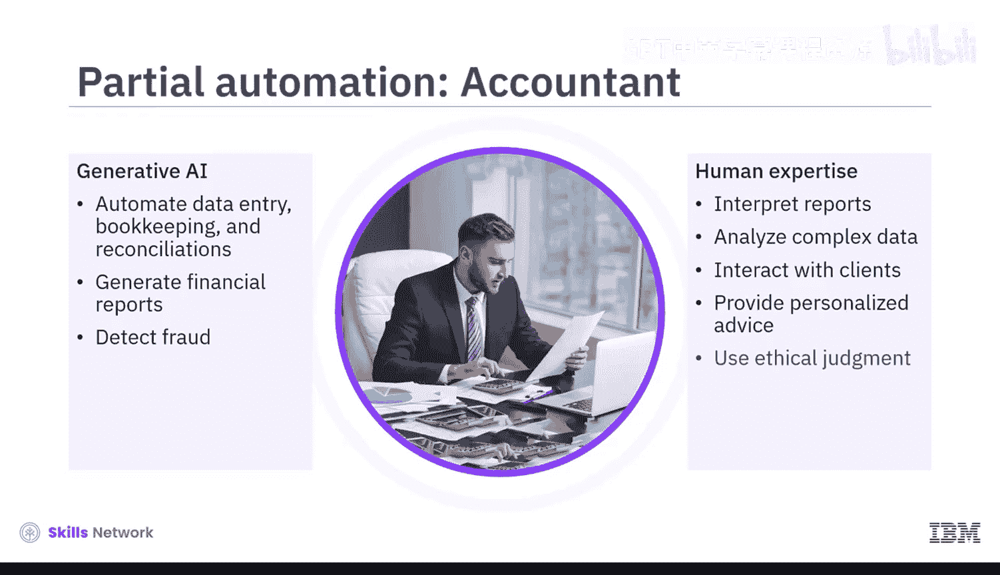

Meet Boona。 She's the manager of a small public relations firm。

 The generative AI tool her firm has onboarded performs predictive analytics to plan resource allocation。

 but also analyzes data to generate insights for managing risk。 With this support。

 she's able to make evidence based decisions， solve complex problems intuitively。

 plan for the future。 negotiate with stakeholders and build client relations。

As generative AI does not automate an entire role， jobs need not be lost。

 People need not be displaced。 It takes， therefore。

 a simple realization for organizations that the biggest challenge to workforce readiness in the context of generative AI is not employee replacement。

 but employee upskilling。

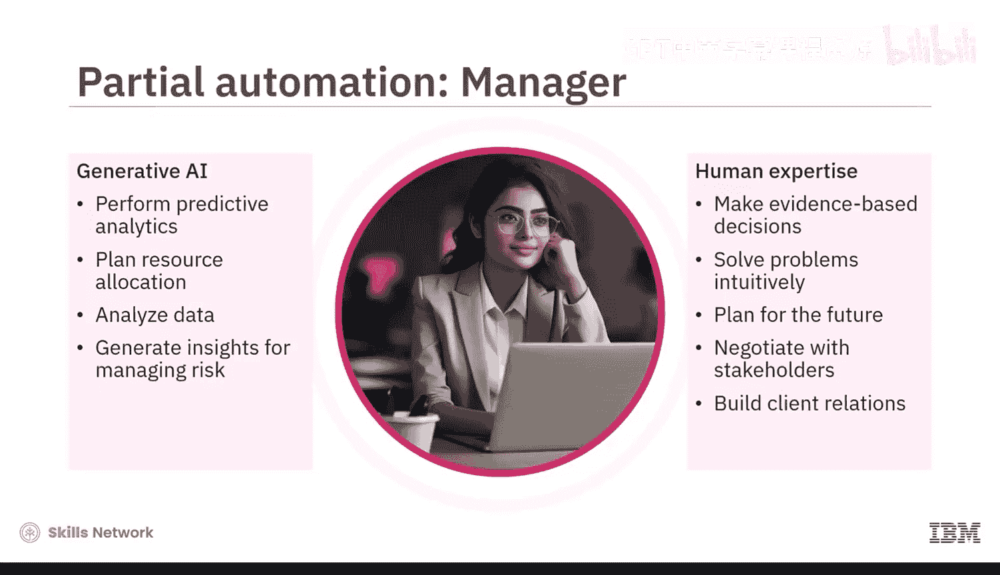

The World Economic Forum says 44% of workers must be upskilled slash reskilled over the next five years。

 this way generative AI and human expertise collaborate to draw on each other's strengths。

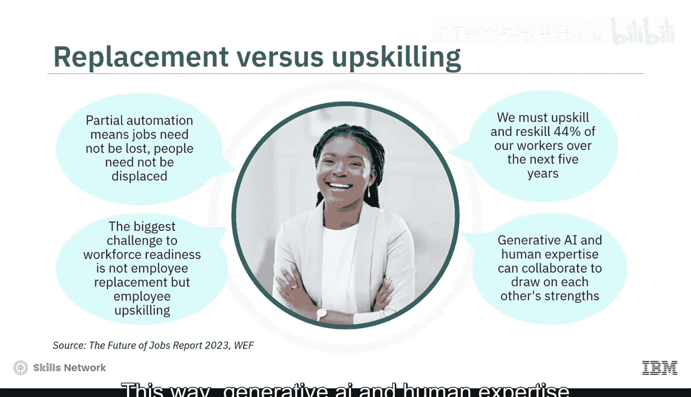

While hiring new talent to perform AI specific tasks is mandatory in the short term。

 organizations can begin a workforce transformation initiative to upskill their existing employee pool for long term alignment。

 This will ensure that there are minimal business disruptions while leaders get a generative AI friendly workforce ready。

 Let's explore the possible steps involved in making this happen。 Step 1， redesign the workflow。

 Step 2， assess skills。 Step 3， hire for AI roles and step 4， prioritize training。

Organizations must redesign business workflows and align employees' roles with the organization's updated priorities and technology exposure。

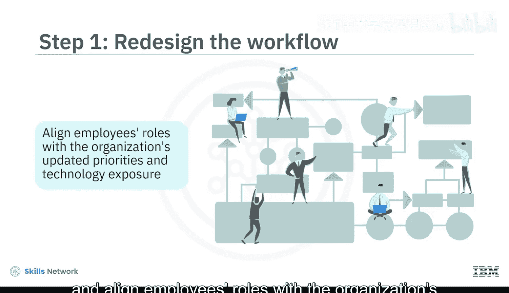

Next， managers must assess the level of employee skills against three factors。

 the resourcing requirements as per the new workflow。While automation is inevitable。

 people centered roles are still important。Current employees must complement generative AI outputs。

 not compete with them。

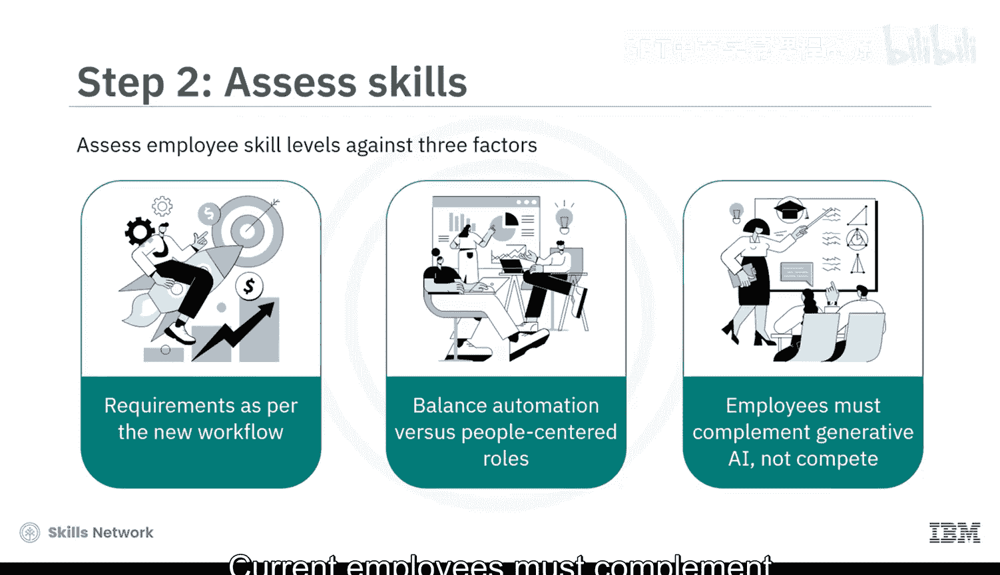

For instance， in June 2023， the recruitment of AI skilled members was nine times higher than in January 2016 globally。

 However， there was a simultaneous increase in the demand for soft skills。

 such as communication and flexibility。 A LinkedIn survey revealed that 72% of US executives agree that soft skills are more valuable for their organizations than AI skills。

Managers must hire talent from outside only to fill the critical talent gaps。

 Everyone else must be considered for in house training and upskilling。

Organizations must identify the roles that will be most impacted in house and prioritize them for coaching and upskilling。

 For example， clerical roles mostly held by women will be automated the most with generative AI。

 These vulnerable employees must be trained to perform higher level tasks。

 while generative AI tools perform repetitive and basic tasks。

 Another example is organizational leadership。 What is the expected role of leaders toward the economy。

 society and their employees， with the widespread use of generative AI。

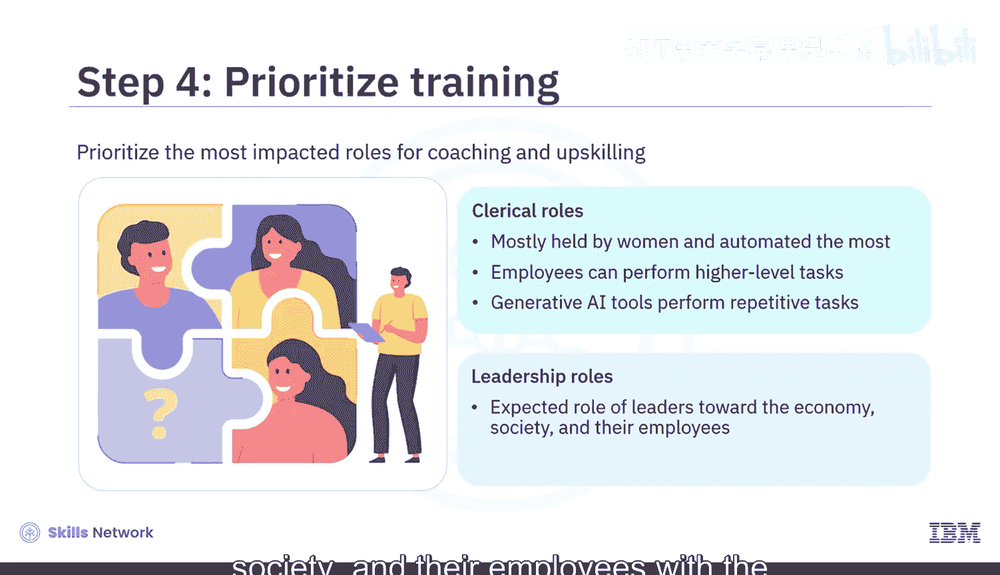

For instance， a financial advisory company is using a generative AI model trained on their proprietary data。

The model generates market trends and competitive analyses。

 helps in scenario planning and risk assessment， and facilitates collaboration between departments。

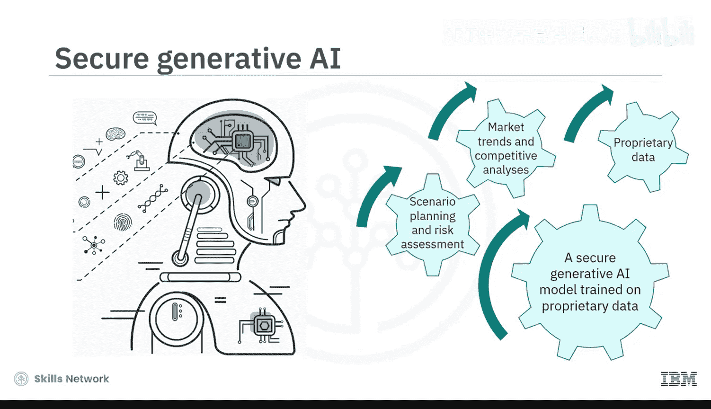

Kumar is the CTO of the financial advisory company to ensure that the firm's foundation models are used ethically。

 he's coached on the principles of AI ethics such as accountability， transparency。

 privacy and security By training on these aspects。

 Kumar ensures that decisions guided by the company's proprietary model impact the company and society positively。

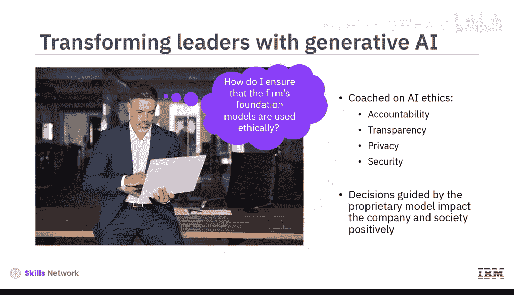

With upskiing， organizations can leverage the rich pool of talent already available to them。

 This is the true impact of generative AI on the workforce， Jo losses。

 risk of increased technology exposure， lack of human touch， proliferation of bias data。

 All these are signs that organizations are not investing in workforce transformation。

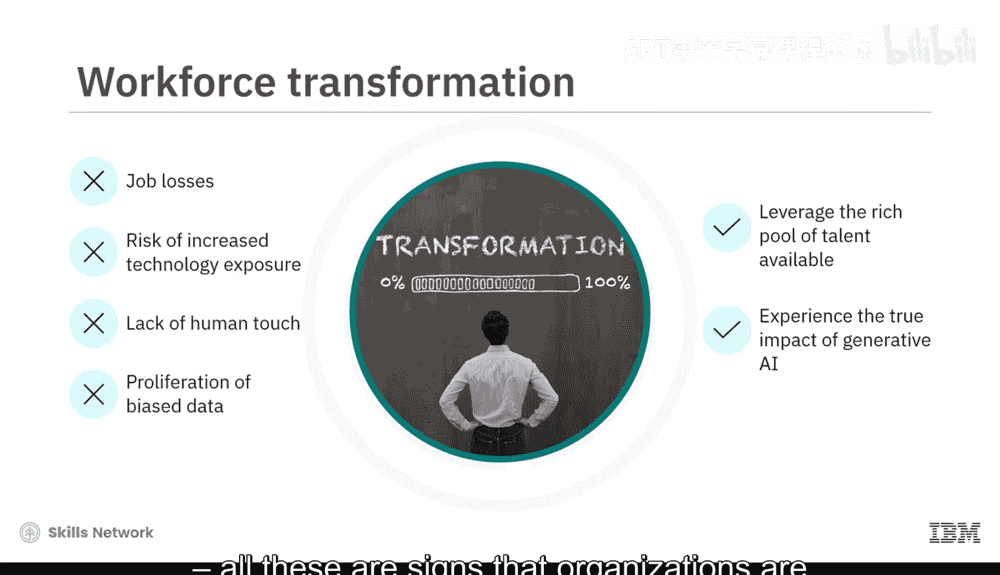

In this video， you identified the impact of generative AI on the global workforce generative AI will partially automate job roles and not displace people。

 The biggest challenge to preparing a workforce for generative AI is employee upskilling。

 organizations must engage in workforce transformation to minimize business disruptions。

 maximize the available talent pool and ensure a high return on investment in AI tech。

 They can follow four steps to ensure this transformation， redesign the workflow， assess skills。

 hire for AI roles and prioritize training。

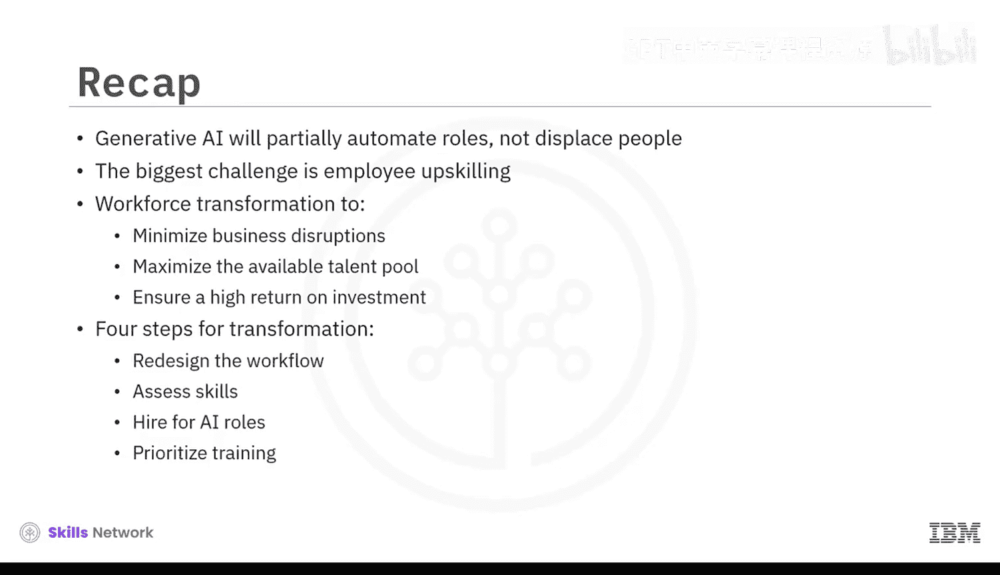