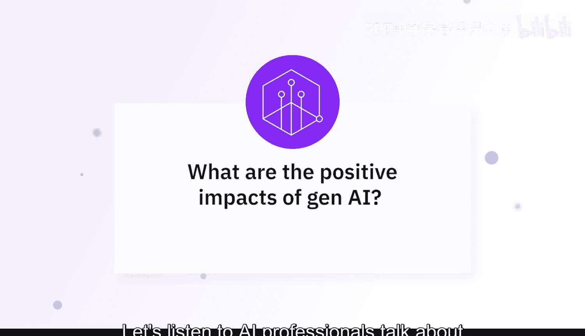
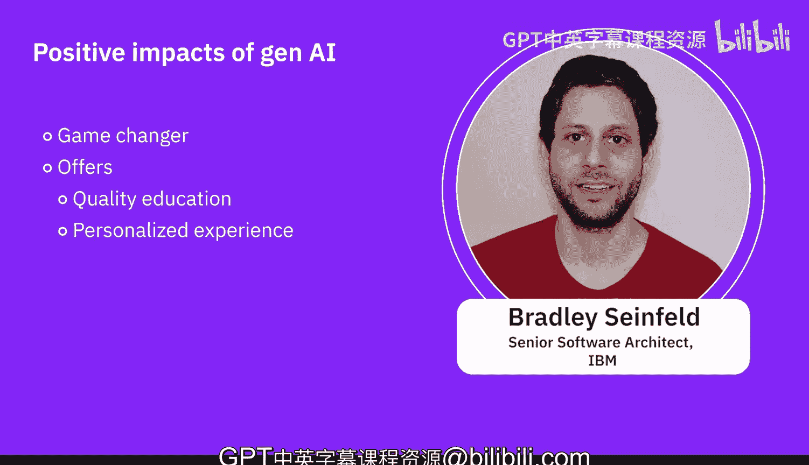
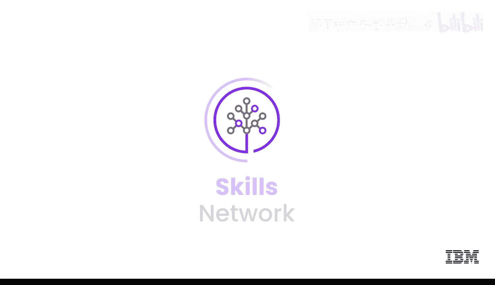

# IBM《生成式AI基础（五课全）｜Generative AI Fundamentals》中英字幕 p63 21_02_04_专家观点：生成式AI对社会的影响.zh_en [BV11XSYBfEje_p63]

Hello and welcome to this expert viewpoint video。 Let's listen to AI professionals talk about the positive impacts of generative AI。

😊。

One significant positive impact that General AI has made on society is the ability to democratize creative processes and enhance productivity。

By enabling automated content creation， a gene of AI allows individuals and businesses to produce high quality text。

 images， music videos with minimal resources， so now you can create a video by giving you a script and a video be generated on the back end that you can then edit a lot of people weren't capable doing this before building images for a web application and you want to have nice images or cool icons for people to click on Now you can have AI help you build those and don't have to hire somebody separate to be able to do that。

 Then parties can use AI tools to generate unique artwork。

 music and writers can use it to help get rid of writer's block and form help form their thoughts to collaborate with the AI。

So people who are not really good at coding can use geneative AI to generate a baseline port which can be used to create better。

 it can be refined to make better and specific applications。That's one aspect of doing it。

 people who are who may not be really good in the particularly English language let's say they can use gene AI to write but text。

 learn a and it just becomes a kind of a print that you can ask a question to and get an answer for and even the most simplest of English terms top in a simple strand straightforward language this is a good enough word the model to understand your requirement and create your response。

One of the positive impacts of this generative AI is the creative empowerment。

 so it actually helps state creativity so every individual can create and manipulate the digital content such as images。

 audio， music， video and it will inspire creativity and open up some。😊。

Vision or new ideas that users did not explore before。

 it also lowers the barriers to interview so anyone with any experience。

 any age without any specific background can use this technology and be creative it also helps us to tackle some use cases。

 for example， it enables us to have personalizedize and customized content creation by tailoring the output to individual preferences。

 interest and context。Back in the day， if you wanted to get the best education。

The best education possible。 It was as simple as paying the right mental money for it。

 Hi personal tutors， go to the right universities， so on and so forth。 Nowadays with generative AI。

 you can pretty much have a personal tutor。Teach you everything a normal personal tutor would。

 but also teach you everything else， I think it's going to be an absolute game changer because education。

 good， quality， personalized education is going to be available to every person on this planet in a way like it never has before。

。

