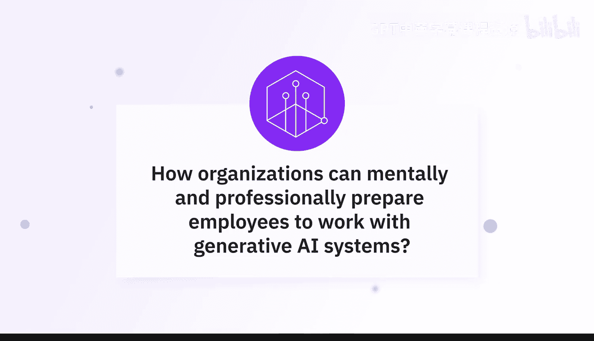
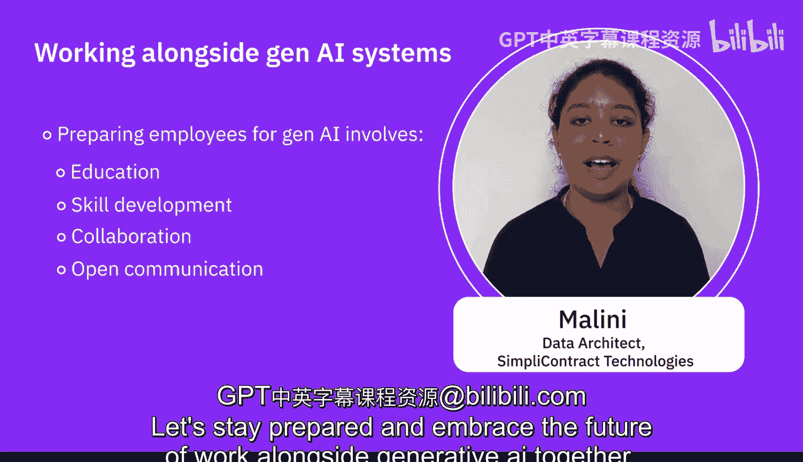
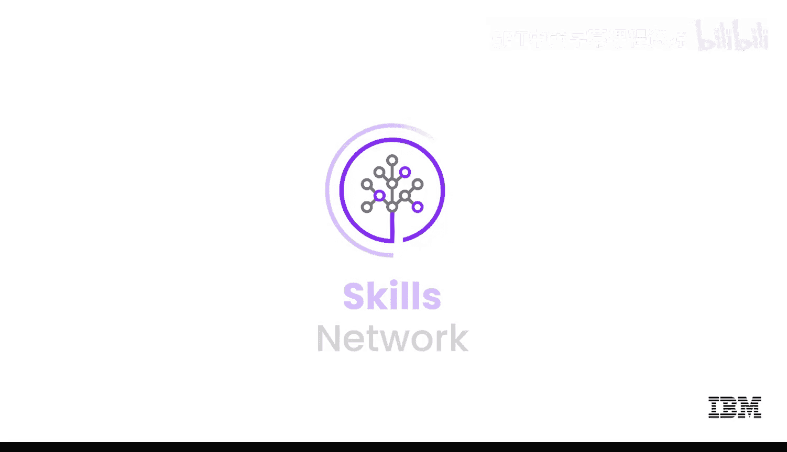

# IBM《生成式AI基础（五课全）｜Generative AI Fundamentals》中英字幕 p64 22_02_05_专家观点：将生成式AI融入组织文化.zh_en [BV11XSYBfEje_p64]

Hello and welcome to this expert viewpoints video。 Let's hear from experts on how organizations can contribute toward their employees' mental and professional readiness to work alongside generative AI systems。

😊。

One of the key aspects that must be taken into account by any organization that is going into the Geneative AI route is that not to rush into the technology。

 this is a great advancement， this is a great change from the way that you have been doing things。

In terms of just simply， you know， putting everything aside and using this technology。

 will that is going to become a catasthe。So one of the biggest suggestions that every corporate should take into account is that you need to be steady and you know。

 systematic in your approach to including these techniques in your day to day life。

Or day to day organizational activities。Firstly， it's essential to raise awareness and educating employees about generative AI。

 encourage continuous learning to adapt the evolving technological landscape Next implementing skill development programs to equi employees with the technical skills needed to collaborate effectively with generating AI。

 foster a collaborative culture through cross functional team， finally。

 establishing communication channels for employees to express concerns and share insights about working with generative AI。

Some of the ways that organizations can make sure that their employees are ready both professionally and mentally to work alongside this generative AI is by providing the training and education the leadership should demonstrate their commitment to this generative AI readiness by investing in their employee training and development and they should be provided by hands-on experience with AI tools and technology to get familiar with it and also build confidence to use it and work alongside with it Also this education and training should be continuous。

 there should also be culture of collaboration and knowledge sharing among the organization so that the people from different teams can do crossfunctional projects and do the knowledge sharing with each other。

Organizations have a lot to do to get their people ready for AI。

 people are worried about it taking their job and I'm a firm believer that at least in the near future that can enhance your job and enhance your skills with AI I use it on a regular basis all day while'm working。

 but the key thing is that you want to have training and education it might even be a good idea to get some AI certification focused on business we need to start thinking with the newer models like WiAC GPT I can generate and create a GT on my own without any software development background so you can become your own software developer in your own process so if you know how to do these things you can use AI to enhance your skills in your job and make you even more important and more more efficient in your current position。

Secondly， there has to be more encouragement to use these technologies more creatively and not blindly。

There need to be checks in place to verify whether the information or the content that you have created as general is you know just blindly being used in terms of generating AI or not。

There needs to be more encouragement to be more creative with these usage and actually encourage and motivate people to use them to do their work better。

And not just simply replace the current standard with an automated tool。

So the main point that I would like to you know suggest to and in that is willing or looking forward to employer generative AI in their approach。

 the biggest thing is that you need to be very systematic in inculcating such technology。

It's important to address ethical and social implications and there should be also emphasis on the human AI collaboration。

 there should be an emphasis of the importance of the employees on bringing in the judgment。

 the creativity， the empathy in conjunctions with AI capability that enables them to automate some processes and help them do their job。

 also there should be support of mental well-being。

 so the organization should provide consulting services。

 employee assistance programs and mental health resources for the employees that may need it along the way to promote well-being and resilience。

There are business process improvements that can be made with generative AI that the business people that understand the process are probably the best ones to make and then understand change management there's always going to be a change process there's going to be fear there's going to be worry and then people are going to then start to consume it and then it's going to start to get better and better so think about that change management process inside the organization and then continue the collaborative culture that most organizations have work together as a team and figure out how to make that workflow more efficient。

And then support and resources for people in your organization。

 if they feel that you're investing in them， they're going to be excited about the change。

In conclusion， preparing employers for generative AI involves education， skill development。

 collaboration， and open communication， let's stay prepared and embrace the future of work alongside Geneative AI together。

