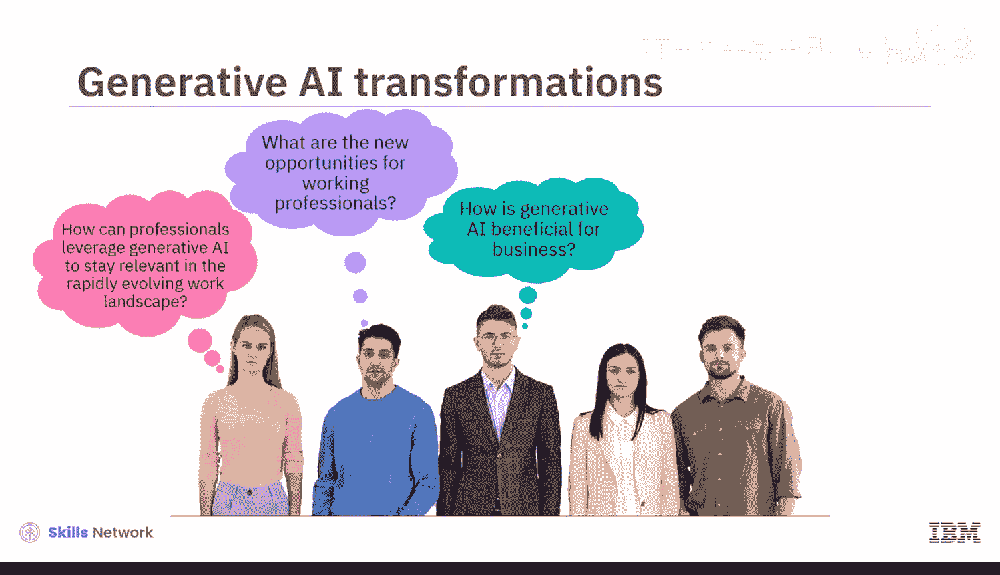
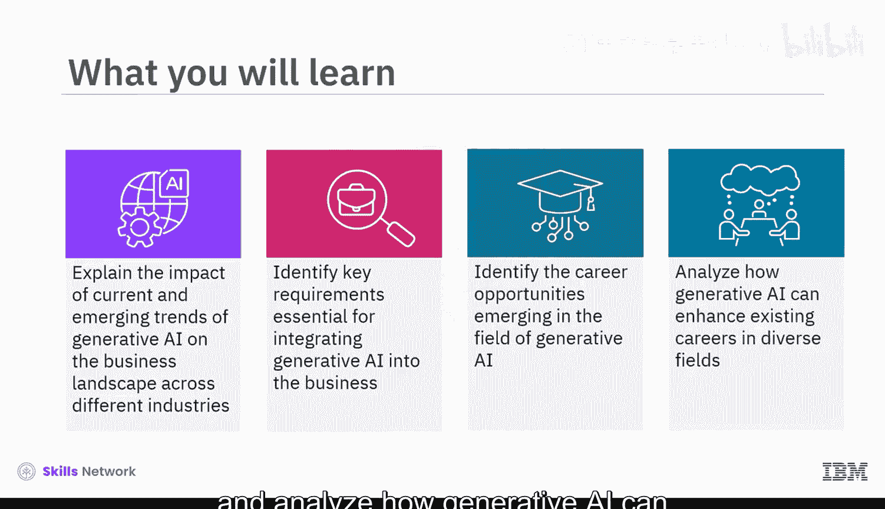
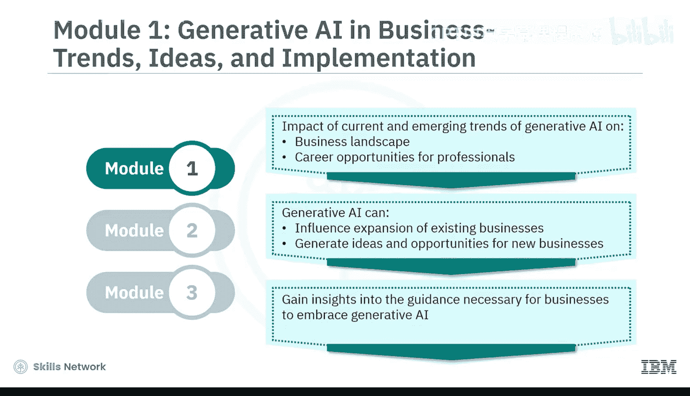
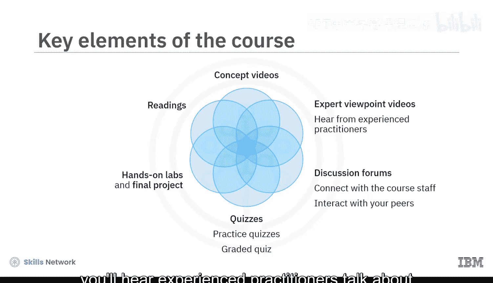
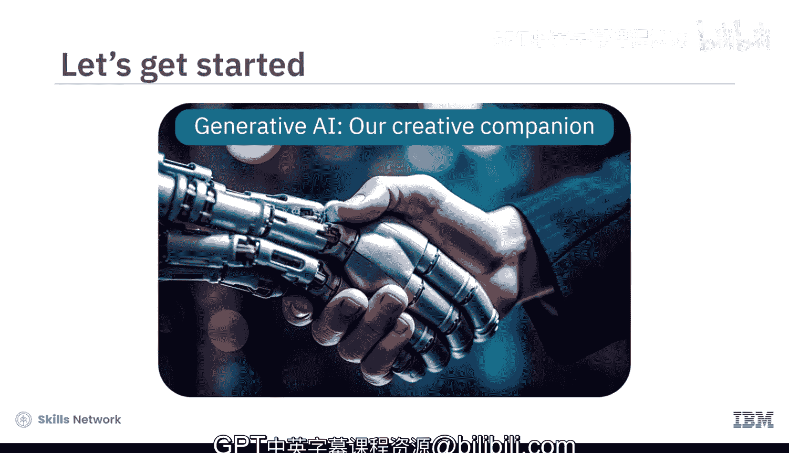

# IBM《生成式AI基础（五课全）｜Generative AI Fundamentals》中英字幕 p65 01_01_01_课程介绍.zh_en [BV11XSYBfEje_p65]

Welcome to the business advancements and career development with generative AI video。

 The emergence of generative AI has prompted numerous individuals to contemplate the future of their jobs。

 simultaneously leaders are eager to integrate generative AI into their operations to ensure the success of businesses in this era dominated by innovation The transformation and work jobs and market dynamics has inspired us to pose insightful questions like how can professionals leverage generative AI to stay relevant in the rapidly evolving work landscape。

 What are the new opportunities for working professionals。

 How is generative AI beneficial for business。 What are the industries that benefit from generative AI。

 How can companies effectively incorporate and secure this technology。

 These are the questions will answer in this course where you will discover the transformative impact of generative AI and businesses and professionals。

 This course invites all beginners， whether professionals， enthusiasts。

 practitioners or students If you have a genuine interest in the rapidly developing fields of generative AI this course is for you。

 Of course for everyone， regardless of your background。😊。

Or experience by the end of this course， you'll be able to explain the impact of current and emerging trends of generative AI on the business landscape across different industries。

 identify key requirements essential for integrating generative AI into the business identify the career opportunities emerging in the field of generative AI and analyze how generative AI can enhance existing careers and diverse fields。

 As this is a focused course comprising three modules you're expected to spend one to two hours to complete each module In module1 of the course。

 you'll learn how current and emerging trends in generative AI impact the business landscape and career opportunities for professionals in diverse fields you'll explore how generative AI can influence the expansion of existing business and generate ideas and opportunities for new businesses。

 you'll also gain insights into the guidance necessary for businesses to prepare for embracing generative AI in module 2。

 you'll explore potential career opportunities in generative AI workspaces such as AI engineer natural language processing engineer prompt engineer data scientists Comp vision。

Engineer， AI research scientist and AI ethicist。 you'll also learn how generative AI can enhance career prospects for content creators。

 I professionals and executives or managers module 3 requests your participation in a final project and presents a graded quiz to test your understanding of course concepts。

 You can also visit the course glossary and receive guidance on the next steps in your learning journey。

 The course is curated with a mix of concept videos and supporting readings。

 Watch all the videos to capture the full potential of the learning material。

 you'll work in handson labs to understand the limitations of geneative AI models and participate in a final project and module 3 There are practice quizzes at the end of each lesson to help you reinforce your learning At the end of the course。

 you'll also attempt a graded quiz。 The course also offers discussion forums to connect with the course staff and interact with your peers。

 Most interestingly， through the expert viewpoint videos you'll hear experienced practitioners talk about career enhancements with generative AI generative AI is like having a creative companion that amplifies our imagination and opens。

😊。

New possibilities across diverse domains Let's get started。

