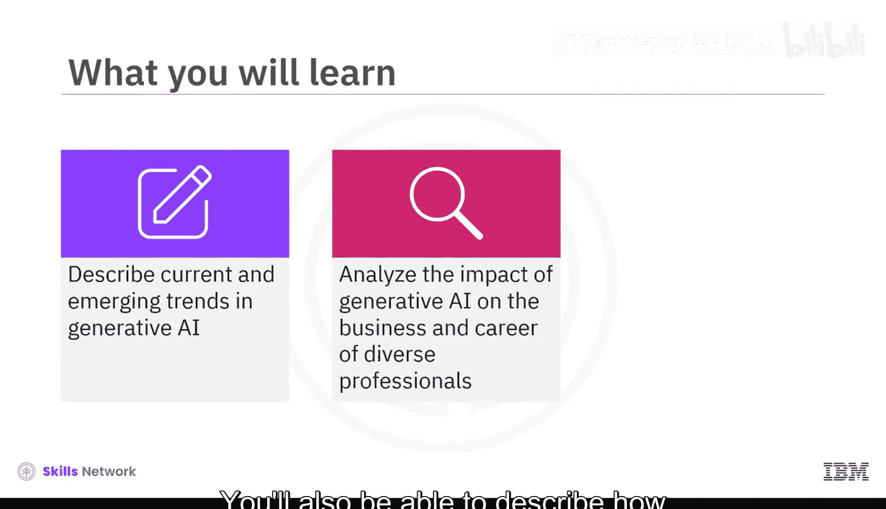
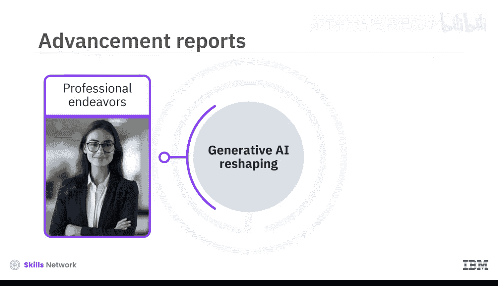
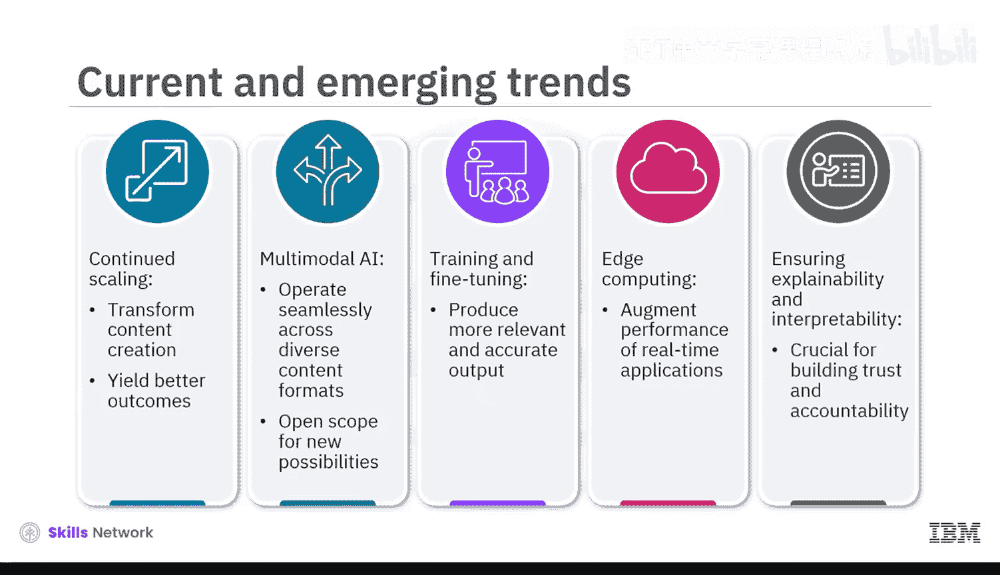
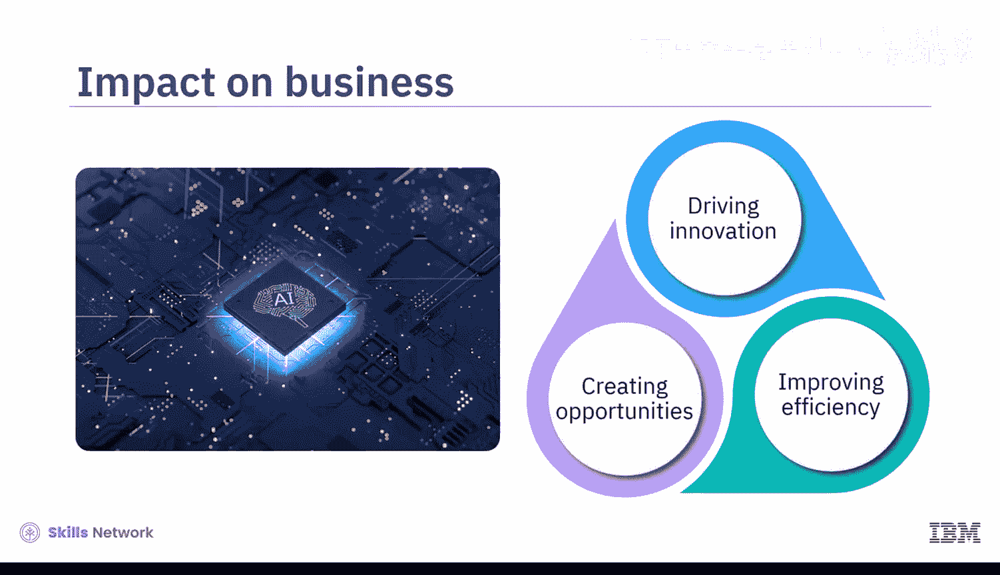
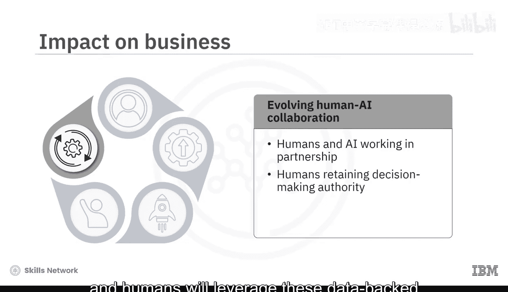
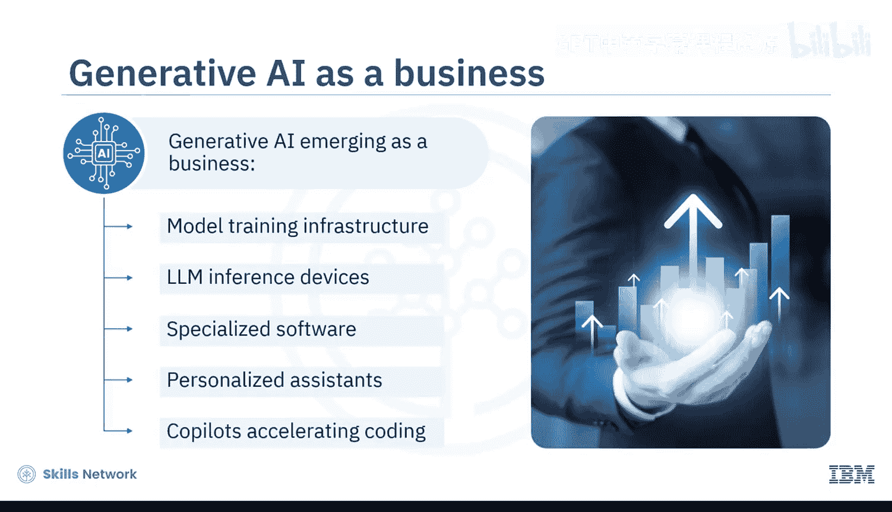
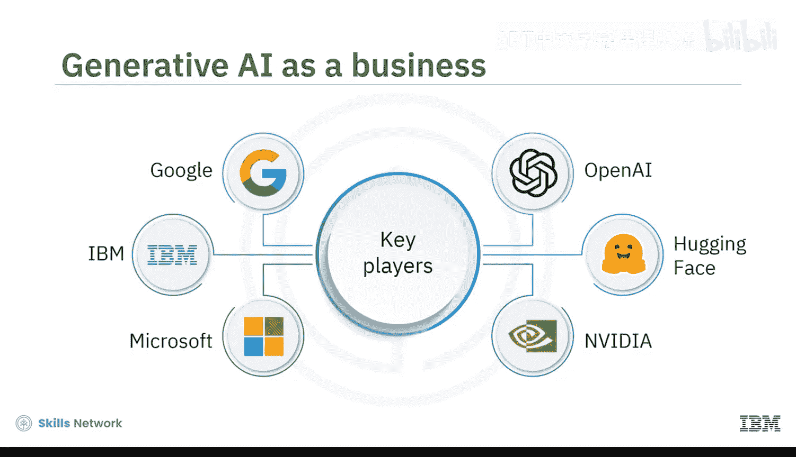
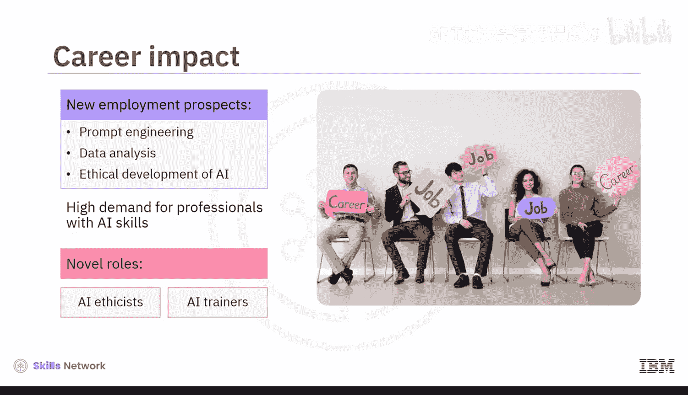
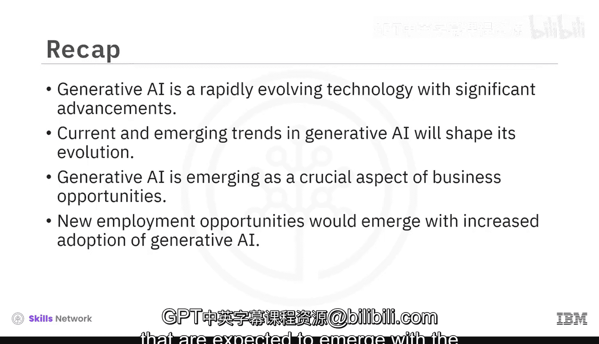

# IBM《生成式AI基础（五课全）｜Generative AI Fundamentals》中英字幕 p66 02_01_01_生成式AI趋势与影响.zh_en [BV11XSYBfEje_p66]

Welcome to generative AI trendsd and Imps By the end of this video。

 you'll be able to describe the current and emerging trends in generative AI and analyze the impact of generative AI on the careers of diverse professionals and the business landscape。

 you'll also be able to describe how generative AI is emerging as a business generative AI is undergoing rapid advancements。

 potentially transforming various aspects of our life。

 including both individual careers and the business landscape。

The recent years have witnessed widespread integration of this technology in almost every industry。

 According to McKinsey's 2023 global report，33% of the top companies have adopted generative AI with an additional 25% currently in the process of integrating the same as the capabilities and accessibility of generative AI models are growing over time。

 This adoption is expected to witness and even more rapid search。

 Let's explore some of the current and emerging trends in generative AI models。

 Model such as G and Dolly have transform the way businesses generate content and engage with technology。

 their intuitive interfaces and Apis facilitate swift prototyping。

 unlocking the extensive possibilities of exploring the full potential of generative AI。 Moreover。

 the development of larger and more robust models by key players like open AI， Google。

 Microsoft IBM and many others is yielding impressive outcomes across diverse domains。

 Model with multimodal capabilities such as Google Gemini can comprehend and operate seamlessly。

 across diverse content formats， including text， code， image， audio and。😊。

This capability is open the scope for new possibilities in the potential applications of generative AI in the field of virtual and augmented reality。

 Many cloudbased platforms and open source frameworks like IBM Watson X hugging face and pytorch enable organizations to train and fine-t the models with their proprietary data producing outputs that are more relevant。

 accurate and aligned with the organization specific goals and emerging trends centers around implementing compact and highly efficient versions of generative AI models on edge devices reducing the dependency on centralized cloud resources and augmenting the performance of real-time applications as new generative AI models are being developed。

 they have increased levels of complexity。 Therefore it's important to make these models more interpretable and explainable because understanding how these models arrive at decision making is crucial for building trust and accountability with these emerging trends。

 generative AI's impact on both businesses and individual careers has expanded the expanding influence of generative AI driven by current and emerging trends is significant。

Sping both businesses and individual careers It's fostering innovation。

 enhancing efficiency and opening new opportunities in various professional domains。

 Let's discuss some of the impacts of generative AI on businesses and the careers of diverse professionals businesses are benefiting from generative AI by boosting labor productivity through streamlining workflows and automating repetitive tasks Expediting R& with generative designs customizing user experience for heightened engagement and loyalty and pioneering innovative business models Personal models such as autog and custom G adapt to individual preferences and contexts。

 Gene content tailored to specific needs and interests Open AI enables the creation of custom versions of chat G possessing a combination of skills generative models cater a highly personalized user experiences across various applications from recommendations systems to virtual assistant functionalities。

 Personal learning platforms utilize generative AI to customized educational content according to individual learning styles。

And progress AI drivenrin design tools assist in the creation of innovative products。

 artistic pieces and even entire virtual worlds generative AI is accelerating scientific breakthroughs by generating new hypotheses。

 analyzing vast data sets and suggesting experimental setups based on its analysis This helps conduct experimental more efficiently Gen AI assistance automate repetitive tasks。

 manage schedules and handle administrative work， freeing up human time for more strategic activities G models are being used to automate the analysis of complex data sets。

 generating insightful reports and recommendations for businesses and organizations platforms using Gen AI have become more user friendlyri and accessible。

 allowing non-technical individuals to leverage the technology for problem solving open source initiatives have democratized access to AI technology fostering collaboration and innovation across communities in the future humans and AI will likely work together in close partnership。

 leveraging each other's strengths to achieve optimal outcomes AI will provide insights and recommendations and humans。

Will leverage these data backed insights and recommendations for results oriented decisions。

 generative AI isn't just reshaping businesses across domains， but also emerging as a business。

 The generative AI business encompasses model training infrastructure LLm inference devices specialized software。

 personalized assistance and coillots that accelerate coding Bloomberg intelligence forecasts a 1。

3 trillion generative AI market by 2032 with an estimated compound annual growth of 42% in the next decade。

 The key players contributing to the advancement of generative AI include industry giants such as Google IBM Microsoft Open AI Huging face and Nvidia with the increased adoption of generative AI new employment prospects are set to surface in areas like prompt engineering data analysis and the ethical development of AI there's a huge demand for professionals with AI skills in the market as companies are actively seeking talent to implement and enhanced new geneative AI solutions。

 The rise of AI drivenn decision making is also giving rise to novel roles such as AI。

and AI trainers thereby influencing the dynamics of the job market In this video。

 you learned that generative AI is a rapidly evolving technology with significant advancements in its capabilities。

 You explored some of the current and emerging trends of generative AI models that are expected to shape its evolution Further。

 you learned how businesses benefit from the Gen AI models and how generative AI is emerging as a crucial aspect of business opportunities。

 Finally， you discovered new employment opportunities that are expected to emerge with the increased adoption of this technology。

😊。

