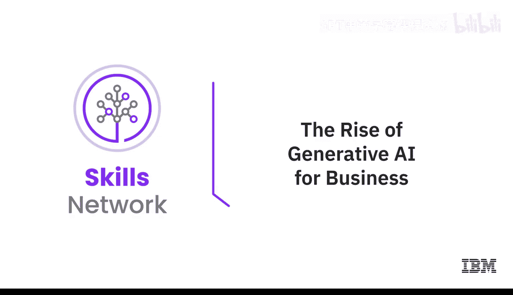

# IBM《生成式AI基础（五课全）｜Generative AI Fundamentals》中英字幕 p67 03_01_02_生成式AI在商业领域的崛起.zh_en [BV11XSYBfEje_p67]

Arthur C。 Clark famously said that any sufficiently advanced technology is indistinguishable from magic。

And perhaps， the first time that you played with generative AI， it did evoke a sense of magic。

Suddenly， for the first time in our history， we have technology that can speak our languages。

 understand our requests， and produce entirely novel output。

AI can write poetry and draw other worldly images， it can write code。

 it can surprise and delight us with an original joke or musical composition。

It can create and an act of creation often inspires wonder AI isn't just about the digital world。

 It's also about the physical world applied properly。

 imagine what AI can do for the pace of discovery and innovation。

What it can do for discover new materials， for medicine， for energy， for climate。

 and so many of the pressing challenges that we face as a species。Ultimately。

 our success depends on how we approach AI。I want you to think back to the first time you heard about generative AI。

 it's a phrase that really became part of the public conversation in maybe November or December of 2022。

We have seen new models， evolve models and an explosion of open models Genrative AI has gone from being a fascinating novelty to a new business imperative in less than a year。

 and every day there is news of a new use case or application。

There's such rapid growth that it can't predict exactly where will be 10 years from now or even 10 months from now。

 but I do know that you're going to want to be actively engaged in shaping that journey。

The future of AI is not one or two amazing models to do everything for everyone It's multimodel it needs to be democratized。

 leveraging the energy and the transparency of open science and open source AI so that we all have a voice in what AI is。

 what it does， how its used and how it impacts society。

Where you get to decide what AI can do and how it integrates with your business。

It's time to start making plans for how you can effectively， safely and responsibly put AI to work。

