# IBM《生成式AI基础（五课全）｜Generative AI Fundamentals》中英字幕 p68 04_01_03_通过生成式AI提升企业竞争力.zh_en [BV11XSYBfEje_p68]

Welcome to the elevating businesses with generative AI video After watching this video。

 you'll be able to describe what it means to elevate a business with generative AI。

 identify the steps for responsibly adopting generative AI。

 and explain how generative AI models enhance business functions。

 What does it means to elevate a business with generative AI。

 It means to responsibly merge AI systems into business workflows to positively impact profitability。

 work culture and society at large。 elevation is different than application。

 It goes beyond applying generative AI as it requires the determined effort on the part of business leaders to ensure all aspects of AI adoption they're considered。

 concluding but not limited to1 feasibility，2 prioritization，3。

 talent acquisition 4 risk management and 5 alignment。

 A feasibility analysis helps identify the business functions that can benefit the most from generative AI。

😊，Leaders must prioritize which business functions to elevate as generative AI is costly to integrate。

 Leaders must find the right talent mix by outsourcing， hiring or upscallling existing employees。

 Leaders must take precautions to protect their businesses against generative AI related challenges。

 Businesses must alter workflows and mindsets to work with generative AI。

 Any business from a multinational organization to a medium scale enterprise to a local entrepreneur。

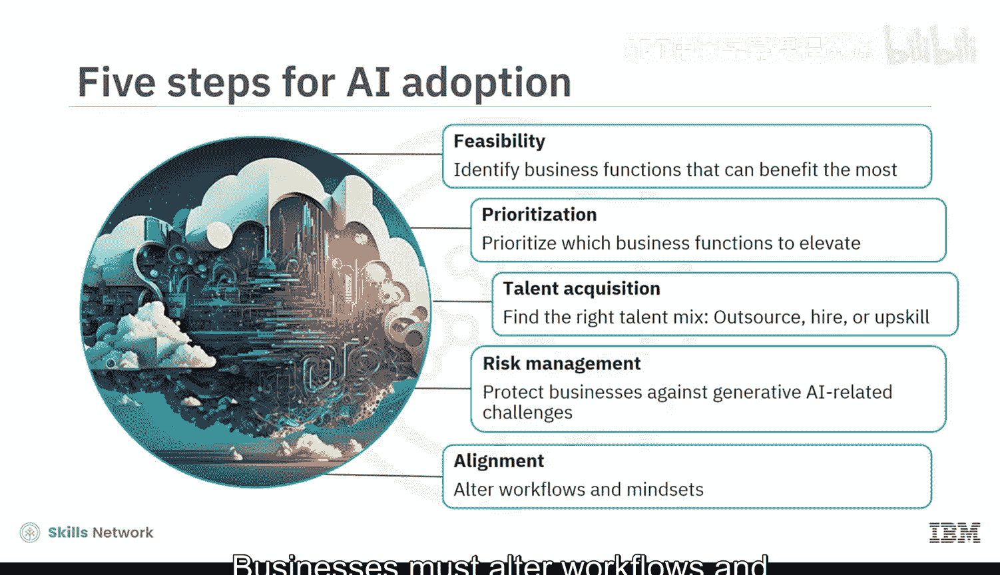

Can leverage generative AI to increase its visibility and revenue while banking。

 high tech and life sciences businesses are likely to see the biggest rise in revenue。

 other industries such as entertainment， sports， education。

 manufacturing and wellness will also be impacted。 This is because generative AI has the potential to revolutionize business functions across all industries。

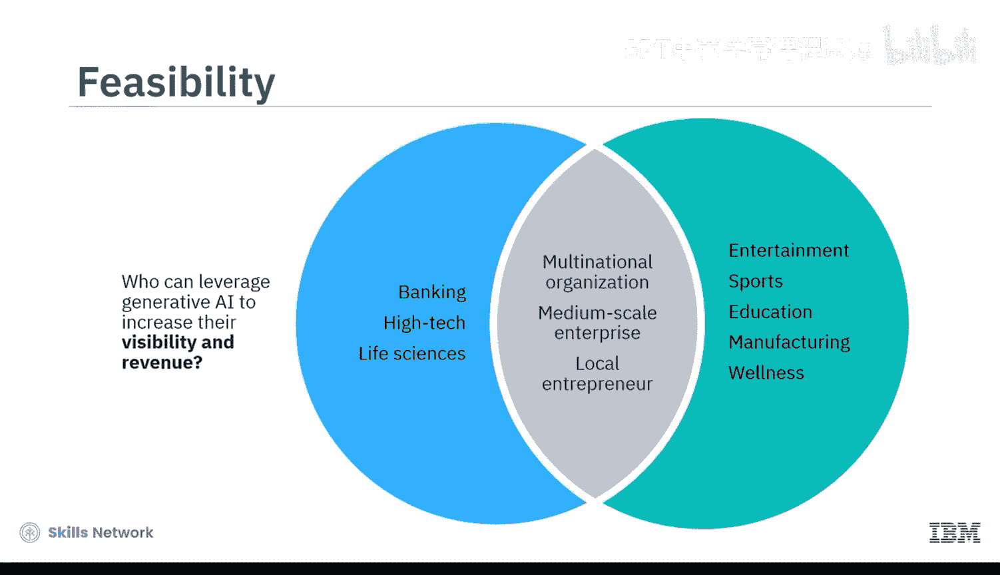

Business functions such as customer service， marketing and sales， human resources， fraud detection。

 product design and development， finance and legal have experienced an increase in efficiency and creativity with generative AI models and tools。

 For instance， conversational generative AI tools also known as chat bots adapt their tone and approach to each customer interaction。

 This reduces resolution times and increase customer satisfaction。

 Lage language models or LLms analyze customer behavior and preferences。

 Enling marketers to customize advertising， personalized recommendations and increase customer interaction。

 Foundation models automate routine tasks and improve data analytics。

 reducinging human error and maximizing productivity。

 diffusion models offer cutting edge tech to create path breaking unique personalized visuals。

 I customer engagement and brand recognition。 However。

 do you really need generative AI for basic tasks such as text classification， risk assessment。

 content retrieval and customer segmentation。 Discriminative AI models are better suited for these tasks。

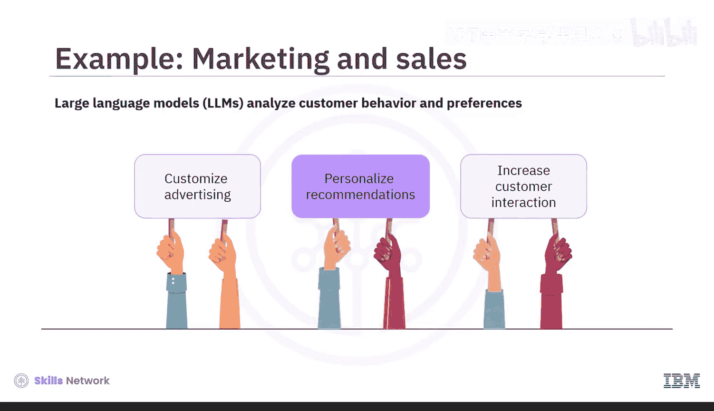

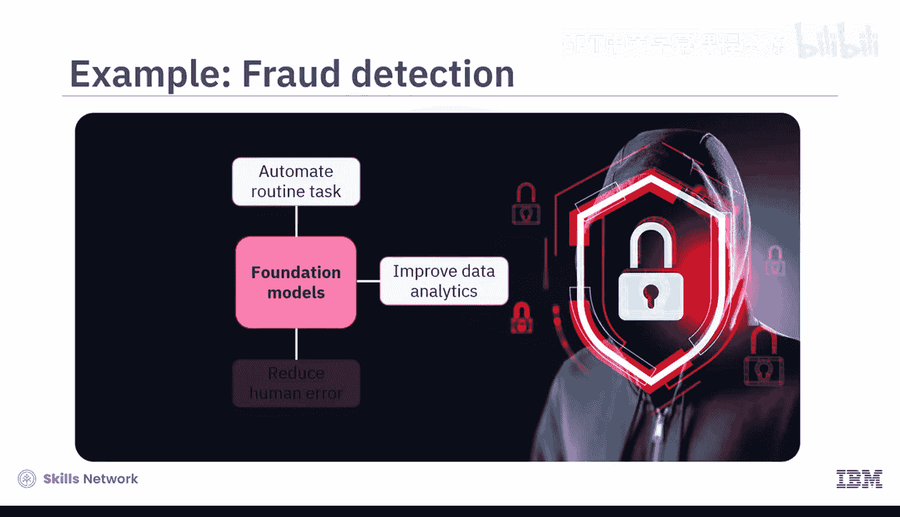

As they produce more accurate results， therefore， it's essential for any business to conduct a feasibility versus impact analysis of where they can apply generative AI to drive value and profits A feasibility analysis needs to define the problem Under the solution that generative AI can offer。

 study the impact of integrating generative AI into workflows assess workforce requirements select the generative AI model that data sets to pretrain the model and fine tune algorithms to deliver the required outputs。

 After performing a feasibility analysis， leaders must prioritize the business functions that can leverage AI to deliver maximum value This is directly linked to affordability as generative AI models are expensive to train and maintain There's also a question of direction do you want to focus on cost cutting or opening new revenue streams to cut costs generative AI helps increase productivity through automation。

 reduce errors and planning and execution and decrease go to market timelines to open new revenue streams。

 businesses can use generative AI to forecast scenarios。

 visualize outcomes and improve data analytics these capabilities。

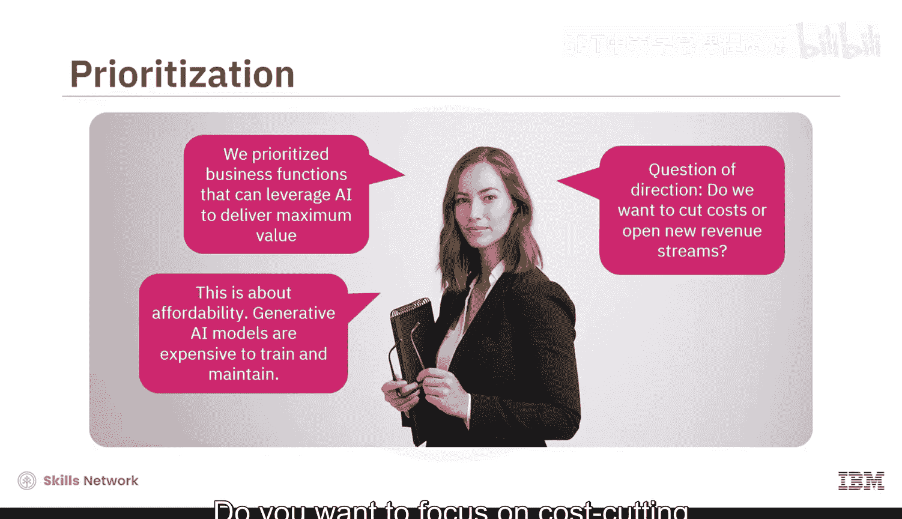

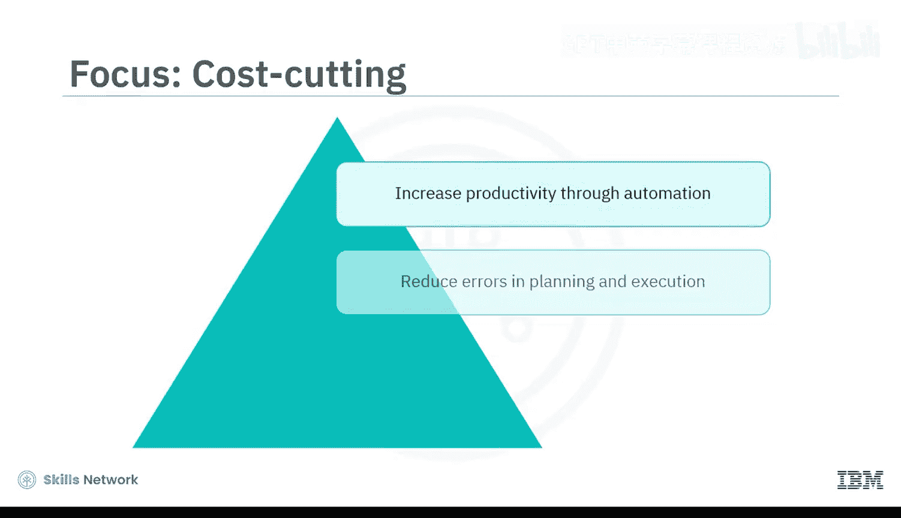

Allow for increased experimentation and innovation。

 They strengthen the teamwork culture as employees spend time on a higher value and collaborative activities。

 The result is increased sales and increased customer retention。

 Business need the right mix of talent。 They can outsource AI specific tasks like building， training。

 deploying and fine tuning AI models。 an ecosystem of AI enablers provides this expertise。

 including open source platforms such as hugging face and proprietary tools such as IBM Watson X Lead need to hire new AI specific in-house staff。

 such as AI developers， prompt engineers and data scientists to monitor and maintain the AI systems。

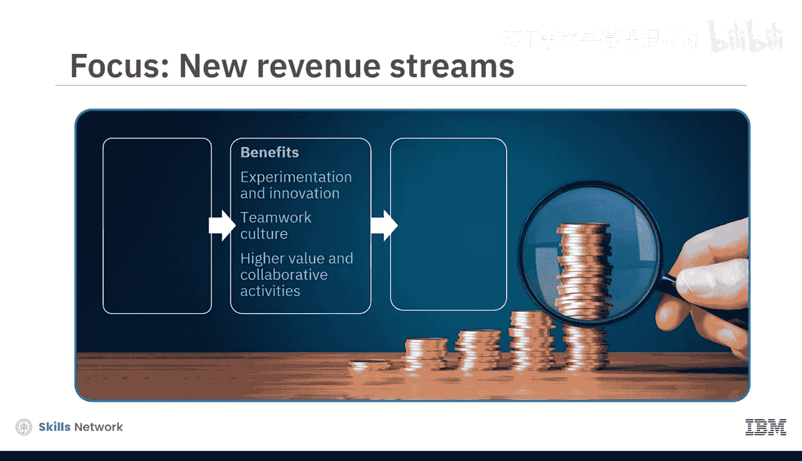

Lastly， they need to upskill the existing workforce to complement and align the generative AI output。

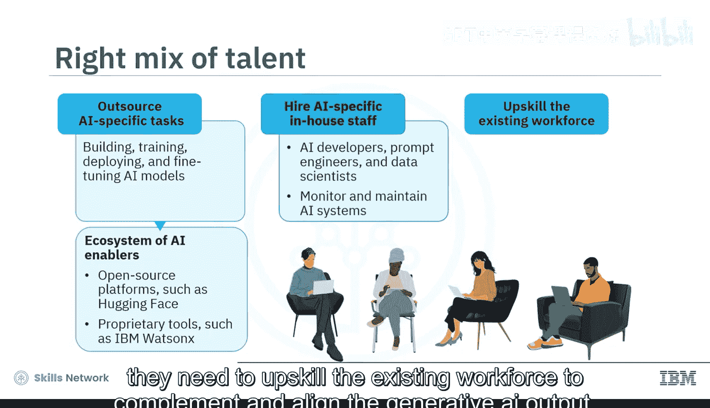

With everything set up， the mind turns to ethics and compliance。

 adopting generative AI can harm the brand if businesses do not address challenges such as copyright infringement。

 data privacy violation， low quality training data， algorithmic bias。

 and hallucinations and inadequate safety， transparency and accountability measures to ensure ethical。

 trustworthy and responsible AI systems， businesses must reduce bias。

 track performance variations on model drift and explain AI powered decisions to stakeholders and customers。

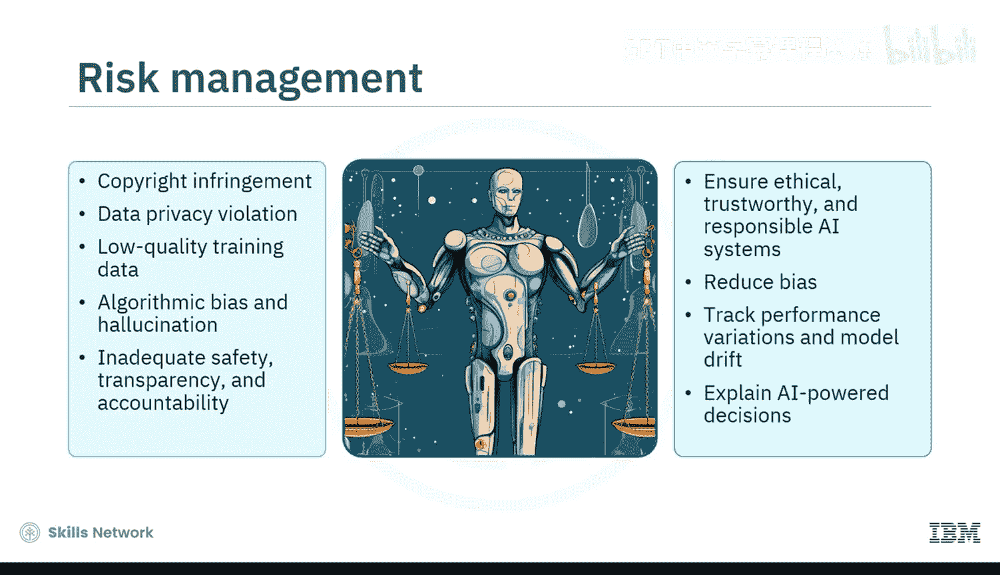

Working alongside generative AI models requires team members to adjust the new workflows。

 learn new vocabulary and align their mindsets。 For instance。

 fixed processes give way to flexible ways of approaching issues， words like neural networks。

 style transfer， deep fake hallucinations and overfitting are spoken daily。

 and human roles keep adjusting based on evolving AI capabilities。

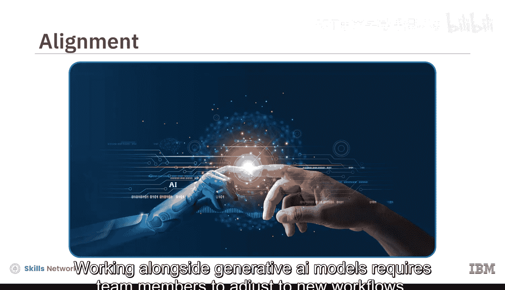

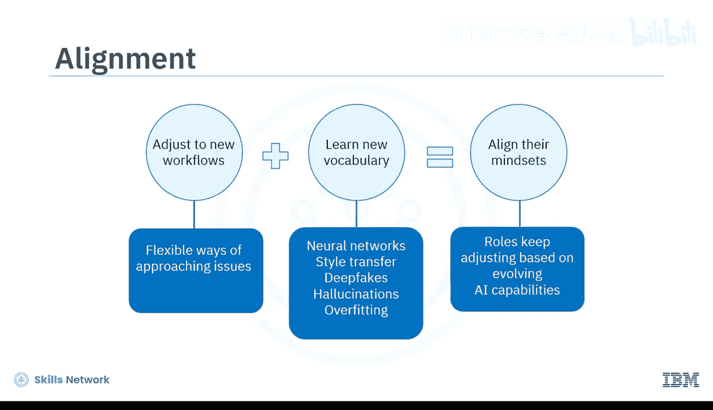

Adopting generative AI cautiously can elevate a business's reputation and revenue。

 earning a customer's digital trust， being transparent with employees and stakeholders and guarding against ethical risks can help deliver the desired outcomes。

 In this video， you learn that businesses should responsibly merge AI systems with business workflows to positively impact profitability。

 Work culture and society。 They must carefully consider all aspects of AI adoption。

 such as feasibility， Priitization， T acquisition， risk management and alignment。

 generative AI models can elevate business functions as long as their integrated ethically。

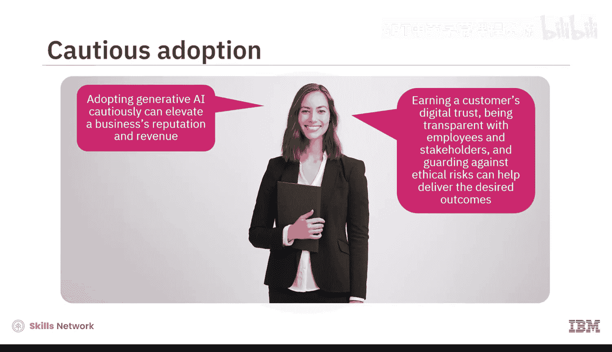

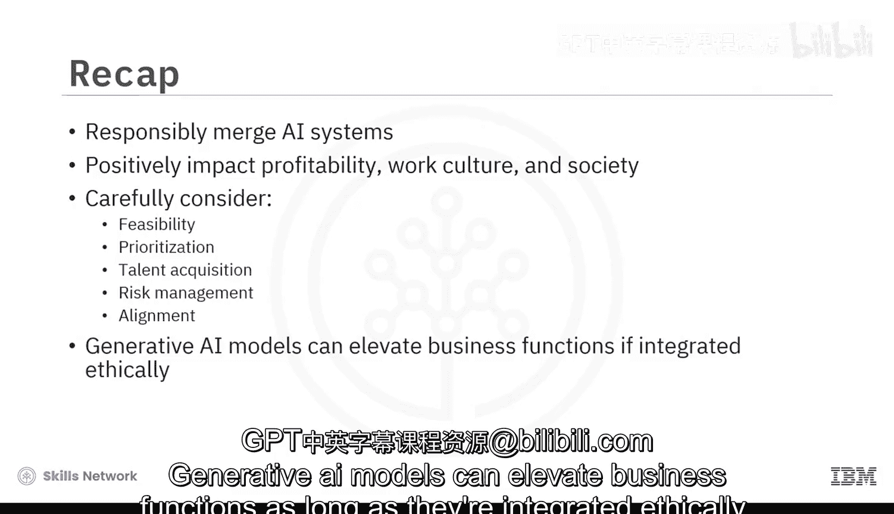