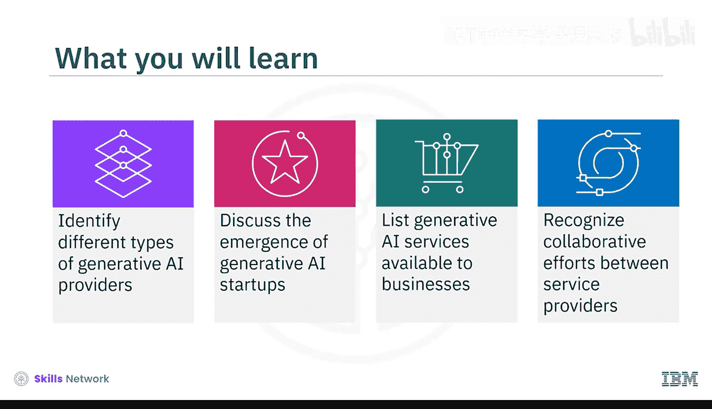
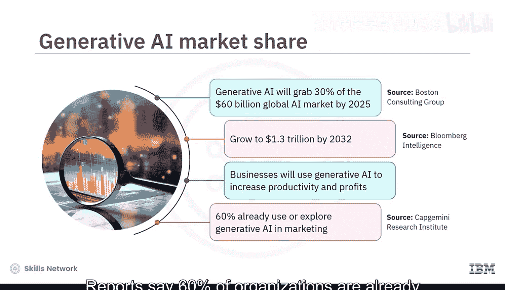
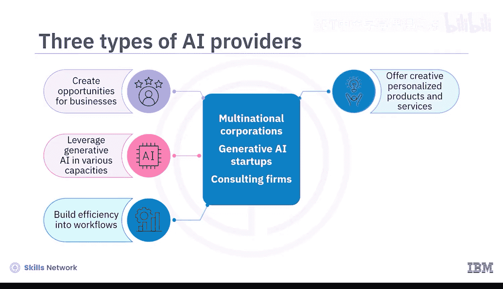
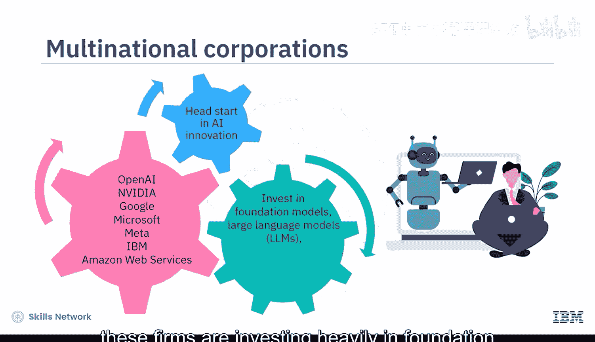
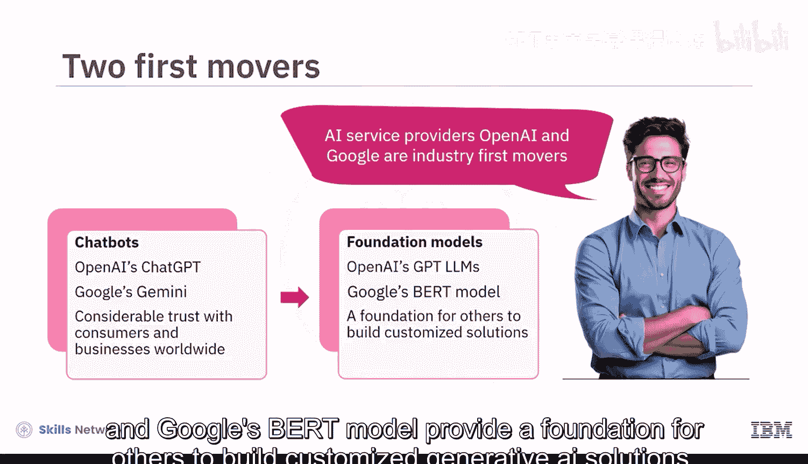
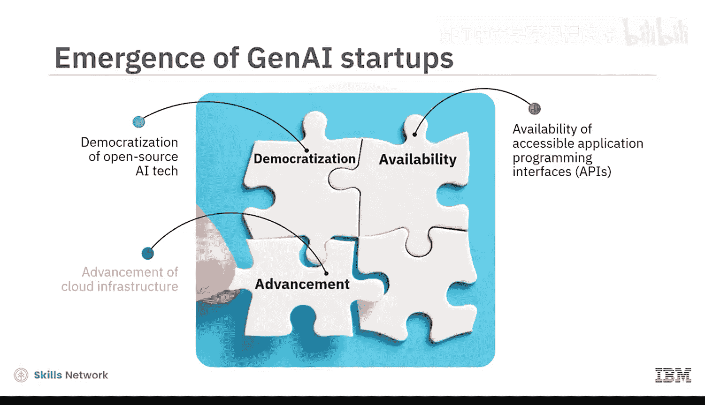
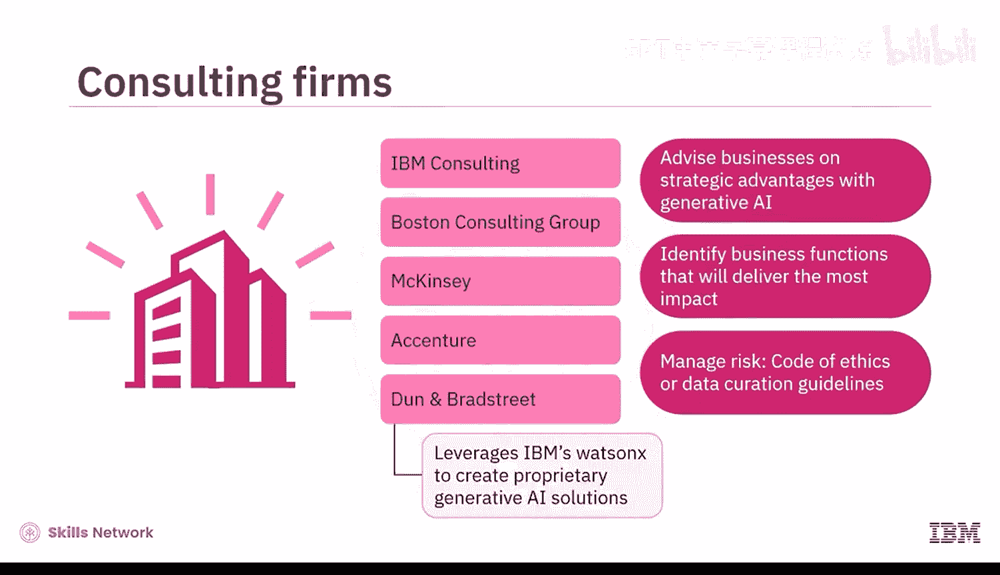
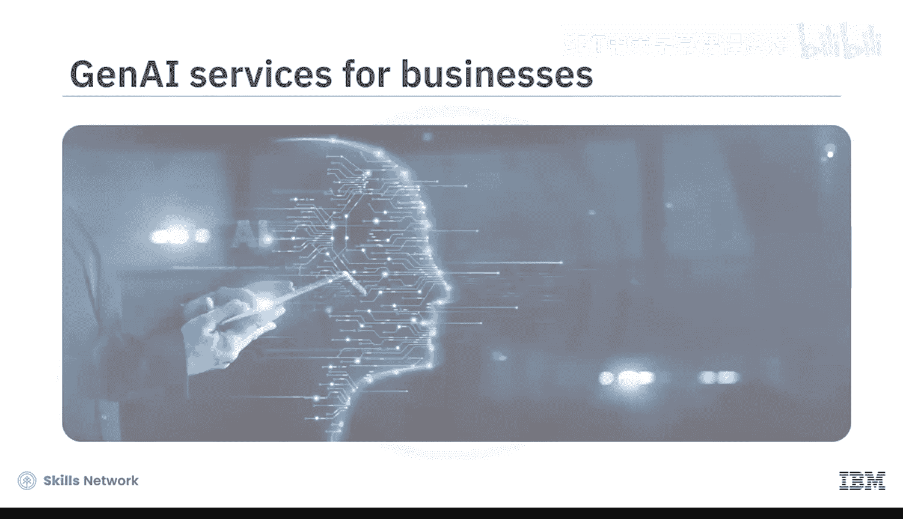
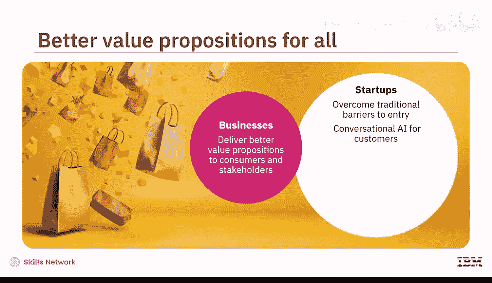
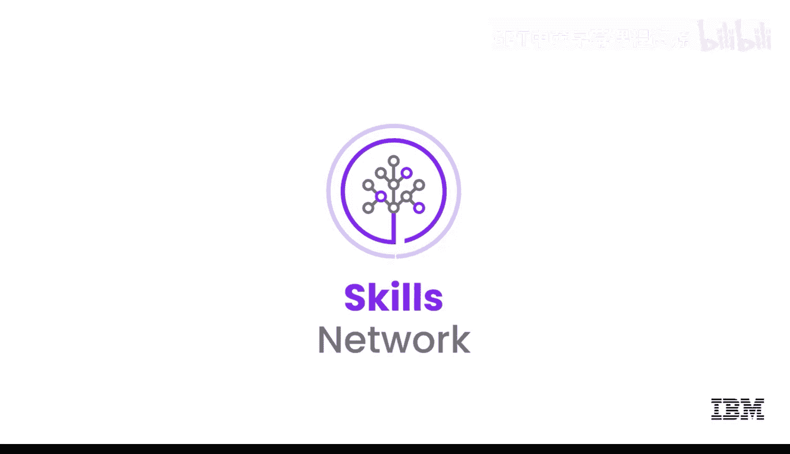

# IBM《生成式AI基础（五课全）｜Generative AI Fundamentals》中英字幕 p69 05_01_04_生成式AI供应商生态系统.zh_en [BV11XSYBfEje_p69]

Welcome to the video， an ecosystem of generative AI providers After watching this video。

 you'll be able to identify the different types of generative AI providers。

 discuss the emergence of generative AI startups， list generative AI services available to businesses。

 and recognize collaborative efforts between service providers。

Generative AI will grab a 30% share of the $60 billion global AI market by 2025。

 which will most likely grow to $1。3 trillion US dollars by 2032。

This means a majority of businesses will use generative AI to increase their productivity and profits。

 Report say 60% of organizations are already using or exploring generative AI and marketing。

The question is， do businesses prefer to build generative AI in house or buy it from the market。

 most organizations prefer to buy， not build generative AI models。

 as this allows them to a safely experiment with generative AI B。

 save time and money training and deploying foundation models， and C。

 leveraging cutting edge expertise from the marketplace。As businesses seek support in this space。

 they encounter three types of AI service providers， multinational corporations。

 generative AI startups and consulting firms。These service providers create opportunities for businesses to leverage generative AI in various capacities。

 to build efficiency into workflows， offer more creative。

 personalized products and services to their customers。

 scale their operations and increase their revenue。

A majority of the AI marketplace is served by multinational corporations， such as Open AI， NviDdia。

 Google， Microsoft， Meta， IBM and Amazon Web services to name a few with a head start in AI innovation。

 these firms are investing heavily in foundation models， large language models。

 diffusion models and other generative AI tools。

2 AI service providers， open AI and Google are industry first movers， Chatbots。

 Chat GPT and Gemini have built considerable trust with consumers and businesses worldwide。

 Open AI's G driven large language models and Google's Bt model provide a foundation for others to build customized generative AI solutions。

Competing against these multinationals are hundreds of generative AI startups。

 helped by the democratization of open source AI tech。

 the availability of accessible application programming interfaces， or APIs。

 the advancement of cloud infrastructure and encouragement from users and venture capitalists。

In 2023， generative AI startups raised $10 billion despite a global funding slowdown。

 This enables them to provide affordable， customized domain or business function specific generative AI tools to meet market demand。

 Some of the startups to watch for are cohere， which builds multilingual L L Ms for enterprise Huging face。

 a collaborative AI community for developers。 Tab 9。

 a code writing AI assistant for software developer。 Soundra， a royalty free AI music generator。

 and assembly AI， which provides AI as a service。😊。

The ecosystem of generative AI service providers also includes consulting giants。

 such as IBM Consulting， the Boston Consulting Group， McKinsey， Accenture and Dun in Brads Street。

 These firms advise businesses on strategic advantages they can gain with generative AI。

 They help them identify the business functions that will deliver the most impact and help them manage risks by establishing a code of ethics or creating data curation guidelines among others。

 For example， Dunn in Brads Street leverages IBM's Watson and X to help clients create proprietary generative AI solutions。

Businesses can expect these service providers to improve multimodal capabilities of foundation models。

 curate data sets to remove algorithmic bias and hallucination。

 find tune and optimize LLMs for greater accuracy，  customize models for specific domains and business functions。

 integrate generative AI with existing software and platforms and provide LLM as a service to help personalize solutions。

 design and deploy models， train staff and offer technical support。

With this expertise， businesses are able to deliver better value propositions to their consumers and stakeholders。

 Startups across all industries are able to overcome traditional barriers to market entry by using conversational AI for customer service。

 rapid content creation for marketing and outreach。

 scenario forecasting for product and service offerings and generative design for innovative products and packaging。

😊。

Service providers may collaborate to learn from each other and increase the adoption of generative AI solutions。

 Two multinational corporations， IBM and Amazon Web services set up an innovation lab for customers to prototype and test generative AI applications。

 IBM Wats and X AI and start Huging face share their open source AI tools to help developers build test and deploy machine learning solutions。

 McKinsey combines its proprietary AI and data models with salesfor customer relationship management technologies to help companies improve their customer buying experiences and sales productivity。

Everyone believes that AI is going to be the greatest force for economic empowerment。In this video。

 you gained insight into the ecosystem of generative AI service providers。

 which includes multinational corporations， generative AI startups and consulting giants。

 These service providers help businesses build efficiency into workflows。

 offer more creative products and services。 scale operations and increase revenue。

 They also collaborate to provide consumers and businesses with improved generative AI solutions。

