# IBM《生成式AI基础（五课全）｜Generative AI Fundamentals》中英字幕 p70 06_01_05_生成式AI对各行业的影响.zh_en [BV11XSYBfEje_p70]

Welcome to impact of generative AI on different industries。 After watching this video。

 you'll be able to discuss the transformative impact of generative AI for industries。

 identify the impact of generative AI on a few prominent industries sectors。

 generative AI is a groundbreaking force in the technological and business landscape。

 leading to a profound transformation across diverse industries。

 As indicated in a report by McKinsey in 2023， generative AI is projected to contribute between 2。

6 trillion to $4。4 trillion annually to the global economy。

 Showcasing the immense value it can bring to industries。

 The growth trajectory of generative AI across industries is not confined to mere numbers。

 but represents a fundamental shift in the way industries operate。

 generative AI isn't just automating tasks， its refining workflows from conceptualizing designs to optimizing processes。

 generative AI is fostering a culture of constant innovation。

 allowing faster adaptation to changing needs and market demands。

 One of the transformative potentials of。😊。

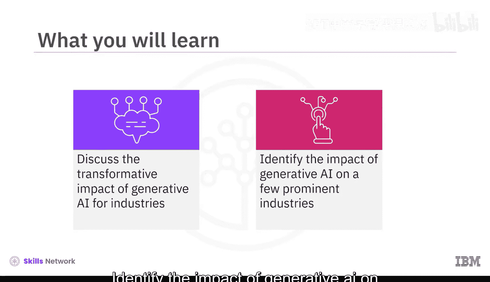

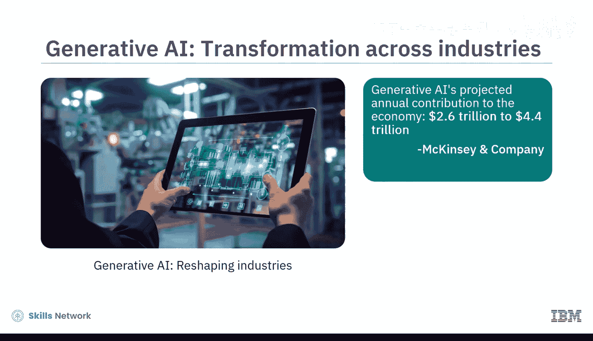

Generative AI includes hyperpersonization。 Imagine personalized customer experiences。

 marketing campaigns and product recommendations tailored to individual needs。

 generative AI models can analyze vast amounts of data in real time to predict outcomes。

 optimize operations and make informed decisions across different industries。

 generative AI models are encouraging collaboration between humans and AI to boost human creativity。

 productivity and efficiency。 generative AI has a transformative impact on almost every industry。

 Let's explore its impact on a few prominent industry sectors。

 The impact of generative AI and high tech industries is profound and multifaceted。

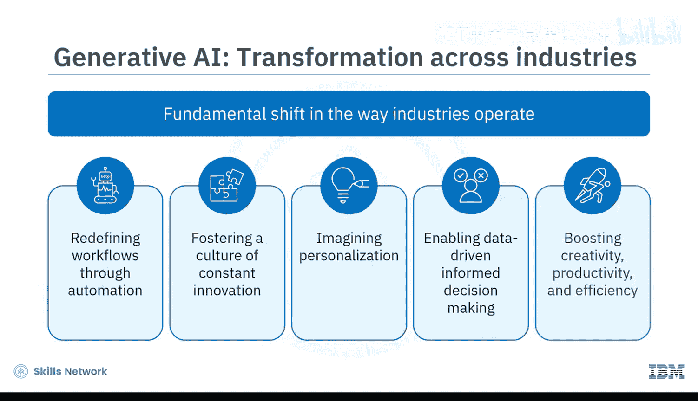

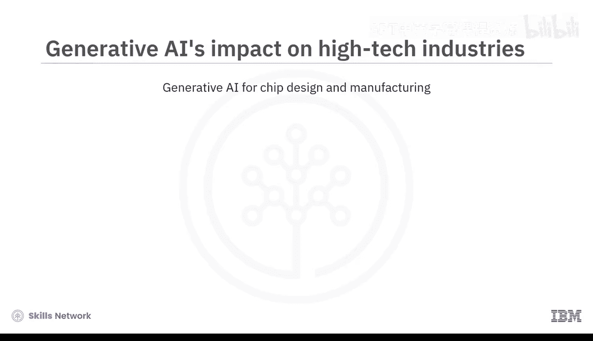

Generative AI is contributing to circuit optimization in semiconductor companies such as NviDdia and Qualcomm。

 generative AI is resulting in faster and more efficient chip designs。

 generative AI is making cybersecur smarter。 It can create attack simulations for training security analysts and testing system effectiveness。

 identify threats and establish predictive models。 Comp such as Palo Alto networks use generative AI to detect anomalies and prevent potential breaches proactively for software development。

 generative AI automates repetitive coding tasks and aids in testing and debugging generative AI products such as Github copit can help developers write code faster。

 smarter and more efficiently In robotics and automation。

 generative AI as pivotal in designing and controlling autonomous robots capable of continuous learning and improvement。

 Compan like Tesla and Boston Dynamics leverage AI to enhance robots dexterity and problem solving skills。

 generative AI is poised to revolutionize the manufacturing landscape As per a market research report。

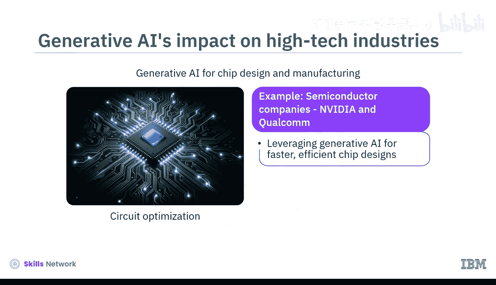

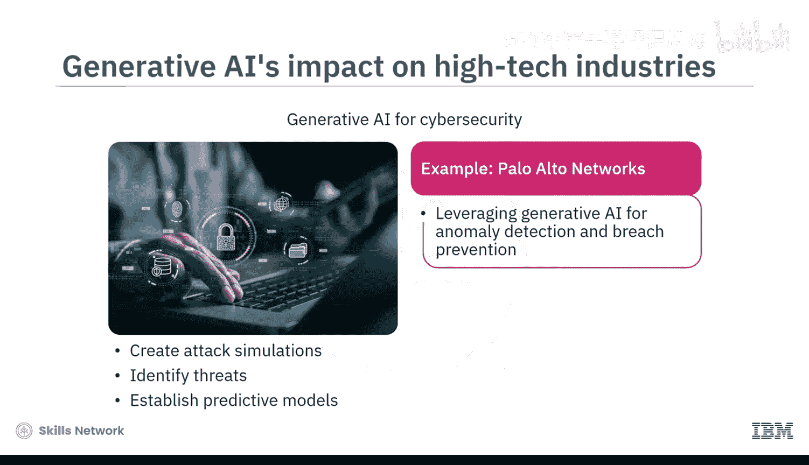

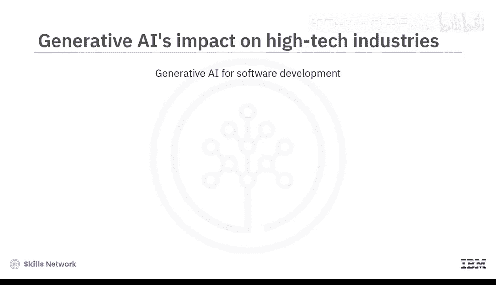

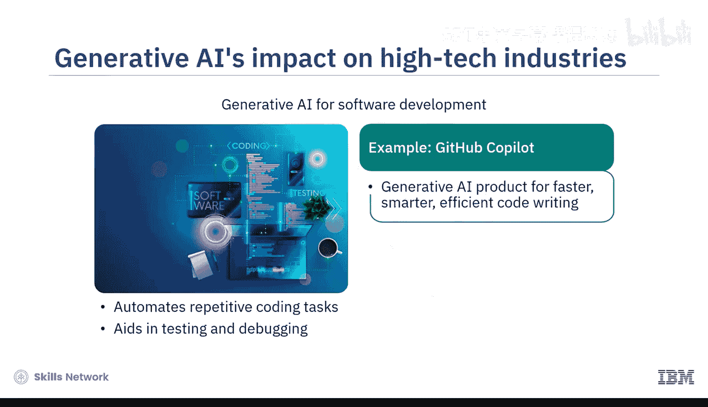

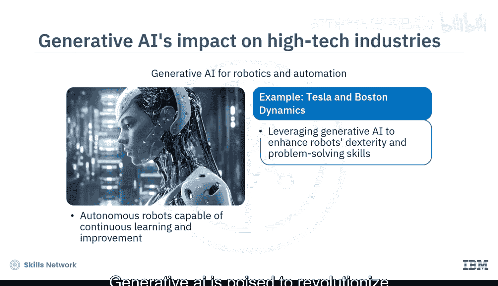

The size of the generative AI in the manufacturing market was $223。

4 million in 2022 and is projected to exceed $6398。

8 million by 2032 generative AI speeds up manufacturing design and fosters innovation by automating intricate tasks and rapidly creating and evaluating design alternatives。

 Airbuss， for instance， reduced aircraft partition wall weight by 45% using generative design。

 generative AI can simulate production scenarios streamline various tasks and minimize downtime For example。

 Siems leverages foundation models to optimize production processes and improve product quality Further generative AI models can forecast demand and optimize inventory levels。

 Additionally， generative AI can create optimal supply chain models by considering factors like costs。

 delivery times and reliability。

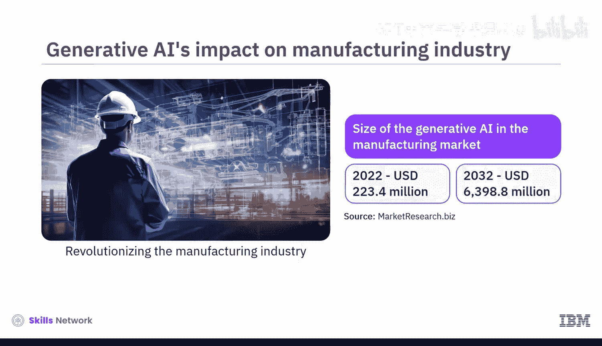

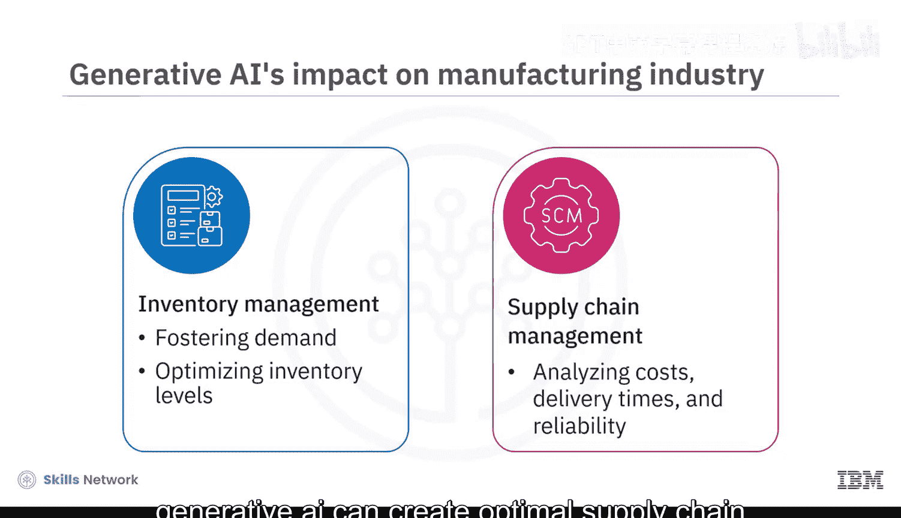

In the finance industry， generative AI exhibits the potential to automate routine tasks。

 improve risk mitigation and streamline financial operations。 According to Goldman Sachs research。

 the use of generative AI and finance is expected to increase global gross domestic product or GDP by 7% and boost productivity by 1 and2%。

 and the banking industry generative AI as the potential to enhance the efficiencies already delivered by artificial intelligence。

 According to McKinsey， generative AI could deliver value equal to an additional $200 billion to $340 billion annually if its use cases in banking are fully implemented。

 generative AI is poised to transform the banking industry by enhancing personalized customer experiences by predicting customers' financial needs and behaviors to provide tailored recommendations。

 For instance， Morgan Stanley utilizes open AI powered chatbots to aid their team of financial advisers by analyzing internal research and data for providing instant personalized insights to clients。

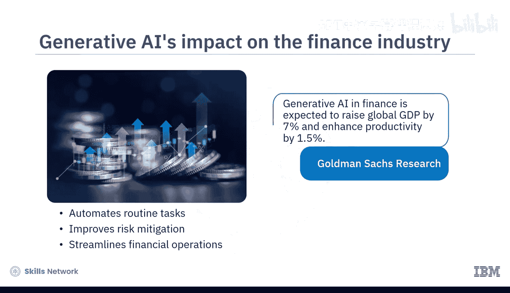

Moreover， generative AI enables more accurate credit risk assessments through extensive data sets。

 Additionally， realtime analysis of transactions and data helps identify suspicious activity。

 thereby reducing fraud As per McKinsey， the retail and consumer packaged goods or CPG industry holds the potential to deliver $400 billion to $660 billion a year by leveraging generative AI for CPG companies generative AI enables personalized customer journey and marketing campaigns streamlined marketing and brand content。

 enhanced chatbots and dynamic pricing it can aggregate market data to test concepts。

 ideas and models， CPG companies are increasingly integrating generative AI into their operations For instance。

 Nestle is using generative AI to validate new product ideas and create market research reports Taptre。

 parent company of brands like Kate Spade and Co utilizes generative AI to automate online personalization。

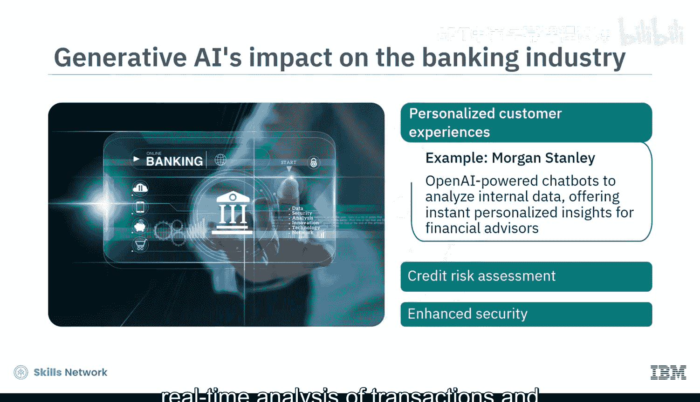

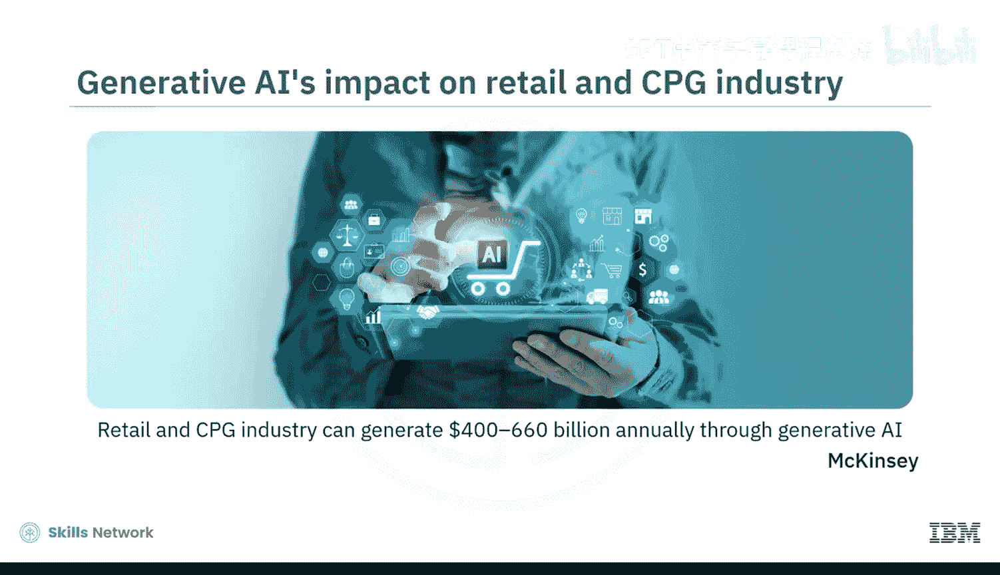

In the healthcare industry， generative AI is redefining drug discovery， personalizing medicine。

 accelerating medical research。 Pharmut firms usually allocate around 20% of revenues to R& D and developing a new drug spans 10 to 15 years on average。

 leveraging foundation models and generative AI can expedite this and yield substantial value According to McKinsey。

 generative AI could reduce the cost of drug development by up to 40% and have the time it takes to bring new drugs to market across different industries。

 generative AI's potential and impact vary in different functions For instance。

 in high tech industries， the greatest impact will be on software engineering while in banking it will significantly affect customer operations In the medical field。

 the impact will be notable in product and R&D marketing and sales functions experience high impact across various industries。

 approximately 75% of the estimated value derived from generative AI use cases is concentrated in four key areas。

 Custom operations， marketing and sales， software engineering and research。😊。

Development Apart from the industries covered in this video。

 generative AI is influencing other sectors， including media and entertainment， education， Con。

 energy and agriculture。 generative AI isn't just a trend。

 It's a driving force behind the next wave of innovation。

 efficiency and personalized experiences across industries to summarize in this video。

 you learned about the impact of generative AI leading to a fundamental shift in the way industries operate。

 generative AI is impacting industries to redefine workflows foster a culture of innovation。

 attain hyper personalization， enable informed decision making and boost creativity。

 productivity and efficiency。 generative AI is making a profound and multifaceted impact on different industries。

 including high tech， manufacturing， finance， retail and healthcare care。😊。

