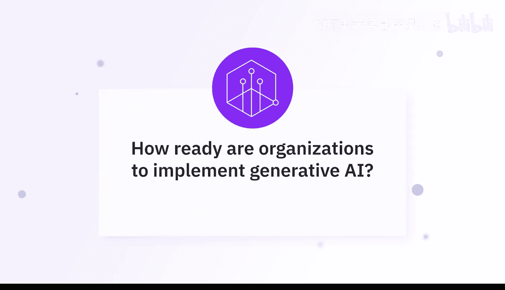
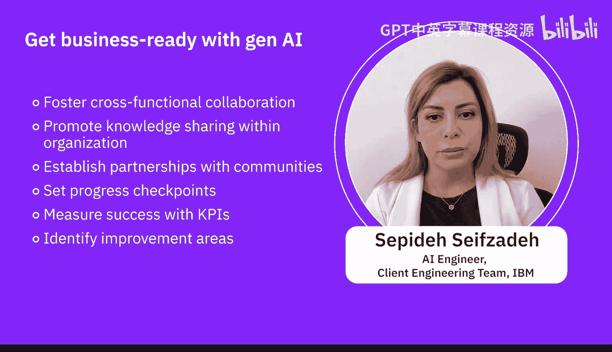

# IBM《生成式AI基础（五课全）｜Generative AI Fundamentals》中英字幕 p71 07_01_06_专家观点：利用生成式AI实现业务就绪.zh_en [BV11XSYBfEje_p71]

Hello and welcome to this expert Viewpoints video。 In this video。

 experts will discuss the business readiness of organizations with generative AI。😊。

Well， organizations again， to be business ready is you know。

 with Gene VI requires a lot of planning and a lot of slowly method methodically incorporating these techniques in their day to day activities。

Start slow and start involving generated VI users in terms of creating presentation decks or data analysis。

 basic data analysis， creating data architectures you can go by you know。

Incoropporating gene AI language models in terms of feedback analysis or feedback posting and accordingly writing emails。

 writing specific tasks or specific requisitions。In terms of slowly incorporating into thecoropporating these things into your day to day activities。

To become business ready with generative AI， there are some steps that organizations should follow。

 such as assessing their organization readiness， they should identify the gaps， challenges。

 the opportunities it provides for them， and then they should develop a very clear strategy and roadmap so that they are clear under the path that they want to take。

And they have to invest in the talent and skills， whether they should educate their current data scientists。

 their engineers， or they should bring in some special experts。

 domain experts and knowledgeable resources， from outside to either educate their resources or just to outsource some of these tasks。

 they have to build data infrastructure， which is a very。

 very important step in this journey to make sure that they have access to the high qualityality data that will be the input to these generative AI models。

 and they also have to make sure that they have data management tools in place and computational resources to run these models。

Well， generative AI can revolutionize your business with captivating ads。

 innovative products and personalized customer experiences， but before you dive in。

 let's ensure your businesses prepared start by educating your team through workshops on the basics of generate AI on its potential for your industry。

 then identify where AI can add the most value， whether in marketing product development or customer service。

 train your team to effectively integrate gene AI into their workflows。

Emphasizing collaboration among departments like marketing。

 design and IT ensure you have a solid data strategy in place with high quality。

 secure data and clear governance policies， keep ethics at the forefront by establishing clear guidelines and regularly reviewing them to ensure responsible AI use by Em learning。

 collaboration and ethical considerations， you can unlock the transformative power of generative AI and propel your business into the future。

Really， it's about gaining a comprehensive understanding of generative AI。

 The latest study has shown 70%。 people are now starting to teach themselves AI before it was under 30%。

 Probably by the end of the year is going to be closer to 100%。

 I think taking some sort of business certification to help you learn AI and how to apply AI for work and integrate it into your role is critical going forward。

So it's a very great opportunity to do the crossfunction collaboration and knowledge sharing within the organization as well。

 they have to establish partnership and collaboration as well with the open source community and with different departments to make sure that they do some checkpoints to make sure that they have their KPIs in place and to measure how generative AI initiative has helped in their business and how they can continue improving moving forward。

。