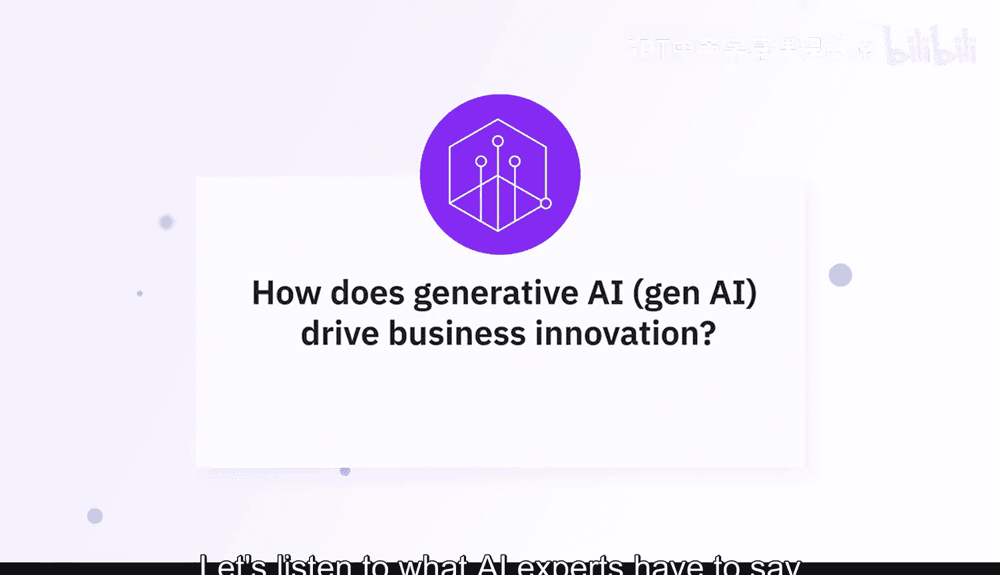
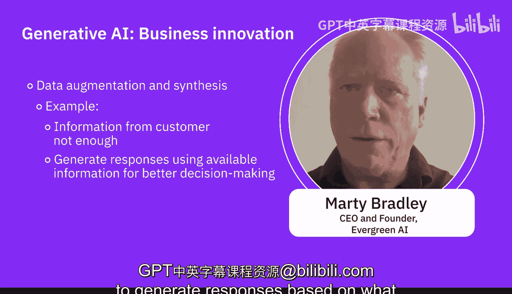
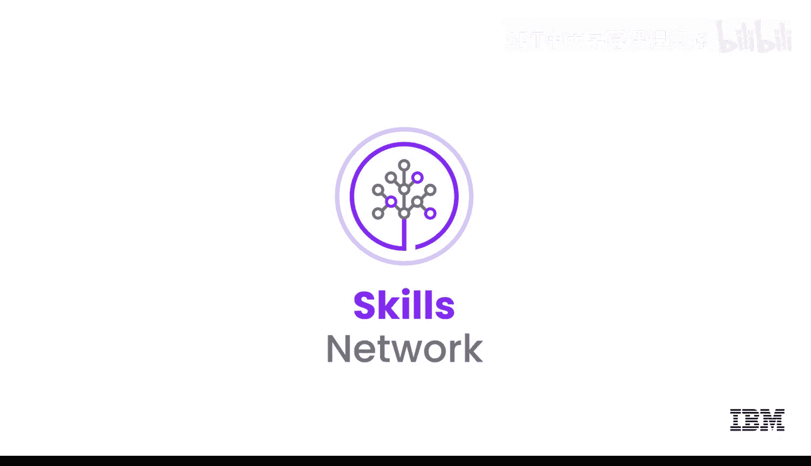

# IBM《生成式AI基础（五课全）｜Generative AI Fundamentals》中英字幕 p72 08_01_07_专家观点：运用生成式AI推动业务创新.zh_en [BV11XSYBfEje_p72]

Hello and welcome to this expert viewpoints video。 Let's listen to what AI experts have to say about business innovation with generative AI。

😊。

I'd say probably one of the best things businesses can do to start implementing and using generative AI is to just think about their processes。

 think about your business， and think about where generative AI can just make something better。

And what are those things to think about pretty much anything that requires a human。

 generative AI can often do it better， faster， cheaper。And that's a win all around。Well。

 generative AI particularly is great in creating a lot of presentations。

 it is available to create a lot of systematic data analysis。

 organizations can use it to create better patterns and more predictive patterns in terms of data science and data engineering applications。

It is because of the democratizationization of all the techniques and all the information that you can have。

 the models that even if you are not aware of generally are available with the gene AI to reuse and reapply in terms of your applications that's specific to your task。

Some of the applications of generative AI in different domain and industries are included as follows but not limited to content generation and personalization。

 for example， in marketing agency can use this technology to come up with a personalized marketing campaign and generate the content of the emails that goes out as advertisement to its end users and do the personalization of this messages based on customer information the other use case can be creative design and visual media that fashion retailer。

 for example， can use these AI generated images and the creative way to create images and videos for their design The other use case can be product innovation and prototyping for example。

 an automated company can use。These generative AI to come up with some 3D models and simulate their design to enhance the performance and optimize their designs to make sure that they accelerate the development of their car in a most efficient way。

Jereroba I can enable a wide range of innovative business ideas and here a you automated content creation。

 website copy， put out more articles， produce high quality marketing content， blog posts。

 social media content， updates， also personal customer experiences， customers come in。

 they tell you some things you can modify and edit that。

 put a positive spin on it how the customer improve that。

What might be of a good aspect of nature is that in terms of language models and in terms of usage of such technologies in terms of the creating better feedbacks for different individuals who are working in a specific task the feedbacks can be made using generative AI particularly simply by giving the key pointers of the performance of any particular person。

 these trivial activities that many people have to do in corporations can be automated using these technologies pretty easily。

And saves a little bit of time。So you want to design prototyping generative AI so it can access and design process by creating multiple iterations of product images or designs。

 the thing here is that you can iterate quickly， we all talk about what's the fastest way to get something into the customer's hands。

 you want to iterate， make changes， let somebody see it and make a change and you can do this much more quickly with a generative AI technology。

And the other use case can be NLP national language processing that a customer service platform can use to have an interactive chatbo with the end user。

 the other use case can be artificial creativity and innovation， for example。

 an architect firm can use this AI generated architecture designs so that it goes beyond the boundaries of creativity and helps them with some new ways of innovation and prediction is another application that by employing generative AI。

 for example， a financial service firm can use these generative AI to predict the investment outcomes and optimize the portfolio and the strategies so that it can enhance the decision making and the risk management for these companies。

It can also help with cross domain innovation and collaboration， for example。

 by having a virtual fashion show， it will be a collaboration between fashion and technology。

So for example， on Skills Network， we have millions of learners and unfortunately things do go wrong once in a while。

 so those learners create tickets。So with millions of learners。

 even when things don't go wrong too often that's a lot of tickets and those are quite frankly difficult to handle so the first thing you need to do is you get a ticket and yet to say has the ticket been raised before。

 leaveve implemented in AI and uses generative AI to tarse the text in whatever language it comes in。

 it'll know how to group it with other similar issues。

 it'll even go over the description and reword things。

 make it very clear so that when we want to go and fix it。

 we know exactly what the problem is without having to read a big block of text from a learner。

It saves us countless hours and it was extremely easy to implement。

So just look for those areas that can be improved that has a human doing something likely monotonous。

 and that's a great candidate to be replaced by generative AI。接在个。

Vous ways in which organizations can benefit and automate stuff but then again creative aspects need to be more encouraged to you know generate let's say that you want to generate a specific PPT you can generate you know style guide but not share private or you know proper information of the company particulars in terms of use geneative AI modify the pT according to the aspects and patterns that the geneative AI models come up so these are some of the suggestions which might。

Again， I talk about all the time about looking at your workflow and your business and deciding what are the steps in the workflow that need a human。

 what are the steps that can be done by AI， and what steps could you delegate off to a virtual assistant and then there's data augmentation and synthesis so let's say you're doing a study and you get some information from your customers but it's not enough for you to make any kind of quantitative decisions you can actually use generative AI to generate responses based on what you're seeing from your customers。

