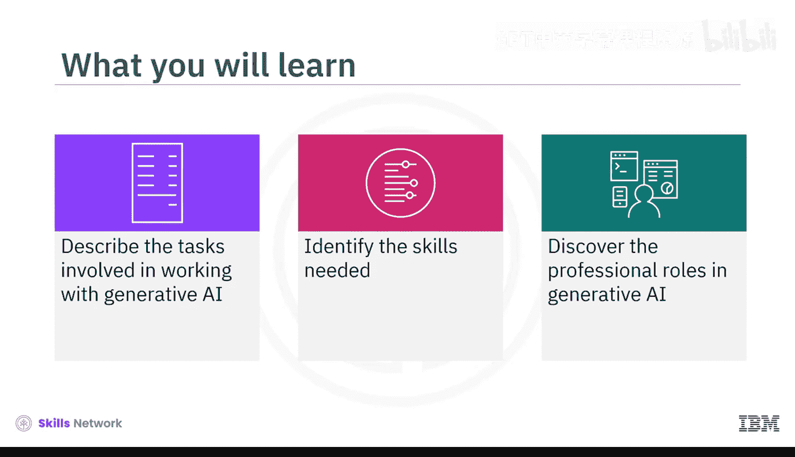
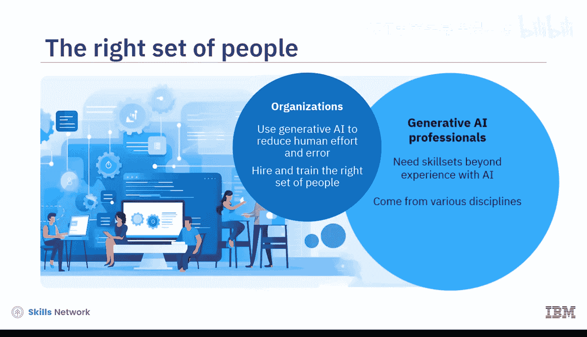
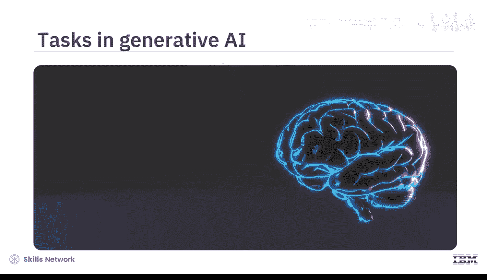
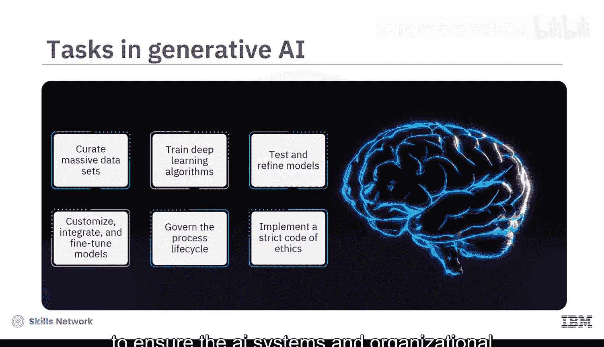
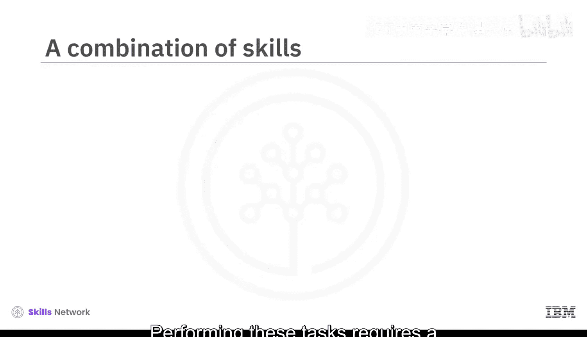
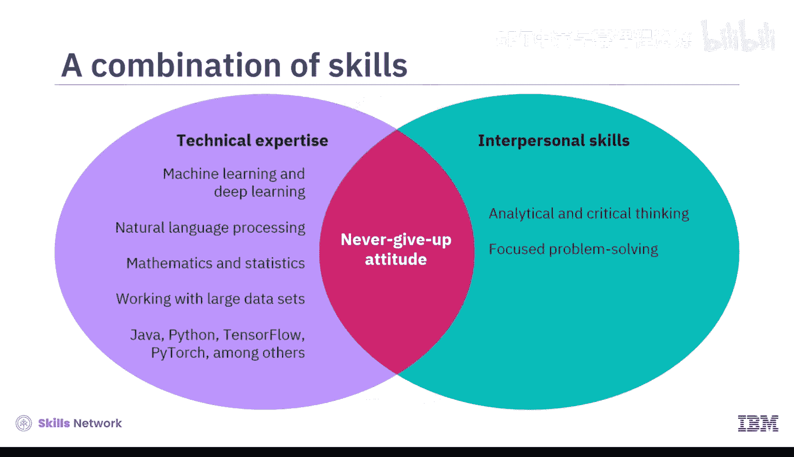
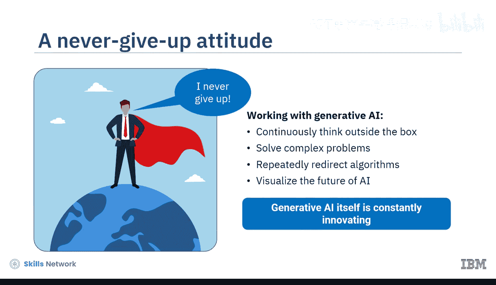
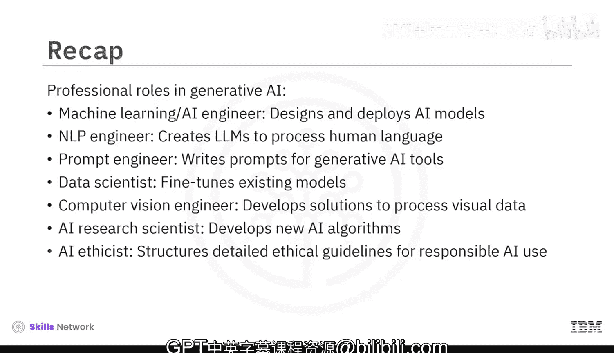

# IBM《生成式AI基础（五课全）｜Generative AI Fundamentals》中英字幕 p73 09_02_01_生成式AI领域的职业机遇.zh_en [BV11XSYBfEje_p73]

Welcome to the career opportunitiesities in generative AI video After watching this video。

 you'll be able to describe the tasks involved in working with generative AI systems。

 identify the skills needed to work with generative AI and discover the professional roles in the generative AI space organizations use generative AI to reduce human effort and error however they still need to hire and train the right set of people to work with the technology That's why we see the rebirth of AI professionals The skills set to work with generative AI systems goes beyond just experience with AI Today's AI professionals come from various disciplines and perform a variety of roles based on the specific tasks they are assigned。

Let's understand these tasks at a broad level， you need to curate massive data sets to train deep learning algorithms。

 you need to test and refine generative AI models， maybe even customize the models or integrate them with other technology This means further fine- tuning the models through the process lifecycl。

 you need good governance to ensure the AI systems and organizational workforce follow a strict code of ethics。

Performing these tasks requires a combination of technical expertise。

 interpersonal skills and never give up attitude only then can AI professionals successfully work with generative AI technical expertise in machine learning。

 deep learning， Natural language processing mathematics statistics and working with large data sets is in high demand Work knowledge of Java。

 Python Tensorflow pi towards and other programming languages is recommended。

 possessssesing analytical and critical thinking， focused problem solving and innovation and creativity is helpful and never give up attitude。

 Why is this such a key aspect of working with generative AI when working with generative AI。

 you have to continuously think outside the box， solve complex problems。

 repeatedly redirect algorithms and visualize the future of this technology。

 generative AI itself is constantly innovating Therefore。

 you must be mentally prepared to enter the world of generative AI These are the roles critical to a generative AI workforce Ma learning or AI engineer。

 natural language processing engineer， prompt engineer data science。

Computer vision engineer， AI research scientist and AI ethicist。

 Let's meet the people who perform these roles。 Meet Eric， a machine learning engineer。

 He has many years of experience in linear algebra， Sta and computer programming。

 He designs and implements generative AI models for practical applications。

 This includes sourcing data， selecting suitable machine learning algorithms， developing models。

 testing them for accuracy and deploying them。 Meet Anita。

 one of the few women working as a natural language processing engineer。

 She has strong linguistic and programming skills。 Her job is to train and build large language models to process human language。

 just like Cha GPT the LLms。 she designs respond to queries and perform speech recognition machine translation。

 Sen analysis， text summarization and other NLP tasks。 If you're curious。

 prompt engineering will be really fun for you。 Meet Professor Jaffa。

 she used to teach psychology at the local university and then took a night course and NLP。

 She recently started working as a prompt engineer， and her role requires her to write clear。

relevant and specific prompts to test how generative AI models will respond。

 Once she understands how the algorithm thinks she can help the organization remove algorithmic bias in the AI system and set up guardrails。

 Meet Manuel。 He's a data scientist with strong experience and data analysis。

 statistical modeling and machine learning techniques。

 Manuel is responsible for fine tuning existing models for specific purpose。

 This includes curating the enormous data sets on which foundation models are trained。

 using his skills。 he extracts valuable insights， patterns and knowledge from the data before training AI algorithms。

 Husseain is a computer vision engineer。 He has a degree in computer science is proficient in C plus plus and has knowledge of applied mathematics。

 His job is to train machines to process videos and images so that they can recognize objects and faces using generative AI。

 he is able to perform image synthesis and style transfer among other tasks。

 His coreresponsibilities involve researching and implementing advanced computer vision techniques。

This calls for frequent collaboration with others。 Chen is an AI research scientist。

 He applies his expertise in mathematics， statistics and programming to develop new AI algorithms。

 models and techniques。 His job involves continuously staying ahead of cutting edge research。

 and applying it to solve complex problems。 Mariannenne is an AI ethicist。

 She has a mix of technical and non-technical knowledge。

 Shes familiar with foundation models and their capabilities and is also well versed and ethical theories and social sciences。

 which she uses to evaluate generative AI's impact on society。

 She structures detailed guidelines and policies to overcome issues such as data bias。

 lack of transparency and copyright infringement。 Her focus is to ensure that organizations use generative AI responsibly。

 In this video， you gained insight into the career possibilities within generative AI with a detailed understanding of the professional roles you can play such as a machine learning or AI engineer。

 a natural language processing engineer， a prompt engineer， a data scientist。

 a computer vision engineer。An AI research scientist and an AI ethicist。

