# IBM《生成式AI基础（五课全）｜Generative AI Fundamentals》中英字幕 p74 10_02_02_利用生成式AI提升职业发展.zh_en [BV11XSYBfEje_p74]

Welcome to the enhancing your career with generative AI video After watching this video。

 you'll be able to recognize how professionals can benefit from using generative AI。

 describescribe specific generative AI capabilities that can be leveraged。

 list the risks associated with generative AI and identify steps to integrate generative AI into your work。

 you can give your career real boost with generative AI experiment with a freely available multi domainomain large language models also known as LLms or invest in domain specific generative AI tools。

 Either way， no matter which industry you work in， no matter which geography you prefer。

 and no matter which role you play， generative AI will help you do what you love to do faster and better。

 generative AI offers three core benefits for professionals。

 increased experimentation and innovation， increased productivity and professionalism and increased accuracy and alignment as foundation models are trained on diverse and multidisciplinary data。

 you can prompt them for ideas or use them to brainstorm。 you can use them to create videos， I。

 Aud and presentation。😊。

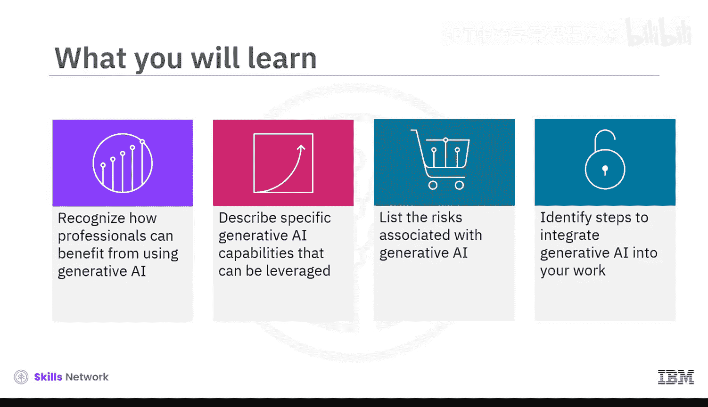

In multiple languages， increasing the creativity and uniqueness of your work with generative AI。

 you now produce higher value output than before。 LLMs can automate many basic tasks。

Giveniv you time for higher value decision making and problem solving tasks with generative AI。

 your working hours now have more commercial value。 Often we may feel stuck in our work。

 maybe even struggle to find experts to validate our research。 However， if you ask the right queries。

 L Lms can act as reviewers， problem solvers and idea or content generators。

 making your work more accurate and aligned with customer expectations。

 Why don't we look at how different professionals such as filmmakers， artists， lawyers， marketers。

 Archects， journalists and financial analysts Use generative AI in their daily tasks。

 Fmakers have an ocean of generative AI tools available to them。 Runway， wondernder dynamics。

 synphasia， deep brain AI and metaphysic among others。

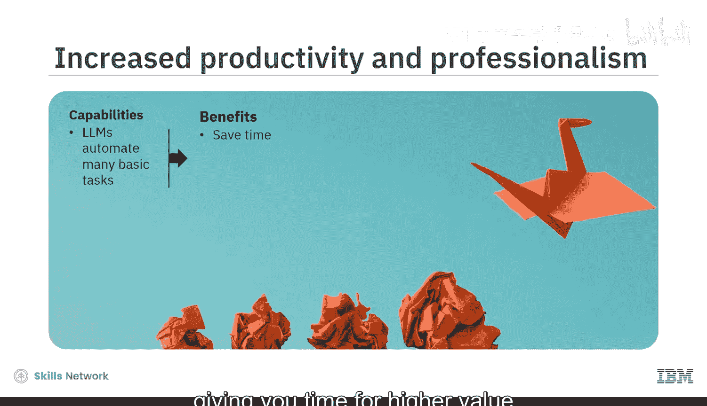

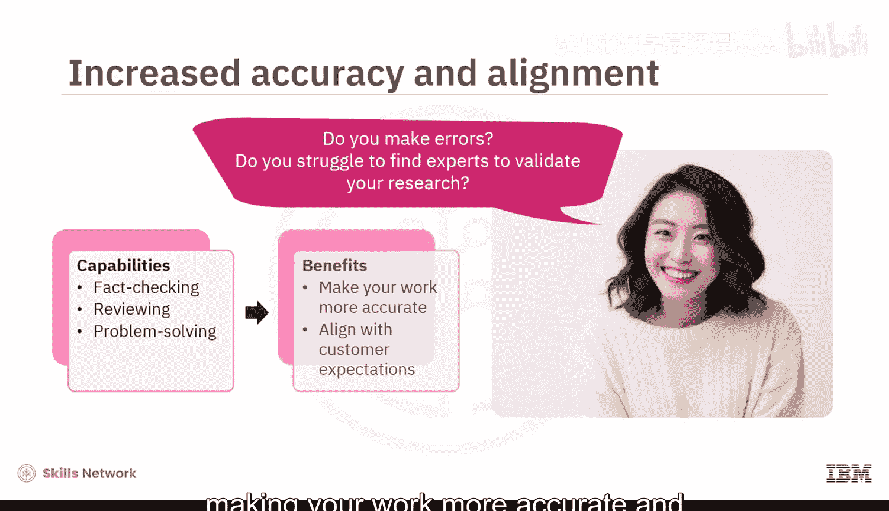

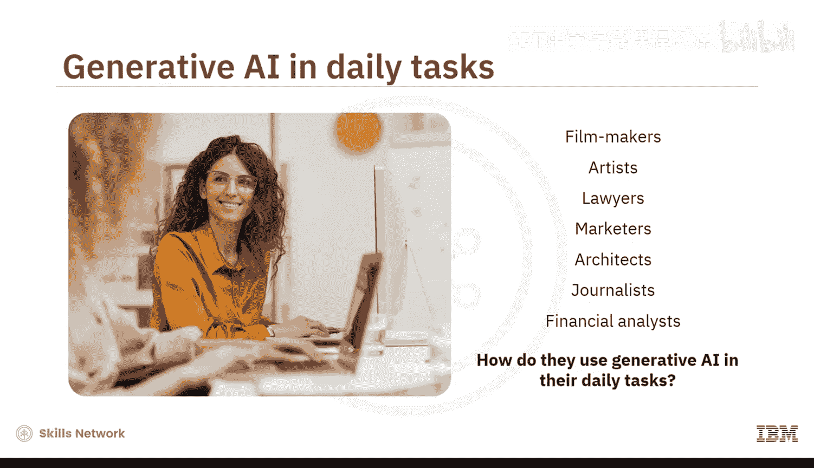

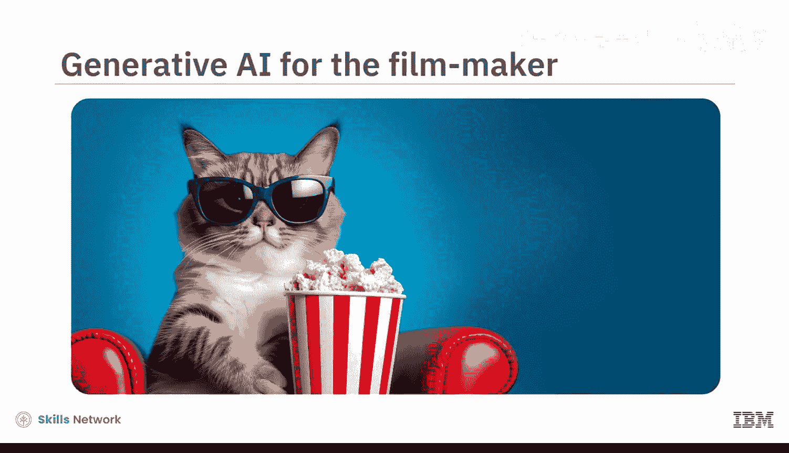

These tools help with screenwriting， content localization， previsualization， sound。

 and visual effects， editing and rottocoping， allowing filmmakers to improve the quality of storytelling。

 streamline production processes and increase visual creativity artistsists can use generative AI tools such as Dolly2 midjoney Canva AI and Jasper among others to experiment with landscapes。

 abstract shapes， colors and textures automate basic processes such as shading。

 colorization and the creation of new colors or textures and add alternate text and text to speech descriptions to increase accessibility。

 This allows artists to focus more on conceptualizing and refining their ideas while simultaneously reducing the time and cost of creating artwork G4 scored 90th percentile in the uniform bar exam clearly signifying that LLms can perform basic paperwork related tasks like interns and junior lawyers at a quick glance。

 lawyers can use tools to click up log geeks， amto and detangle AI among others with generative AI lawyers。

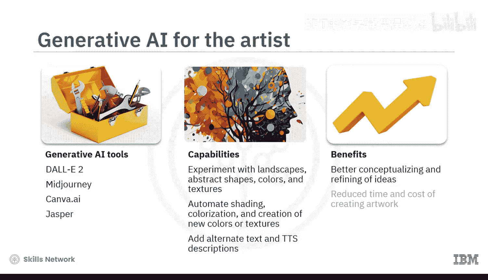

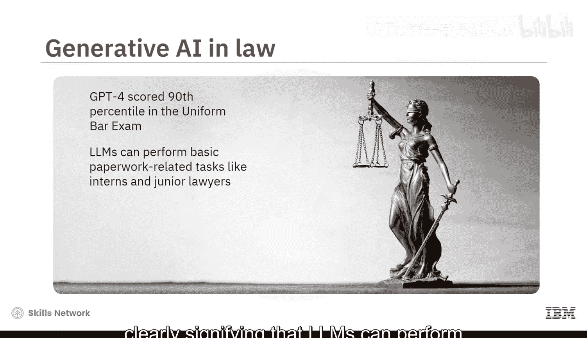

Do and brainstorm to gain perspective on issues。 autocompare contracts with company policy on a semantic level and research templates and samples of legal documents。

 This allows lawyers to draft contracts， notices and clauses more quickly。

 freeing up their time to focus on higher value services such as strategy and negotiation。

 client acquisition and management and value added services to build goodwill and reputation。

 Marketers can use generative AI tools such as chat G Jasper。

 Einstein G by salesforce G 4 powered rapidly and flick to empower their marketing strategies and automate their workflows by doing this。

 they gain deeper insight into customer behavior and create more effective posts。

hts and online campaigns。 What about making buildings better。

 can foundation models help with that generative AI tools such as market AI Finch and Tessa modulus。

 automate entire building design workflows。 They also generate thousands of designs based on specific parameters such as loadbear capacity。

 code compliance or material efficiency。 This allows architect。

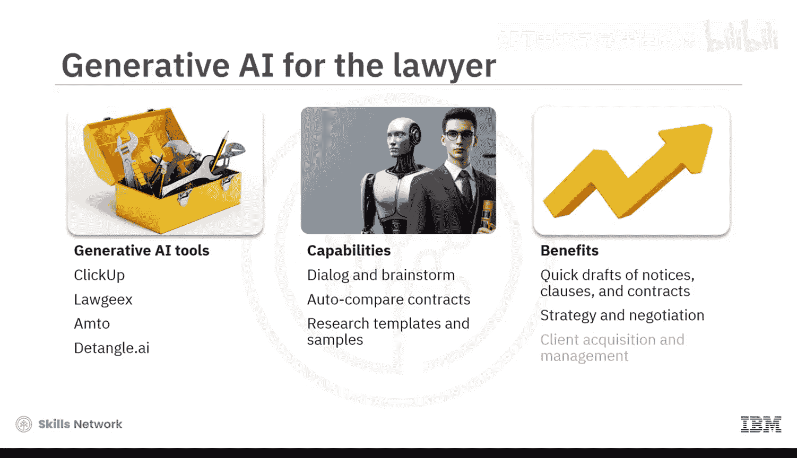

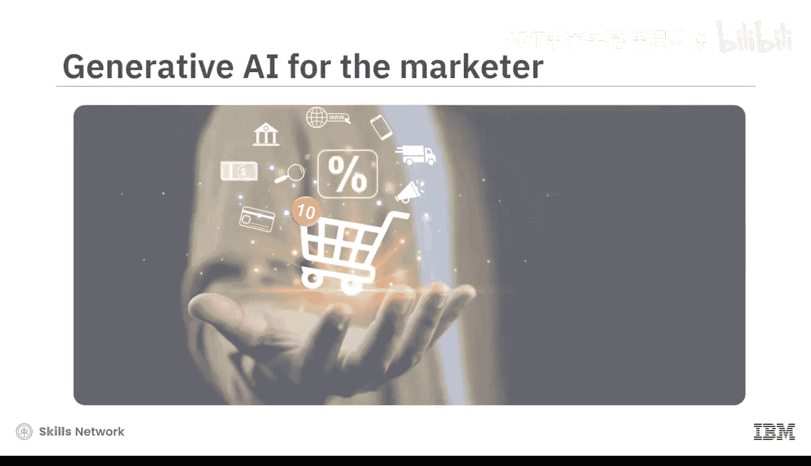

Construction engineers and interior designers to optimize space and create sustainable and efficient structures。

 Media houses and LLms have a symbiotic relationship。

 Many AI firms turn to media archives to train their LLms。 On the other hand。

 journalists use generative AI to improve the accuracy and timeliness of articles and increase user engagement。

 Have you heard of longsshot AI Connect， pinpoint from Google's journalist studio or descript。

 These are generative tools designed for modern journalism， using generative AI journalists。

 scan text for fake news， misleading content or discrimination。

 summarize and identify newsworthy items and write articles with predictable content。

 such as obituary sports updates or weather forecasts。 They also convert texts into videos。

 infographics or illustrations。 Personal news alerts based on reader preferences and transcribe interviews and articles for increased accessibility。

 LLms such as planful predict AI data rails， FP genius and Annanaplan plan IQ are trained specifically。

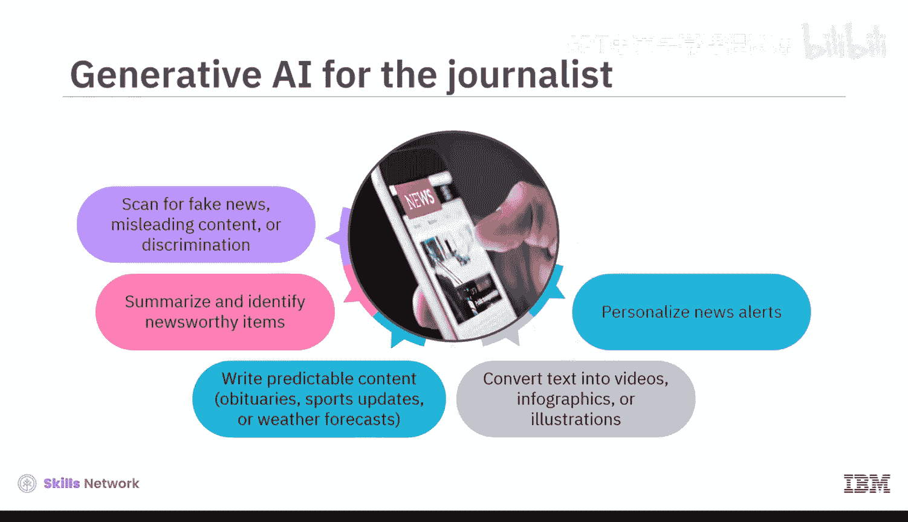

F data， they're effective in data sharing， sentiment analysis。

 news classification and integration tasks， allowing analysts to increase their collaboration and productivity and make better informed decisions by leveraging generative AI。

 Your workday integrates the best of AI productivity and human integrity。 However。

 there are risks that emerge。 For instance， does the AI tool infringe on the copyright of proprietary data。

 Can you copyright machine produce art。 Can you prove that a generative AI application has reproduced your work without your consent。

 LLms are curious and clever， but they produce different responses for the same prompt。

 Exhi algorithmic bias and often hallucinate。Therefore。

 use generative AI to create first drafts only， then rewrite the content in your own words。

 Only utilize the generated elements that make 00% sense to you。 Whatever your choice of profession。

 you can begin using generative AI in your work today with these five steps。

 Read up on key concepts in AI。 get certified through generative AI courses。

 experiment with freely available tools， Start a personal project to gain handson experience and stay up to date with the latest research as generative AI keeps evolving。

 So will you in this video， you explored how generative AI can increase your experimentation and innovation。

 Product and professionalism and accuracy and alignment。 However。

 proceed with caution as LLms can exhibit algorithmic bias， infringe copyright or hallucininate。

 Go step by step to begin using generative AI in your work。

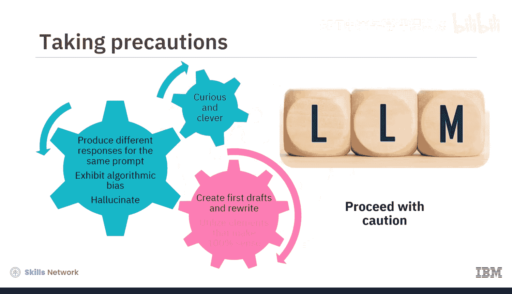

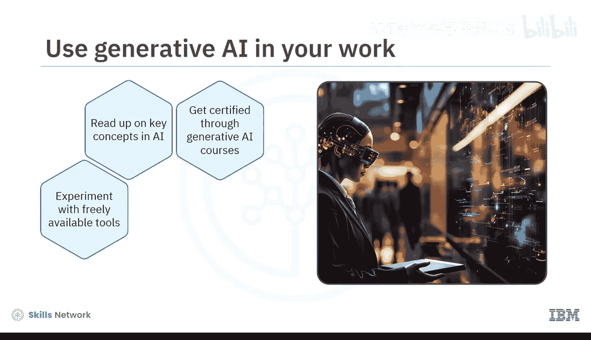

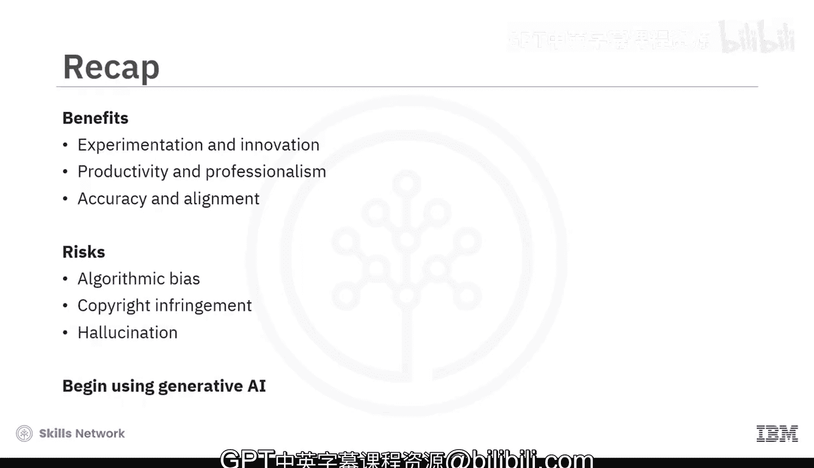