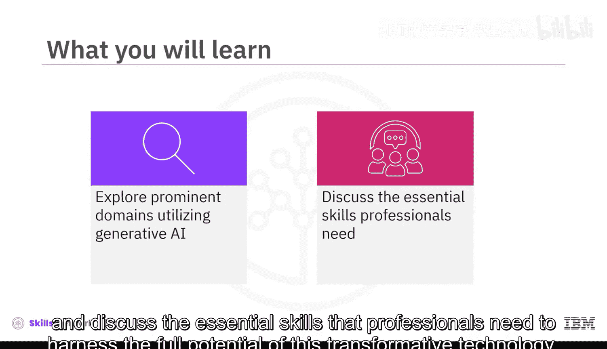
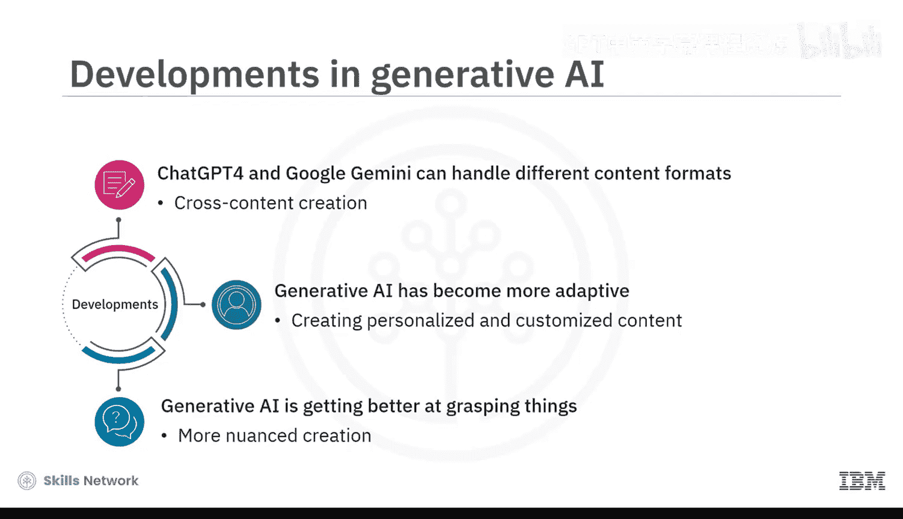
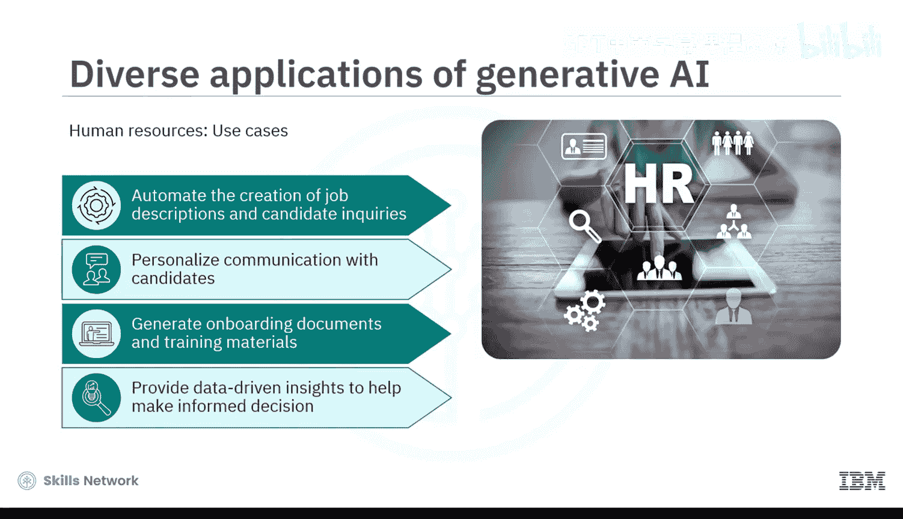
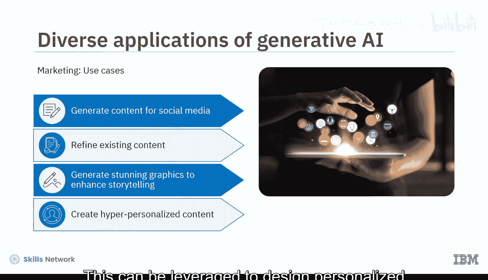
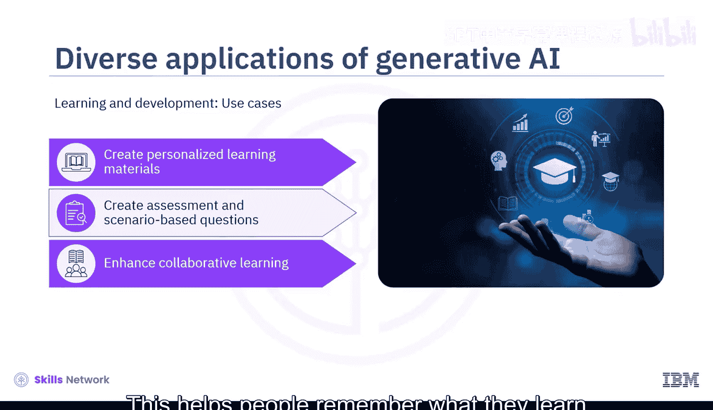
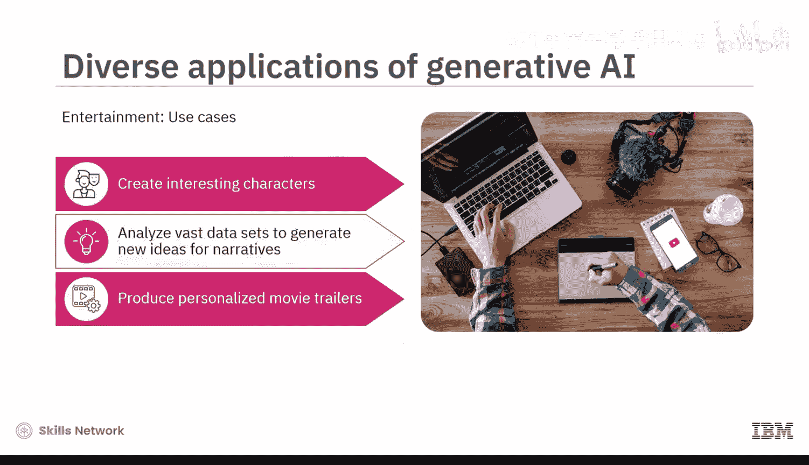
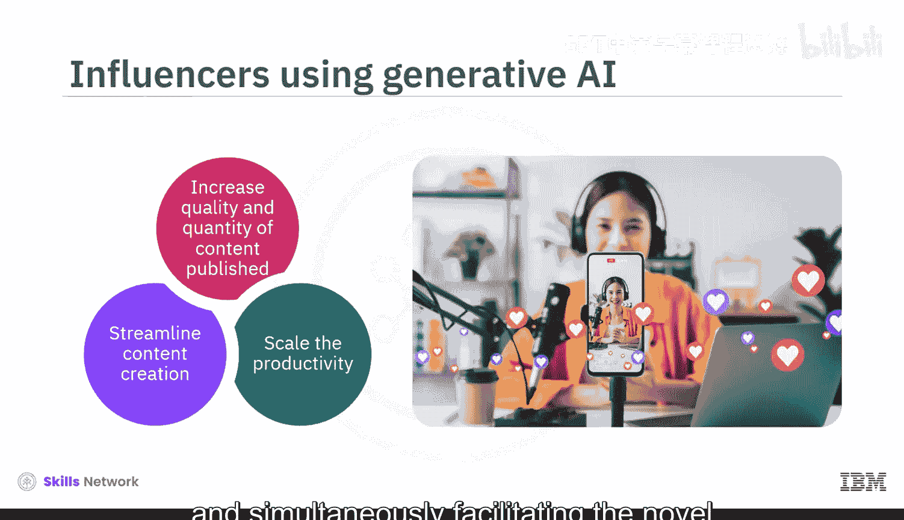
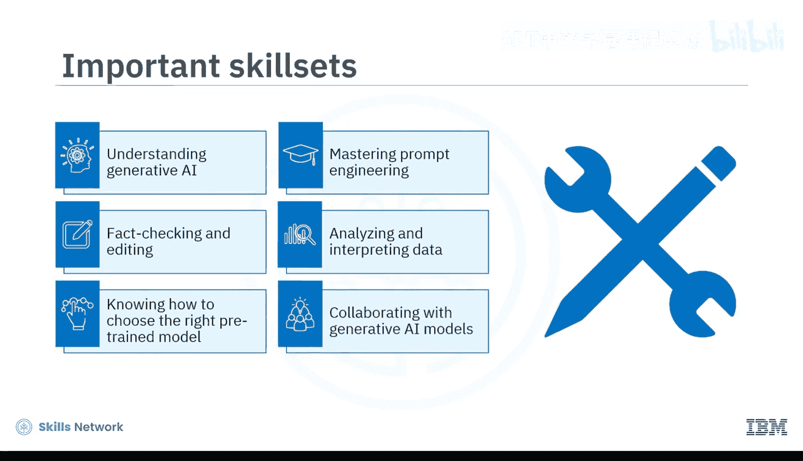
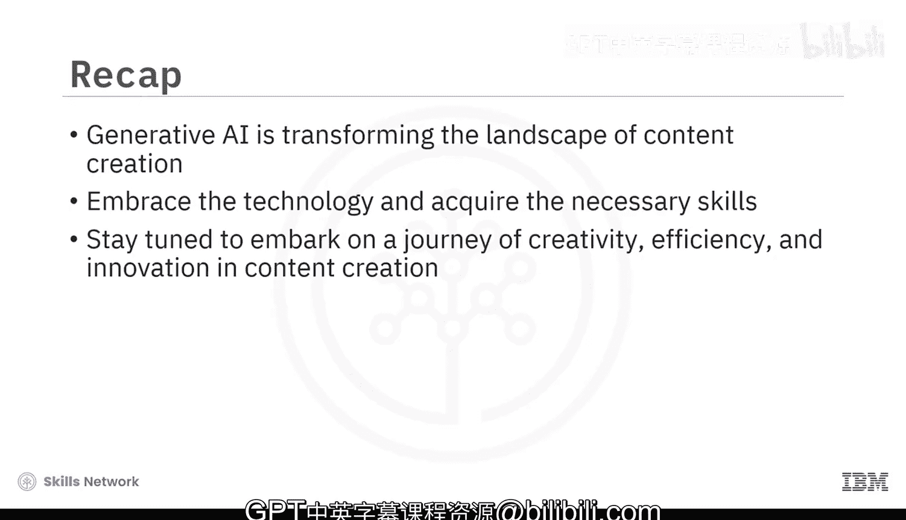

# IBM《生成式AI基础（五课全）｜Generative AI Fundamentals》中英字幕 p75 11_02_03_生成式AI在内容创作领域的应用.zh_en [BV11XSYBfEje_p75]

Welcome to the video generative AI for content creators After watching this video。

 you'll be able to explore a few prominent domains utilizing generative AI for content creation and discuss the essential skills that professionals need to harness the full potential of this transformative technology。

 content creation has evolved and become a crucial element across diverse domains such as human resources。

 marketing， learning and development， media production， entertainment and many others。

 generative AI as transformed content creation by offering numerous benefits。

 such as increasing efficiency， Gene unique and innovative content。

 creating personalized content and providing datadriven insights。

 Here are some statistics from a survey conducted by Hootsuite， a social media management platform。

 highlighting the growing popularity of generative AI among content creators across various domains。

 According to the survey，23% of American authors use generative AI to maintain good grammar or generate plot ideas and characters。

 Additionally，57。1% of marketers use generative AI tools to create long content like blogs。

 White papers。😊。

Meanwhile，55。4% are using it to write shorter content like social media posts and product descriptions。

 Another report from Seo AI stated that 17% of respondents confirmed using generative AI tools and HR departments for recruitment processes。

 Pop of generative AI among content creators is evolving with exciting developments showing up all the time。

 For example， multimodals like chat G4 and Google Gemini handled different formats like images。

 code and audio seamlessly This opens possibilities for cross content creation like generating a script based on a painting or generating a narrative accompanied by relevant images or visual scenes。

 generative AI has become more adaptive， catering to specific styles， tones and target audiences。

 This empowers creators to create personalized and customized content such as personalized articles。

 learning tutorials and product recommendationsInterestingly。

 generative AI is getting better at grasping the why behind things， creating more nuanced creations。

 particularly in educational materials， as content creators。

Consider integrating generative AI into your daily work to stay ahead of the competition。

 Let's explore some of the applications of generative AI and content creation across different domains In the field of human resources。

 generative AI can automate the creation of job descriptions and candidate inquiries。

 It can personalize communication with candidates share targeted messages。

 tailor interview questions and provide relevant information based on their preferences and experiences。

 It can generate onboarding documents and training materials。

 AI powered chatbots offer instant HR related support， answering employee questions about benefits。

 payroll or policies。 generative AI can provide actionable insights from employee data。

 enabling HR professionals to make decisions about talent management。

 Workforce planning and employee engagement strategies。

 Some of the generative AI models and tools helpful in performing the above tasks are open AI's G Googles smart compose and write Sonic in the field of marketing。

 a diverse set of generative AI tools such as Jasper， copy AI or right Sonic are available。

To automate content creation， thus saving time and effort。

 these tools can create social media posts and blogs。

 craft emails for campaigns and produce various other drafts of content that human marketers can refine and personalized generative AI can also refine existing content by providing valuable insights and improvement suggestions with multimodal capabilities of generative AI Marketers can generate stunning visuals。

 including graphics， I， art forms and videos to enhance their storytelling create eyecaching social media posts or create visually engaging presentations。

 generative AI models such as G4 can create hyperperson content by analyzing data sets and tailoring content to individual preferences and behavior。

 This can be leveraged to design personalized campaigns for the companies they are targeting in the field of learning and development。

 generative AI is making learning more personalized。 It does this by analyzing a student's profile。

 finding out what they're interested in in what they already know。 For instance。

 if a student understands things better through audio lessons than reading。

 Then the AI might recommend more audio。

Resources， matching their interests and prior knowledge。

 generative AI can also create assessments and scenario based simulation questions for online platforms。

 These resources can help check how well the learners understand and what skills they possess。

 It can also enhance collaborative learning on online platforms by creating interesting discussion starters。

 engaging case studies and activities for solving problems together。

 This helps people remember what they learn and encourages them to think critically in the fields of entertainment。

 generative AI can be used to create interesting characters for video games。

 animations or virtual worlds。 It can analyze vast data sets from movies。

 scripts and audience preferences， Gene new ideas for narratives。

 resulting in more engaging and targeted content。 IBM Watson has been employed to analyze the content of films and produce movie trailers。

 including most captivating and thrilling scenes。 On the other hand。

 Netflix is using generative AI to develop personalized movie trailers catering to individual preferences。

 generative AI has also immensely impacted the creator or influencer economy by streamlining content creation。

😊。

personalized and automated social media engagement and driving data drivenn collaborations。

 It has raised the bar for the quality and quantity of the content being published on platforms like YouTube。

 Tiktk and Instagram。 generative AI's assistance and content creation is empowering the emerging wave of new content creators in the market。

 and simultaneously facilitating the novel creators to scale their publishing efforts。  moving ahead。

 let's discuss the important skills that professionals should possess to harness the full potential of this technology。

 familiarizing oneself with different generative AI models， their capabilities。

 limitations and best practices is important for using them most Pro engineering is the practice of designing prompts that guide AI models to create the desired content。

 Mastering prompt engineering is key to getting the best response from AI tools。

 En accuracy and AI generated content often requires careful editing and fact checking。

 Undering how to analyze data generated by your AI tools can help you refine your prompts。

 track the performance of your content and identify areas for improvement， knowing how to。

Cose the right pretrained models and finetune the output produced is also valuable。

 Collaborating creatively with generative AI models is a good approach。

 content creators should integrate AI suggestions into their work and refine them to align with their creative vision In this video you learned that generative AI is transforming the landscape of content creation across various domains such as human resources marketing。

 learning and design， entertainment and many others the model has also impacted the creator or influence their economy by streamlining content creation as content creators embrace this technology。

 acquiring the necessary skills and leveraging the right tools will be key to unlocking its full potential by understanding the diverse applications of generative AI professionalsf can embark on a journey of creativity efficiency and innovation in content creation get ready to unleash your creativity with generative AI。

