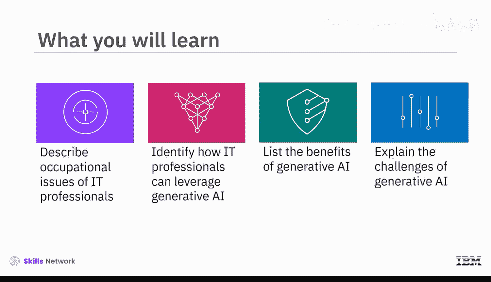
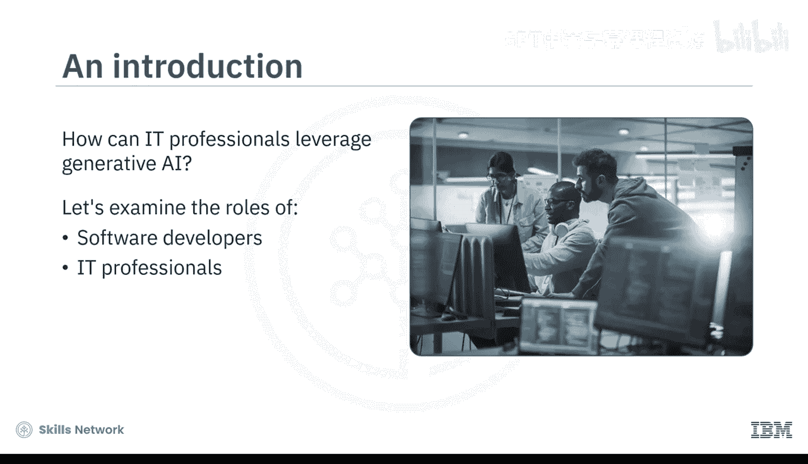
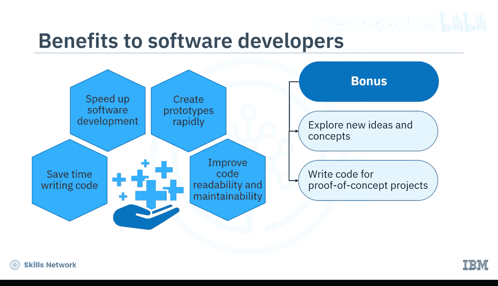
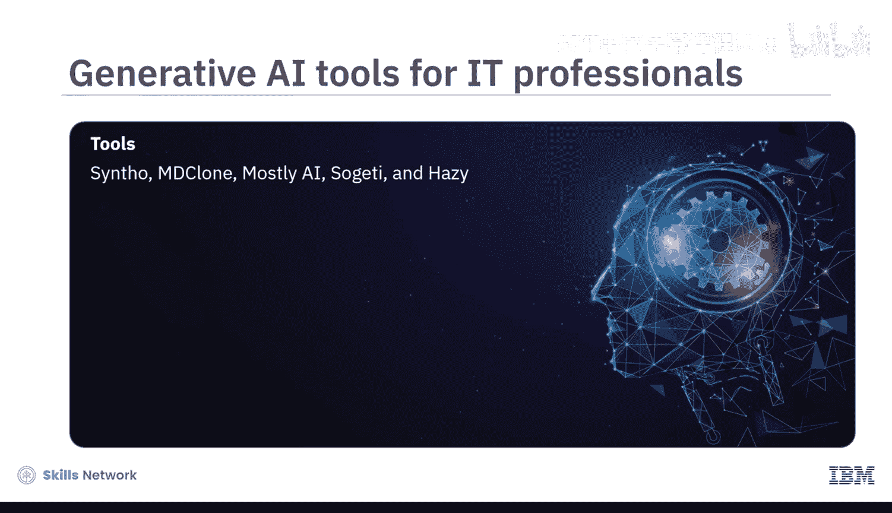
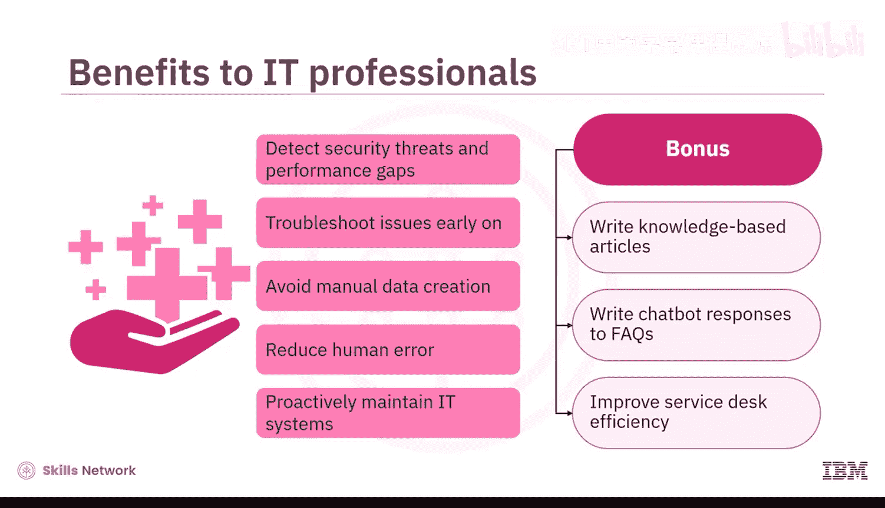
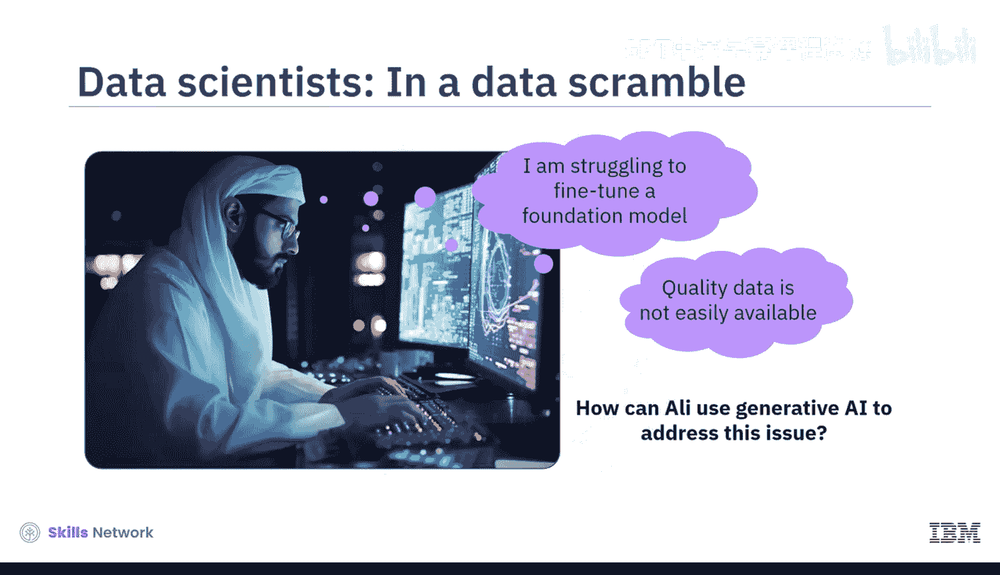
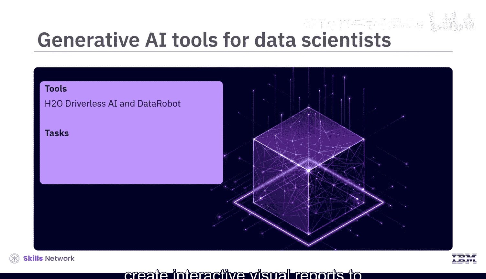
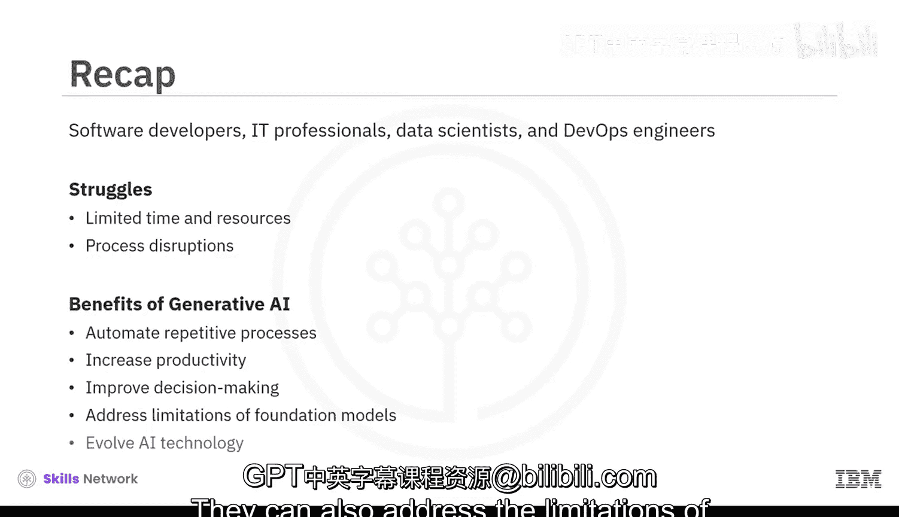

# IBM《生成式AI基础（五课全）｜Generative AI Fundamentals》中英字幕 p76 12_02_04_生成式AI在IT专业领域的应用.zh_en [BV11XSYBfEje_p76]

Welcome to the generative AI for IT Professionals video After watching this video。

 you'll be able to describe occupational issues of IT professionals。

 identify how IT professionals can leverage generative AI。

 list the benefits of using generative AI and explain the challenges of using generative AI。

How can professionals in the field of information technology leverage generative AI。

 Let's answer this by examining the role of four professionals， software developers。

 I T professionals， data scientists and devops engineers Meet Shanti， a software developer。

 She's in a bind。 The code she wrote is missing some segments。

 She needs to write them manually through the night， which might lead to errors。

 How can Shanti use generative AI to modify the code more efficiently。

Generative AI tools such as open AI codex， Microsoft Copilot， GitHub Copit。

 tabab 9 and kite generate boilerplate code suggest code completions for repetitive code segments or generate code snippets from natural language prompts。

 Shawnte can use them to analyze code changes， F simple bugs and identify potential bugs during the code review process。

Visual Studio Livesha creates pair programming sessions in which the tool acts as a coding partner to help catch errors in real time。

 Diff blue cover generates test cases for more extensive and efficient testing and checks documents。

 unit tests and test data for bookss。 Sphinx generates documentation for code and systems based on natural language descriptions。

By using generative AI software developers， save time writing code， speed up software development。

 create prototypes rapidly and improve code readability and maintainability。

 No longer tasked the fixing repetitive code defects。 Shate is able to explore new ideas。

 She uses generative AI to write code for proof of concept projects and experiment with problem solving approaches。

 Acros the coast sits Joel， an I T professional。 His team as short staffed and struggling to perform scheduled system administration tasks。

He wants to know if generative AI can help them address this issue generative AI tools such as Runde。

 Ansible andterraform automate code for system administration， configuration management。

 user provisioning， security patching and other routine tasks。ElasticSe， loggash。

 and Kiana identify patterns， anomalies， and potential issues in system logs。Synth MD cloneone。

 mostly AI， Soheti and Hazy generates synthetic testing data to pretrain systems by using generative AI IT professionals detect security threats and performance gaps。

 troubleshoot issues early on， avoid manual data creation。

 reducing human error and proactively maintain IT systems。

 Joel also uses generative AI to write knowledge based articles and chatbot responses to frequently ask questions improving service desk efficiency。

Located down south Ali is a data scientist with an AI firm。

 he's struggling to fine tune a foundation model because quality data is not easily available。

 How can he use generative AI to address this issue？

Generative AI tools such as Google AI Plat， vertex， AI， Amazon。

 SageMaker and Microsoft Azure Ma learning overcome data scarcity by training and testing AI models on synthetic data sets。

 they also generate code for data cleaning and preprocessing tasks and even suggest and generate features based on the data。

H2O， driverless AI and data robot create interactive visual reports to communicate complex data insights。

By using generative AI data scientists improve the efficiency of the fine tuning process and the quality of pretraining data。

 this helps them make informed decisions and save time。

 Ali even uses generative AI to brainstorm new features and capture insights from existing data。

As a Devopps engineer， Lila oversees the continuous integration and continuous deployment。

 or CICD pipeline， This pipeline integrates six phases to deliver a new application。

 Her team is facing operational snags in the monitoring phase of the pipeline and wants to use generative AI to close this gap。

Generative AI tools such as Jenkins， Gitlab， CICD and Ccle CI automate phases of CICD pipeline。

 for instance they generate test cases to deploy applications automatically。

 they issue alerts and offer insights to improve monitoring and troubleshooting。

 they also suggest code to optimize infrastructure for cloud based environments。

Terrraform automates the generation of IAC scripts。By using generative AI。

 DevOs engineers facilitate infrastructure management， automate testing and deployment。

 and accelerate the software release cycle。This helps them guarantee the reliability and security of automated processes。

However， generative AI models come with their own sets of risks， high cost graphics。

 processing units， algorithmic bias， possible misuse， lack of transparency。

 pooror data security measures， copyright infringement issues and unregulated applications by actively experimenting with generative AI I professionals can address any known and unknown limitations to help improve the capabilities of foundational models。

 This will further help increase their productivity and creativity。

In this video you discovered how software developers， IT professionals， data scientists。

 and DevOs engineers struggle with limited time， limited resources and process disruptions。

 by using generative AI tools， they can automate repetitive processes resulting in increased productivity and improve decision making。

 they can also address the limitations of foundation models to help evolve AI technology。

