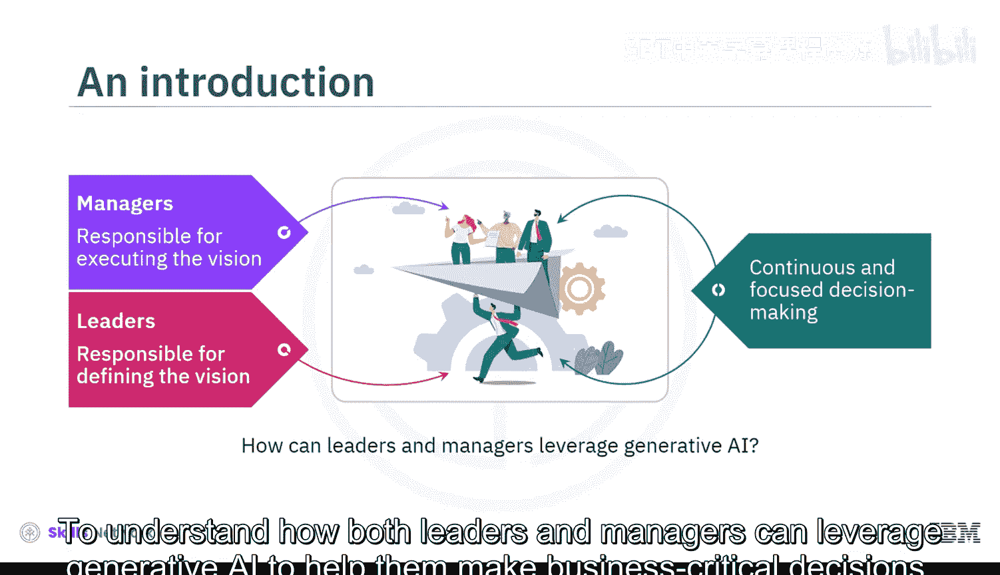
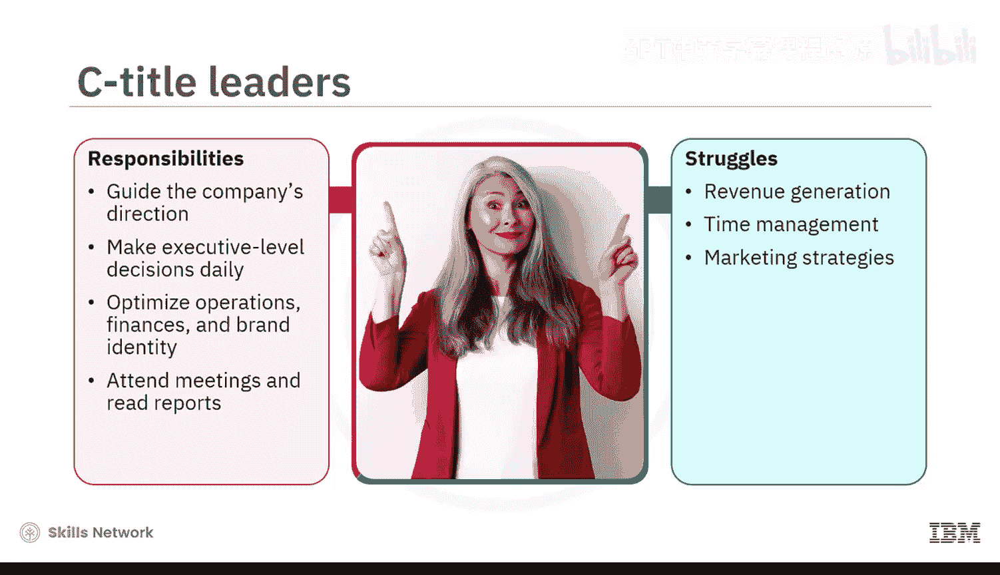
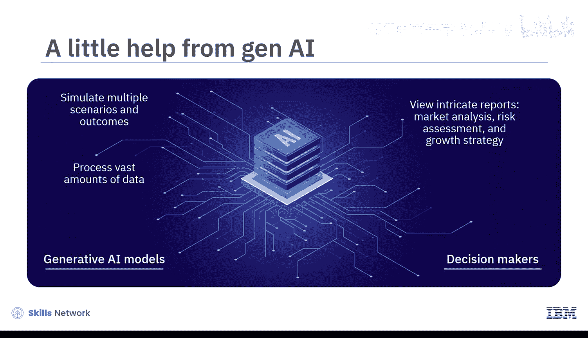
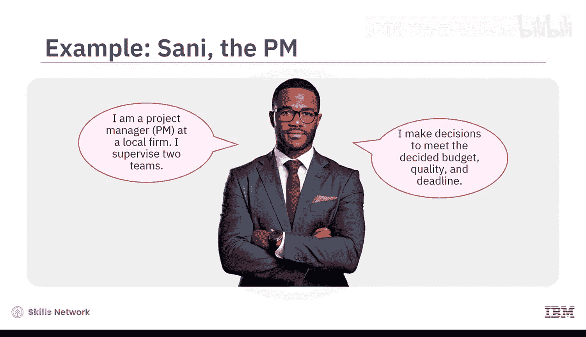
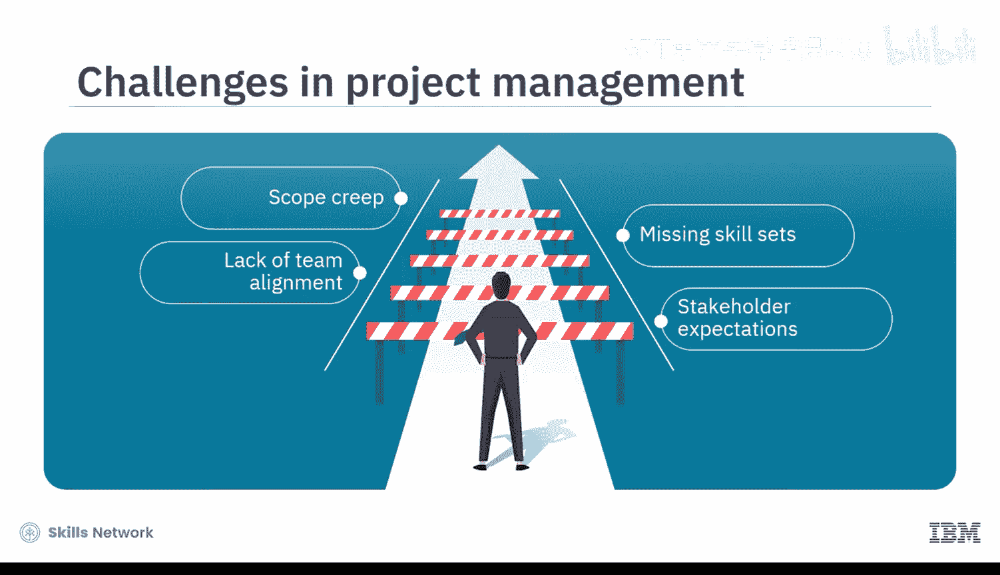
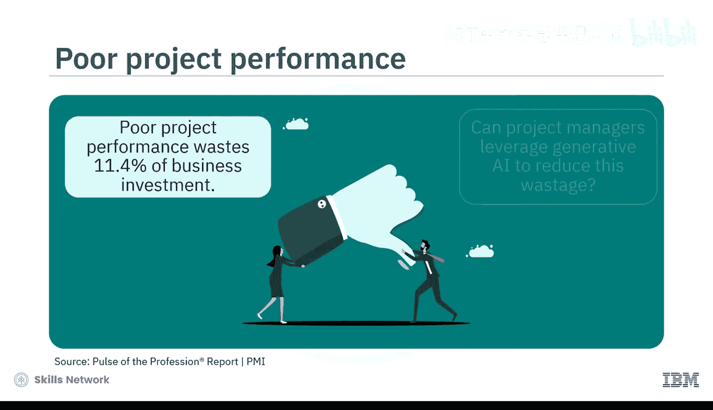

# IBM《生成式AI基础（五课全）｜Generative AI Fundamentals》中英字幕 p77 13_02_05_生成式AI在领导力与管理领域的应用.zh_en [BV11XSYBfEje_p77]

Welcome to the generative AI for Leaders and Manager video After watching this video。

 you'll be able to describe the core tasks performed by leaders and managers。

 Ex the challenges they face while performing these tasks。

 list the generative AI capabilities they can leverage and identify the benefits of using generative AI Lead are responsible for defining an organization's vision while managers are responsible for executing that vision。

Both these roles call for continuous and focused decision making to understand how both leaders and managers can leverage generative AI to help them make business critical decisions。

 Let's start by exploring the leadership role。

Lia is at an industry conference， and everyone is only talking about chat G in the rise of AI。

 As the CEO of a 50 person firm， Lannyia wants to use generative AI to increase her brand presence and sales。

 However， she's hesitant about how much AI she can take on。

 The expense and risk of training foundation models makes her nervous。 Lania is not the only one。

 According to Erstten Young，70% of CEOs see the need to act quickly on generative AI to gain a strategic advantage。

 However，68% report being uncertain about the technology and find it challenging to act quickly。

 C title leaders have one key responsibility， to guide the company in the right direction。

 This includes making executive level decisions daily to optimize the organization's operations。

 finances and brand identity。 Despite spending many hours attending meetings and reading reports。

 Lead struggle with revenue generation time management。

 marketing strategies and leadership obligations。 How can generative AI help leaders address these struggles。

 generative AI models process vast amounts of data and simulate multiple scenarios。

outcomesThis allows decision makers to view intricate reports on market analysis。

 risk assessment and growth strategy and visualize the impact of their decisions in advance using generative AI tools。

 leaders can take a new approach to problem solving and decision making that contributes to people and profits when the organizational vision is focused。

 managers can focus on delivering results。

Meet Sanny。 He's a project manager at a local firm and supervises two teams。

 This includes making decisions daily to ensure the projects meet the decided budget。

 quality and deadlines。 Unfortunately， Sandy's day is never easy。

 Project management comes with its own challenges， Con scope creep， missing skill sets。

 lack of team alignment， stakeholder expectations and communication versus miscommunication。

 According to the project management Institute，11。4% of business investment is wasted due to poor project performance。

 Can managers leverage generative AI to reduce this wastage。

 generative AI tools automate repetitive tasks such as planning， scheduling communication。

 resource allocation and tracking and reporting。 For instance。

 they create documentation and visualized data reports。

 All project tasks with team member skills and provide real time feedback。

 alerts and recommendations。 With this input， project managers are able to make data driven decisions。

 I bottlenecks and mitigate risk。

Invest in ideation and innovation involve stakeholders in early problem solving and monitor control project progress。

At the end of the day， there's no rush to invest in too much AI too soon。 However。

 for successful AI adoption， there is a need to understand how you can work with generative AI and responsibly integrate it into your workplace and workflows。

 four steps that you can consider。 Always collaborate Lead should get buy in for managers， employees。

 stakeholders and advises， there's no need to make this decision in isolation。 Prioritize。

 which is the business problem you want to solve first。

 Ver data that is generated from the AI model for accuracy and alignment with company values。

Decide what data to use and when generative AI models will analyze， collate and visualize data。

 but leaders and managers must apply their experience。

 social intelligence and ingenuity in how data is used In this video。

 you learned that generative AI helps leaders simulate multiple scenarios。

So that they can visualize outcomes in advance and approach problems differently。

 It also helps managers control project progress through task automation。 They can plan， schedule。

 communicate， allocate resources and track and report more efficiently。

 Business teams should collaborate， prioritize， verify and decide their approach for successful AI adoption。

 using their experience， Social intelligence and ingenuity。

