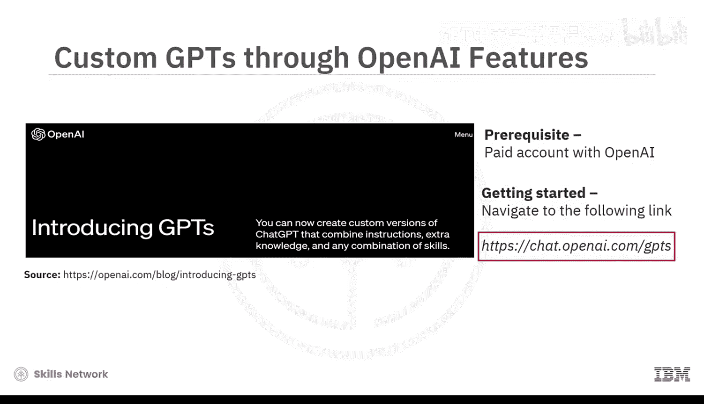
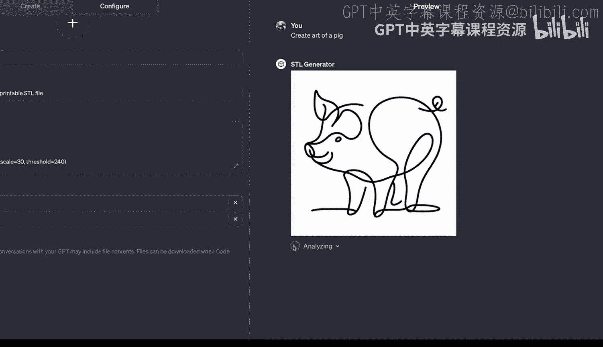
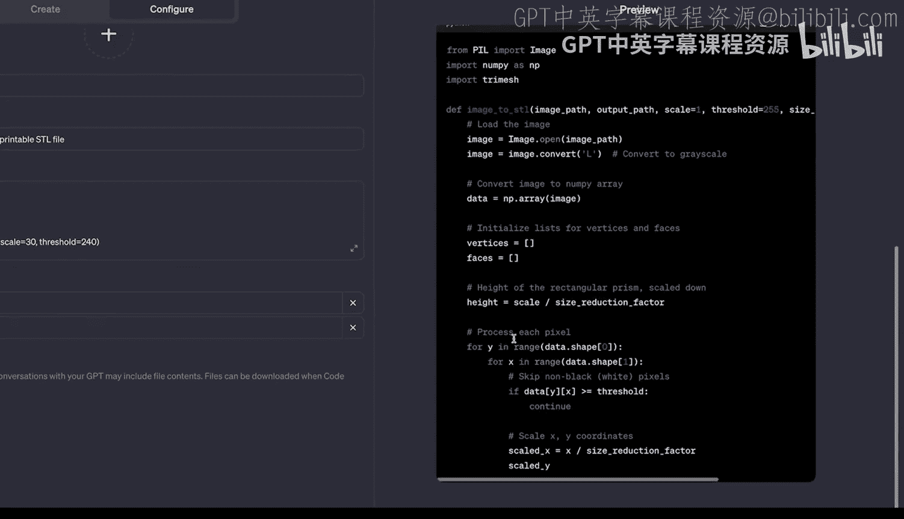
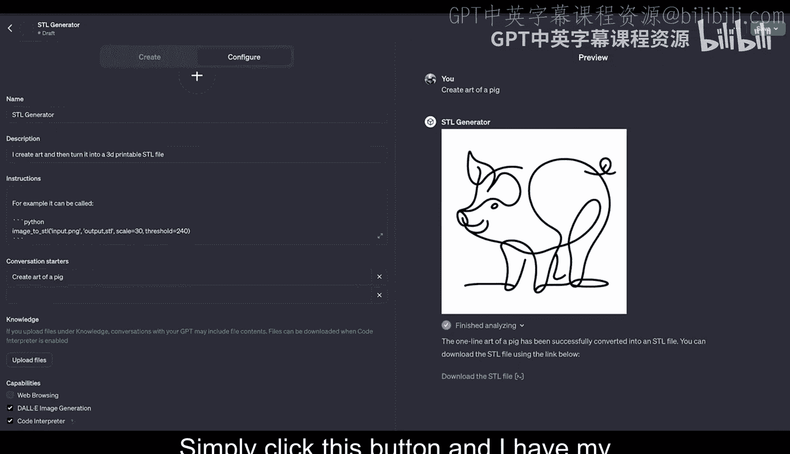

# IBM《生成式AI基础（五课全）｜Generative AI Fundamentals》中英字幕 p78 14_02_07_演示：创建自定义GPT.zh_en [BV11XSYBfEje_p78]

Hello， my name is Bradley Steinfeld and I work for IBM in this video I'm going to give you two quick demos of how to create custom GPTs Now as of January 2024。

 you will need a paid account with openAI to use the custom GPT features。To get started。

 simply go to chat。openai。com/gptS。

When you get to this page， you'll see the GPT store， which lists a whole bunch of GPTs。

 custom ones that people have created and shared that you can simply get up and use。

 but in order to create your own in the upper right， simply click the Cate button。

And now I've landed on the GPT editor page， you'll notice at the top left there are two buttons configurefi and createre if I click create I'm sent to the GPT builder chatbot。

 which is the easiest way to create a custom GPT。And first it simply asks what would you like to make。

 so to start， I'm going to create an interview assistant。

And it's going to be to help me conduct interviews on a very specific job posting。

 so I'm going to say I would like an interview assistant to help me conduct job interviews for the attached job posting。

And I'm going to take a PDF file of a job posting and simply attach it。And when it's uploaded。

 I can simply send the message now the GPT builder is going to analyze what I've sent to start customizing and updating the custom GPT that I'm building。

So you can see here it says great， I've set up the GPT as an interview assistant for a software developer intern role。

😊，It will be providing questions blah， blah， blah so pretty much it already knows the job posting information and then it says how about we name this GPT interview assistant would that work for you and it's also in the process of generating a profile picture and it's going to say is that profile picture good I'm going to say yes both the name and profile。

Picture are dead。I can continue chatting with this chatbot to continue to customize and configure my GPT。

 but let's just say this is enough for now。Right away on the right side。

 I can start already using and testing out the G so I can say generate five。

Interview questions for this role。And as soon as I do that。

 it will say based on the job role you're applying for here are various interview questions Now the great thing about this is I'm also able to upload a PDF of a resume and to get even more specific questions and this is very useful because creating this GPT is very trivial and easy to do you can see it generated all these instructions and information in here which I can continue to tweak and configure but the value of this demo is that within just a couple minutes I have a GPT that not only I can use to help me conduct interviews that's very specific to the job posting but I can also share it and if you see in the upper right corner there's a save button and I can keep it from myself or share it to anyone with the link or share it widely in the GPT store now in this case I probably want to share it to other colleagues and other people who are conducting interviews and to give them this helper。

Now dig deeper into all these different settings in the configure menu。

 let's do this with a new demo。I'm going to go back。

And create a new custom GPT This time I'm going to start in the configure menu from here I have the ability to customize each and every aspect of our custom GPT。

So for this demo， I'm going to create a custom GPT that first generates a special type of art called one line art。

 and then from that art， it's going to generate an STL file。

 which is a 3D printable file that I can actually print on a 3D printer。So first to name it。

 I'll just name it STL。Okay。Generator。Description will be I。Create art。

And then turn it into a 3D printable STL file。For its instructions。

I'm going to paste in some custom instructions that I've created now this are just some truck soon。

 I'll go over some key parts。Your primary focus is creating art based on user descriptions。

 using the unique and minimalist technique of one line drawing your artwork must be black and white and must not have a background。

I give it more rules on how to create this one line art， and then I say after you create the art。

 you can then convert it to an STL file to convert it to an STL file。

 please use the following code and I give some Python code。

Which is going to convert that art to an STL file now you don't need to use code。

 but it does give you a lot more confidence that it's going to work。

So Ive pasted that into the instructions for conversation starters。

 these are just helpers when other people use your custom GP so you can say。Create art of a pig。

And you'll see it adds a little button that someone can simply click that to paste it in as their first message。

Next， we have the knowledge base， so we use this in the previous example with the job posting PDF。

 I am not going to use this right now。And next we have capabilities。

 web browsing to allow your custom G to browse the web to get information。

 Dolly image generation to allow your custom GPT to generate an image and code interpreter。

 which allows the custom GPT to actually run Python code。

The two that are important to us are going to be Dolly image generation to generate the one line art and then code interpreter to actually run the code to convert that image to an STL file。

 Last but not least we have actions and actions are probably the most powerful thing you can do in a custom G。

 but also the most complex。 They allow you to connect your custom G to external services on the web to actually do real things beyond just chatting。

 Now this is more an advanced topic， so I'm not going to cover it right now。 With that。

 we already have our STL generator and G。 I can test it out simply by clicking create art of a pig。

And you'll see if I click our little conversation starter， it simply just paste it as my first line。

 and now the STL generator is going to start by generating our one line art。Beautiful。

 it's generated a black and white picture that follows the right one line art style。

 and you can see below it it says analyzing。

If you click it， you can see the actual code that's running。

 which should be equivalent to the code that I sent in。

And it's going to take this picture and convert it to a 3D Pri file。And after it's completed。

 you'll see it says the one line art of a P has been successfully converted into an STL file。

 you can download the SDL file using the link below。

Simply click this button and I have my STL file of a P one linear drawing Okay。

 the 3D print is done and the P came up beautifully it was a complete success Now just a few things to finish up first of all I want to be clear you do not need to create code yourself in order to create a custom GP。

The G will fill it in for you if you don't enter any code and will do its best。 Now that said。

 the more you put into a G， your custom G， the more you'll get out of it。

 So if you want to get popular on the G store or if you want to create something that really is amazing。

 you probably need to invest a little bit more time than a few minutes。

 That said one quite amazing thing of these Gs is how quick and easy they are to create just think about it in just a few minutes with zero code you can create an application on the web and share it with people you couldn't do this before。

 especially with zero code so fast。 So think about what use cases makes sense。

 There's a lot out there。 and the future is very bright， thanks。😊。

