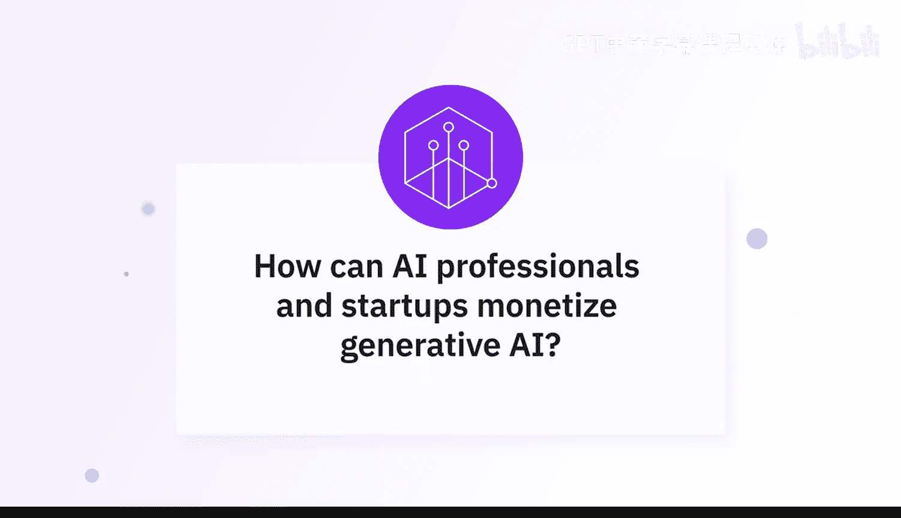
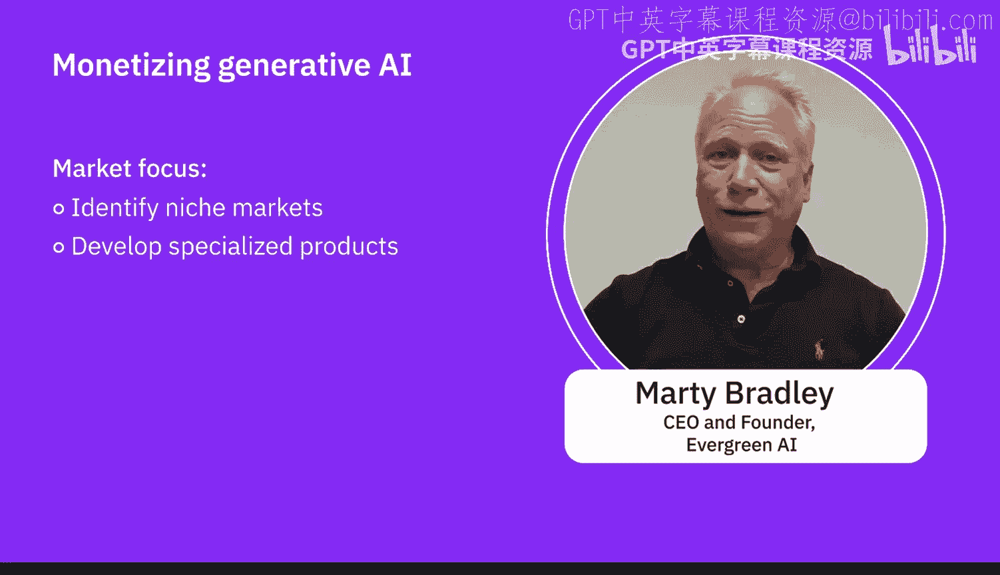

# IBM《生成式AI基础（五课全）｜Generative AI Fundamentals》中英字幕 p79 15_02_08_专家观点：通过生成式AI实现创新变现.zh_en [BV11XSYBfEje_p79]

Hello and welcome to this experter Viewpoints video。😊。

Let's hear from experts on how to monetize generative AI。

Generating profit in terms of you know using your workforce better and using the predictive analysis and analytics that the models provide you by reducing the number of human hours that you spend on it。

Is kind of one of the biggest applications that Gene AI really helps。So analyzing patterns。

 analyzing existing data is what generated AI is really good at， it is good at generating patterns。

Secondly， you know， you can save some time in terms of。

gatheringathering information and gathering data because geneative AI is good enough if you have a decent enough size of sample set。

 it can generate synthetic data which is going to be of similar nature。

 so data augmentation and synthetic data creation in itself is a great power that the industries today get in terms of generative AI usage。

So some of the ways that can help AI professionals and startups to make some profit and income from generative AI is by providing AI services and consultation help develop and monetize content generation tools that can help create some text images。

 and design automation platforms to help end users with some creative content creation。

 so creative services and products is also under this category because generative AI helps us to do some creative let's say。

 architectureural design or artwork or creating a music compositions or images so that they can actually put it out there and it can help them maybe create some income or revenue from this content。

So nowadays， it's very easy for anyone to use generative AI chat GptT， midjoourney。

 so on and so forth。 So if you're creating a startup or an AI business。

 I think that one of the most important things is differentiation。

 make something that's not trivial or easy for me to do with one of those tools that's already available that might mean doing multiple modals。

 you know mixing text image video to create something unique， something different。

 something that would take me hours to do if I had to do it myself。

The technology is changing so fast。 So if you stay up on the technology。

 there are a lot of opportunities for training。 A lot of organizations are looking for。

 How do they upskill their employees， So any kind of consulting training。

 if you know how to build models。 if you know how to write code， there are a lot of， I think。

 a missed market is you don't need to build a just an AI product where you need to do is solve a problem for an industry。

 So if you have a job or you used to work somewhere。 And there was a pain point that everybody had。

 find a way to solve that problem， It's a lot， it'll be a lot easier to solve with AI and especially with Gen AI。

Of course， profits can be earned in terms of analysis of the market scenario， the。You know。

 creating better dedicated advertisements， creating different。

Human based upon the human bases or based upon the market surveys。

 you can create dedicated strategies for best。Marketing and use of your the product or services that you're providing so yeah startups really have a great tool and gene AI aspects to try to personalize the strategy that they want to target in terms of using the techniques and using them to create problems。

The other thing is to provide the training and workshops to to the community by providing the material。

 providing some certification program， AI powered product enhancement。

 so by leveraging this generative AI into end users or customers already existing product or platform to enhance and their offering or infrastructure can be also another alternative that。

They can consider the data augmentation platform also is another possible way to offer subscription based or paper use pricing model to access the generated synthetic data。

YeahThe other is that the obvious is create AI products sometimes just little tools that you build that you don't really think about that you could turn them into to doing an AI product So the nice thing about that is is that you build individual AI products and then you look at an overall product that basically orchestras and a large language models are great for doing that also there are things like Langgra。

 which will help you build and identify the nodes of the graph and then the graph and the LLM basically will decide when and how to execute each of these tools So there's a lot of benefit to that a lot of things in your organization that you could probably bring together So again find a need that you like something that's interesting to you and write a product in that niche and then sell it。

。