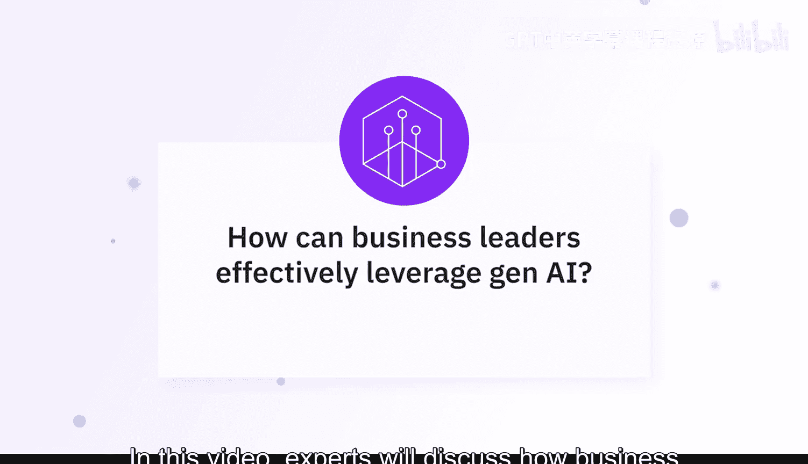
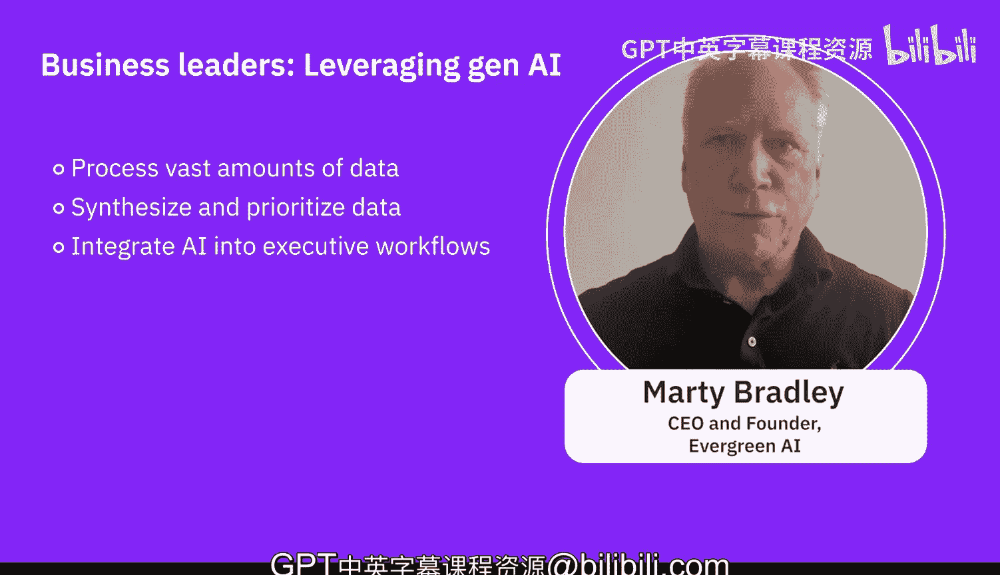
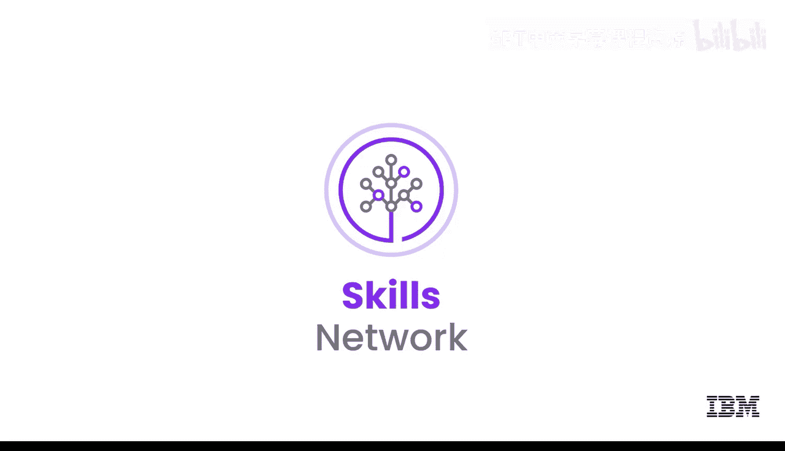

# IBM《生成式AI基础（五课全）｜Generative AI Fundamentals》中英字幕 p80 16_02_09_专家观点：运用生成式AI提升商业领导力.zh_en [BV11XSYBfEje_p80]

Hello and welcome to this expert viewpoints video。 In this video。

 experts will discuss how business leaders can effectively leverage Gen AI。😊。

Let's say that a manager can you know maybe use Generative AI to create feedbacks for their employees based on certain different pointers that they might have managers。

 business managers can also strategize how to best utilize a particular person's resource in terms of what kind of skill sets that they have and of work that it will be best for them to do。

So， you know， in terms of creating better strategies and based upon whatever information that the model is trained or。

 there is a possibility of creating better workflow and a more stable workflow in terms of getting。

Better outputs there and faster than you know human brainstorming would be able to do and then utilizing your workforce in a more efficient manner。

Some of the ways that business leaders can leverage these generative AI into their day to day and how it can help them to accelerate and automate some of their tasks is by content generation for marketing for example。

 they can automate this process and it can help them create more creative content for let's say for marketing material for social media posts for email newsletters or for email marketing campaign it can help them optimize messages and create more content for engaging with the end user and customers it can also help them by product design and innovation。

 so they can explore new ideas it trade on and design rapidly and optimize product features based on AI generated insights。

😊，Generative AI can do a lot of things for executives。

 It can inform strategic decision making if you take a stepwise process。

 if you think about how you go through your strategic planning。

 you can break those steps down Now what you can do with generative AI is your executives in their lives of business can access experts that they never had access to before。

 so they can go through and access all the top minds in finance， all the top minds and marketing。

 all the top minds in sales and generate responses and information and get ideas that they can take to your strategic planning meet。

 And then now you can then take that information and build it in and work through strategic planning and pairing with the AI to give you quicker。

 faster ideas。It can also help analyze customer data and derive actionable insights for personalized recommendation and marketing and that can help the customer service。

It can also provide decision support to business leaders by generating forecast prediction and scenario analysis based on the historical data and market trends so that the leaders can actually make more informed decisions。

 mitigating risk and identifying opportunities for growth。

 it can also help the leaders by in process optimization and automation such as supply chain management。

 inventory forecasting and resource allocation， so the leaders in risk management and compliance efforts they can leverage generative AI to detect the anomalies to identify potential risk or compliance issue and it will help them to proactively address challenges and ensure the regulatory compliance。

Keep in mind that AI won't necessarily replace you， but it can process vast amounts of data。

 probably more data than you can put in your head， so having AI do that and synthesize that data down and prioritize it for you is phenomenal。

 I don't think there's anything better that you can do for your organization as an executive then to integrate AI into your workflow。

 So look for AI for work for executives。

