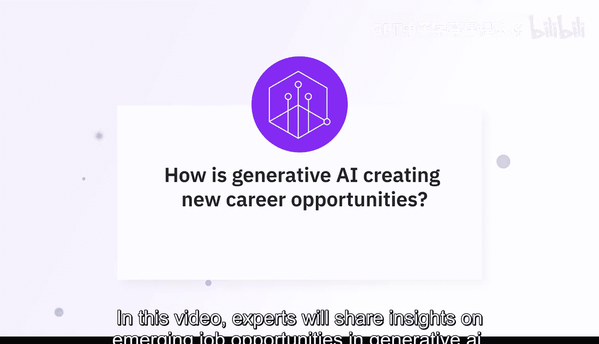
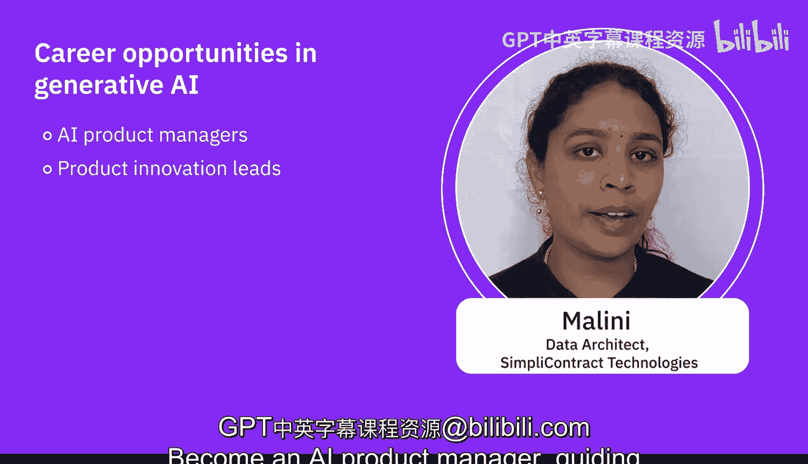

# IBM《生成式AI基础（五课全）｜Generative AI Fundamentals》中英字幕 p81 17_02_10_专家观点：借助生成式AI拓展职业视野.zh_en [BV11XSYBfEje_p81]

Hello and welcome to this expert Viewpoints video In this video。

 experts will share insights on emerging job opportunities in generative AI。😊。

As for a survey， Ch engineering in itself is one of the most lucrative job opportunities that is there people which have skills in Ched engineering and are skilled in using geneative AI to create your outputs very scarce and very in demand other than that in terms of data analytics and data science or any kind of such data related applications geneative AI is of great importance and has been it is a good baseline for any starting person to develop whatever background information that they require。

 they can use geneative AI models to gather that information to develop specific outputs that they require in terms of their use。

As a generative AI continues to grow and advance， there will be some role and responsibility for skill professionals also in demand。

 for example， we will need a more AI research scientist that can work on advancing the toical foundation and practical application of this technology。

We also need machine learning engineers to help design。

 implement and deploy these models for real world applications and use cases for customers in different domain and industries。

We will need more data scientists who can analyze large amount of data to drive insights and can do data augmentation。

 pattern recognition， and anomaly detection also by leveraging generative AI。

Computer Viion engineer who use this technology to analyze the visual information。

Natural language Pro engineer who uses technology to analyze the natural language data。

 such as for some applications like tech generation， sentiment analysis and language translation。

Your career opportunities around AI right now are just exploding and and GenAI specifically so our company。

 we are GenAI strategist and help people understand their workflows and how they can use Gen AI to cut down that lead time in the workflows so there's a lot of work around data engineering so clean an up data if you have background in ETL extraction transformation and load that's moving data from one place to another a lot of people are trying to get data into a large data lake so that they can work their model off of a single data structure or data store and then engineering so if you're a software developer that's used to moving thing and understand DevOs and know how to get things into a production environment know the testing around that those are kind of things you can excel at and basically bring in other people and help them get their product。

Into a production of I Devops engineers， data science engineers。

We would also need AI ethical consultants who should help us to define and develop ethical guidelines。

 assess the risk and ensure that we have responsible AI in development and deployment phase so that we can trust these models when we put them in action。

We also need some consultants for some advisory services and experts in the field that are specialized in this domain。

There will be more demand of product management because some companies that help create the platforms for end users to be able to access this technology like IBM。

 Google， Facebook， as well as they develop and create and train these large language models。

 it also helps open up some job opportunities for creative technologies who find intersection of different application like intersection of art design and technology。

As a machine learning engineer， you will build the brains behind these creative systems。

 dive into your data as a data scientist。Uncovering the patternss that fuel these models blaze new trials as an A resource scientist。

 pushing the boundaries with a cutting edge technology。Design seamless AI interface as a UI designer。

Or ensure responsible developments as a air ethics and policy specialist。Love bringing ideas to life。

Become an AI product manager。Guiding the creation of world changing products。

。