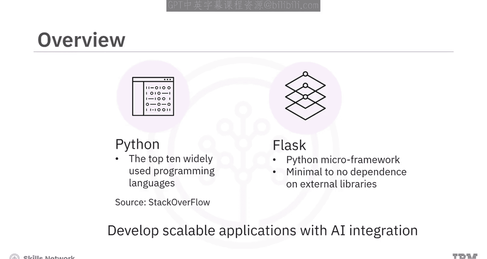
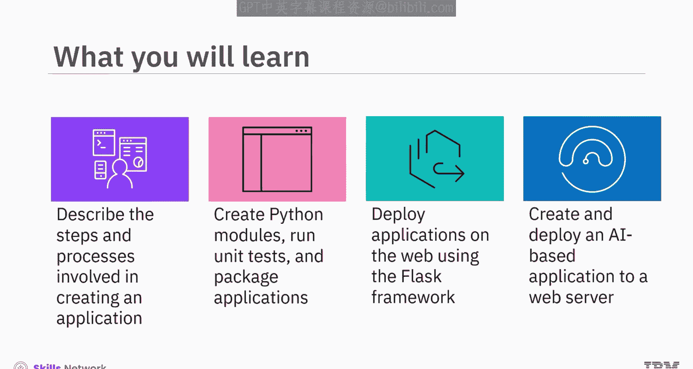
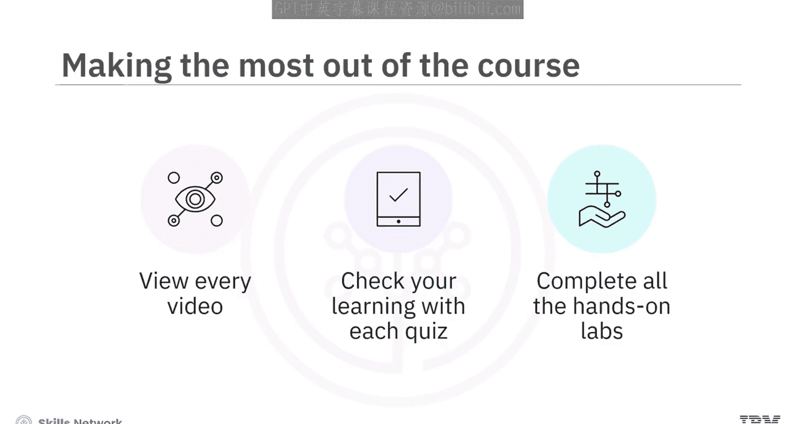

# IBM《生成式人工智能工程｜Falsk、生成式AI应用、数据分析、机器学习、Keras、架构和数据、NLP基础、transformer、微调、高级微调、RAG》 p01 0_课程介绍.zh_en -BV1NAq6Y9E7z_p1-

Welcome to this course on developing AI based applications using Python and Flask。

Python is among the top 10 widely used programming languages globally。

 according to a survey conducted by Stack Overflow。

Flaask is a Python micro framework with minimal to no dependence on external libraries。

Using Python and Flask， a programmer can develop concise applications。

 even in corporate components of AI， and can also easily be part of a scalable solution。

After completing this course， you will be able to describe the steps and processes involved in creating an application。

 create Python modules， run unit tests， and package applications。

Deploy applications on the web using the Flask framework。

 and create and deploy an AI based application onto a web server using IBM。

 Watson Emded AI Libraries and Flask。

This course is intended for anyone with basic programming knowledge。

 an elementary understanding of Python， and is interested in building reusable web applications with AI integration。

Module 1 will introduce you to the basics of application development。

 including the lifecycle and best practices for coding。

 you will also have the opportunity to create modules。

 run unit tests and package applications you will learn the ideal coding practices for Python and learn how to run static code analysis。

In moduleule2， you will start with an introduction to Flask。Next。

 you will be introduced to deployment concepts， including routes， request and response objects。

 error handling， and decorators。You will also be able to create and deploy an application using Flask Finally。

 in moduleule3， you will have the opportunity to apply all your knowledge from the previous modules to develop functional web applications and AI based web applications using Watson embedded AI libraries。

With one practice project and one graded project， you will be able to demonstrate your proficiency in creating and deploying applications using flask。

You must submit your work for the graded project to your peers。

There is a lot to cover here to get the most from this course， make sure to view every video。

 check your learning with each quiz， and complete all the hands on labs。

If you have any trouble with any of the course material。

 please don't hesitate to contact us in the discussion forum。

Thank you for being part of our course and welcome。

