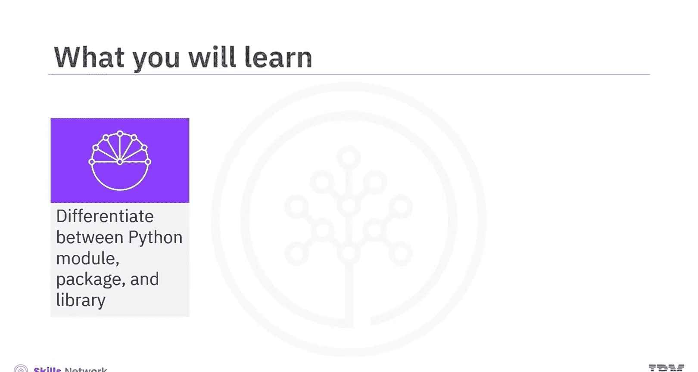
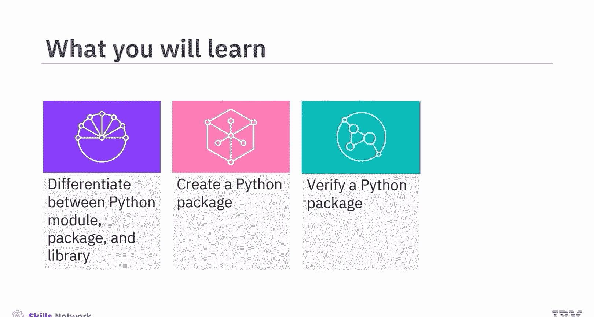
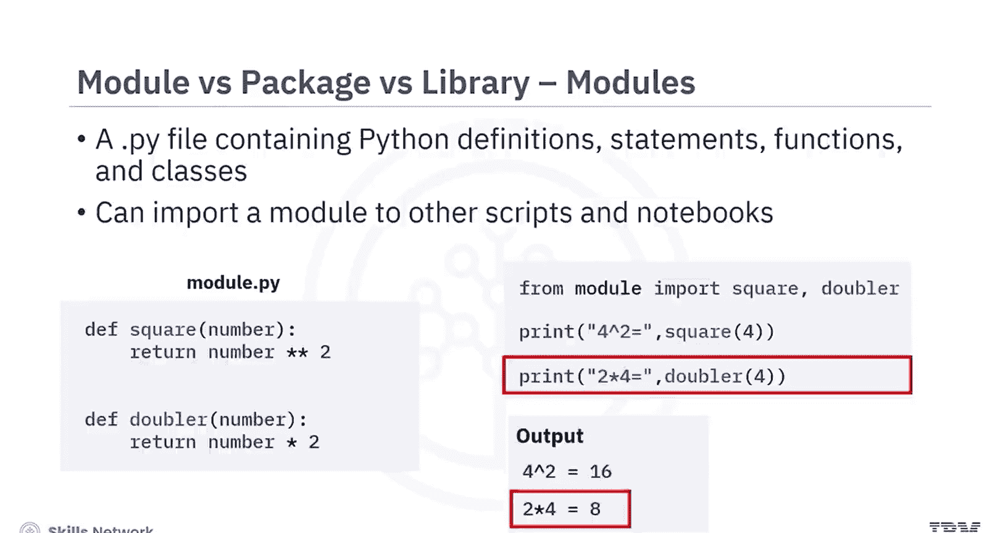
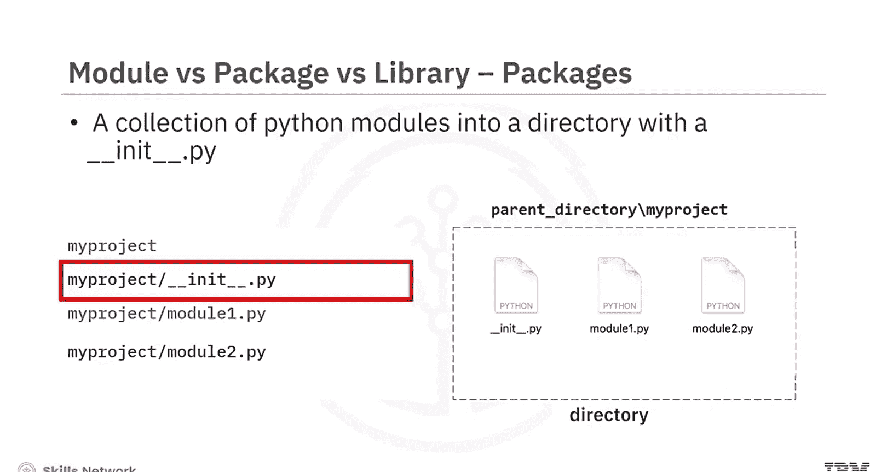
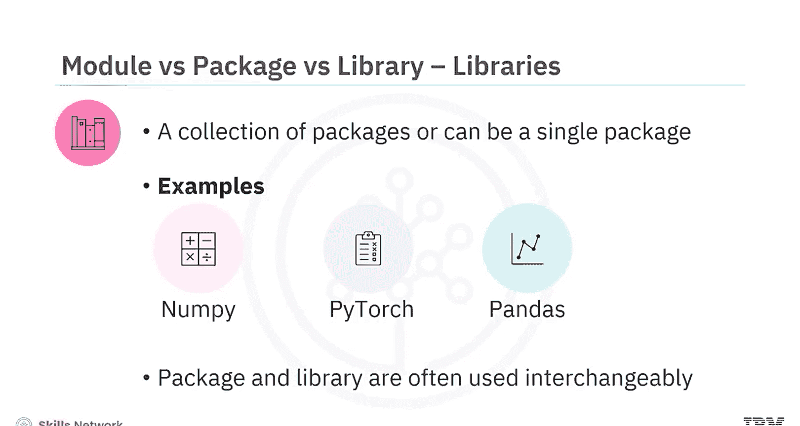
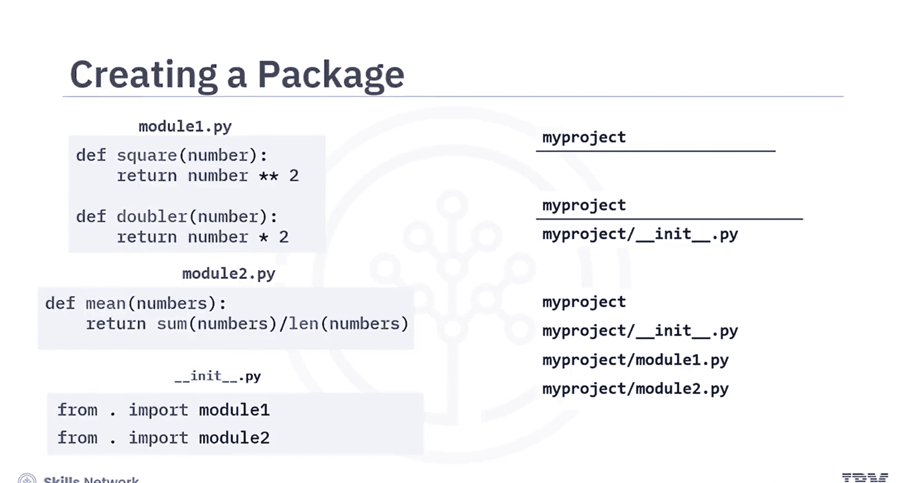
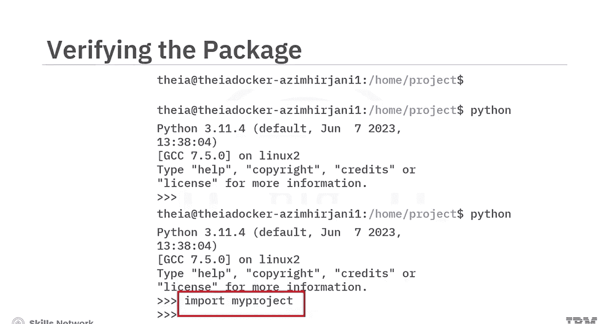
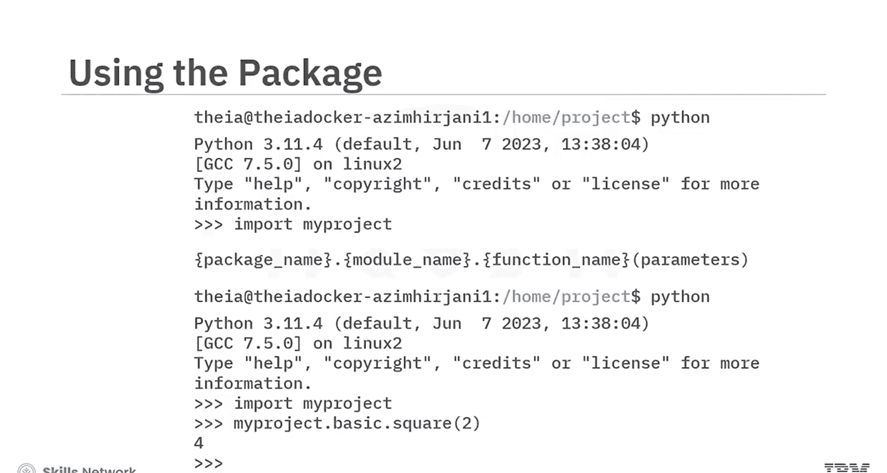
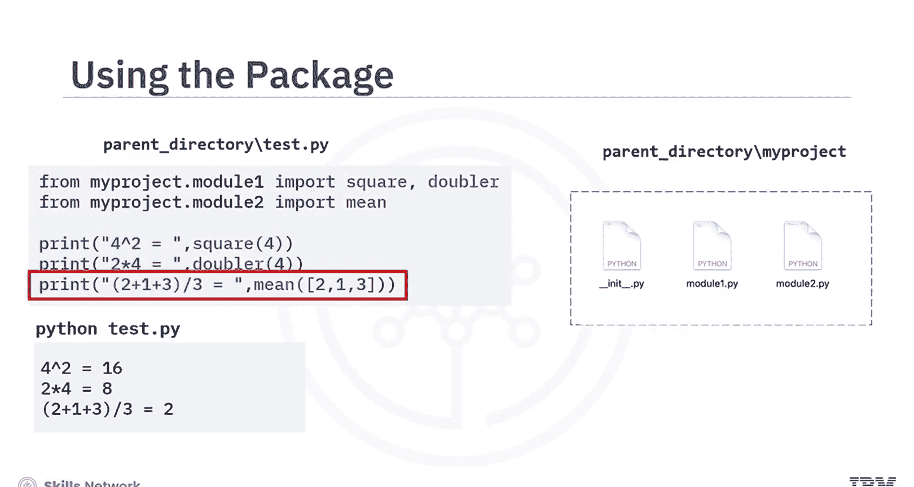
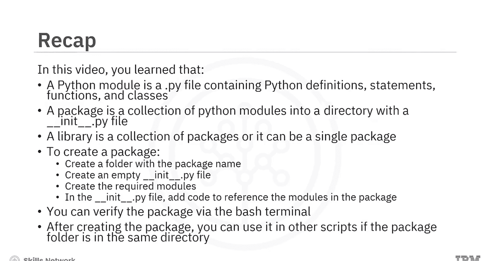

# IBM《生成式人工智能工程｜Falsk、生成式AI应用、数据分析、机器学习、Keras、架构和数据、NLP基础、transformer、微调、高级微调、RAG》 p07 6_打包.zh_en -BV1NAq6Y9E7z_p7-

Welcome to packaging。 After watching this video， you will be able to differentiate between Python module。

 package and library。😊。

Create a Python package。 verifyify a Python package and use a Python package。

Moduless， packages and libraries are frequently used terms in Python。

Let's look at each of the terms in detail。A Python module is a Do Py file containing Python definitions。

 statements， functions and classes。You can import a module to other scripts and notebooks。

 For example， consider a module named module dot pi that has two functions。

 The first function is depth square number， returnturn number asterisk， asterisk 2。

 which squares the input and returns the result as an output。😊，The second function is death Dor。

 number return number asterisk 2， which doubles the input and returns the result as an output。

If the function is in the same directory， you can import it and use the functions in that module。

Let's consider using the square function with print command4 carrot symbol2 square4。

 the output is displayed as4 carrot symbol2 equals 16。Similarly。

 for the print Dor function with value 4， the output is 2 asterisk4 equals 8。

A package is a collection of Python modules into a directory with an init do P file。

 which distinguishes it from just a directory of Python scripts。

The example shows the package my project in parent directory with two modules。

 moduleule 1 dot pi and Module 2 do pi。It also contains in it dot pi file。

When you import a module or a package， the corresponding object created by Python is always of type module。

Note that the distinction between module and package is only at the file system level。

A library is a collection of packages， or it can be a single package。Examples include nue， pie torch。

 and pandas。Note that the terms package and library are often used interchangeably。 Therefore。

 numpe pie torch and pandas are also referred to as packages。

Let's look at the steps to create a Python package。 Consider there are two modules。

 Module 1 dot pi has two functions。 Square and Dor moduleule 2 dot pi has one function。

 mean to make my project folder into a package， you must have in it dot pi as a file in the My project folder the contents of the init dot pi file must be from dot import moduleule 1 and from dot import module 2。

😊，Typical steps to create a package include。First， create a folder with the package name。

 Then create an empty init dot pfi。 create the required modules。 Finally， in the init dot p file。

 add code to reference the modules needed in the package。 After creating the package。

 you need to verify the package。 to verify the package。 First， open a bash terminal。

 Make sure the directory is the same as the folder where your package is located。

 open the Python interpreter by running the command Python in the shell。

Using the Python prompt， type import， followed by project name， for example， importmport My project。

If the command runs without errors， it is an indication that the package is successfully loaded。

The general structure for testing your package is the package name， dot module name。

 dot function name， followed by the parameters without the curly brackets。

 but keeping the round brackets。 For example， using my project， my project dot basic dot square 2。

 the function will return the value 4。

After creating the package， you can use it in the other scripts if the package folder is in the same directory。

In this case， you have the file test dot Pi in the parent directory。

You can import the functions in the package， for example。

 using the Python code from my Project moduleule 1。

 import square comma doubleubr from my project moduleule 2。

 import mean print 4 carrot symbol2 equals square4 print 2 asterisk 4 equals doubler for print2 plus1 plus 3 divided by3 equals the mean 2 comma 1 comma 3。

 you can then run the functions and check if you get the correct results。

In this video， you learn that a Python module is a Dot P file containing Python definitions。

 statements， functions and classes。A package is a collection of Python modules into a directory with an init dot pi file。

A library is a collection of packages， or it can be a single package。To create a package。

 create a folder with the package name。 createate an empty in it dot pi file。

Create the required modules in the Init dot P file。

 Add code to reference the modules needed in the package。

You can verify the package via the bash terminal。After creating the package。

 you can use it on other scripts if the package folder is in the same directory。

。

