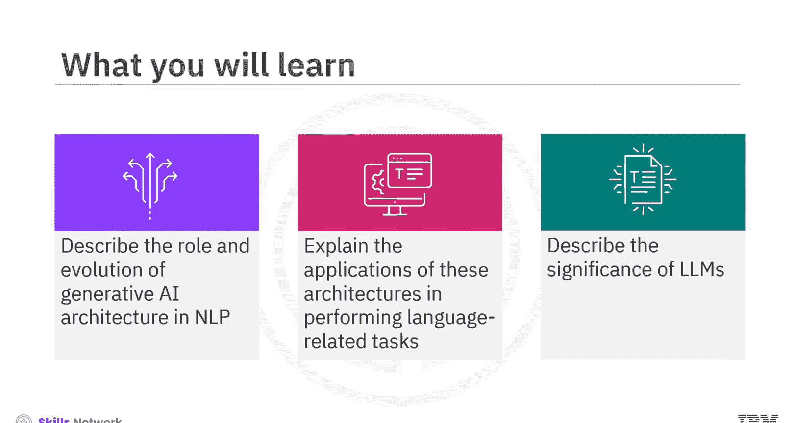
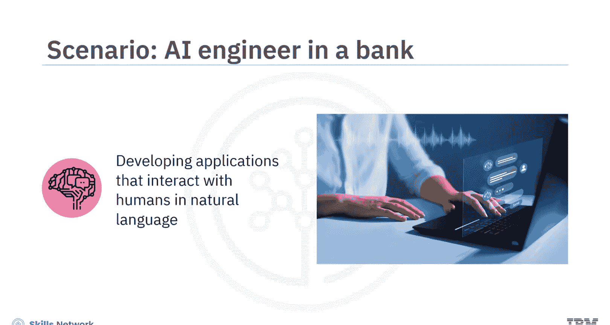
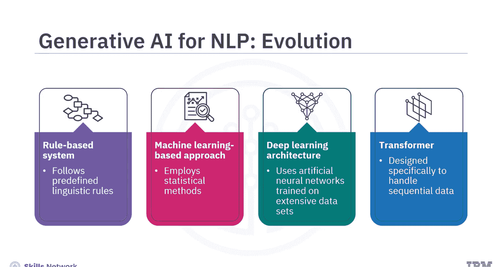
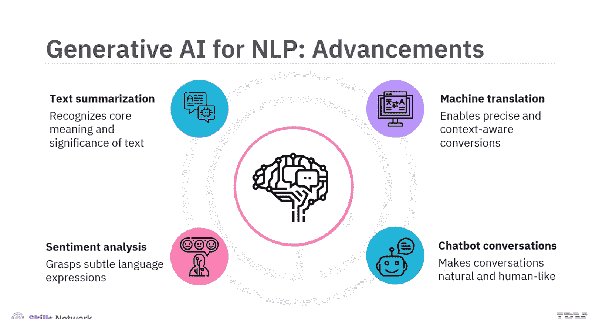
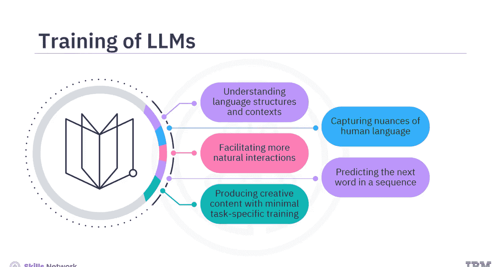
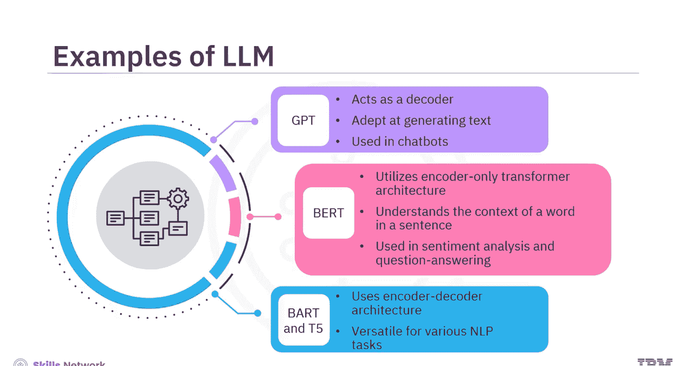
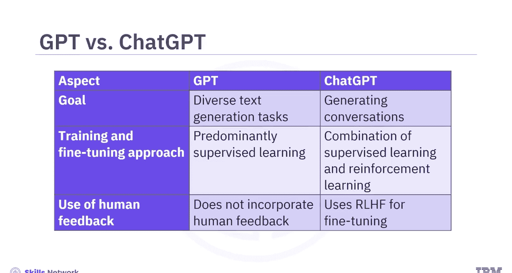
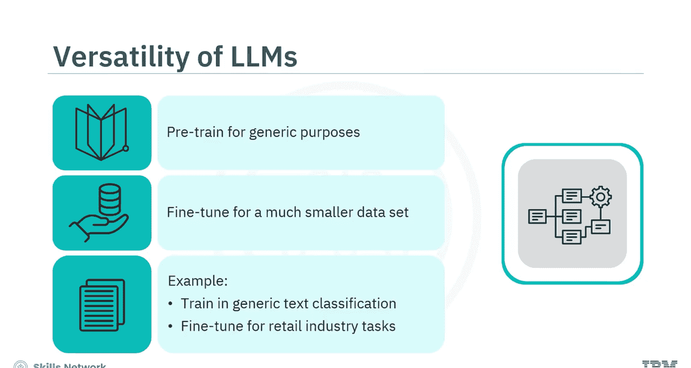
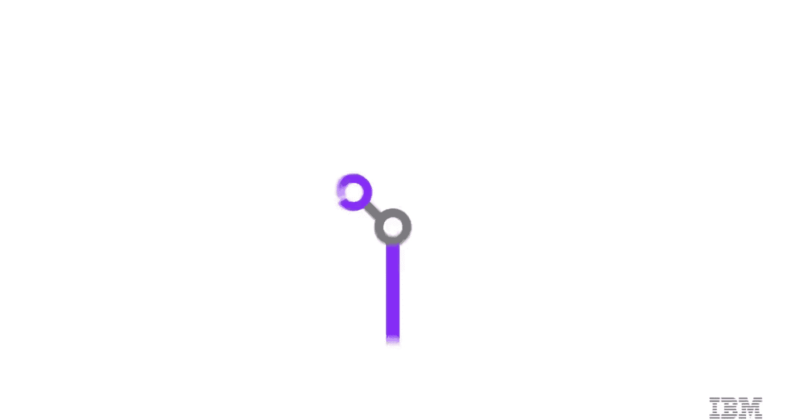

# IBM《生成式人工智能工程｜Falsk、生成式AI应用、数据分析、机器学习、Keras、架构和数据、NLP基础、transformer、微调、高级微调、RAG》 p100 4_生成式AI在NLP中的应用.zh_en -BV1NAq6Y9E7z_p100-

Welcome to generative AI for NLP。 After watching this video。

 you'll be able to describe the role and evolution of generative AI architecture in the context of natural language processing or NLP。

 You'll be able to explain the applications of these architectures and performing language related tasks and describe the significance of large language models or LLMs。

 Imagine you work in a bank as an AI engineer。 The bank has assigned you the task of creating a virtual assistant that can engage in natural language Con with customers answering their queries on account details。

 investment options and so on。 You'll explore how you can use generative AI architectures to develop applications that interact with humans and natural language。

 generative AI architectures enable machines to comprehend human language and generate responses。

 you cannot distinguish from what a human generates。

 They improve language processing by incorporating context awareness and ensuring coherent interactions。

 They enable meaningful conversations through predictive analytics and advanced modeling。😊。

The NLP systems based on generative AI architectures sense the feelings and grasp the intentions behind words。

 extending their understanding beyond mere words。 Let's look at the evolution of generative AI for NLP。

 It started with rule based systems that strictly follow predefined linguistic rules。

 such as grammar。 While these systems were precise， they lacked flexibility。 Next。

 machine learning based approaches emerged。 These approaches employed statistical methods to learn from vast language data sets and make predictions。

 These were more adaptable than rule based systems。

 but still limited in understanding complex language nuances。

 A significant advancement happened with the introduction of deep learning。

 Deep learning focuses on training artificial neural networks with extensive data sets。

 It involves many computational units within these networks working together to make more nuanced language interpretations。

 Transformers represent the latest in this evolution。

 The transformformer architecture is specifically designed to handle sequential data。

 Transformers have a greater ability to understand context and dependencies。

Within language and their predecessors， generative AI for NLP is constantly evolving due to consistent efforts to improve how machines understand and generate language。

 you'll notice this evolution in the significant advancements in machine translation Chatbot conversation。

 sentiment analysis and text sumization in machine translation。

 these architectures significantly enhance accuracy by enabling more precise and context aware conversions between languages。

 in chatbots or virtual assistance， you can utilize generative AI architectures to make the conversations more natural and humanlike with the degree of empathy in personalization。

 En the user experience the ability of generative AI architectures to grasp subtle language expressions improve the effectiveness of sentiment analysis。

 offering deeper insights into user sentiments In text summarization。

 you can employ these architectures to enable recognition of the core meaning and significant of text and a document。

 resulting in a more precise summary generative AI architectures include language models focusing on understanding and generating human language。

Which。Large language models or LLMs are foundation models that use AI and deep learning with vast data sets。

 such as websites and books to generate text， translate languages and create various types of content。

 They are referred to as large language models due to the size of the training dataset set which may reach petabytes。

 Also these models contain billions of parameters which are variables defining the model' behavior。

 These parameters are finetuned during training to optimize the model's performance on specific tasks。

 For example， when the model learns about emotions。

 a parameter could represent the weights assigned to specific words， such as happier Sa。

 The extensive training of LLms on massive data sets enables them to understand language structures and contexts comprehensively。

 They can capture the nuances of human language， facilitating more natural interactions。

 LLms are proficient in predicting the next word in a sequence。 with their vast resources。

 LLms can produce creative content with minimal tasks specific training。

 Some examples of LLms are the generative pretrain transformer series。

OrGPT series， bidirectional encoder representation from Transers or Bt。

 bidirectional and autoaggressive transformers or Bart and text to text transfer transformer also called T5 G primarily acts as a decoder。

 adept at generating text It excels in tasks where creating coherent and contextually relevant content is crucial。

 for example， chatbots。 Bert utilizes an encoder only transformer architecture It is exceptional in understanding the context of a word within a sentence which is crucial for nuanced tasks like sentiment analysis and question answering Model such as Bart and T5 follow an encoder decoder architecture They leverage encoding for contextual understanding and decoding to generate texts。

This versatility makes them well suited for various NLP tasks。

 The term GT and chat GT might sound interchangeable。

Though these models share similarities， GT focuses on diverse text generation tasks。

 whereas chat GT focuses on generating conversations for training and fine tuning GT predominantly uses supervised learning。

 It might use reinforcement learning， but with less focus on conversational aspects。

 chatt GT uses a combination of supervised learning and reinforcement learning。

 GT does not incorporate feedback from human interactions as part of its learning process。

 whereas chat GT uses a methodology called reinforcement learning from human feedback where R LHF。

 which uses human feedback to create a reward model。

 Most of the LLms are based on the transformer architecture。

 The versatility of LLms makes them a key contributor to advancements in natural language understanding and generation。

 You can pretrain LLms for generic purposes and then finet with a much smaller data set。 For example。

 the LLms may be trained in generic text classification。

 You can fine tune them in a retail industry context for categorizing products into groups。

s as electronics or clothing based on textual descriptions remember that while these models can generate authoritative text across domains。

 they may also generate information that sounds right but is inaccurate you may also need to address biases and consider the potential impact of the generated content on society Let's now recap what you learned In this video you learned about generative AI architectures for NLP generative AI architectures enable machines to comprehend human language and generate responses you cannot distinguish from what a human generates generative AI started with rule-based systems that follow predefined linguistic rules Then machine learning approaches emerged focusing on statistical methods。

 a significantly leap happened with deep learning which uses neural networks trained on extensive data sets。

Transformers represent the latest in this evolution The enhanced capabilities of generative AI architectures have led to significant advancements in machine translation。

 chatbot conversation， sentiment analysis and text summarization LLMs are foundation models that use AI in deep learning with vast data sets they're called large language models due to the size of the training dataset set which may run into petabytes。

 Also they have billions of parameters， examples of LLMs or GT， Bert， Bart and T5。

