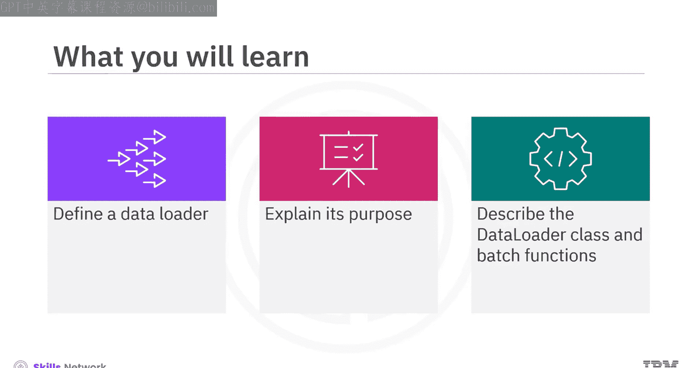
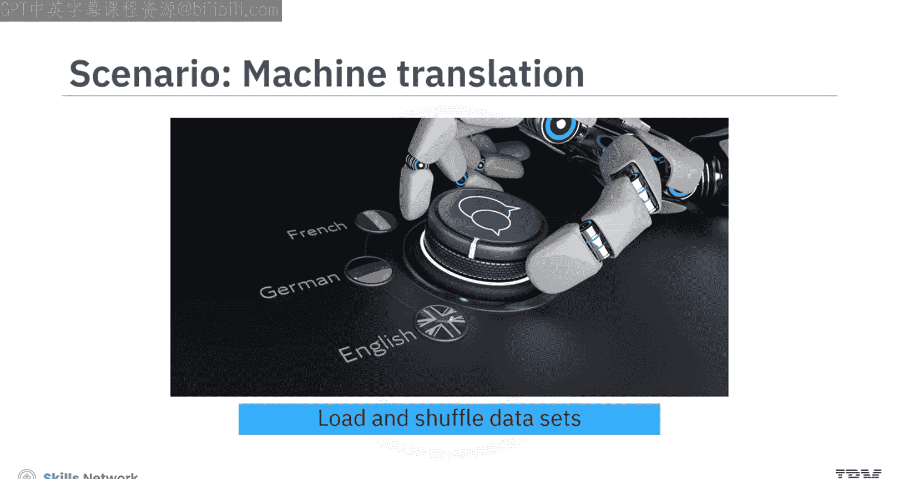
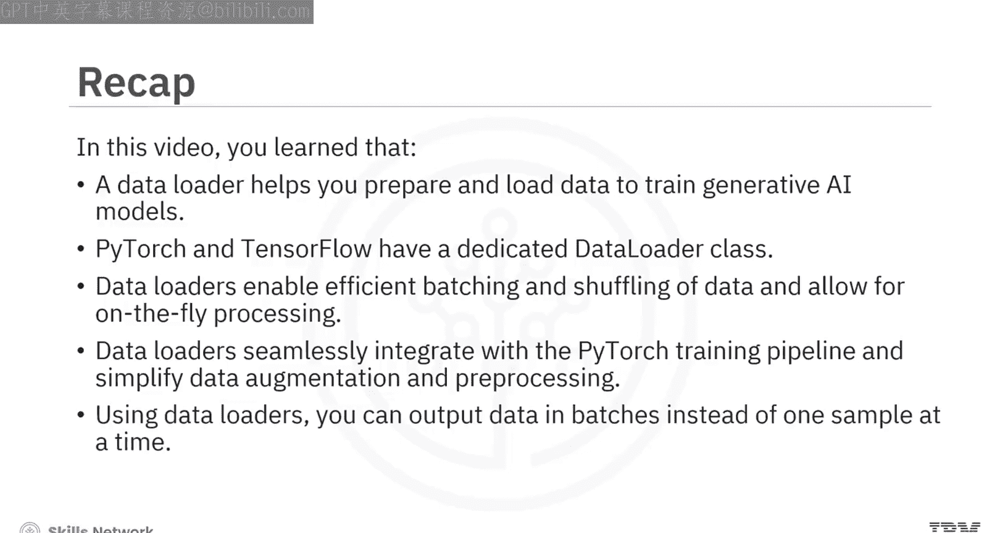

# IBM《生成式人工智能工程｜Falsk、生成式AI应用、数据分析、机器学习、Keras、架构和数据、NLP基础、transformer、微调、高级微调、RAG》 p102 6_数据加载器概述.zh_en -BV1NAq6Y9E7z_p102-

Welcome to overview of data loaders After watching this video。

 you'll be able to define a data loader， explain its purpose and describe the data loader class and batch functions。

Imagine you're developing a machine translation application with huge data sets。

It's challenging to manually load and shuffle these data sets to train the underlying language model how can you manage this process efficiently A data loader helps you prepare and load data。

 leadingad frameworks such as Pytororch have a dedicated data loader class that you can use to handle and prepare data while training generative AI models。

Natural language processing or NLP data loaders and piytorch enable efficient loading and preprocessing of textual data for NLP tasks。

 Data loaders enable efficient batching and shuffling of data。

 which is essential for training neural networks。 They allow for on the fly preprocess。

 which optimizes memory usage by loading only the required data during training。

 data loaders seamlessly integrate with the piytorrch training pipeline。

 making it easier to train and evaluate models， They simplify data augmentation and preprocessing。

 allowing you to apply various transformations to the input data。In Pytororch。

 you'll work with data sets and data loaders for efficient data handling a data set which is a collection of data samples in their labels is the starting point。

 let's consider three text samples， the task is to classify whether they are grammatically correct or incorrect。

 you typically divide your data set into a training set used to train the model。

 a validation set to tweak and validate the model parameters and a test set to assess the model's performance in real world scenarios。

 the terms training set and validation set can sometimes be used interchangeably。

 although they have distinct functions and model training and evaluation。

This example shows how to create a custom data set and use the data loader class in Pytorch。

 The dataset set consists of a list of random sentences。

 The objective is to generate batches of sentences for further processing such as training a neural network model。

 The code defines a custom data set called custom dataset set。

 This data set inherits from the torch do us data do data set class and is initialized with a list of sentences。

 The data set comprises three essential methods。 The init method initializes the data set with a list of sentences。

 The L method returns the number of samples。 The get item method retrieves an item in this case。

 a sentence at a specific index I X。You can create a data set object and access the first sample like in a list。

 You can access the second sample， and so on。Using data loaders。

 you can output data in batches instead of one sample at a time。

 A data loader is an iterator object and pytorch used for loading。

 shuffling and batching data from a data set。 Faacilitating training on groups of samples。

 an iterator is an object that can be looped over。 It contains elements that can be iterated through and typically includes two methods and next you commonly use iterators to traverse large data sets。

 Each time you call the next function， it returns new batches of samples。

 Call next again will fetch the next item in the iterator。 This process continues。Next。

 you create an instance of your custom data set by passing the list of sentences。 Additionally。

 you specify a batch size， which determines how many sentences will be grouped in each batch during data loading。

 You can then create a data loader by providing your custom data set and batch size to the torch do us data do data loader class。

 In addition， you can set shuffle is true to randomly shuffle the sentences before they are divided into batches。

 The shuffling is particularly useful for training deep learning models as it prevents the model from learning patterns based on the order of the data。

 Then iterate through the data loader to see how data is loaded in batches。 During iteration。

 the sentences in each batch are printed to illustrate how the data loader groups and presents the data。

 In most NLP applications， the majority of data transformation is performed in the batch function。

You use data loaders for various transformations on input text data。

 These transformations include tokenizing the text， numericalizing it。

 resizing it to a consistent size and converting it into tensors。

 These preprocessing steps ensure the data is prepared in a format suitable for deep learning models to process and interpret。

 The code defines the tokenizer using the get tokenizer function， with the basic English option。

 Next， it builds a vocabulary from the sentences using the build vocab from iterator function。

 This function constructs the vocabulary from the tokenized sentences。

 After tokenizing the input data。 The sequences may not be the same size。

 Each sample in a data loader must be the same length。 Hence you would use padding。

 You can utilize the pad sequence function and pytorch。

 which pad sequences in a batch to match the length of the longest sequence。

 The padding value equals zero argument specifies the value to use for padding。

The batch first argument guarantees that the batch dimension is the first dimension in the output tensor。

 When you set batch first to true， the first dimension in the output tensor will represent the batch size。

 Conversely， if the default value for batch first is false。

 the first dimension in the output tensor will represent the sequence size and the batch size will become the second dimension。

 Let's see an example of how batch first works with the batch first argument as true。

 The first dimension in the output tensor is the batch size， which is two here。

When you set batch first to false its default value。

 the first dimension in the output tensor represents the length of the input sequences in the batch。

 in this case， 10。To keep the original data set untouched。

 you can take care of data transformation in the collate function。

 You also have the option to utilize the collate function for tasks such as tokenization。

 convertting tokenized indices and transforming the result into a tensor。

 Let's look at an example of a custom collate function that performs these tasks。

 The code defines a custom collate function named collate F N。 Within the function。

 Each sample in the batch is tokenized using the tokenizer function。 Next。

 tokens are mapped to numbers using the vocab。 Then the pad sequences function is applied to the tensor batch to pad the sequences within the batch to have equal lengths。

 Now， you can create a data loader using the collate function and the custom data set。

Let's now recap what you learned in this video you learned about data loaders。

 A data loader helps you prepare and load data to train generative AI models Pytorrch and TensorFlow have a dedicated data loader class。

Data loaders enable efficient batching and shuffling of data and allow for on the fly processing。

 Data loaders seamlessly integrate with the Pytorch training pipeline and simplify data augmentation and preprocessing Using data loaders。

 you can output data in batches instead of one sample at a time。

。