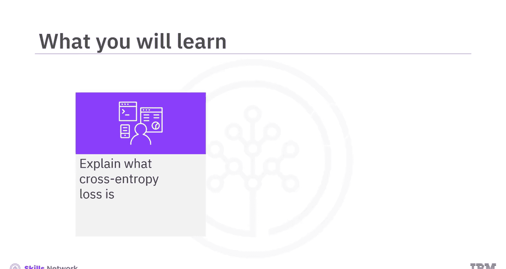
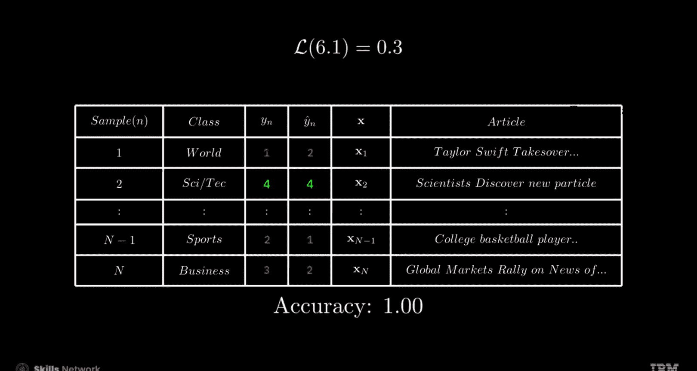
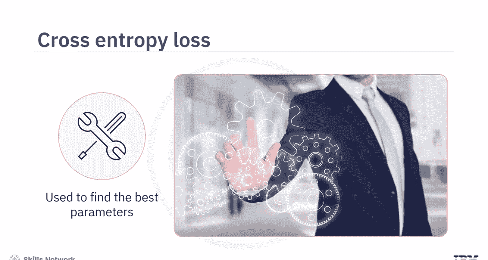
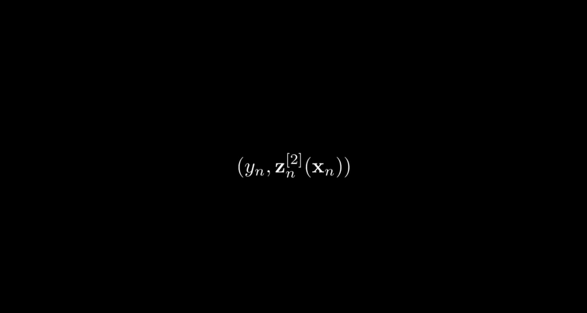
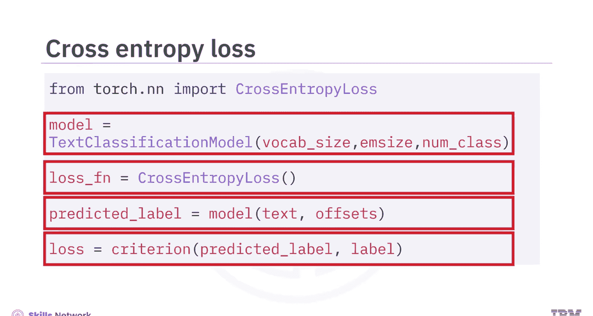
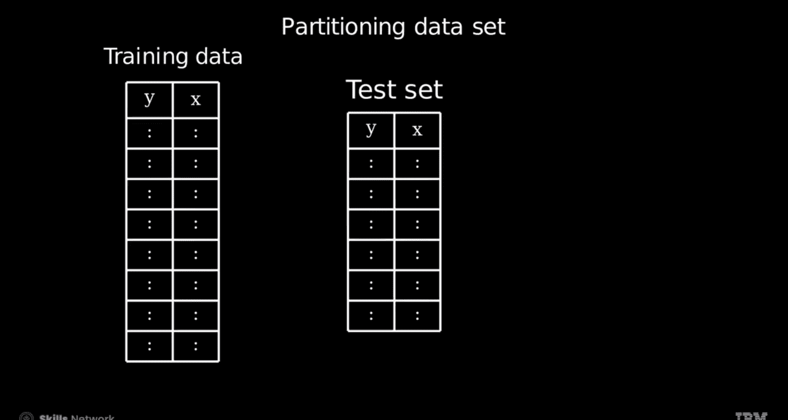

# IBM《生成式人工智能工程｜Falsk、生成式AI应用、数据分析、机器学习、Keras、架构和数据、NLP基础、transformer、微调、高级微调、RAG》 p106 3_使用TorchText进行文档分类训练.zh_en -BV1NAq6Y9E7z_p106-

Welcome to document categorization training with torch text After watching this video。

 you'll be able to explain what cross entropy loss is and describe how optimization reduces losses in your model a neural network functions via matrix and vector operations called learnable parameters here you'll identify and obtain these parameters。

 with networks having millions to trillions of parameters。

 Theta is used to collectively represent them in neural network training。

 learnable parameters are finetuned to enhance model performance。

 This process is steered by the loss function which serves as a measure of accuracy The goal is to find the optimal parameter values denoted as theta that minimize the discrepancy between the model's predicted output。

 hat y and the actual label。 why as your focus is solely on the parameters。

 you'll consider the loss function explicitly as a function of theta Although the term loss and costs are often used interchangeably for clarity。

 the terminology consistent with pitorrchs framework is followed the table compares actual labels Y and predict。

Labels Y hat from a neural network， featuring vectors X correctr predictions are in green and errors are in red。

 showing 20% accuracy。 The aim is to adjust theta to lower loss and improve accuracy as the parameter theta is adjusted。

 you'll observe a reduction in the loss leading to an alignment between the true class labels Y and the predicted labels hat Y shown by the increase in green concurrently there is an increase in the model's accuracy。

 which is a positive indicator of performance improvement。

 Now you'll learn how cross entropy is used to find the best parameters。

Recall that you input an embedding vector into the network for each category。

 the neural network outputs a vector of logics， where each logic is a score reflecting the article's likelihood of fitting a particular news category。

 as shown here。 The associated table links vector elements to categories。

 World is first followed by sports， business and science and technology。

 Los are transformed into probabilitybabilities through the softm function depicted here。

 This process， given input X computes the probability that the predicted class hat Y corresponds to a certain category。

 Each logic is exponentiated to ensure positivity and then normalized against the sum of all logics。

 This creates a conditional distribution for each predicted class that is given a sample X。

 The probability of belonging to the class world。 Sports business and science and technology is shown here。

 The softm transformation plays a crucial role in enhancing the distinction between scores assigned to different classes。

True probability distribution Y is shown here。 Each bar represents the probability of y equals 01。2。

3， Let's begin by evaluating the expected value difference between the true distribution。

 That is the probability of y and the conditional distribution。

 That is the probability of y given x and theta， rather than simply calculating the difference in squaring it apply the logarithm to both distributions before finding their difference known as the KL divergence。

 only the second term which is referred to as cross entropy loss， is dependent on theta。

 The problem now is finding the distribution of y for which you can employ a useful technique。

You can compute the expected value of a function using the distribution。

 the probability of Z depicted here。 However， if the distribution is unknown。

 you can estimate it by averaging the function applied to a set of samples。

 This technique is known as Monte Carlo sampling。Monte Carlo sampling can be applied to approximate the true cross entropy loss by averaging the output of a function over samples X and y as shown here。

 you can calculate the conditional distribution using the softm function。

 It should be noted that usually the batches of data have been used。

 but not all the samples in Pytorch， the loss function utilizes the network's output logicts Z。

 which is a proxy for Y hat and the true label's Y for computation。

In Pytorrch， after importing the cross entropy loss first。

 define a text classification model and then create a cross entropy loss object。

The model calculates logics for a given input。 Then it computes the loss by comparing these predictions to the true labels using pytorrch's cross entropy loss function。

 Now， you are going to do optimization， which is the method used to minimize the loss。

 The gradient descent equation is key to reducing loss in the model。 Here's the breakdown。

To update your next parameter to theta subk plus 1。From theta subK。

 using the current parameter values nudging closer to minimal loss。

The learning rate Ada sets your step size。The gradient of the loss function points where the loss changes most by moving in the reverse direction of this gradient。

 you can fine tune your parameters， thereby decreasing the loss with each step。 Now。

 let's observe the process unfold。 gradient descent starts with an initial random parameter guess denoted as k equals 0 in the first iteration that is k equals 1。

 adjust parameters using the gradient of the loss function。 Scd by a learning rate of 0。1。

 And add this to the parameters from k equals 0 to compute the loss。

 This process is repeated for k equals 2 updating the parameters and recalculating the loss。

 which decreases incrementally。This iterative refinement continues。

 reducing loss and enhancing model accuracy with each step。

 This image depicts a 2 D loss function surface with a chosen starting point。

 The algorithm fine tunes the parameters iteratively toward the minimum loss。

 visualualized by the red point moving downward along the white trajectory line that converges on the lowest loss point。

 In practical use。 neural networks have millions of parameters。

 leading to a complex loss surface as shown here。 loss can vary sharply。 Ri or falling quickly。

 Many strategies exist to reduce loss， known as optimization methods。

 These strategies will not be detailed here， but will be referred to as methods to improve optimization or training。

 Tyically， you partition your data set into three subsets。 Tra data for learning。

 Val data for hyperparameter tuning and test data to evaluate real world performance。 In this case。

 you have predeterminine the hyperparameter。 And now your focus must be。On test data。

In ptorrch， you will first initialize this stochastic gradient descent or SGD optimizer for the model's parameters with a learning rate or L R of 0。

1。 A scheduler reduces the learning rate by a factor of gamma after each epoch。

 which enhances the optimization process。 Reet all gradients for the variables to be updated。

 That is the learnable weights of the model to 0 before the next iteration。

 The model makes a prediction and calculates the loss。

 The backward function computes the derivatives of the loss。 Finally。

 gradient clipping is applied to improve optimization。 Let's now recap what you learn。 In this video。

 you learned that a neural network functions via matrix and vector operations called learnable parameters。

 In neural network training， learnable parameters are fine tune to enhance model performance。

 This process is steered by the loss function， which serves as a measure of accuracy。

 The prediction function works on real text that starts by taking in tokenized text。

It processes the text through the pipeline， and the model predicts the category。

 Cross entropy is used to find the best parameters for unknown distribution。

 estimated by averaging the function applied to a set of samples。

 This technique is known as Monte Carlo sampling。 Opim is used to minimize the loss。 General。

 the data set should be partitioned into three subsets。 Training data for learning。

Validation data for hyperparameter tuning。And test data to evaluate real world performance。

