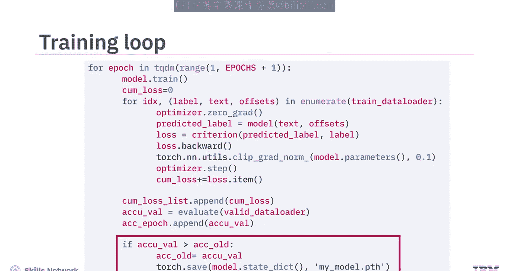
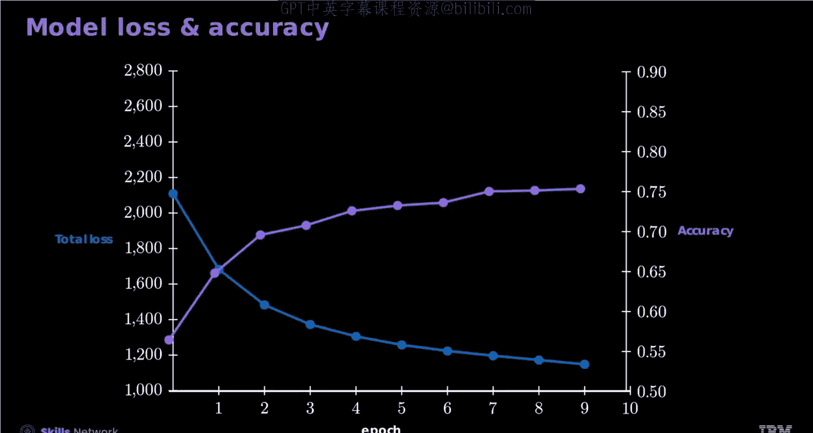
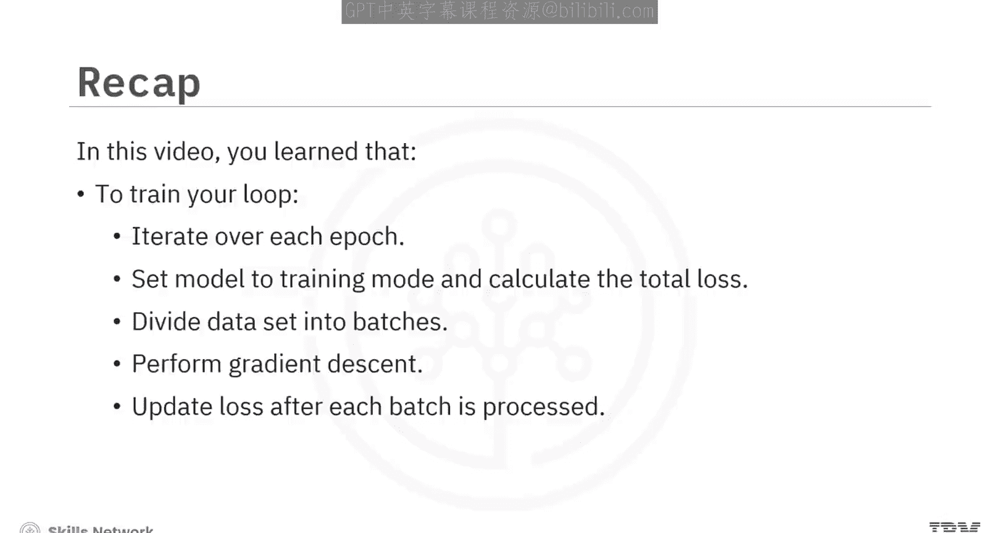

# IBM《生成式人工智能工程｜Falsk、生成式AI应用、数据分析、机器学习、Keras、架构和数据、NLP基础、transformer、微调、高级微调、RAG》 p107 4_在PyTorch中训练模型.zh_en -BV1NAq6Y9E7z_p107-

Welcome to training the model in Pytorch After watching this video。

 you'll be able to describe how to train a neural network in Pytorrch。

 Let's use concepts related to cross entropy loss and optimization to train the model with pytorrch。

 consider you have a news data set that has been tokenized an indexed Let's proceed to split the data set create two iterators for the AG news data set where one contains only training Further。

 split the training data into training and validation After splitting data loaders are set up for training validation and testing batch size specifies the sample count for gradient approximation and shuffling the data promotes better optimization These are the codes that you can use to define your model When you do so in it waits helps with optimization This code creates an instance of the text classification model Now you initialize your optimizationr and loss function and then set the number。

Of epochs， during which you'll record the loss and accuracy for each epoch。To train your loop。

 iterate over each epoch， that is， each time you pass through the entire data set。

Set the model to training mode and iteratively calculate the total loss。

 Divide the data set into batches， which improves performance。

 perform gradient descent to adjust the model parameters。 Finally。

 update the loss after each batch is processed for each epoch。 record the loss and accuracy。

 If the model achieves higher accuracy on the validation data set， you can save its parameters。

 As you plot the loss and accuracy over time。 you can observe a trend。 as the loss decreases。

 accuracy correspondingly increases。 Let's now recap what you learned In this video。

 you learned that the training data is split into training and validation。

 And then data loaders are set up for training validation and testing。

 batch size specifies the sample count for gradient approximation and shuffling the data promotes better optimization When you define your model in it weights helps with optimization。

To train your loop， iterate over each epoC， set the model to training mode。

 and iteratively calculate the total loss， divide the data set into batches。

 perform gradient descent， and finally update the loss after each batch is processed。

