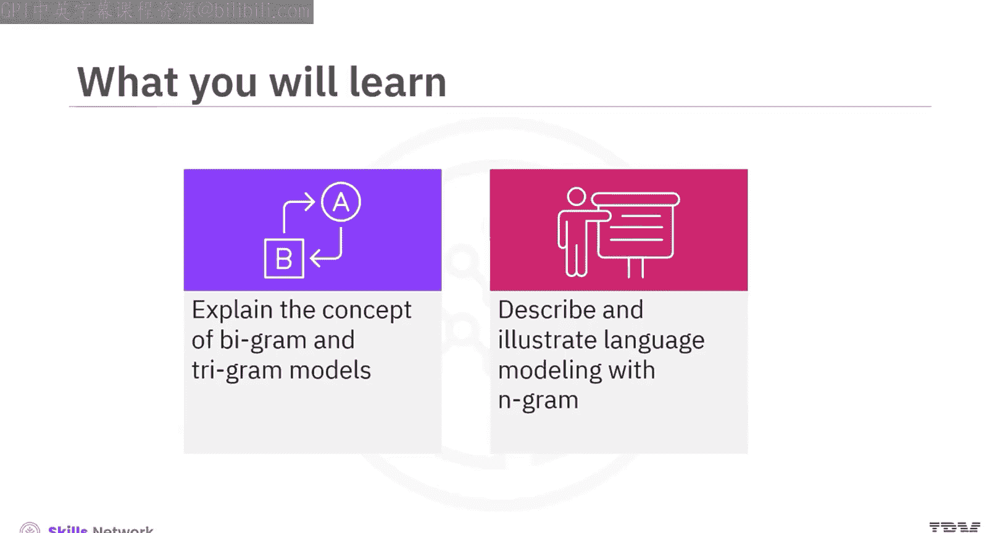
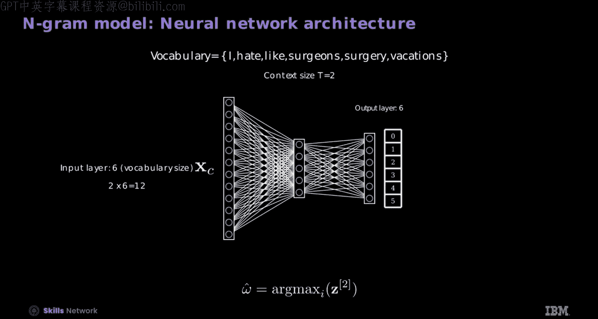

# IBM《生成式人工智能工程｜Falsk、生成式AI应用、数据分析、机器学习、Keras、架构和数据、NLP基础、transformer、微调、高级微调、RAG》 p108 5_使用N-gram进行语言建模.zh_en -BV1NAq6Y9E7z_p108-

Welcome to language modeling with Ngrams。 After watching this video。

 you will be able to explain the concept of bigram and trigram models。

 You will also be able to describe and illustrate language modeling with Ngrams。

 Let's begin with understanding about Ngrams。 Consider the phrases I like and I hate。

 How would you complete these sentences。 For instance， if you are given， I like， followed by a blank。

 would you choose surgery or vacation。 Most people would likely complete it with vacation upon seeing the word like。

 Similarlyly， with the phrase I hate followed by a blank。 the expected completion is surgery。

 Ref common associations with these words。 These examples demonstrate how your word choices are often influenced。

 are the context provided by preceding words。 Consider the phrase I like vacations。

 which can be represented as a sequence。 You can depict this using a table with each column labeled mega 1 to 3。

😊。

Representing a word and the subscript indicating its position in the sentence that is word 1。

 word 2 and word 3。 The same goes for I hate surgery。 This is where the bygram model comes into play。

 It's a conditional probability model。 What's the probability of your third word， word 3。

 given the second one， word 2， Word 2， represents your context。 The second word。

 which is crucial in guiding the prediction。In a bygram model， your context size is one。

 meaning you'll consider only the immediate previous word to predict the next one。

 given the second word is like， that is word 2 equals like。

 What could the third word be using the table count the occurrences of each potential follow up to like in the third column by examining the table observe that surgery never follows like。

 Hence the probability of word 3 being surgery is0。 However， vacation appears after like。

 and the probability of word 3 being vacation is one。Consider the phrases surgeons like surgery。

 and I hate surgery， adding surgeons changes the context of the sentence。

 making it at least plausible that surgeons like surgery。 Let's create the same table。

 the trigram model is also a conditional probability function。

 and can improve on the bigram model's limitations by increasing the context size to 2。 Now。

 in addition to word 2， you also use word 1 to predict word 3。

 Let's examine the probability of word 3 equaling surgery。 Given that word 1 is I and word 2 is like。

 you will find that the probability is 0。 However， if you change word 1 to surgeons the probability of word 3 being surgery is now one。

Consider the phrases surgeons like surgery。 I hate surgery， and I like vacations。

 How would you complete the phrase surgeons like， You can employ the trigram model to predict the next word by leveraging the probabilities generated from the table for context set the first word to surgeons and the second to like to predict the third word denoted as omega。

 identify which word maximizes the likelihood of being the third word。

 This optimization is achieved using the Arg max function。

 which selects the word with the highest probability from the different possible third words given that the first word is surgeons and the second is like。

As illustrated， all possible outcomes for the third word have a probability of0， except for surgery。

 Therefore， the predicted third word is surgery。 Let's consider predicting the next word word 3。

 Given that the first word is I and the second word is like。 If instead。

 you're aiming to predict a word at some arbitrary point T。 using the preceding points T 1 and T2。

 And if you're assuming these relationships remain constant over time that is implying stationity。

 then you can apply the trigram or bigram models at any point in time。 for the trigram case。

 you can use words at positions T2 and T1， to predict the word at position T。

 following the same predictive process。 you can generalize the concept of a trigram to an Ngram model。

 which allows for an arbitrary context size。 in this expanded framework T denotes the chosen context size。

 However， calculating the。Probabilities for larger context sizes can become increasingly complex。

 Fortunately， neural networks offer a solution by approximating these probabilities。

 specifically apply the soft max function to estimate the probabilities and then train a neural network to predict the next word based on the previous words。

 the context word is used as a feature that is the context vector to define the previous words。

 Let's revisit the previous example where each word in your vocabulary of six words that is I hate like surgeons Sur。

 Vas is represented by a six dimensional one hot encoded vector。

Consider encoding the phrase I like with a context size of two。 If you employed a bag of words model。

 the vector representation of I like would be identical to that of like I to establish the concatenate vector。

 Con the individual vectors corresponding to each word as illustrated here。

 Instead of performing the operation on raw one hot vectors concatenate the one hot encoded embedding vectors。

 in the realm of neural networks。 the context vector is generally defined as the product of your context size。

 and the size of your vocabulary。 Typically， this vector is not computed directly。 Instead。

 you should construct it by concatenating the embedding vectors。

 Let's examine the neural network architecture for an N gram model。

 Imagine your working with a small problem。 a six word vocabulary and a two word context。

 recall the neural classifier designed to categorize one of four articles， which has four output。

However， the network must predict one of six possible outputs， one for each word in the vocabulary。

 so there are six neurons in the output layer given the context size of2 adjust the input accordingly the input dimension is the product of vocabulary size and context size with six words and a context size of2 your input dimension is 12 utilize the final layers output directly without needing to convert it to probabilities。

 this feed forward neural network ignores the dependence on T as it does not have a built- in mechanism to capture the order or position of words in a sentence like recent neural networks that work better at generating text Let's now recap what you learned in this video you learned that a bygram model is a conditional probability model with context size1。

 That is， you consider only the immediate previous word to predict the next one。

G model is also a conditional probability function and can improve on the bygram model's limitations by increasing the context size to2 the concept of a trigram can be generalized to an Ngram model。

 which allows for an arbitrary context size in the realm of neural networks。

 the context vector is generally defined as the product of your context size and the size of your vocabulary typicallyy this vector is not computed directly。

 but is constructed by concatenating the embedding vectors。

