# IBM《生成式人工智能工程｜Falsk、生成式AI应用、数据分析、机器学习、Keras、架构和数据、NLP基础、transformer、微调、高级微调、RAG》 p109 6_将N-gram作为神经网络与PyTorch.zh_en -BV1NAq6Y9E7z_p109-

Welcome to Ngrams as neural networks with ptorrch。 After watching this video。

 you will be able to create an ngram model in pytorch and train it。

 You will also be able to use ngrams as neural networks with pitorrch。 In ptorrch。

 you can create an embedding layer with an arbitrary vocabulary size and set the embedding dimension and a context size of two。

 The next layer input dimension must be the product of this context vector embedding dimension and the context size。

 Start with two indices。 representing the input context size of two。

 These two samples are used as input for the embedding layer。

 The output is two embedding vectors of dimension 3。

 Use the method reshape to reshape the embeddings to form the context vector which is the context size or number of samples multiplied by the embedding dimension。

 This concateates all the samples together。 This is used。

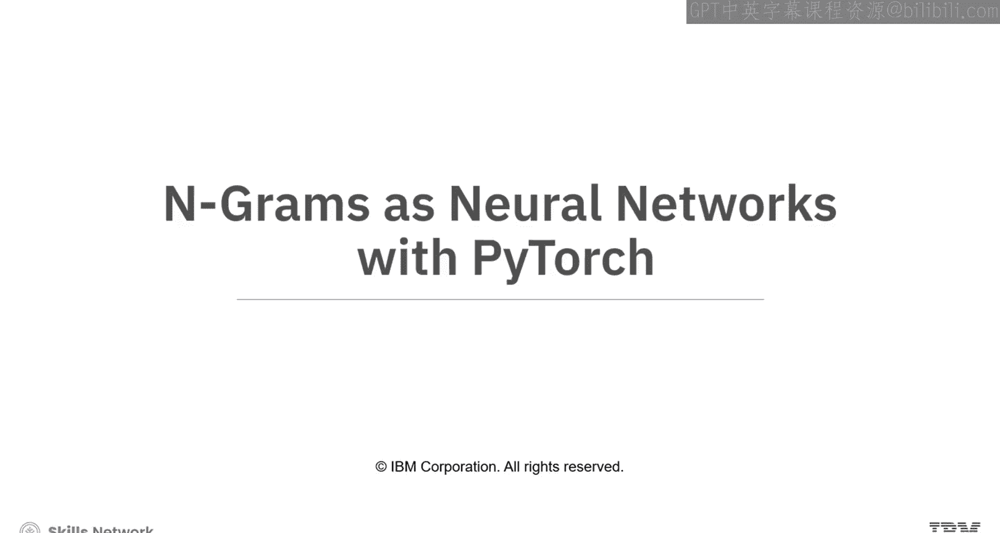

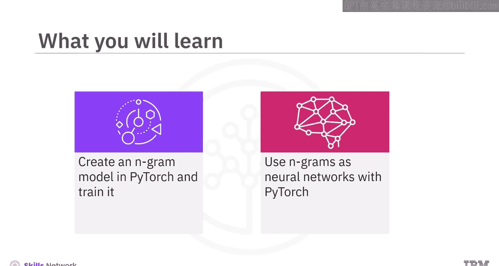

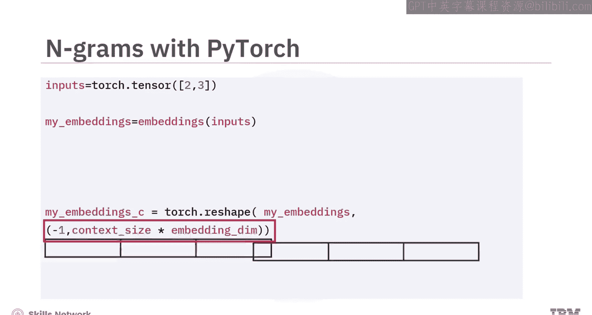

As an input to the next layer in pytorrch， the Ngram language model is essentially a classification model。

 using the context vector and an extra hidden layer to enhance performance。

 The Ngram model predicts words surrounding a target by incrementally shifting what's known as a sliding window in a bigram model。

 the prediction for words at position T is based on the position T1 and T2 Beg at T equals 3 to preclude negative indices。

 Each table row represents a distinct t value that aligns with the words position。

 column2 displays the context and column 3 shows the predicted word， both dependent on row T。

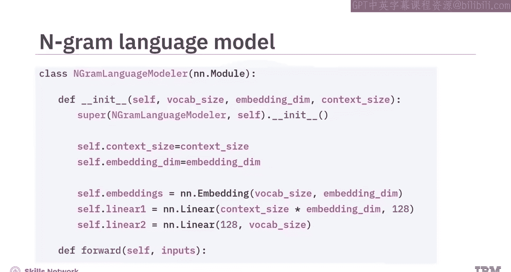

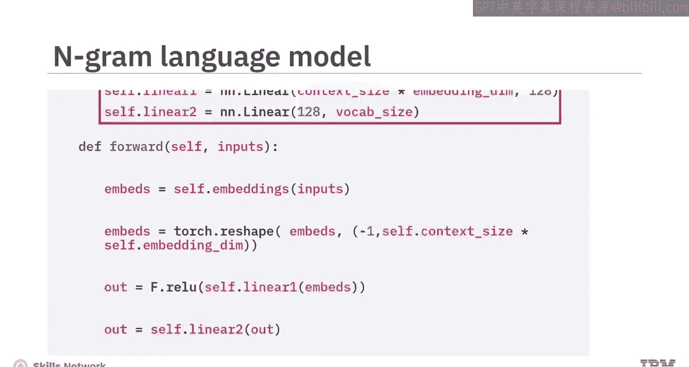

Consider the phrase I like vacations with each words index beneath it for T equals 3。

 the context is I like shown in blue， and the predicted target word is vacations in red。

 moving to T equals 4 presented in row 2。 The context updates to like Vas with n as the next prediction。

 This method is applied throughout the entire sequence。

 in ptorch for N gram modeling implement windowing to create batches of context and target words。

 It initiates the process where targets and contexts are generated using a batch function。

 a for loop iterates from the start of the context size。

 which in this example begins at2 marking vacation as your initial target within the window I is the target index。

 The context is gathered by subtracting J from I Then slide the window forward incrementing I to capture successive targets and contexts for the entire sequence here you are going。

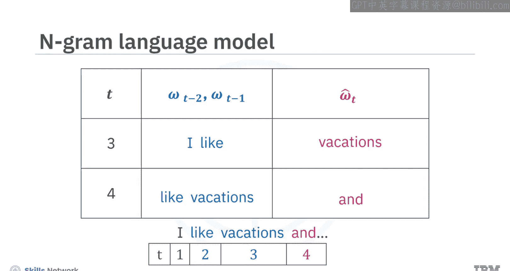

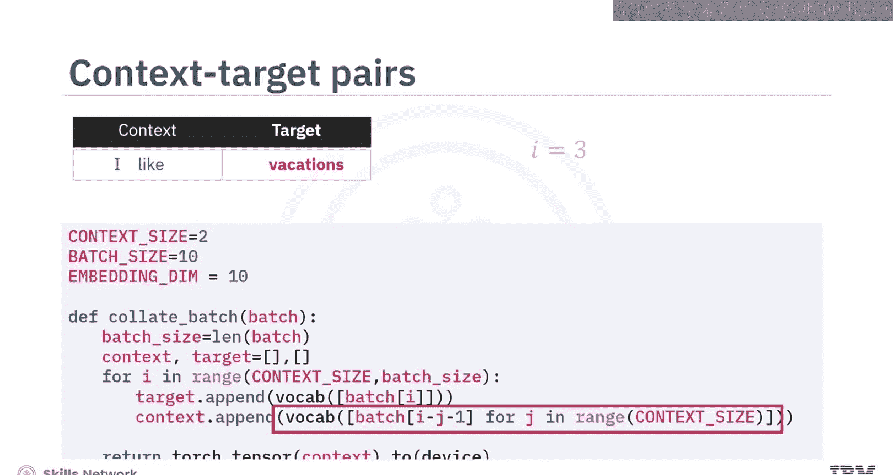

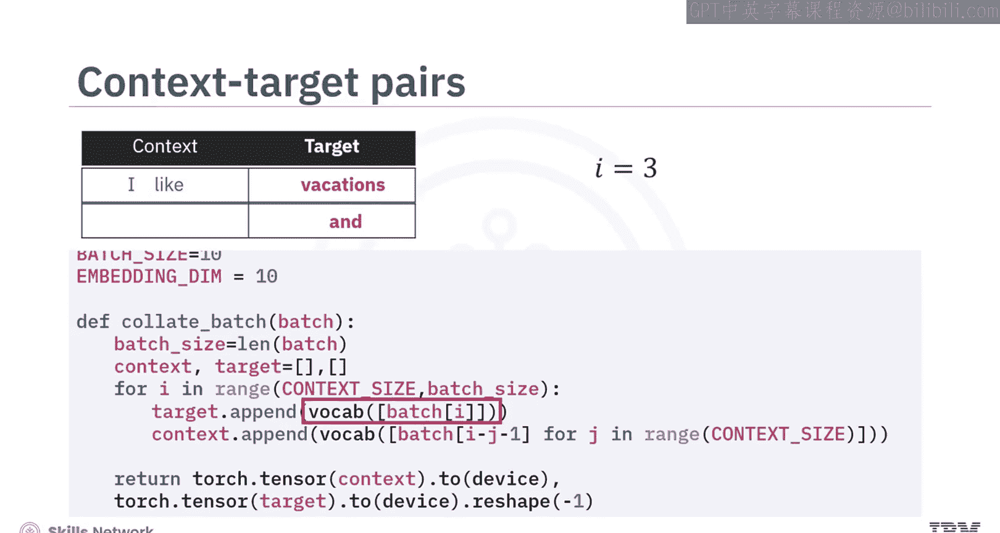

To create a toy data Now you'll create a pipeline that converts the text to indexes instead of using a data set object。

 you will use a list object in training the model， prioritize the loss over accuracy as your key performance indicator Tra the model similarly to your classification model by padding tokens to ensure consistent shape here you will pad with previous values for alignment。

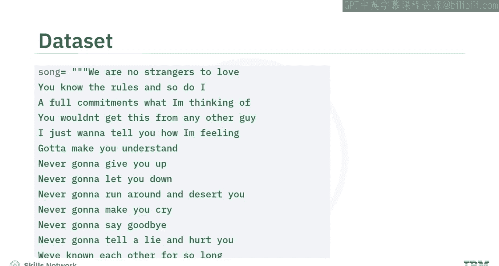

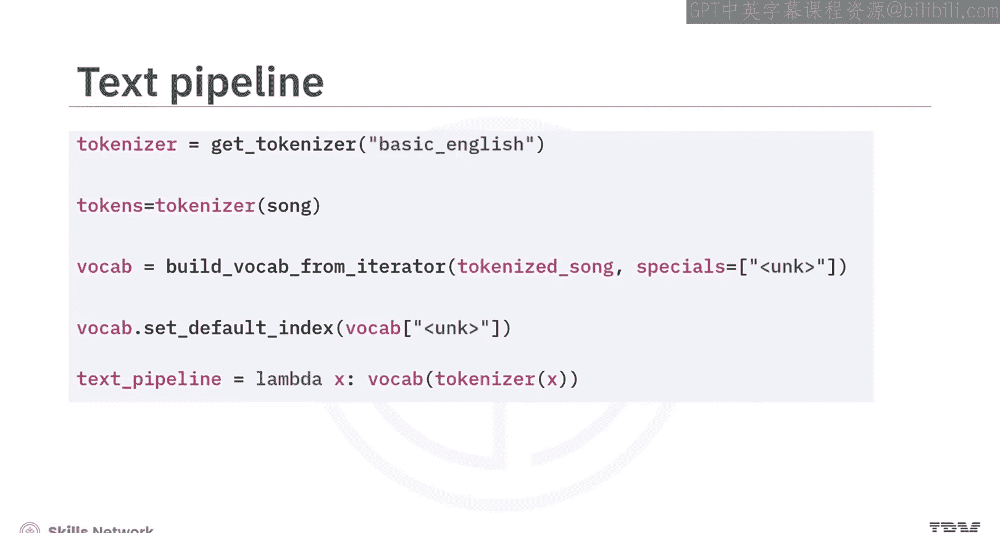

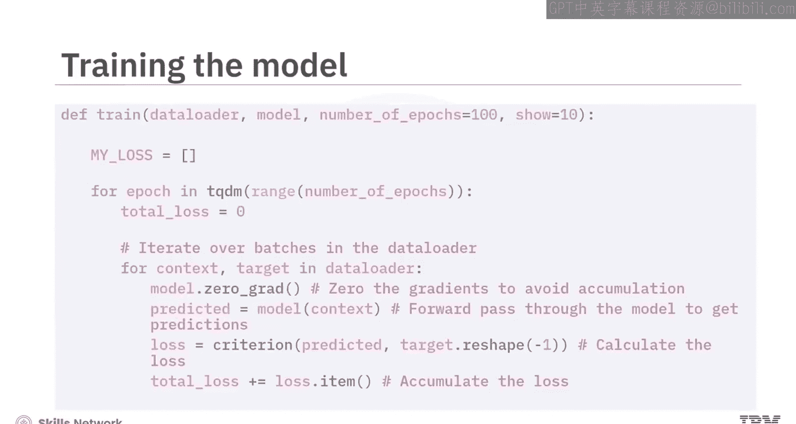

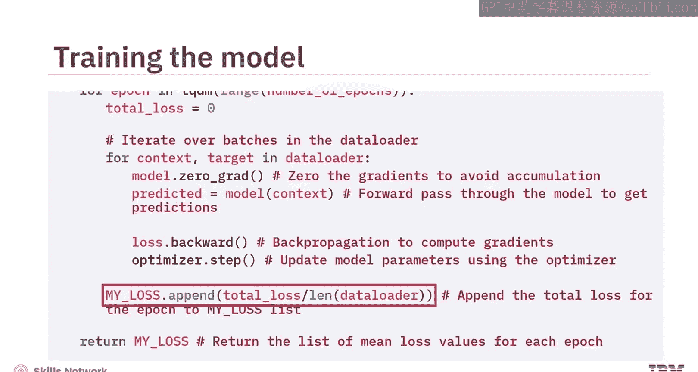

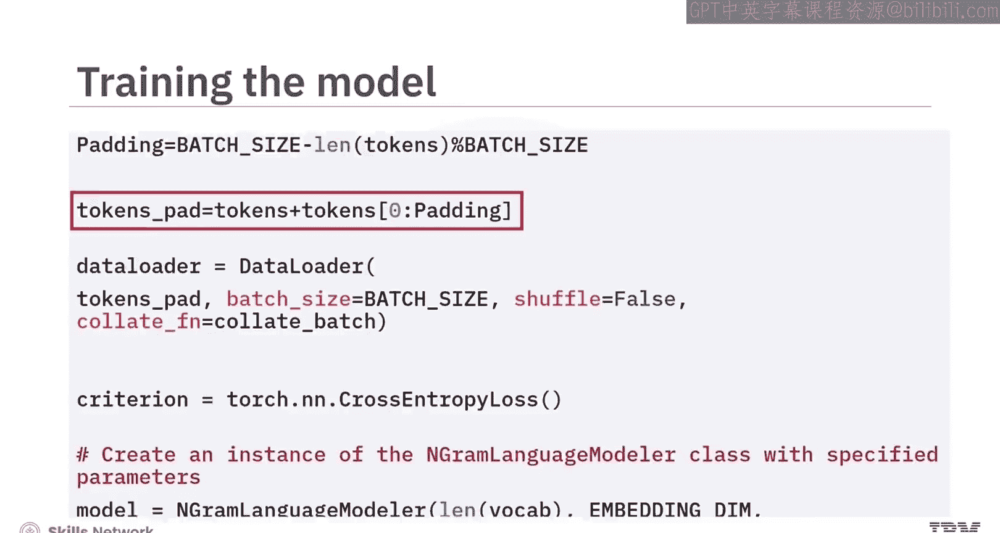

The index to token attribute obtained via Voab get it O S is a list where each element corresponds to a word。

 and the index within the list corresponds to that word token index。

 This list serves as a mapping to translate the numerical output of a neural network。

 which could represent class or token indices。 back into a human readable format。

 essentially acting as a decoder。 Thus， when a neural network predicts an index。

 This list can be used to retrieve the associated word。 Let's make a prediction。

 Apply a text processing pipeline to the string never gonnana。 The result is the list 3，1。

 which represents the token indices。 Con the list of token indices into a ptorrch tensor。

 make a prediction with the model and select the index with the largest value。 Finally。

 convert the index to a token using the index to token mapping。

 You can use this function to generate a sequence of words using a model。

 Let's now recap what you learned。

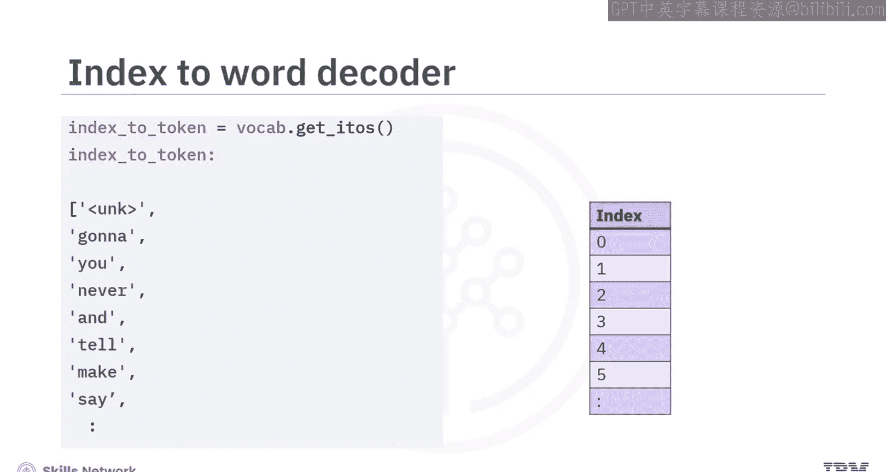

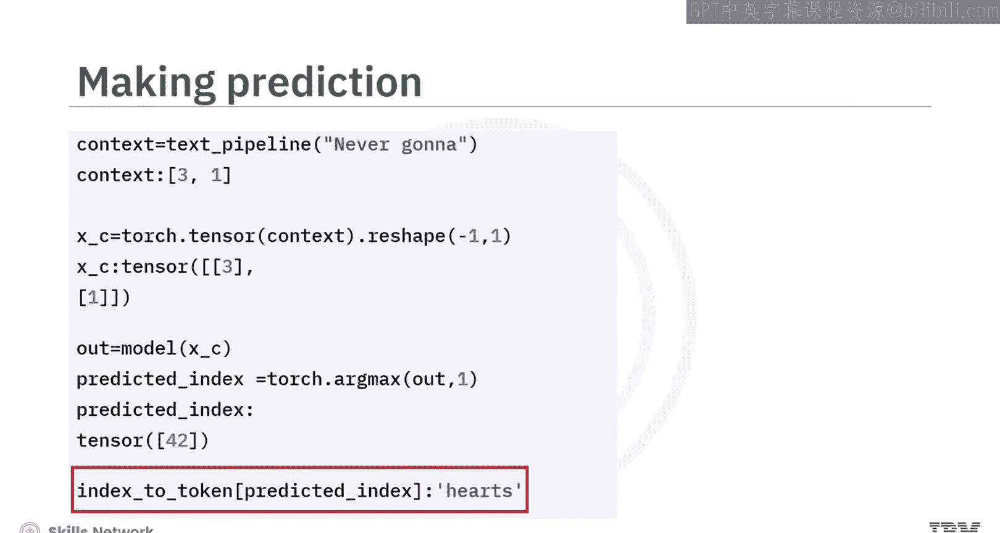

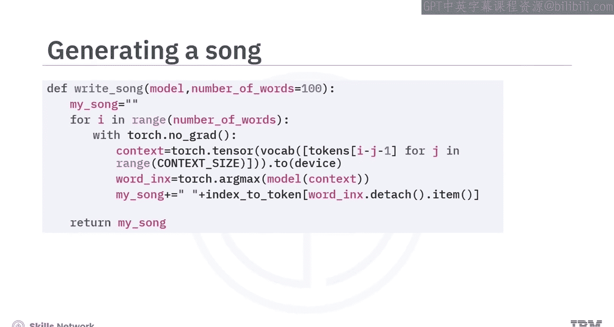

In this video， you learned that an Ngram model allows for an arbitrary context size in Pytor。

 the Ngram language model is essentially a classification model。

 using the context vector and an extra hidden layer to enhance performance。

 The Ngram model predicts words surrounding a target by incrementally shifting as a sliding window in training the model prioritize the loss over accuracy as your key performance indicator or KPI。

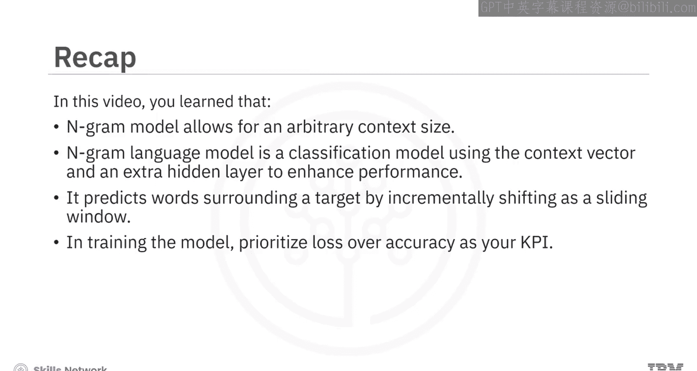