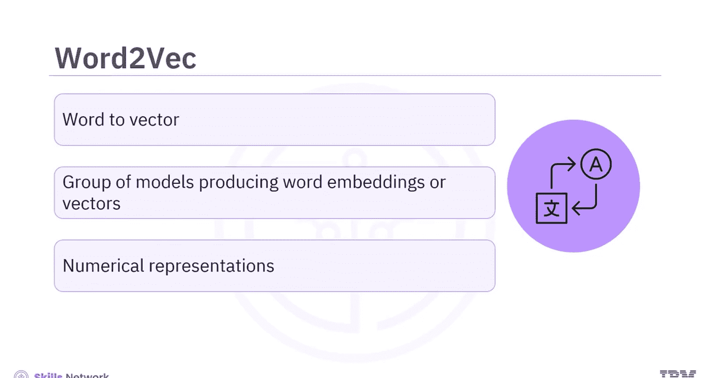
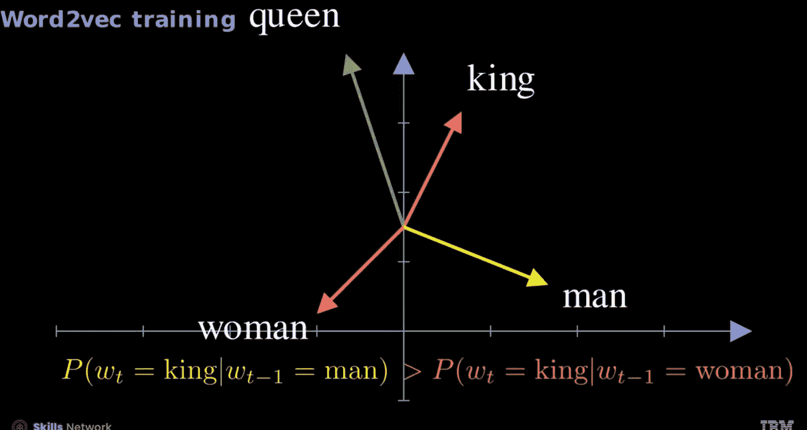
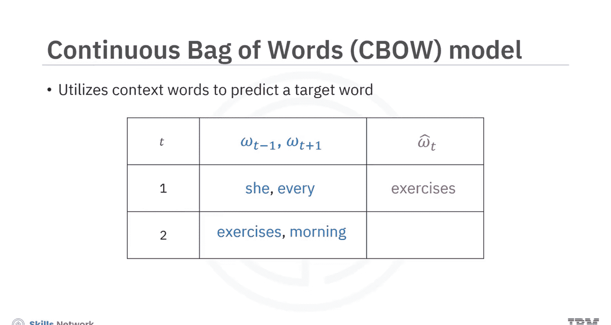
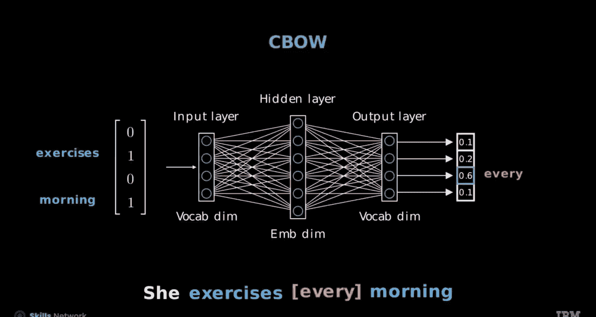
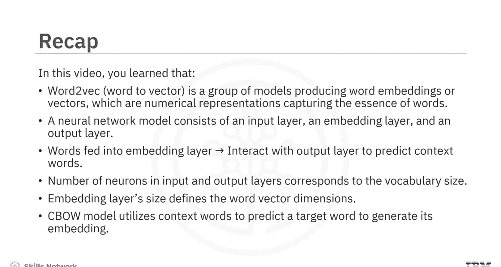

# IBM《生成式人工智能工程｜Falsk、生成式AI应用、数据分析、机器学习、Keras、架构和数据、NLP基础、transformer、微调、高级微调、RAG》 p110 7_Word2Vec简介和CBOW模型.zh_en -BV1NAq6Y9E7z_p110-

Welcome to word to Veec In and Cbo models。 After watching this video。

 you'll be able to explain the concept of word to Vec and describe word to Vex's continuous bag of words or Cbo model。

 You will also learn to create a CBbo model。 So what is word to Vec。

 It is the short form for word to vector。 It is a group of models that produce word embeddings or vectors。

 which are numerical representations capturing the essence of words。 For example。

 king is closer to man and queen to woman due to their similar meanings。Interestingly。

 subtracting man from king yields a vectors similar to queen。

 illustrating the effectiveness of these embeddings and capturing word relationships。

 These vectors can be utilized in natural language processing or NLP tasks to enhance performance by substituting the randomly generated embeddings。

 to acquire these vectors。 you can begin with randomly generated embeddings。😊。

You can use a neural network model consisting of an input layer。

 an embedding layer and an output layer。 Words are fed into an embedding layer。

 which interacts with a softm output layer to predict context words。

 Tra involves tuning the W hidden layer and W prime output layer weights to refine word vector representations。

 the number of neurons in both input and output layer corresponds to the vocabulary size。

 while the embedding layer size， which is chosen by the user defines the word vector dimensions。

 After training the neural network。 If the network predicts queen following woman with a higher probability than it does for man。

 the embedding for queen will be closer to woman than to man。  Similarlyly。

 if king is probabilistically more associated with man than with woman。

 the resulting vector for king is closer to man than woman Now。

 let's use the network to attempt to predict words from the given window using other words within the window Se the window width to one at T。

s1 exercises is the target word with she and every as context words at T equals 2。

 every becomes the target surrounded by exercises and morning in context for the context and target words with a window width of one the context includes the word at t minus1 and t plus1。

 The target word is at T at T equals1， the context consists of she and every。

 The target word is exercises。 as you move to t equals 2。

 the context includes exercises Mor and the target word is every Next。

 you will learn about the continuous bag of words or sibo model This model utilizes context words to predict a target word and generate its embedding in the table shown the second column lists the predicted word from the network When she and every are given as inputs。

 the model predicts exercises。With exercises and morninging as inputs。

 the model predicts every in the Cbo model for the sentence。 she exercises every morning。

 the input dimension of4 matches the number of unique words in the corpus。

 The goal is to predict word likelihood。 So the output dimension is also4。

 The target word is exercises。 with context words she and every combined into a bag of words vector。

 This vector passes through the hidden layer containing word embeddings in the output layer。

 Exp the highest logicit value for exercises indicating the model's prediction for this context。

Now， let's shift the context window to consider new inputs。

 The words exercises and morning are encoded as one hot vectors and provided as inputs to the model。

 During training， your goal should be to fine tune the model's weights so that it effectively predicts the target word every。

 which should correspond to the highest logict value in the output layer。To create the Cbo model。

 first， you will initialize it， Then you will define the embedding layer using N N embedding bag。

 which calculates the average of context word embeddings。

 you will also configure the fully connected layer using self do Fc with input size embed dim and output size vocab size。

 In the forward method。 you will pass input text and offsets through the embedding layer。

 which retrieves context word embeddings and calculates their average。 Next。

 you will apply the reu activation function。 Afterward。

 the output of the reu activation goes through the fully connected layer。 Finally。

 you will create an instance of the Cbo model。 Next。

 you will initialize the tokenizer using steps 1 and 2 using step 3。

 you will create a vocabulary from tokenized data。 In step 4， you will set the context size to2。

 Then you will slide over the text to form context target pairs。

Next， using step 5， you will set up a text processing pipeline。

 a data loader and a batch function for a network。 It will have a bag of words of batch size 64 to prepare batches for training on next word prediction tasks。

 Let's now recap what you learn in this video you learn that word toveec is the short form for word to vector。

 It is a group of models that produce word embeddings or vectors。

 which are numerical representations capturing the essence of words。

 A neural network model consists of an input layer and embedding layer and an output layer。

 Words are fed into an embedding layer， which interacts with an output layer to predict context words。

 The number of neurons in both input and output layers corresponds to the vocabulary size。

 While the embedding layer size， which is chosen by the user defines the word vector dimensions。

 The continuous bag of words or Cbo model utilizes context words to predict a target word and generates its embedding。

