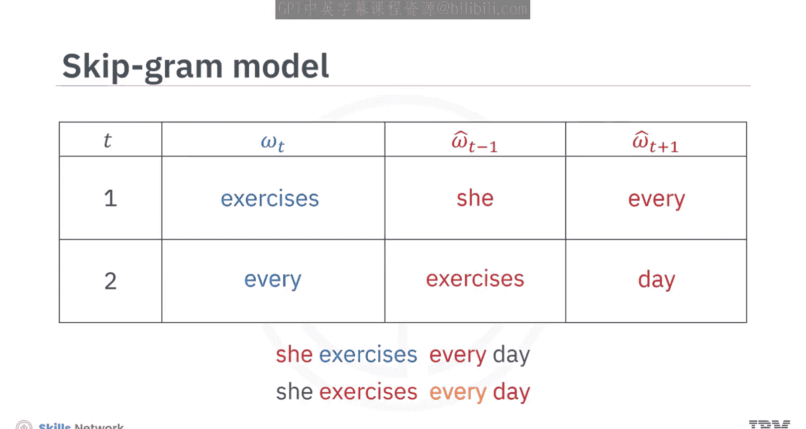
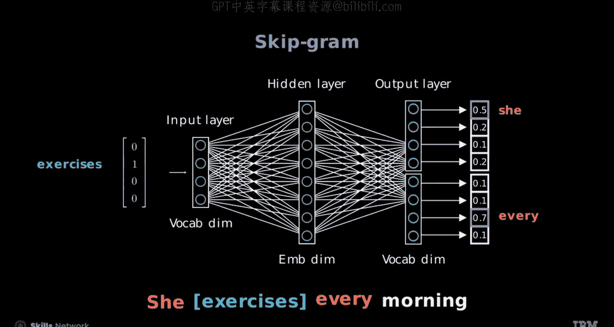
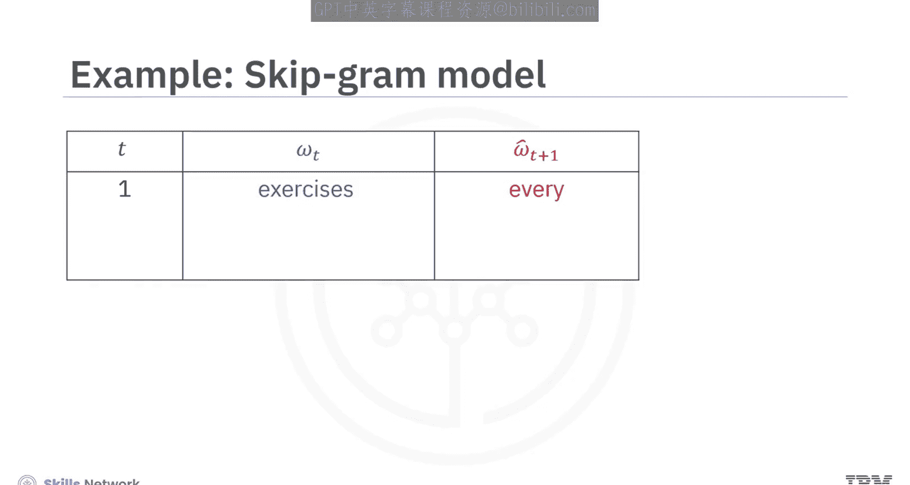
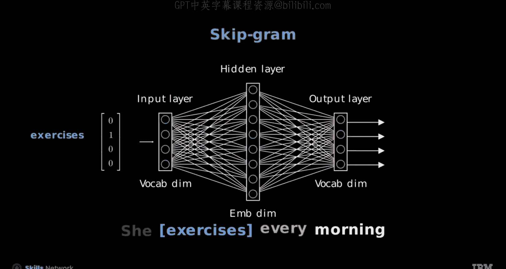
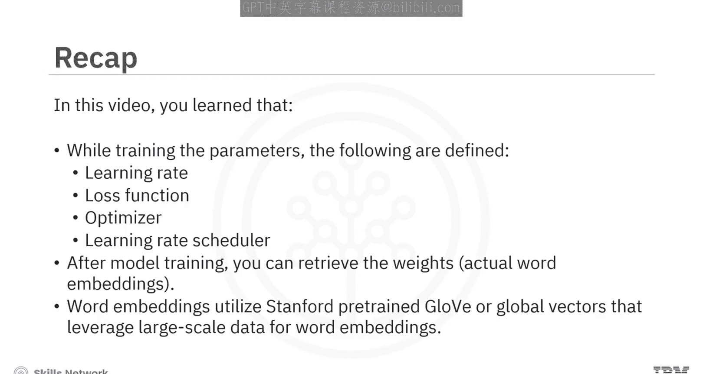

# IBM《生成式人工智能工程｜Falsk、生成式AI应用、数据分析、机器学习、Keras、架构和数据、NLP基础、transformer、微调、高级微调、RAG》 p111 8_Word2Vec跳元模型和预训练模型.zh_en -BV1NAq6Y9E7z_p111-

Welcome to Word to Vec， SkipGram and Pretrained models After watching this video。

 you will be able to describe Word to Vex's SipGm model， create a SGra model in Pytorch and train it。

 and explain large pretrained embedding models。A skip gram model is a reverse of the continuous bag of words or sebo model。

 It predicts surrounding context words from a specific target word。 For instance。

 it aims to forecast words T-1 and T plus1 for a given target word T。

At T equals one with exercises as the target， the model predicts she and every at T equals2 when every is the target。

 It aims to predict exercises and day。 The terminology may be confusing as the target is not the dependent variable In this depiction。

 Exs is the selected target word encoded as a one hot vector within the vocabulary space。

 marked by a one for exercises and zeroes for all other terms。

 The output layer is tasked with predicting the surrounding context words。 she and every Ily。

 after training， the model's output for each context position should have the highest logic values for the actual context words。

The skip gram model simplifies the task by predicting one context word at a time from a target word。

 For example， for T equals one with exercises as the target。

 it predicts the preceding context word she。 independently。

 it predicts the following context word every this makes the complex context prediction easier by breaking it into smaller manageable tasks。

 Now， let's examine the neural network。 At the input， you have one hot encoded vector for exercises。

 and the prediction is she。

The second pair is exercises， and every。

Let's take a look at the S gram model in Pytorch to create a skip graram model first。

 you will initialize it。Then you will define the embeddings layer using N N embedding。

 which creates word embeddings for the given vocabulary size and embedding dimension。

 F C layer is a fully connected layer with an input dimension or embed dim and an output dimension of vocab size in the forward method。

 The input text is passed through the embeddings layer to obtain word embeddings。 Next。

 you will apply activation and linear layer。 Finally。

 you will create an instance of the skip gram model。

The sequence generation function is identical to Cbo。

But with a switch in the order of the target and context。

 this breakdown allows you to work with the full context in smaller parts。

 The code segment breaks the context into smaller， manageable segments。

 Let's now look at the first sample in the code snippet。Each sample consists of two elements。

 the target word and its context。 The nested loop iterates through the context。

 That is the second element of the sample and appends each part to the target。

 This results in the original full context being segmented into smaller， discrete parts。 Next。

 you will flatten the data。 The collate function is similar to the sebo model。

 You will then create a data loader object。Let's examine a single batch from the data loader you have created。

 The tensors are returned， including the target and context。 You can also observe the indices。

 Additionally， the tokens are displayed here， which makes it quite intuitive to train the parameters。

 you will define the learning rate and loss function cross entropy loss criterion。

 The optimizer optimizes the parameters of the model。

 which are obtained by model Cbo parameters for the skip gram model。

 you only need to change the input object of the optimizer。

 Then you will define a learning rate scheduler。Now。

 let's define the training function to train the model for a specified number of epochs。

 You must include a condition to check whether the input is for skipgramm or Sibo。

 The output of this function includes the trained model and a list of average losses for each epoch。

Now， to retrieve word embeddings， you will call the train function with the data loader you created for training the Cbo model。

 Once the model is trained， you can retrieve the weights which are the actual word embeddings you can get the embedding vector for specific word by its index。

 Now， you will learn about text classification using pretrained word embeddings。

 Word embeddings utilize Stanford's pretrained glove or global vectors that leverage large scale data for word embeddings using a different method It can be integrated into pytorrch via torch text vab for improved NLP tasks such as classification。

 you will initialize glove with glove within parentheses name equals within single quotes 6 B to load pretrained vectors and create a custom vocab object to match different tokens。

 you've developed a text classification model and integrated glove word embeddings into a pitorrch layer you。

😊，Dot from pretrained with G Ves 6B dot Ves。You will create a word amending bag operation。

 You can also try setting freeze to false if you have a larger data set。 That's it。

 Check out the lab for more。 Let's now recap what you learned。

 In this video you learned that skip gram model predicts surrounding context words from a specific target word。

 It operates in contrast to the Cbo model。 The skip gram model simplifies the task by predicting one context word at a time from a target word The sequence generation function in the creation of the skip gram model is identical to Cbo。

 but with a switch in the order of the target and context。

 This breakdown allows you to work with the full context in smaller parts。

 while training the parameters， you define the learning rate。 Los function。

 Opimr and learning rate scheduler。 Once the model is trained， you can retrieve the weights。

 which are the actual word embeddings。 Word embeddings utilize Stanford pretrained glove or global vectors。

That leverage large scale data for word embeddings。

