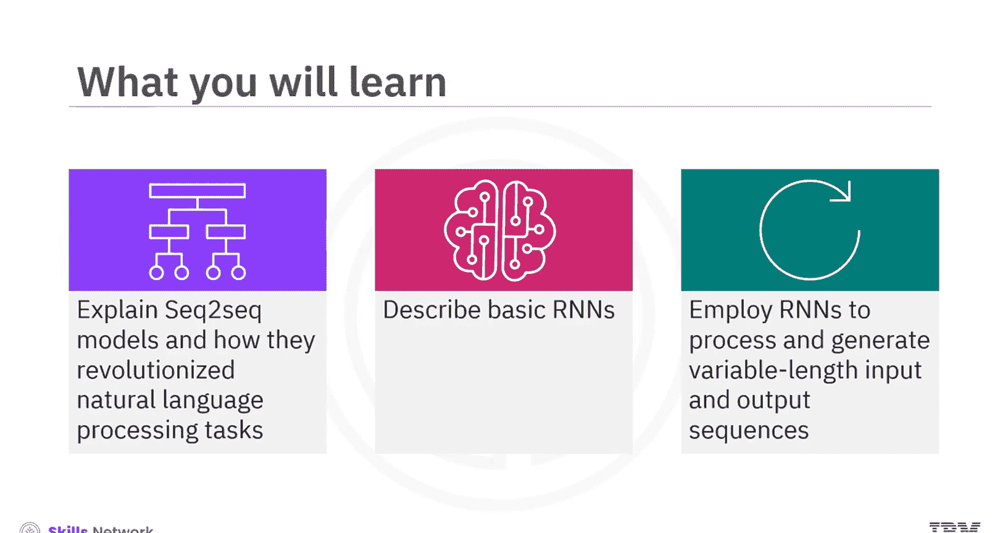
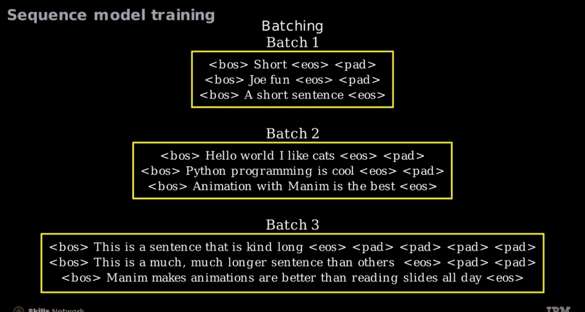
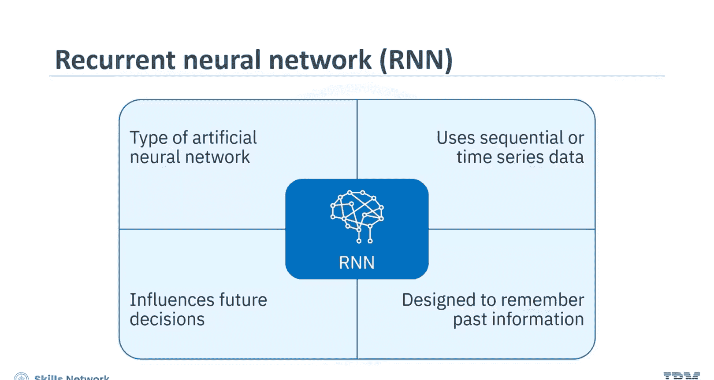
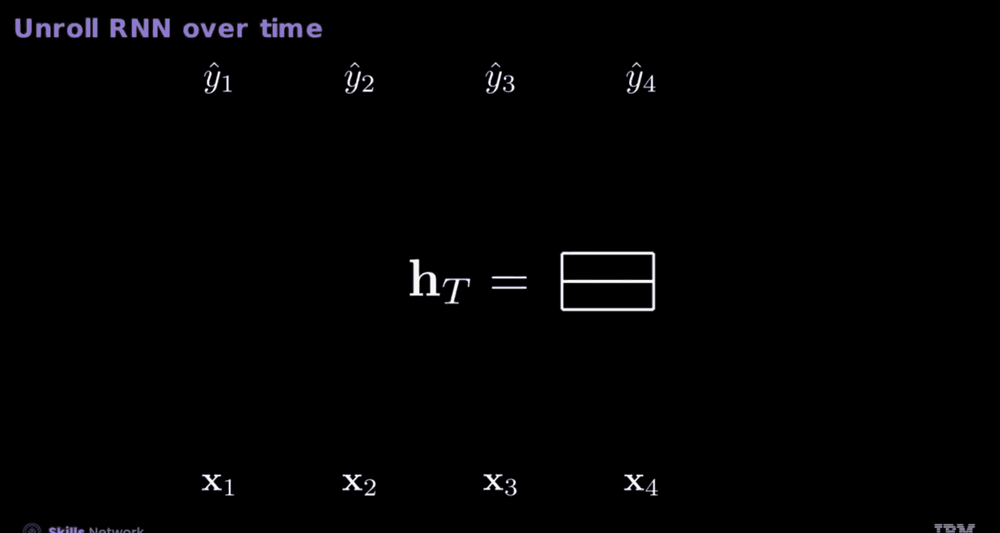
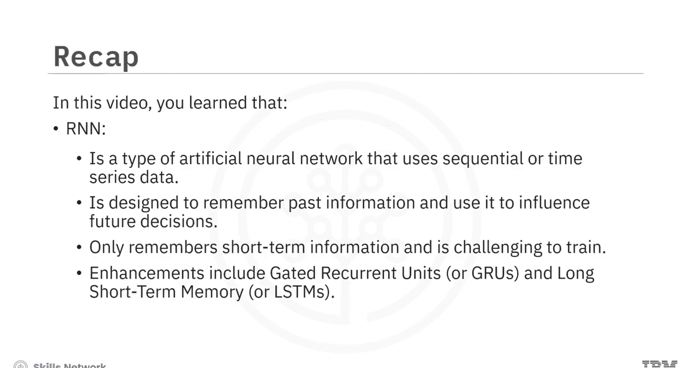

# IBM《生成式人工智能工程｜Falsk、生成式AI应用、数据分析、机器学习、Keras、架构和数据、NLP基础、transformer、微调、高级微调、RAG》 p112 9_序列到序列模型和循环神经网络简介.zh_en -BV1NAq6Y9E7z_p112-

Welcome to the introduction to sequence to sequence models and recurrent neural networks After watching this video。

 you'll be able to explain sequence to sequence models and how they have revolutionized various natural language processing tasks such as machine translation。

 text summarization and chatbots， you'll also be able to describe basic recurrent neural networks or RNNs and how sequence to sequence models employ RNNs to process variable length input sequences and generate variable length output sequences sequence to sequence models within generative AI are used in machine translation such as converting English phrases into French chatbots transform your queries into conversational responses。

 while sumization algorithms condense extensive texts into concise summaries with codegeneration you describe your task and the AI generates the appropriate code。

Sequence to sequence models process multiple inputs here illustrated by5 embedding vectors labeled x1 to x5 corresponding to time units。

 the outputs marked y1 to y5 typically represent tokens but can vary widely with many applications notably input and output sequences need not be of equal length For instance。

 sequence to label tasks take multiple inputs to produce a single label Use in document classification。

 conversely labeled to sequence tasks generate a full sequence from a single input as seen in generative models for image creation context is vital for accurately interpreting language Take the sentences the man bites the dog and the dog bites the man while a bag of words model cannot differentiate between them treating them as similar due to identical word frequencies。

 sequence representation through one hotend words or embeddings captures their distinct meanings The difference is highlighted。

In red， illustrating how such representations enable a more precise understanding of context neural networks typically operate under the assumption that each sample is independent and identically distributed or IID to illustrate。

 imagine drawing a ball labeled with variable Yt from an urn multiple times。

 If each draw is independent and the urns contents are unchanged。

 the T is redundant and the probability distribution remains constant fulfilling the IID assumption。

 however， consider the scenario where the balls are not replaced after each draw In this case。

 the probability for y at T equals1 is11 but the probability at T equals2 depends on the previous draw at T equals1 This necessitates adjusting the probability distribution after each draw leading to the concept of conditional distributions the model needs memory therefore。

You require a model that can account for this dependency using models that have memory In sequence model training。

 you'll refine your data starting with a collection of sentences punctuated by BOS and EOS tags to denote beginnings and ends This clear demarcation helps the model recognize start and stop points within a sequence Next。

 sort the sentences by length to batch together those of similar size which streamlines the learning process Pytorch like other frameworks requires consistent batch sizes therefore。

 you should append pad symbols to the shorter sentences to equalize their lengths with the rest Now you'll learn about recurrent neural networks or RN It is a type of artificial neural networks that uses sequential or time series data as its name suggests RN is designed to remember past information and use it to influence future decisions Let's explore how a simple RNN operates。

First， look at the input layer。Labeled as X T。 This is where your R andN receives data at each specific time step。

 It's akin to receiving a new puzzle piece at every moment。 Next。

 you have the heart of your R andN the hidden state denoted as H T。

 Think of it as the network's memory where you will apply an activation function usually a tan H it captures and retains information from all the previous inputs。

 This is crucial because it allows the network to remember and consider past data while processing the current input Now observe how the hidden state and the current input combined in some R andNs they concatenated forming a larger set of data for processing in what is also called the concatenated layer。

 This is critical for understanding the network's ability to connect past and present information。

 Let's move to the output represented by ZT。 This is what the R andN calculates at each time step based on the current input and what it has。

Remembermembered in its hidden state。 This is where the context is stored。

 This process is similar to a regular neural network for the classification problem。

 you can simply obtain the maximum value and use R andNs in Y in language modeling to predict the word omega hat This method is called greedy decoding where the model picks the highest score token and returns it as its prediction。

 please note that top K sampling strategy seem to produce more fluent text than the traditional greedy method let's unroll the R and N over time。

 start with the initial hidden state that is a vector of zeros。

 Then with each input Xt the R andN updates its hidden state H T and produces the output hat Y t for the next iteration In a new input Xt and the network utilizes the hidden state from the first time step Learn from the past to inform the future and then the process。

To output a sequence hat YT， you sometimes need to use only the hidden state。

 or you can even use the last hidden state H as an input to another R RNs only remember short term information and are challenging to train to popular RNN enhancements are gated recurrent units or GRs and long shortterm memory or LS In a GU there are two gates。

 the reset R and the update Z The update gate determines the proportion of the previous hidden state to carry forward while the reset gate decides how much of the previous hidden state to disregard working together they update the hidden state and control the flow of information over time Finally another activation function is applied before the model makes a prediction the LSTM cell comprises the input gate the forget gate and the output gate L。

Extend a network's memory complementing short term with long term recall They selectively retain and transport crucial data through time。

 The diagram shows H as short term memory discerning what's important Its selectively filters specific information from C that is pertinent to the current time step conversely C preserves the full scope of the memory to be conveyed to subsequent time steps Let's now recap what you learned in this video you learned that sequence to sequence models within generative AI are used in machine translation such as converting English phrases into French sequence to label tasks take multiple inputs to produce a single label useful in document classification label to sequence tasks generate a full sequence from a single input as seen in generative models for image creation R andN is a type of artificial neural network that uses sequence or time series data It is designed to remember。

Past information and use it to influence future decisions RNNs only remember short term information and are challenging to train Two popular RNN enhancements are gated recurrent units or GRUs and long short term memory or LSTMs。

。