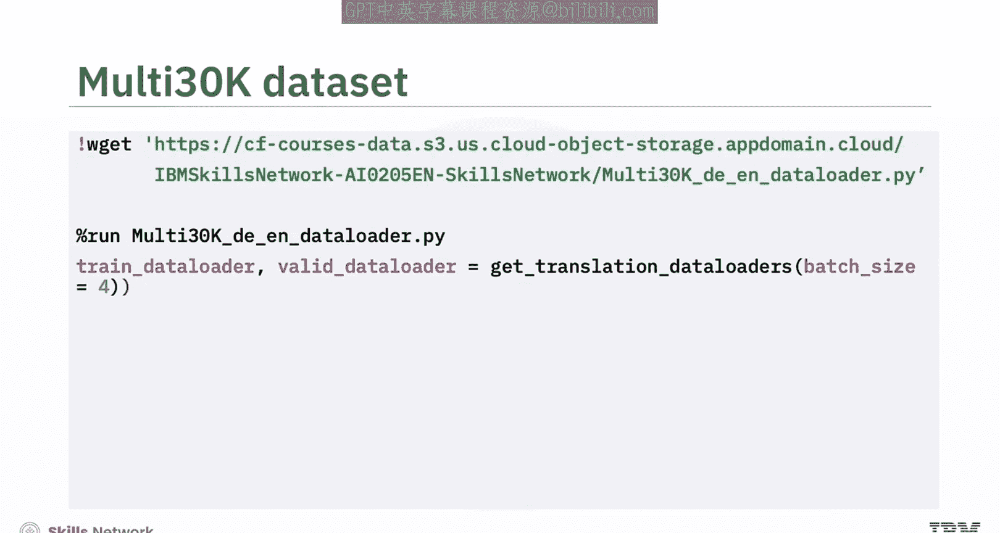
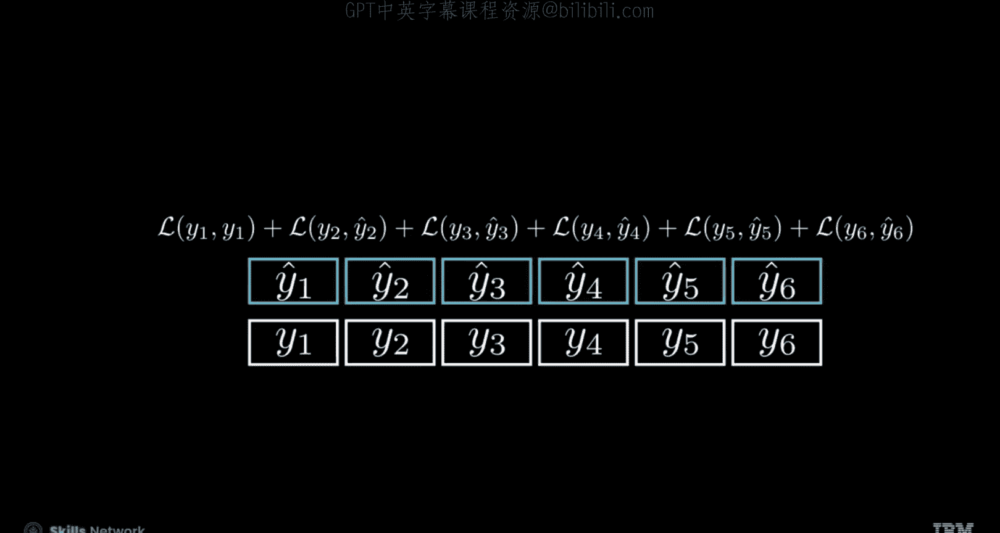

# IBM《生成式人工智能工程｜Falsk、生成式AI应用、数据分析、机器学习、Keras、架构和数据、NLP基础、transformer、微调、高级微调、RAG》 p113 10_编码器-解码器RNN模型的训练和推理.zh_en -BV1NAq6Y9E7z_p113-

Welcome to Encoder decoder RNN modelss， Train and inference。 After watching this video。

 you will be able to use a translation data set in Pytororch to train and infer an encoder decoder RNN based model。

 you will be working with the multi 30 K dataset set， which includes training。

 validation and test sets of English to German text。

Before delving into implementing the sequence to sequence or seek to seek model。

 let's review how to load data in batches for training models using Pytorrchs data loader A dot Py file has been created that fetches the multi 30 K data set。

 The collation that is tokenization， numericalization， and addition of beginning of sequence or BOS。

 end of sequence or EOS and padding have also been done。

You will also see the created iterable batches of SRC and TRG tensors。As a first step。

 you must download and run the dot pi file， Then call the get translation data loaders function with an arbitrary batch size to create the data loaders for training and validation。

 You can also check a data sample。 In general， sequence to sequence models are more difficult to train than R NNs and several factors come into play。

 However， typically， the aim is to minimize the cross entropy loss by summoning the output of the predicted outcomes with the actual labels。

 Let's use blue to denote a correct prediction。 The procedure for training sequence to sequence models has almost similar steps。

 But let's highlight similar differences from neural networks。 First。

 initialize the model in training mode to activate essential layers like dropout。

 ensuring optimal performance during training。

Iterate through training data batches， assign input， SRC。

 and target TG sequences to the correct device and generate predictions by output。

For sequence models like R and Ns， where the input shape often differs from other model types。

 it's crucial to reshape the output's tensor2 Here， target length1 represents the rows。

 excluding the initial B or beginning of sequence token。

 ensuring you don't include it in loss computation。 batch size is the columns。

 Each representing a separate sequence in the batch and output dimension corresponds to the columns representing the predicted output for each token in the sequence。

 This reshaping aligns the rows and columns correctly for loss calculation。

 matching the output predictions to the target dimensions。 Finally。

 you can calculate the average loss per batch after processing all batches。

 You will also create an evaluate function that is identical to the training function。

 but you must use different data and set the model to eval to speed it up。

 Let's see how to make a prediction。 Per translations in sequence models requires a more complex。

for making predictions。 The function takes a model， a source sentence。

 a target language vocabulary and a maximum translation length。 Firstly。

 convert the source sentence to the correct format。

 then feed it into the models encoder to obtain hidden and cell states。

 Start the target tensor with the B token to initialize the translation and reshape it。

 to generate the translation， iterate up to max L。 utilize the last target tensor and the previous states in the decoder to obtain new outputs and states。

 Then choose the next token with the highest probability。 Add it to the translation and store it。

 end the process if the E token appears。 else feed the output to the input。 Finally。

 convert token indices to words。 remove special tokens and concatenate the tokens to form the translationd sentence。

 Now， you're ready to run all the functions in the lab。 Let's now recap what you learned。

 In this video， you learned that in general。Sequence to sequence models are more difficult to train than R andNs due to several factors in model training。

 the aim is to minimize the cross entropy loss by summing the output of the predicted outcomes with the actual labels。

 the procedure for training sequence to sequence models includes initializing the model and training mode to activate essential layers like dropout。

 ensuring optimal performance during training， iterating through training data batches。

 assigning input SRC， and target TG sequences to the correct device。

 and generating predictions by output， reshaping the output's tensor。

 which aligns the rows and columns correctly for loss calculation。

 and finally calculating the average loss per batch after processing all batches。

 Per translations in sequence models requires complex functions for making predictions。

