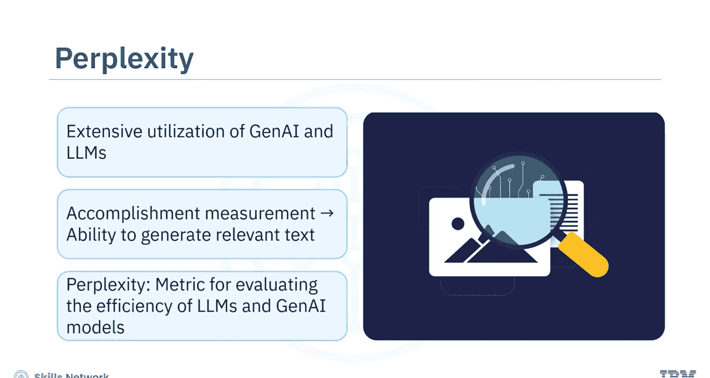
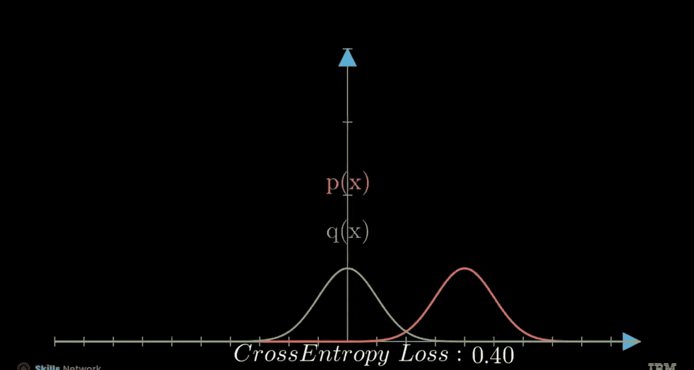
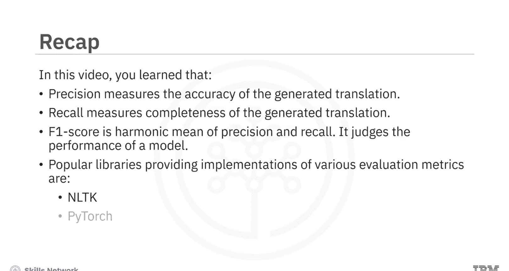

# IBM《生成式人工智能工程｜Falsk、生成式AI应用、数据分析、机器学习、Keras、架构和数据、NLP基础、transformer、微调、高级微调、RAG》 p115 12_评估生成文本质量的指标.zh_en -BV1NAq6Y9E7z_p115-

Welcome to metrics for evaluating the quality of generated text。 After watching this video。

 you will be able to describe the concept of perplexity。

 Evaluate the quality of text using precision and recall in text generation and implement evaluation metrics for generated text。

 generative AI and large language models or LLms are extensively used to generate texts。

 images and a lot more。 The measurement of their accomplishment lies in their ability to generate consistent and contextually relevant text。

 But how can you measure and evaluate the performance of these models accurately。

 This is where perplexity comes into play。 It is a metric that has emerged as a precious tool for evaluating the efficiency of LLms and Gen AI models。

 Let's take a look at an illustration。 Consider the phrase， I love to travel。😊。

Given a text corpus， there are tools to assign precise probabilities to whole sequences of words。

 effectively gauging the likelihood of any specific sequence occurring within the data。

 This probabilities mirror true values or y labels in a classification task As you parse the sentence note that the conditional probability becomes more complex。

 Each word's probability takes into account the cumulative context provided by all preceding words。

 For instance， travel isn't considered alone， but as part of the chain I love to Ref its dependence on what has already been said。

 This principle is universally applicable to sequences of any length。

 symbolized by the variable omega T to represent each word It is crucial to understand that this is a simplified model。

 actual probability Comps for a complete corpus are significantly more elaborate。

 denote this inferred probability as P。To evaluate the performance of your language model or LM。

 you must compare its output against the actual likelihood typically derived from validation data。

 Your LM calculates the probability of observing a particular sequence as illustrated here。

 it approximates the true probability distribution exemplified by a bygram model sourced from a neural network。

 where theta represents the model parameters and the first term is one。

This estimated probability is known as the likelihood， which is symbolized as Q。

 The term Q is essential for gauging the fidelity of your Lm to the underlying data it aims to represent This is closely related to the loss function in perplexity。

 you can employ cross entropy loss to measure the discrepancy between the predicted and actual distribution。

 for demonstration， a simplified scenario is presented with a single variable。

 As your predicted distribution converges with the true distribution。

 the cross entropy loss diminishes。 Ily， when the two distributions coincide perfectly。

 the cross entropy loss reaches 0， indicating no difference between them。Consequently。

 as the predicted distribution more closely approximates the true distribution。

 you'll observe a decrease in the cross entropy loss。

 signifying an improvement in your model's accuracy in the context of language modeling。

 perplexity can be seen as a measure of how surprised or uncertain the model is when predicting the next word in a sequence perplexity is calculated as an exponent of the loss obtained from the model for each sequence。

 perplexity is calculated from the average loss of all its tokens。

 by applying the exponential function to the average cross entropy loss， you can obtain perplexity。

Exponentiating the loss has the effect of undoing the logarithm and transforming the value back into a more interpretable space。

 Let's look at an example to see how to calculate perplexity。

 Suppose you have another model with less accurate predictions。

 as shown by applying the exponential function to the new loss value。 You get 142。6。

 You can see that the exponential function makes the difference clearer。

 Low perplexity values indicate better performance。

 Perplexity provides an overall measure of model performance。

 but doesn't capture the nuances of generated text quality。

 Perplexity is usually used only to determine how well a model has learned the training set。

 Other metrics like blue Rouge and more are used on the test set to measure test performance。

There are also metrics that measure the similarity between the generated text and a set of references based on Ngram matching。

 this is helpful in evaluating the quality of the generated text。

And when there is more than one valid generated text， for example， in the translation task。

 you can compare the generated translation with different versions of the translation。

 This illustration shows how match ngrams are counted by comparing a hypothesis sequence with a reference sequence the is matched。

 So the unigram count increases to1 Big is not matched。

 so the unigram count remains one Cat is matched， so the unigram count increments to2 Si is not matched。

 So the unigram count stays at two on is matched， so the unigram count goes to3 The is matched。

 so the unigram count increases to4 Also on the is the first matched bygram。

 so the bygram count increases to1 rugg is not matched。

 So the unigram count remains4 and the bigram count remains one in machine translation precisionion and recall are used to evaluate the quality of the translated text compared to the reference。

Tar translation precisioncision in machine translation measures the accuracy of the generated translation count match is the number of matching n gras between the generated translation and the reference translation and count generated is the total number of n gras in the generated translation。

Recall that machine translation measures the completeness of the generated translation。

 It emphasizes the coverage of the important content from the reference translation。

 Count reference is the total number of Ngrams in the reference translation。

 F1 score is also a harmonic mean of precision and recall that is used to judge the performance of a model based on them in the field of natural language processing or NLP。

 There are several popular libraries providing implementations of various evaluation metrics。

 Some of the commonly used libraries for NLP evaluation metrics are NLT K library。

 which includes blue and meteor。 You can also see their initialization codes。

 Then you have the pi towards library with perplexity and cross entropy loss。

There are other libraries as well that include Blue and Rouge。

Let's look at a use case of the NLTK library that calculates the blue score for a generated translation first define a function that creates references and hypothesis lists in the format that sentence blue accepts。

 calculates the blue score for them and returns the score， then create an array of references。

 finally， call the function to calculate the blue score for the hypothesis sentence that can be the models generated translation。

Let's now recap what you learned。In this video you learned that perplexity is a metric and a precious tool for evaluating the efficiency of LLMs and Gen AI models In perplexity。

 you can employ crossenttropy loss to measure the discrepancy between the predicted and actual distribution Perplexity is calculated as an exponent of the loss obtained from the model perplexity provides an overall measure of model performance but doesn't capture the nuances of generated text quality in machine translation。

 precision measures the accuracy of the generated translation。

 whereas recall measures the completeness of the generated translation F1 score is a harmonic mean of precision and recall that is used to judge the performance of a model based on them in NLP there are several popular libraries that provide implementations of various evaluation metrics such as NLTK and pytorch libraries。

