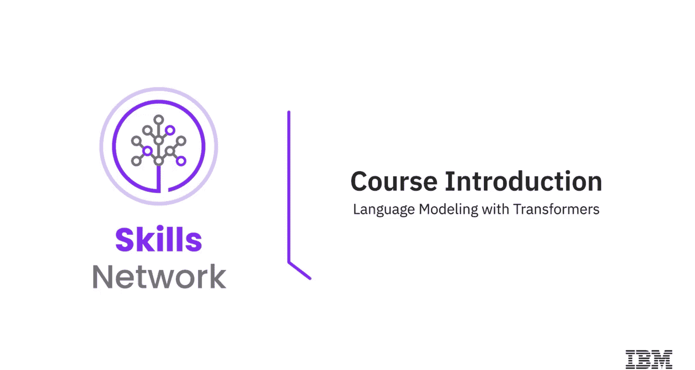
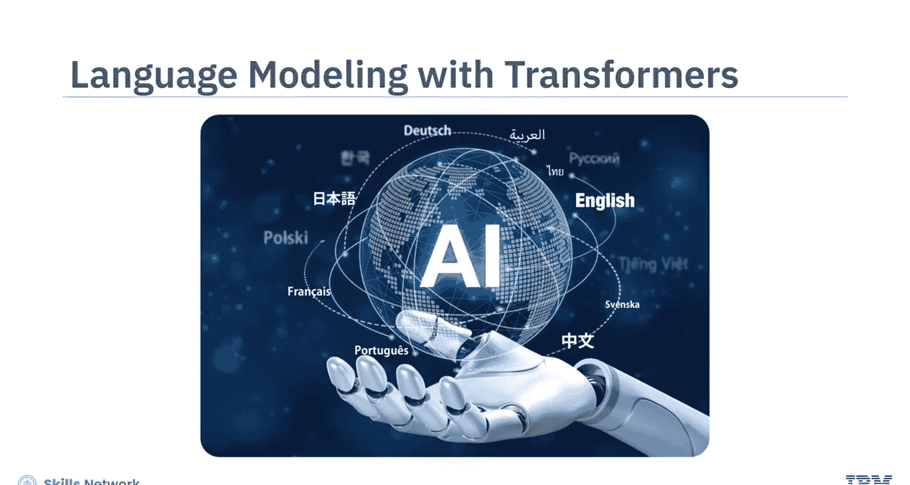
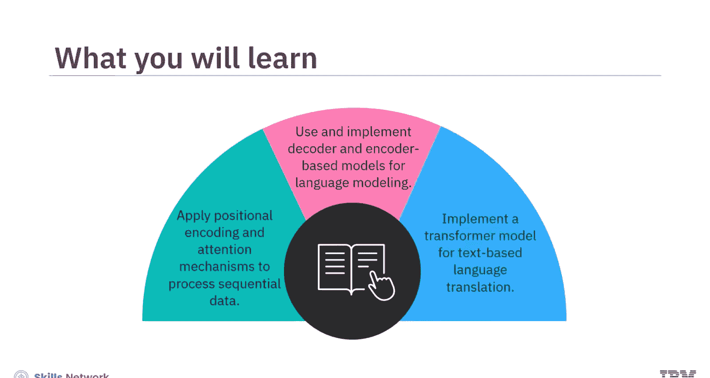
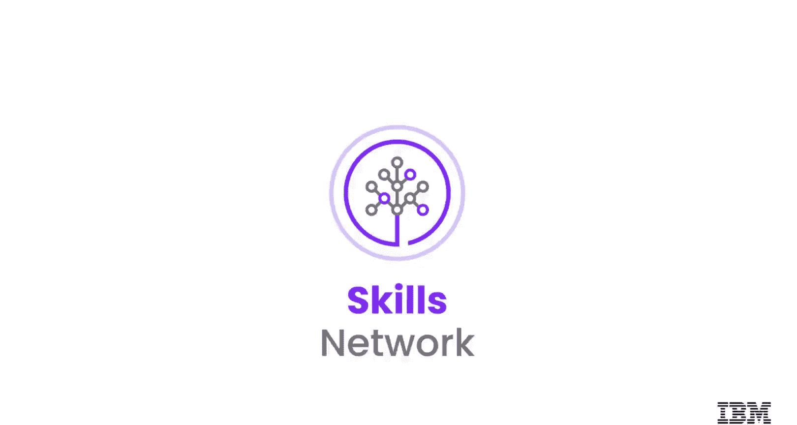

# IBM《生成式人工智能工程｜Falsk、生成式AI应用、数据分析、机器学习、Keras、架构和数据、NLP基础、transformer、微调、高级微调、RAG》 p116 0_课程介绍.zh_en -BV1NAq6Y9E7z_p116-

Welcome to this course on language Modeling with Transformers here you will learn about the fundamental and advanced concepts of transformer based models for NLP。

This course is suitable for existing and aspiring data scientists， machine learning engineers。

 deep learning engineers， and AI engineers For this course。

 a basic knowledge of Python and Pytorrch and an awareness of machine learning and neural networks would be an advantage。

 though not strictly required。After completing this course。

 you will be able to apply positional encoding and deten mechanisms in transformer based architectures to process sequential data。

 use and implement decoder based models such as GPT， and encoder based models such as BRT。

 or language modeling， and implement a transformer model to translate text from one language to another。

In module 1， you'll learn about positional encoding and its implementation in Pytorch。

 You'll also learn how the attention mechanism works in language translation。

 how self attention mechanisms help in language modeling and how transformer based models are used for text classification。

 Further， you'll understand the functionality and implementation of the scaled dot product attention mechanism。

 and also learn to enhance the efficiency of attention mechanisms。In the hands on lab exercises。

 you'll use Pytorch in the Jupiter environment to implement a basic self attention mechanism and positional encoding you'll also apply transformers to perform text classification using a data loader。

In module2， you'll learn about decoder models like GT and encodeder models like BERT。

 along with their training and Pytor implementation。

 you'll also learn to pretrain BRT model using masked language modeling or MLM and next sentence prediction or NSP。

 and also perform data preparation for BERT。Finally。

 you learn about the applications of transformers for Trans by understanding the transformer architecture and its implementation in handson labs。

 you'll build and train a decoder GPT like model and an encoder model that is BerRT model Finally。

 you'll also construct a transformer model for language Trans from scratch using Pytorrch。

This course has the right mix of content to facilitate learning。

 videos are short and focused on the main topic。Readings provide detailed content primarily in text format。

 The labs provide the technical environment， detailed instructions and code snippets that you can use to complete hands on exercises。

 The practice and graded quizzes will help you apply what you learned and assess your knowledge。

To get the most from your course， watch all videos， complete the labs to practice your new skills。

 and attempt all quizzes。Let's get started on this exciting journey， good luck。

