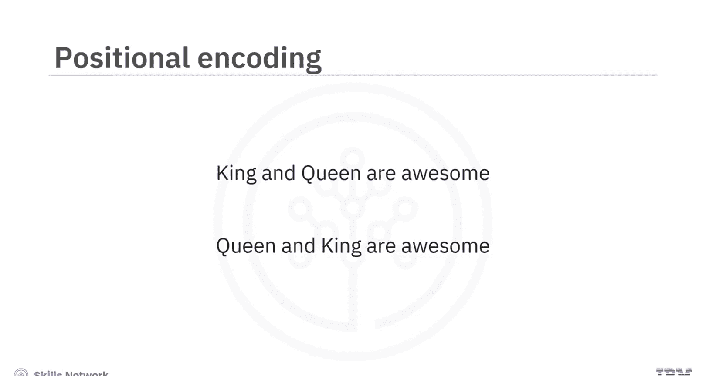
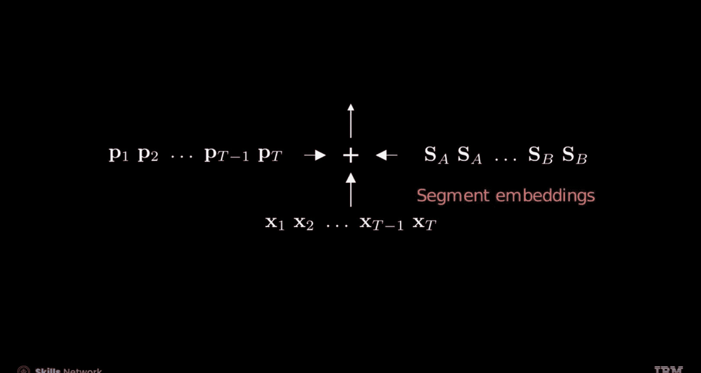

# IBM《生成式人工智能工程｜Falsk、生成式AI应用、数据分析、机器学习、Keras、架构和数据、NLP基础、transformer、微调、高级微调、RAG》 p117 1_位置编码.zh_en -BV1NAq6Y9E7z_p117-

Welcome to positional encoding。 After watching this video。

 you'll be able to explain the importance of positional encoding。

 Describe the techniques used to achieve positional encoding and implement positional encoding in pytorrch。

 Have you ever tried on scrambling letters to form words。😊。

The order of position of the letters in a word is important to convey the intended meaning。

 Similarly in transformer based models， It's crucial to capture the position of each token to maintain the semantic meaning as tokens are processed independently and simultaneously。

 Let's take an example。 Consider the phrases king and queen are awesome。

 And queen and king are awesome。 These sentences are slightly different。

 Let's look at the embeddings for these。 You'll see that the vector representation of embeddings is identical。

 You can introduce positional encoding to address this issue。

 It incorporates information about the position of each embedding within the sequence。 Typically。

 positional encoding is added to the input embeddings。

 enabling the model to differentiate between the positions of various elements and the input sequence。

 You can see that after adding positional encoding。

 The vector representations of king and queen in the second sentence shown in green is different from their vector representations in the first sentence shown in blue。

Positional encoding consists of a series of sine and cosine waves and involves two parameters。

 Let's look at them。The Pas parameter represents the position of the sine wave over time。

  similar to the time variable T or the x coordinate in a standard plot。 The parameter I。

 which is the dimension index， effectively generates a unique sine or cosine wave for each embedding。

Controlling the number of oscillations for each wave。

 each one of these waves is added to a different dimension in the word embedding Let's explore this further with an example。

Let's begin with the sequence of embeddings for transformers are awesome。

 where each row represents an embedding for a specific word。

 and each column corresponds to an element within that embedding。

Pas is the specific position of each word embedding within the sequence。 In this example。

 the sequence length is 3。 Each word embedding has a dimensionality of 4 and will be differentiated based on whether its indices are odd or even。

 Let's add positional encoding to the embedding for transformers for each dimension in positional embeddings。

 You introduce the corresponding sine and cosine waves。 Thus， for I equals 0， a sine wave is added。

 and this pattern is repeated for I equals1。 ensuring that each dimension is uniquely represented by its own wave。

You can view the values in a table。Similarly， the positional encoding values are calculated for the word R；

 finally， the positional encoding values are calculated for the wordA。

You can view a table depicting the values for positional encoding corresponding to the input sentence。

The four graphs illustrate positional encoding， one for each dimension of the word embeddings for a sequence length of three。

 you see only three values for each sine function。Let's generate positional encoding with an embedding dimension of 8 to depict a realistic setting。

 Occaionally for practicality， you can align the maximum sequence size to match the vocabulary size by rotating the positional encodings rows become indicative of varying encoding functions。

 While columns represent time where position in a sequence。

 positional encodings provide unique and periodic values for sequence positions。

 The cosine waves will never intersect the line at the same points。

 ensuring models distinguish and process variable length sequences effectively。

 their range between -1 and one prevents overshadowing the embeddings。

 These encodings also support differentialiability and relative positioning。

 making it easier to train the model， you can also represent each word embedding as a column vector X positional encoding can be conceptualized as a series of vectors where each vector P captures a specific location within a sequence when this positional vector is added to its corresponding embedding vector。

 the combination。preserveserves the positional information。

 ensuring the element sequence order is maintained within the resulting vector in models such as GT。

 positional encodings are not static， but rather learnable parameters W。

 These learnable parameters represented by tensors are added to the embedding vector and optimized during training segment embeddings used in certain models such as Bt are related to positional encodings。

 providing additional positional information。 You can integrate segment embeddings into the existing embeddings alongside the positional encodings。

Let's now look at how positional encoding is implemented using pitorrch。

 consider the embedding my embeddings。You can construct a module to integrate positional encoding into the embeddings。

 The output shape sequence length is set to exceed the longest sequence in the training data set with the embedding dimension defining its depth。

 Next， you incorporate the token's positional encoding into the embeddings and apply drop out as a regularization technique to mitigate overfitting。

 You can apply positional encoding to get the encoded tokens。

You define a module with learnable parameters for positional encoding。

 an N N dot parameter tensor is instantiated with the desired shape。

 This positional encoding is then integrated with the embeddings。

 You can also apply dropout as a regularization strategy to reduce the risk of overfitting。 Finally。

 the module applies these positional encodings to obtain the final end tokens。

Let's now recap what you learned In this video， you learned that positional encoding incorporates information about the position of each embedding within the sequence。

 Poal encoding consists of a series of sine and cosine waves and involves two parameters。

 The Pas parameter represents the position of the sine wave over time。 The parameter I。

 the dimension index， effectively generates a unique sine or cosine wave for each embedding。

 Control the number of oscillations for each wave。 positional encodings can also be learnable parameters。

 These learnable parameters represented by tensors are added to the embedding vector and optimized during training。

 Sement embeddings used in certain models such as Bt are related to positional encodings。

 providing additional positional information。😊。

