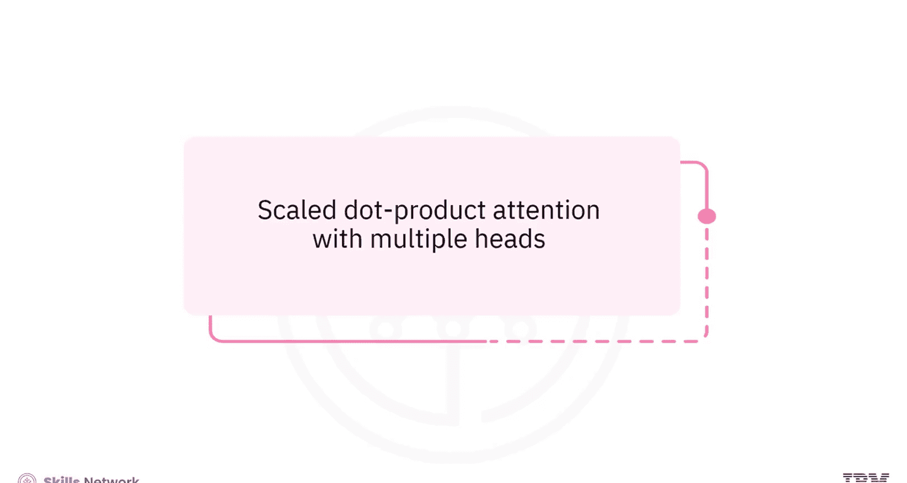
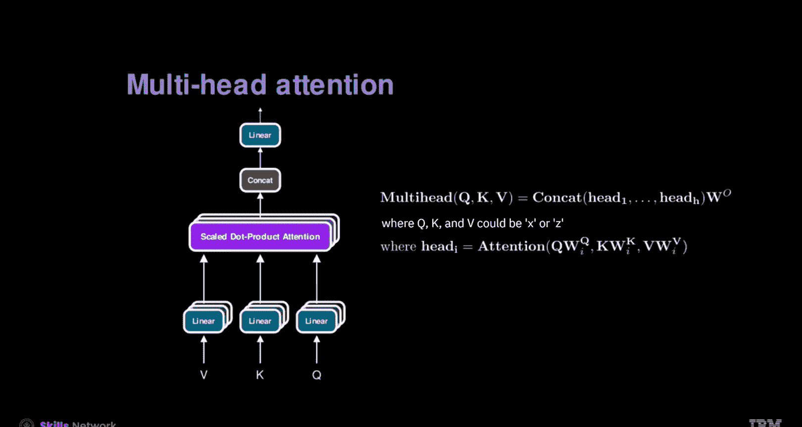
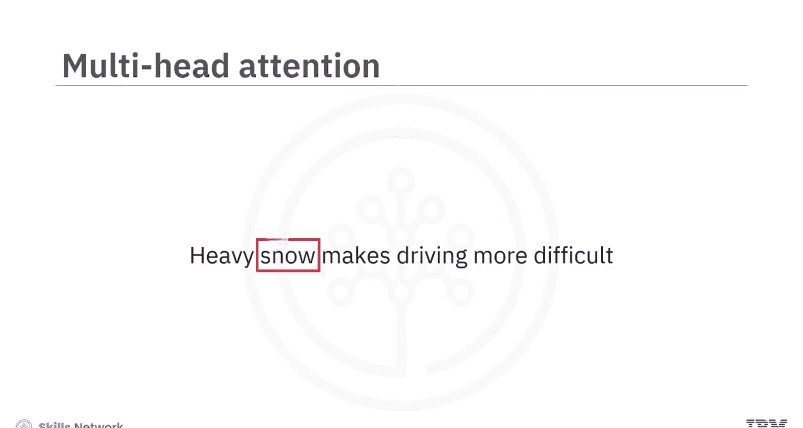
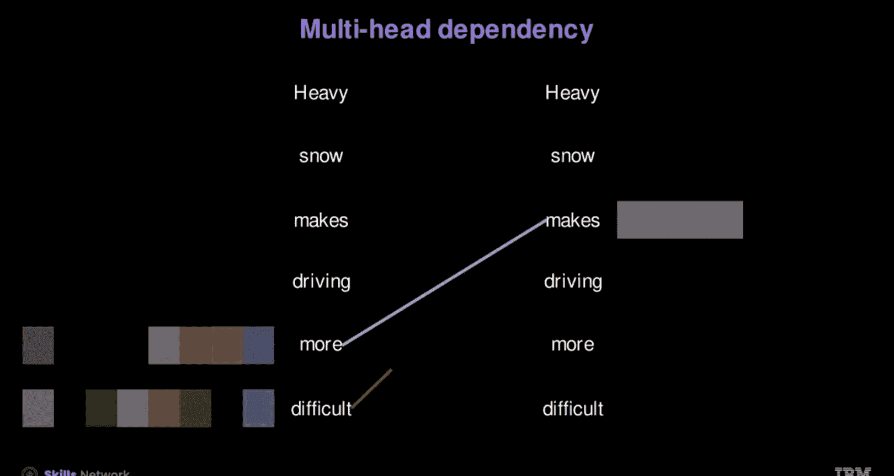
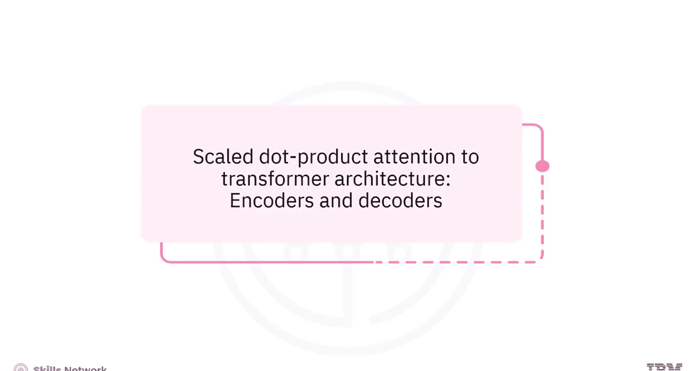
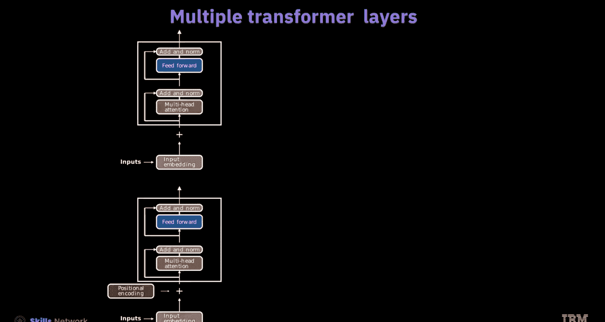

# IBM《生成式人工智能工程｜Falsk、生成式AI应用、数据分析、机器学习、Keras、架构和数据、NLP基础、transformer、微调、高级微调、RAG》 p120 4_从注意力到Transformer.zh_en -BV1NAq6Y9E7z_p120-

Welcome to the video from attention to Transers After watching this video。

 you will be able to describe the functionality and implementation of a scaled dot product attention mechanism with multiple heads。

 De how the transformer architecture enhances the efficiency of attention mechanisms and explain how to implement a series of encoder layer instances and Pytorch。

 let's first look at scaled dot product attention with multiple heads。

 the scale dot product attention mechanism within in transformformer models fundamentally involves a series of matrix multiplications。

 incorporating queries Q keys K and a scaling factor to prevent the dot product from becoming too large。

 depending on the task type， a masking operation may be employed。

 and finally the values V are multiplied to produce the output。

In the self attention architecture， the queries Q， keys。

 K and values V all derived from the same input column vector X。

 They are each multiplied by their respective learnable parameter matrices for tasks such as language translation。

 cross attention mechanisms are utilized， wherein the values and keys come from a different input source。

 like the language that needs to be translated， represented as Z。

Multihead attention operates by executing several scale dot product attention processes in parallel。

The output is called heads。 This strategy allows each head to attend to distinct segments of the input sequence。

 For example， the input consists of embeddings displayed at the bottom is 7。

4 dimensional vectors in blue。The output is an enhanced set of embeddings depicted as 74 dimensional vectors at the top in gray。

 You multiply the inputs by the learnable parameter and scale dot product attention。

 followed by a linear layer。Then you multiply the result by a final learnable parameter。

 and the output is termed a head In an example with multiple heads。

 each four dimensional vectors is split into two two dimensional vectors， yielding 14 vectors。

 These split vectors are processed by their individual attention mechanisms。 Sub。

 the 14 output vectors are concatenated， Recombining the corresponding pairs to produce 74 dimensional vectors。

 Then the final linear layer is applied。 You can scale the process for an arbitrary number of heads by concatenating the outputs of each head and then multiplying them by a final linear layer。

 The number of heads serves as a hyperparameter with the sole constraint being that the input dimension must be divisible by the number of heads。

 Consider the phrase， heavy snow makes driving more difficult。

 You can see that makes as multiple dependencies， including snow more and difficult。

 In this instance， the color blocks represent different heads in the multi head attention。

 Each head focuses on a different dependency。 One of the attention heads focuses on the distant。

Depenency of the verb makes completing the phrase makes more difficult。

 Other heads focus on snow and driving。 You can utilize the N N dot multihead attention module of pytorch to initialize the multi head underscore attention object with an embedding dimension of4 and two attention heads。

 You must ensure that the number of embedding dimensions is divisible by the number of heads by performing a modulus check。

 The multi head attention object is then instantiated with the specified parameters。

 You can explicitly set batch first to false adhering to the standard sequence processing convention。

Randomly generated query， key and value tensors with a sequence length of 10 and a batch size of 5 are created。

 You can then invoke the forward method of the multihead attention mechanism。

 The output size matches one of the input sizes Signifying consistent dimensionality。

 It's important to note that multi head attention is merely one component of the broader transformer architecture。

 The efficiency of attention mechanism can be enhanced by incorporating additional layers。

 as in the case of transformers。 The two primary types of transformers are encoders and decoders。

 In the encoder phase of a transformer。 The multi head attention mechanism。

 initiates the process by handling word embeddings that have been combined with positional encodings。

 Only the input represented as x is passed to the multihead attention。 Unlike some models。

 encoder models do not apply masking directly to the attention mechanism。

 The next step is the normalization process referred to as add and norm。

 It is essential as it merges the attention output with its original input embeddings and normal。

As the result， this process enhances the depth of the model while mitigating potential issues with gradients。

 subsequently， a feed forward network applies a fully connected layer to each position。

 followed by an additional add and norm phase depending on the requirements of the specific use case。

 further layers can be integrated into the architecture in the transformers decoder。

 the multiheadten layers distinctly masked to prohibit foresight into future data This design ensures that each position can only attend earlier positions in the sequence。

 Additionally， normalization layers are employed consistently throughout the decoder for complex tasks like language translation。

 across attention layers incorporated， following this。

 a positionwise feed forward network applies a fully connected layer independently to each position succeeding by an addd and norm step。

Further refining the output while decoders primarily drive language generation。

 they also include a final linear layer analogous to a neural network。

 which maps embeddings to word predictions in Pytorch implementations。

 a masked encodeder can be adapted to perform similarly to a decoder， which may seem confusing。

Stacking multiple transformer layers in series allows the modeling of complex relationships and representations within the data across different levels。

 In this instance， you stack two encoder layers。 This layer depth is an important hyperparameter that can be adjusted to enhance performance。

 Let's see how you can construct a series of encoder layer instances in pytorch。 First。

 specify the number of attention heads and the dimensions of the embeddings。

Then determine the desired number of layers。 The next step is to create a transformer encoder layer object by specifying the number of heads in the dimensionality of the embeddings。

 then provide the number of layers to the transformer encoder constructor to assemble a sequence of encoder layers。

 positional encodings are added before this。 You can randomly initialize the input tensor x with dimensions corresponding to sequence length batch size and embedding dimension When x is passed through the transformer encoder。

 it is process sequentially across all the encoder layers。

 Each layer applies multihead self attention followed by feed forward neural networks incorporating residual connections and layer normalization at each step you can see that the output embeddings retain the same size as the input。

 Let's now recap what you learned in this video you learned that the scaled dot product attention mechanism involves a series of matrix multiplications that incorporate queries。

 keys and a scaling factor。 a masking operation may be employed in the values are multiplied to produce the output。

attentiontention operates by executing several scale dot product attention processes in parallel the efficiency of attention mechanisms can be enhanced by incorporating additional layers。

 as in the case of transformers stacking multiple transformer layers in series allows the modeling of complex relationships and representations within the data across different levels。

