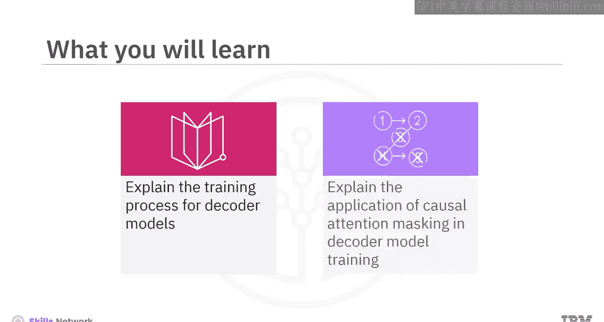
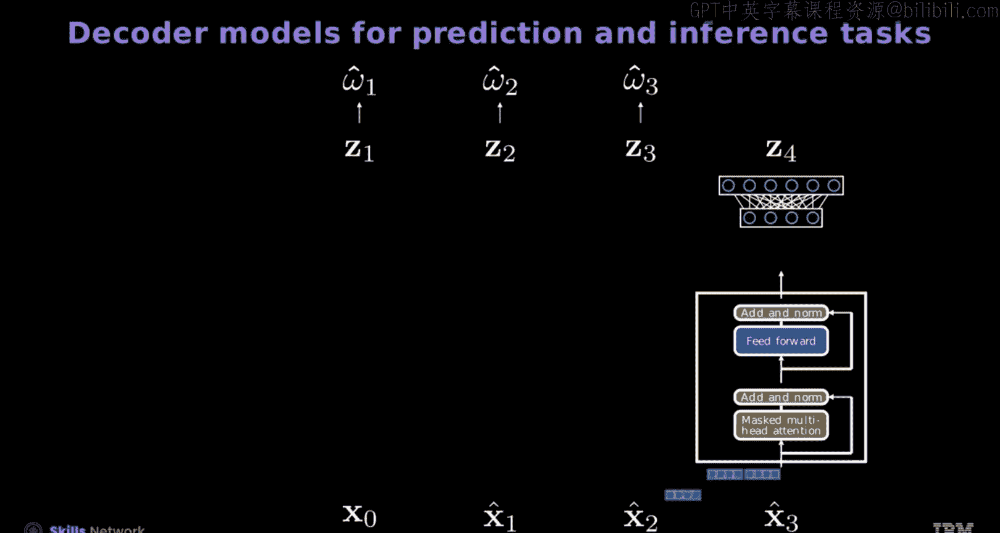
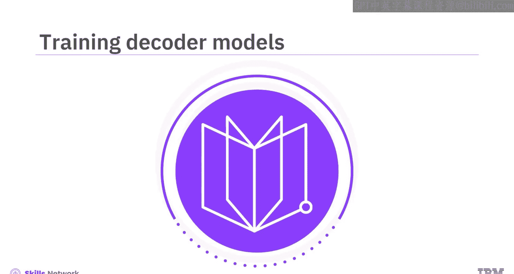
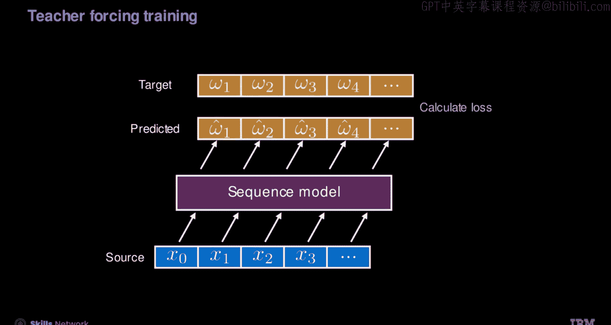
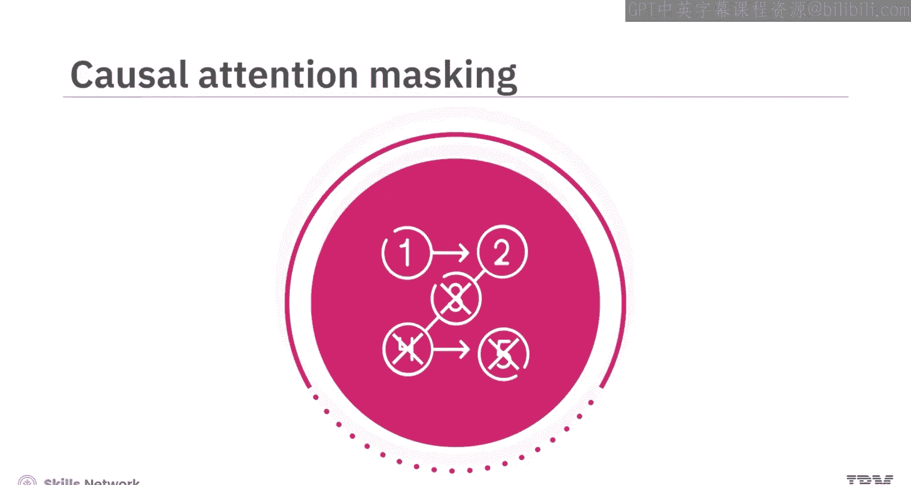
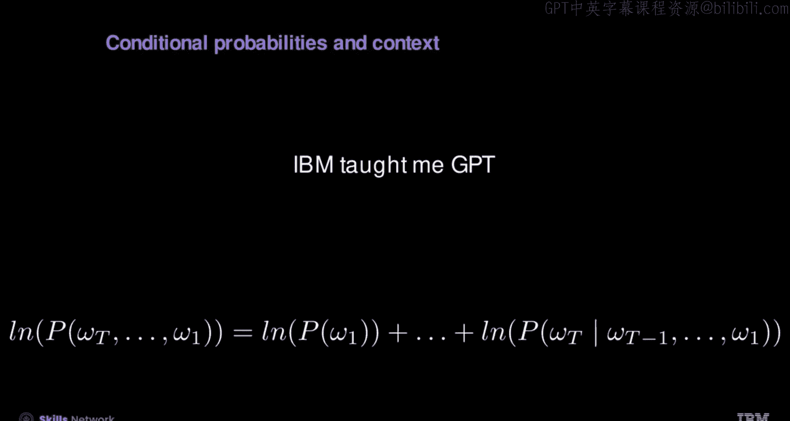

# IBM《生成式人工智能工程｜Falsk、生成式AI应用、数据分析、机器学习、Keras、架构和数据、NLP基础、transformer、微调、高级微调、RAG》 p123 7_训练解码器模型.zh_en -BV1NAq6Y9E7z_p123-

Welcome to Training decoder models After watching this video。

 you'll be able to explain the training process for decoder models you'll also be able to explain the application of causal attention masking and decoder model training。

Let's look at some new notations and refresh some of the concepts for sequence models in language modeling。

 you'll use mega hat T to represent the token or word index at time T。 When appropriate。

 you'll also use it to denote the token value。 This representation is derived from the maximum output value of the final layer and the neural network that is associated with the decoder。

 During prediction， you use this approach to generate a word embedding vector denoted as x hat T。

 which signifies your prediction， you use a hat notation to indicate that it is an estimate。

 although the word embedding itself is not a true estimate。

 but rather a hypothetical vector based on the decoder's output。

 let's delve into the prediction tasks associated with autoregressive transformer decoder models。

 Be with the first word embedding x at the initial time T equals0。

 the decoder generates a contextual embedding typically represented in gray。

 This contextual embedding is then fed through the neural network which helps shape the embedding of the subsequent encoding。

 The predicted word embedding x1 hat is combined with the original word em。

And reintroducuce to the model。 as a result， you obtain two contextual embeddings both depicted in gray。

 The last of these contextual embeddings is leveraged to predict the next token。

 This newly predicted token and the previous embeddings are fed back into the decoder。

 This sequence of events produces three contextual embeddings。 and once again。

 the final embedding is used to predict the subsequent token。

 This cyclical process repeats itself throughout the model's operation。

 It should be noted that positional encoding is added at each step。

 Let's now look at the training process for decoder models。

 This training set example presents input tokens in the first column and their targets Shi one time step forward in the second special tokens are appended depending on the model。

 Start tokens may or may not be used， and tokens are typically included。

 and zero padding is applied for uniform sequence length。

 You use the variable omega to denote tokens。 with superscripts indicating the sample number。

 Each sequence is a distinct sample。 These input tokens are converted into word embeddings。

As X and fed into the model。 This video focuses on analyzing a single sequence。

 analogous to examining one sample in a neural network。 During the training phase。

 the decoder's operation diverges from that of the inference phase。

 The decoder employs actual word embeddings rather than their approximations throughout the training。

 It processes the whole input sequence from index 0 to 3。

 and employs a causal mask to ensure that output predictions depend exclusively on prior sequence elements。

 The output denoted as H and Z are estimated values for the sequence at indices 1 to 4 built upon the inputs from indices 0 to 3。

 Unlike inference tasks were only the final token is used in training。

 the model uses all the predicted tokens at every sequence position。

 to achieve this all output contextual embeddings Id in gray and the output logics marked in red are harnessed to compute the loss。

 The predictions represented by omega hat primed or most likely tokens。

 The loss is then calculated using the true tokens omega and the logic values。 here， the loss。

Is the comparison between the actual token and the predicted token is shorthand After calculating the loss。

 you can train the model on one sequence or batch of sequences at a time Henceforth for simplicity。

 let's drop the prime to streamline the notation。During training。

 the model can use its own predictions from the previous step as the input for the next step。

 For example， the initial input x sub0 produces the output omega sub1。

 which in turn generates the token x hat sub1。 This predicted token is then used to generate the following token omega sub2。

 and the process continues in this matter。The model's output is used to determine the loss。

 Tea forcing is a technique employed in training sequence models such as transformers。

 In this method， instead of feeding the model's own predictions back as inputs for subsequent time steps。

 the actual previous token from the sequence is used。 In this example。

 x sub0 serves as the initial input to produce the model's output omega hat sub1。

 for the next time step， the actual token x sub1 is used to generate the subsequent output。

 Irespective of the model's previous predictions。 The process continues for the whole sequence。

 This approach ensures that even if the model makes an incorrect prediction at any step。

 it will still receive the correct token as the next input。

 allowing it to remain aligned with the actual sequence。 Consequently。

 this helps the model learn accurate mappings from inputs to outputs to determine the loss。

 causal attention masking is a technique that you can use in decoder training to determine which tokens in a sequence are attended to by each token during generation。

 in this self attention process， a causal attention mask with negative infinity values in its upper triangle。

Is applied to the attention matrix。 This mask ensures that each token can only attend to preceding tokens or itself。

 Prohiing future tokens from influencing the attention score。 For example。

 subsequent tokens should not influence the token me when predicting next token。Post masking。

 the scores undergo a soft max operation， which nullifies the impact of future tokens。 As a result。

 the computation of subsequent embeddings is concentrated exclusively on the previous and current tokens disregarding the future ones。

 The animation showcases the mask attention mechanism during decoder training。

 It computes attention scores using the complete input sequence denoted as x 0 to x 3。

 The scores for x 0 are exclusively used for predicting omega 1。To predict the second token。

 attention is limited to x0 and x1， masking out the subsequent tokens。

 this selective attention extends to all future predictions。Though the process may seem sequential。

 it occurs in parallel within the attention mechanism of the decoder。 Notably。

 this masking technique is crucial for accurately predicting intermediate tokens during inference。

The process is crucial for calculating probabilities unlike a neural network language model where the condition is static。

 the attention module incorporates subsequent probabilities into its estimates。

 This is illustrated by how the probability of G depends on me and its preceding tokens and how me relies on its own predecessors a key limitation is the context size。

 which is the number of tokens， the model can consider as input After the likelihood is determined during training。

 the logarithm is computed and combined with other sequences to train the model。

 Let's now recap what you learned In this video， you learned that during the training phase。

 the decoder's operation diverges from that of the inference phase The decoder employs actual word embeddings rather than their approximations throughout the training in training。

 the model predicts the next token at every sequence position During training。

 the model can use its own predictions from the previous step as the input for the next step in teacher forcing technique instead of feeding the model's own predictions back as inputs for subsequent time steps。

 the actual previous token from the sequences used causal。

Attention M ensures that each token can only attend to preceding tokens or itself。

 prohibiting future tokens from influencing the attention score。

