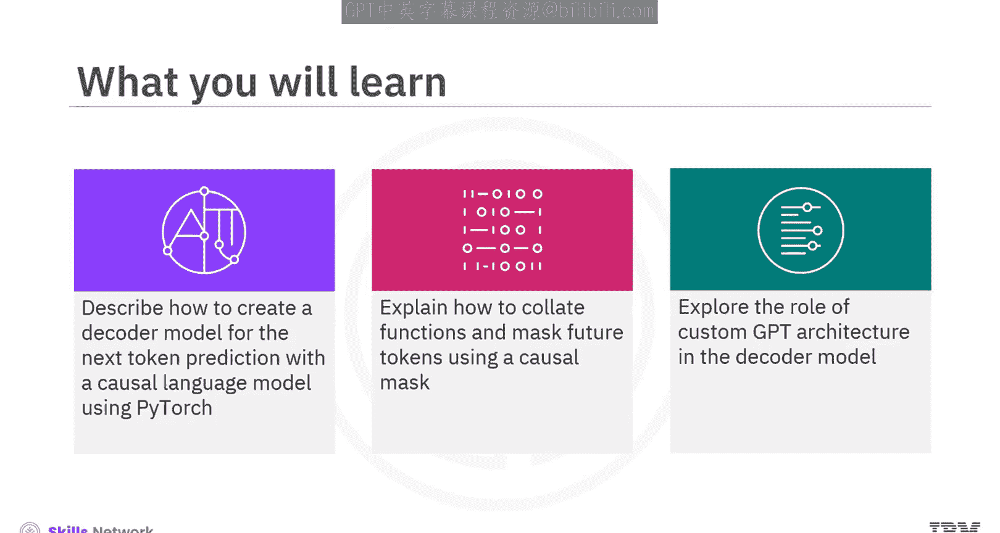
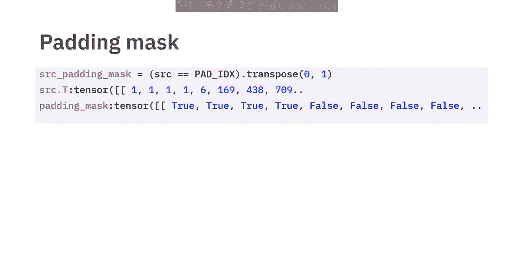
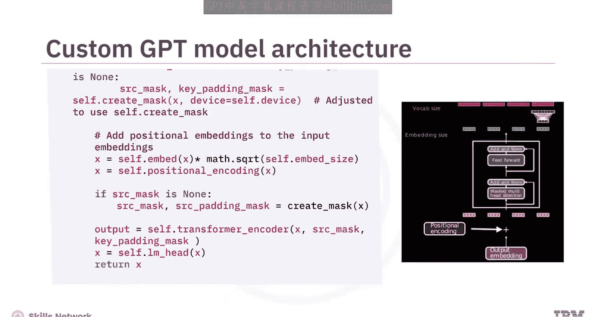
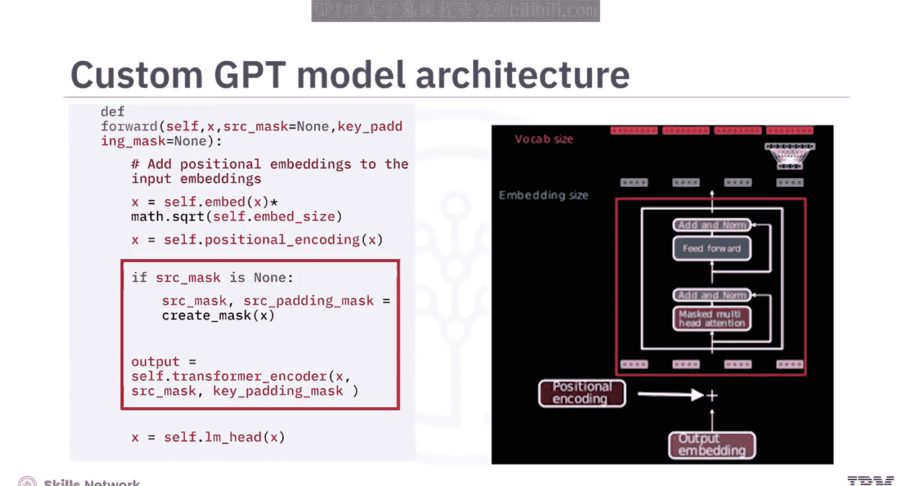
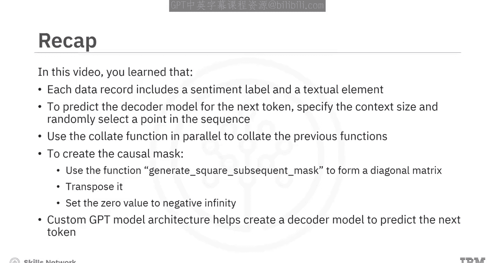

# IBM《生成式人工智能工程｜Falsk、生成式AI应用、数据分析、机器学习、Keras、架构和数据、NLP基础、transformer、微调、高级微调、RAG》 p124 8_解码器模型的PyTorch实现：因果语言模型.zh_en -BV1NAq6Y9E7z_p124-

Welcome to the video decoder models Pytorch implementation causal language model After watching this video。

 you'll be able to describe how to create a decoder model for the next token prediction with a causal language model or Lm using pytorch you'll also be able to explain how to collate functions and mask future tokens using a causal mask Additionally。

 you'll also be able to explore the role of custom G architecture in the decoder model decoder models leverage just the decoder of a transformer model At every stage for a specific word the attention layers can only access the words placed before it in the sentence。

 such models are usually termed as autoregressive models。 However。

 the pre-training of decoder models typically incorporates the prediction of the next word in the given sentence。

 Therefore， these models are most useful in text generation The decoder models are similar to the generative pretrained transformer or G Let's begin by understanding how to create a decoder model for future text tokens using pytorrch in causal LM Internet movie data。

or IMDb test and validation splits are useful for training and evaluating the decoder model。

 Each data record includes a sentiment label often ignored and a textual element is prioritized to create training data。

 however， customized vocabulary is useful for tokenizing and mapping the textual data to indices to achieve this first load the IMDB data set in neural language processing or NLP。

 certain special tokens such as unknown tokens padding tokens pad and end of sentence tokens EOS are used These tokens serve widely recognized purposes such as an unknown token represents words not found in the vocabulary。

 typically during inference。 however， the padding token Pa equalizes the lengths of sequences and a batch for models that require inputs of the same size and the end of sentence token EOS signifies the end of a sequence which is crucial for models to understand when a sentence or a sequence of token's ends Next。

 a language models predict words by analyzing the previous text where。

length acts as a hyperparameter。 Let's look at the process visualization steps first specified context size。

 which means block size and input text。 Next， randomly select a point in sequence from the text of length block size and shift the source by one token to generate a target sequence。

 This function helps to check several parameters such as block size text random sample stop random start and source sequence。

 Let's invoke the function get sample using the block size of 10。

 You can observe the source and target sequences and verify that both sequences are 10 tokens long。

 based on your verification you've observed that one token shift of the source forward。 Next。

 use the collate function and parallel to collate the previous functions。

 The function get sample retrieves the source analysis of the previous text and helps target using block sizes as a global variable It means that padding helps to ensure the sequences are of the same size in a batch Next。

 compare the source and target indices to reveal that the token shift sequentially。

Now let's understand how to create a causal mask to prevent the model from being influenced by future words First use a function generate squares subsequent mask。

 This function helps to form a diagonal matrix， transpos it and set zero values to negative infinity however pytorch includes the function generate square subsequent mask to create causal masks with sequence length as the input you can see that the outcome of this function is an upper triangular matrix filled with negative infinities。

 which are dimensioned equally in rows and columns to the sequence length。

 pytorrch creates a causal mask for transformers ensuring predictions for a token that are dependent on the previously visible tokens。

 they also use a function such as generates square subsequent mask and create mask to complete this task。

Further， the encoder ignores the zero padding using a padding mask where padding tokens are converted to true Now。

 let's explore the role of custom G model architecture in creating a decoder model to predict the next token。

 The custom G model consists of an embedding layer， a positional encoding layer， a transformer enr。

 and a linear layer that is LM head for language modeling。 First。

 the embedding layer maps each input token to a dense vector of size embed underscore size。 However。

 the positional encoding layer adds positional information to the input embeddings。 Further。

 the transformer encoder consists of multiple layers of multihead selfatten。 adding a source mask。

 This helps the encoder to behave like a decoder。 Finally。

 the linear layer outputs the lots over the vocabulary size。

Next， the forward method of custom GPT model takes as an input sequence of tokens X and adds the positional encoding。

Further add the source mask， SRC mask and padding mask to the encoder to get the output as a sequence of contextual embeddings this output is converted to logics Now you've reached the end of this video let's recap in this video you've learned to create a decoder model to predict the next token Each data record includes a sentiment label and a textual element to create training data。

To predict the decoder model for the next token， you need to specify the context size and randomly select a point in the sequence you also learn that the collate function can be used in parallel to collate the previous functions to create the causal mask first use the function generate square subsequent mask to form a diagonal matrix。

 transpose it and set the zero value to negative infinity Finally you learn that the custom GPT model architecture helps create a decoder model to predict the next token here the embedding layer maps each input token to a dense vector of size embedded size and the linear layer outputs the logics over the vocabulary size。

