# IBM《生成式人工智能工程｜Falsk、生成式AI应用、数据分析、机器学习、Keras、架构和数据、NLP基础、transformer、微调、高级微调、RAG》 p125 9_解码器模型的PyTorch实现：使用训练和推理.zh_en -BV1NAq6Y9E7z_p125-

Welcome to decoder Models， Pytorrch Imple usinging Training and inference。After watching this video。

 you will be able to create small instances of the models and calculate the loss；

 you'll also be able to describe the model's training process and explain how to generate text auto aggressivelyively。

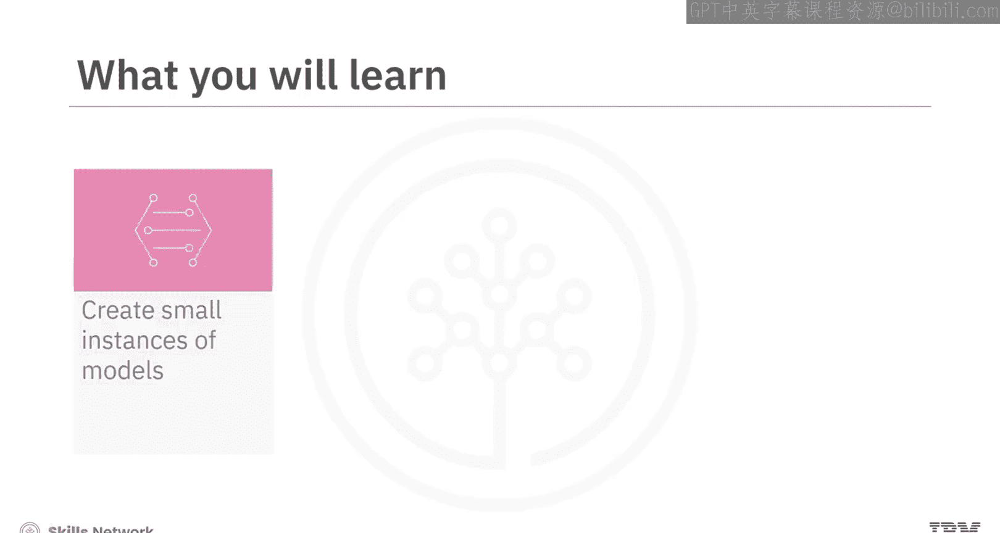

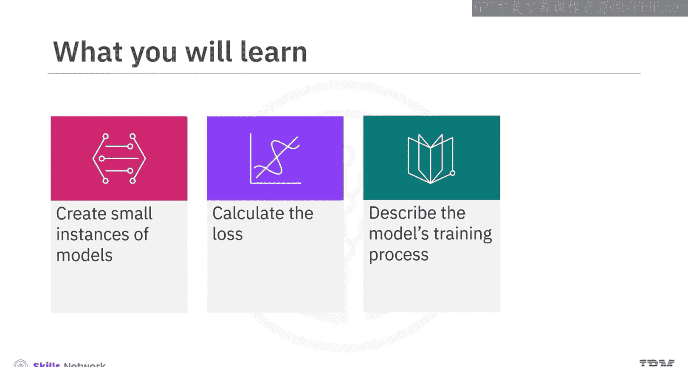

The decoder model in Pytorch refers to a neural network architecture that uses encoded information and generates output sequences。

 decoder models help in sequence to sequence text generation tasks such as machine translation and image captioning。

 It's important to note that the decoder model is similar to the generative pretrain transformer or GT。

Let's begin by understanding how to create a small instance of the model。

Create a small instance of the model， first specify the model hyperparameters。

 including encoder layers of  two and the number of attention heads of two。

Then define the instance for the custom GPT model。

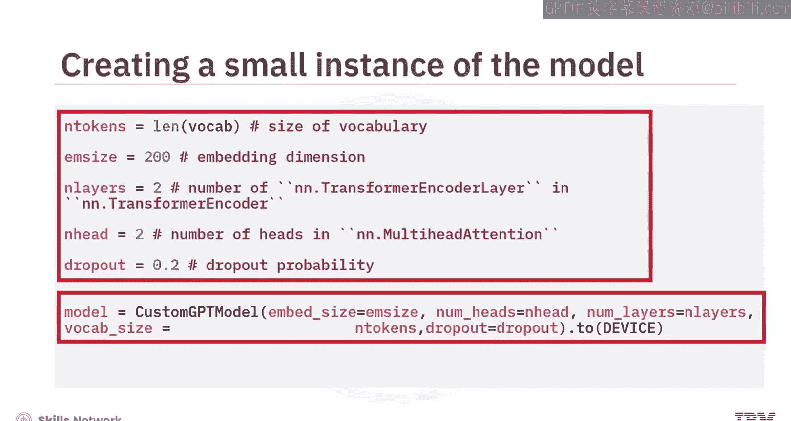

Now let's calculate the loss during loss calculation。

 the encoder model generates a source and a target。However， examining a batch from the target。

 you can observe that the dimensions are sequence length by batch size。

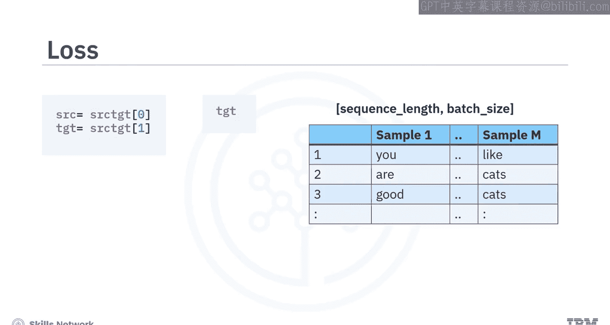

During prediction， the decoder model generates logicits class 1 and class 2。

 it's important to note that the dimensions of the logicits are sequence length。

 batch size and number of classes， Additionally， each table represents one sample of a batch。

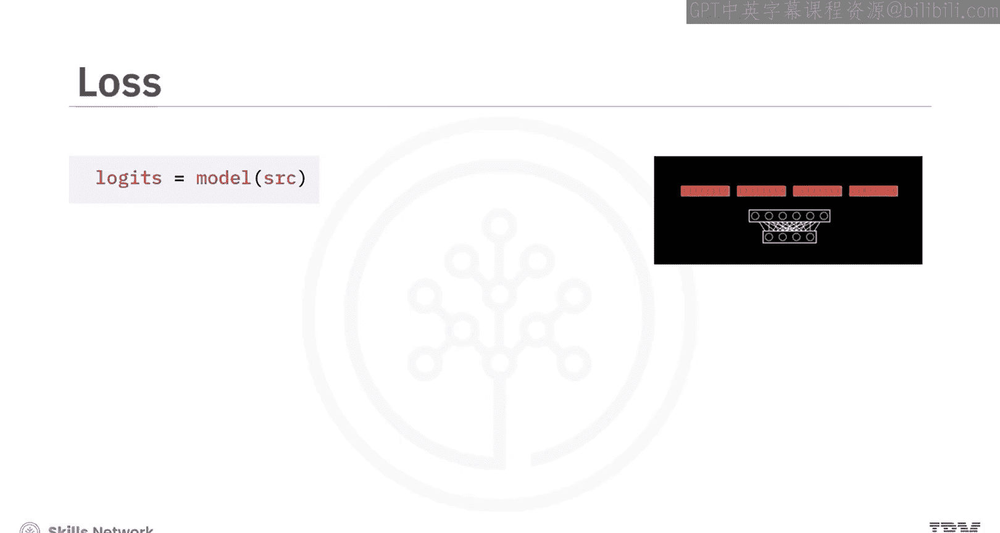

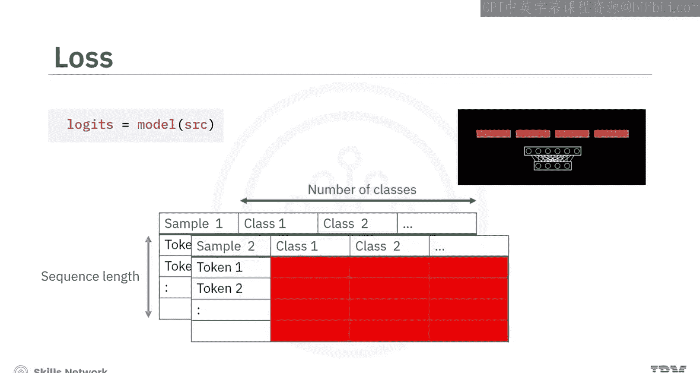

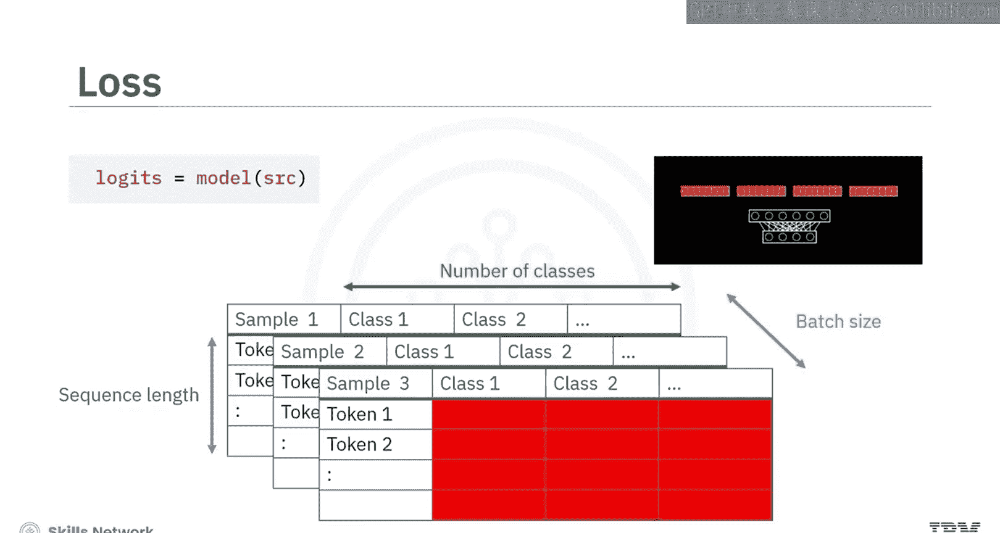

In preparation for loss calculation， you can see the reshaping of logicits where each row corresponds to the prediction for a token。

 spanning across both the sequence and the batch dimensions Next to calculate the loss。

 you can reshape the target tensor so that its elements correspond correctly to the logics。

 This process ensures that every row from the logics aligns with the appropriate target outcomes for accurate loss estimation。

 The illustration represents the mega hat， which is useful for its simplicity。

 and all the related logicits are in a real worldor scenario。

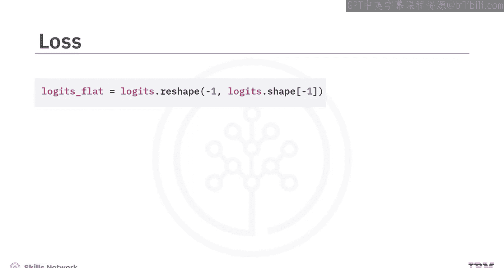

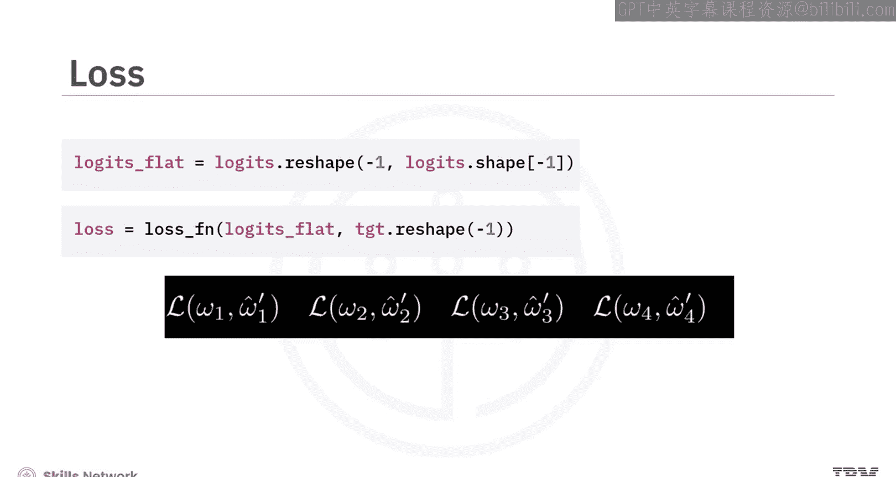

However， the training process is similar to other models such as convolutional neural networks or CNNNs。

 recurrent neural networks or RNNs， transformers and generative models。

 it uses the modified loss shape and other functions such as validation and checkpoint saving that help in the optimization。

The evaluate function measures the performance of the model by computing its average loss in the validation data set。

 however， the trained model is useful to generate inferences。Now。

 let's understand how to generate autoregressive text， also known as inference。

 Autoregressive text generation is a method of generating text where the model predicts the next token in a sequence based on the previous tokens。

 This process is iterative， where the decoder model generates one token at a time and uses the generated token as input for the next prediction。

Preparing an encoding prompt helps to create a process for text generation。

 This process serves as a starting point for the model to generate subsequent tokens。

 Once this prompt is tokenized， the decoder model can process and generate the next tokens based on the input。

 here， the pad tokens are used to process multiple batches。 However。

 they're not necessary for a single prediction。For example。

 a tokenized decoded prompt is mapped with vocab indices padding。

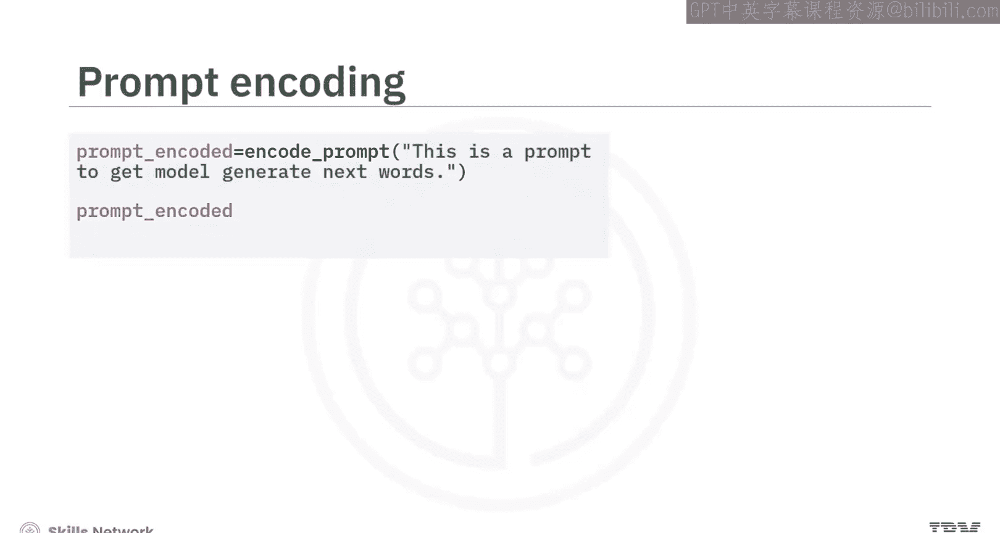

The generate function creates autoregressive text in the decoder model to do so。 First。

 create the encoded prompt tensor from the input sentence。 complete the sentence with。

 then feed the prompt into the model。 You can see that the mask is generated in the model。

 and the model will output the logicts during the process。 Next， select the final logicit vector。

 Now， identify and generate the token with the highest logicit score。 In this case。

 the further append the to the prompt for subsequent autoregressive text generation。

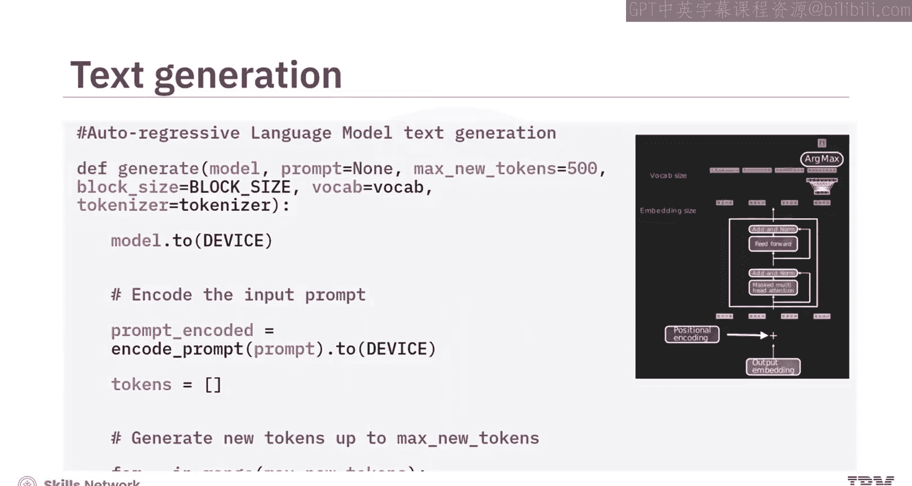

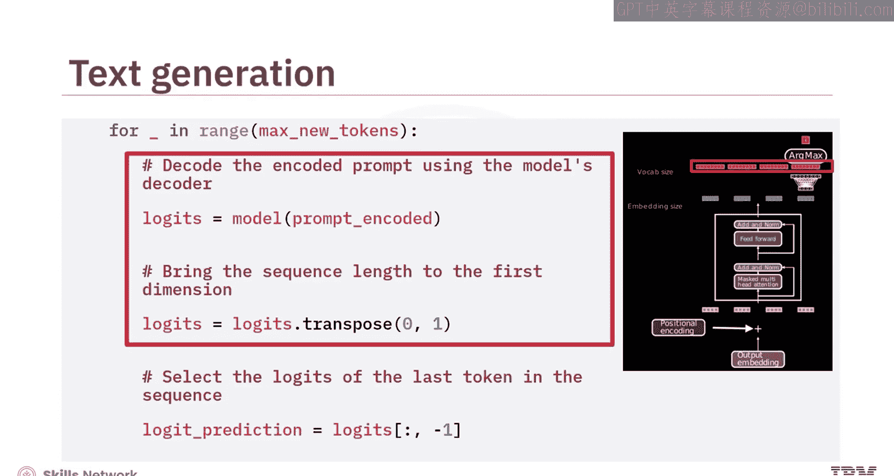

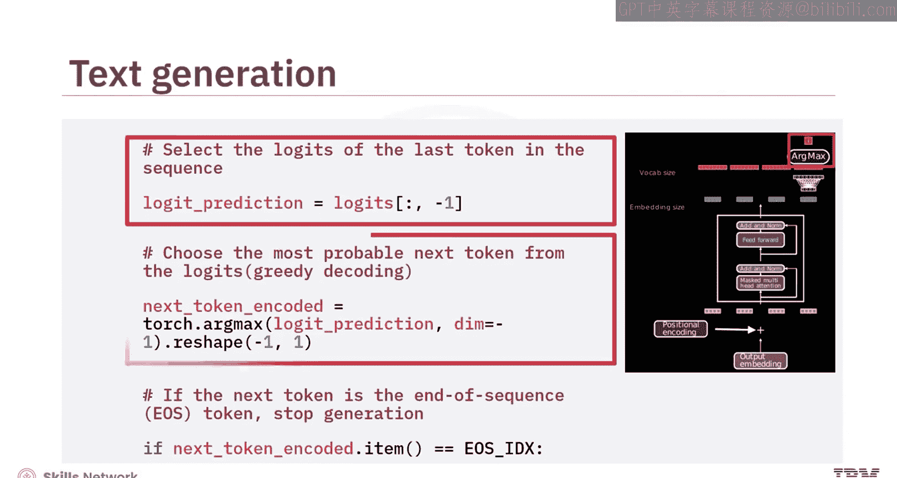

You can see that the decoder model receives the updated prompt and generates a token with the highest lot value；

 in this case the token is next， now append a token next to the prompt to generate the next round of autoregressive text。

You can see that the decoder model has again received the updated prompt and generated a token with the highest loit value。

 In this case， it is a word。 Now， append the token word to the prompt to generate the next round of autoaggressive text。

 Finally， this loop continues until the token reaches the other end of the sentence where passes max new tokens to the decoder model。

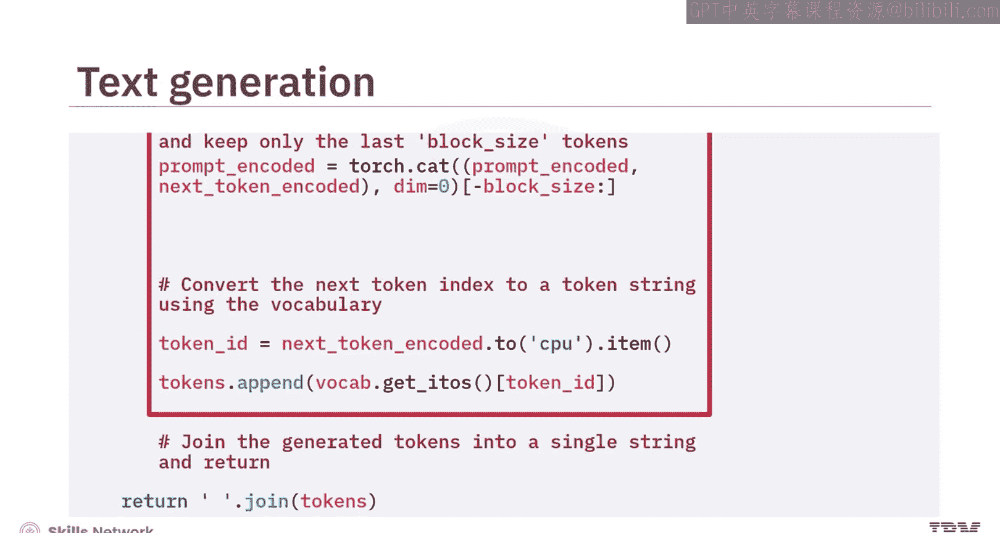

Now you've reached the end of this video。 Let's recap In this video。

 you've learned to create small instances of the models by specifying the model hyperparameters。

 The encoder model generates a source and a target while calculating loss。

 The training process is similar to other models and uses the modified loss shape and other functions that help in optimization。

 autoregressive text generation is a method of generating text where the model predicts the next token in a sequence based on the previous tokens。

 you learned the function generate to create an autoregressive text in the decoder model。 Finally。

 you learned to generate an autoregressive text， create an encoded prompt and feed it into the model。

 then generate a mask and you'll see the lot output and select it。 Next。

 identify and generate the token with the highest lot score and appendant for generating subsequent autoaggressive text。

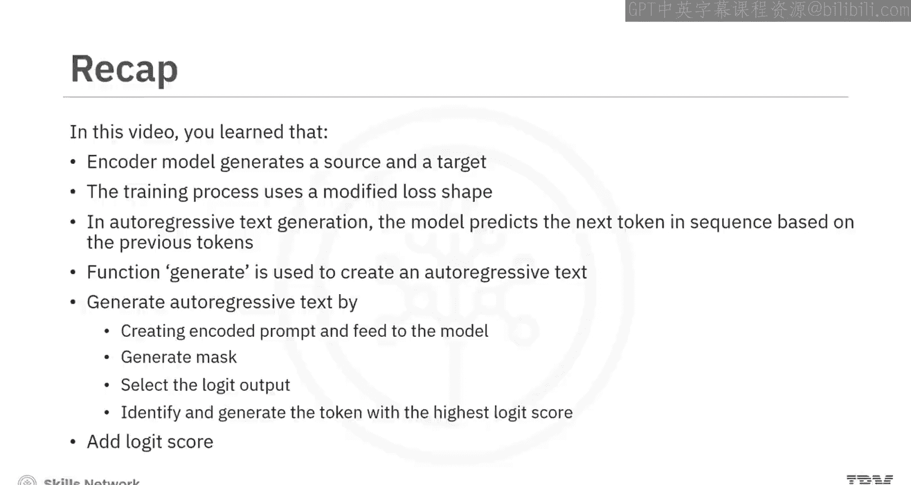