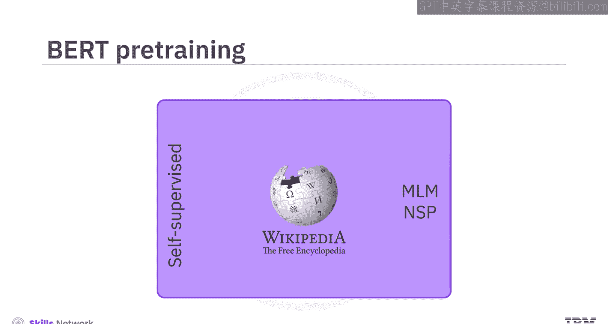
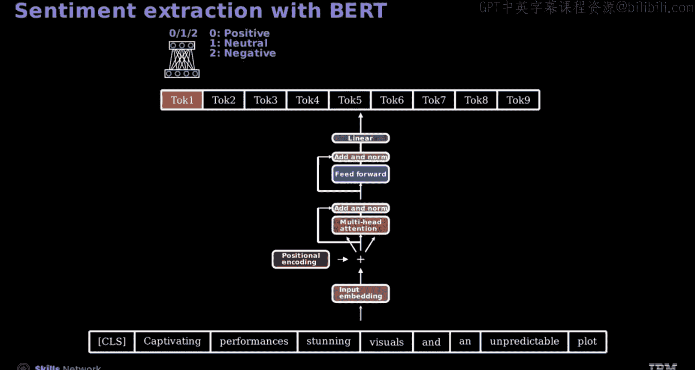

# IBM《生成式人工智能工程｜Falsk、生成式AI应用、数据分析、机器学习、Keras、架构和数据、NLP基础、transformer、微调、高级微调、RAG》 p127 11_使用NSP进行BERT预训练的编码器模型.zh_en -BV1NAq6Y9E7z_p127-

Welcome to encoder models with Bert pretraining using NSP After watching this video。

 you'll be able to perform pretraining of Bt models using next sentence prediction or NSP tasks。

 You'll also be able to describe how Bt models can be fine tuned for downstream tasks such as question answering or sentiment extraction。

 Bert is pretrained via selfsvised learning on vast text corpoa。

 using mass language modeling or MlM and next sentence prediction or NSP。 to perform the NSP task。

 the Bt model is trained to determine whether a given sequence logically follows a preceding one。

 Take， for example， the sentence My dog is cute。 You would anticipate the following sentence to logically be。

 he likes playing During Bert's training a random sentence such as he likes studying medicine may be presented as a potential successor The model's job is to predict which sentence is the appropriate continuation You must alter the embeddings for this task In Bert you can perform token。

usings a standard tokenizer for simplicity and ease of coding from scratch。

 Please note that actual Bt uses word piece tokenization。

 begin by adding this CS token at the start of your sequence。

 This special token has a specific function。 Following this。

 you will insert the SP token to denote the end of a sentence。

 Each token will be associated with its respective embedding。 Additionally。

 you can introduce segment embeddings which serve to distinguish whether a token belongs to the first or the second sentence In sentence tasks。

 Finally， incorporate positional andcodings to give the model and idea of the order of tokens in the sequence。

 Let's look at the segment embeddings。 You have tokenized the sentences my dog is cute and he likes playing for the segment embeddings you need to assign a value of one to all tokens up to and including the first SP token。

 indicating they belong to the first sentence。 After the SP token， assign sign a value of two。

 signifying that the subsequent tokens are part of the second sentence。Additionally。

 use a binary variable Y to indicate sentence succession。

 A0 denotes that the sentence is not the logical follow up or not next。

 While a one signifies that it is indeed the subsequent or next sentence。 Let's set y equals1。 here。

 insert a random sentence。 My dog is cute， and he likes studying medicine。

 for the segment embeddings， follow the same procedure。

 but the binary variable Y equals 0 denotes that the sentence is not the logical follow up or not next。

 Let's consider an example of a data set。 My name is Dave。

 followed by I live in Toronto is labeled as a consecutive sentence with the value set to1。

 This indicates that the sentences are sequentially related。 Conversely， my name is Joyce。

 Toronto as the capital of Ontario is labeled with a value set to false。

 indicating that the sentences are not related。 In addition to the CS and S P tokens。

 Incor0 padding to ensure all sentences are of uniform length for processing purposes。

 The labels have been。Added for the masked language modeling as well， shown here as Bt labels。

In the NSP task， the input consists of word embeddings that are processed by the encoder to generate contextual embeddings。

 These embeddings are used to determine whether for a given pair of sentences。

 The second sentence logically follows the first just like a standard classification task。

 The CS token highlighted in yellow， corresponds to the NSP classification token。

 which encapsulates information from the entire sequence。

 This token is then fed into a neural network designed specifically for the NSP task。

 which assesses the relationship between pairs of sentences。

 Let's approach this as a two class classification problem。

 Use the output value from the logics to determine the class。

 to train the encoder component of the Bt model， you can utilize the outputs from a neural network that has been trained for NSP and MlM tasks。

 The training process involves minimizing the combined loss。

 which is the sum of the losses from the two tasks。

 Ac word prediction from masked words and the ability to discern whether the predicted word fits with。

In the context in Pytorch， the lots are used as inputs to the loss function to drive this optimization。

After pretrain， you can fine tune Bt for specific downstream tasks。

 fine tuning involves training Bt on a task specific dataset set， such as sentiment analysis。

 where the model predicts whether the sentiment of the input sequence is positive。

 neutral or negative as shown。 during fine tuning， the Bt learns task specific patterns and adapts its representations to perform well on the target task。

 token representation of the Cs token will be transformed via a neural network to generate the model prediction。

 The contextual embeddings can also be used in many other tasks like vector databases。

 Let's now recap what you learn In this video， you learned that to perform the next sentence prediction or NSP task the model is trained to determine whether a given sequence logically follows a preceding one。

 The Bt model's job is to predict which sentence is the appropriate continuation。

 The CS token is added at the start of the sequence。

 and the SP token is added to denote the end of a sentence。 segment embedding served。

To distinguish whether a token belongs to the first or the second sentence impaired sentence tasks positional encodings give the model an idea of the order of tokens in the sequence in the NSP task。

 the input consists of word embeddings processed by the encoder to generate contextual embeddings these embeddings are used to determine whether for a given pair of sentences。

 the second sentence logically follows the first， just like a standard classification task Traing the encoder component of thet model involves minimizing the combined loss。

 which is the sum of the losses from the two tasks Ac word prediction for masked words and the ability to discern whether the predicted word fits within the context fine tuning involves training Bt on a task specific data set。

 such as sentiment analysis where the model predicts whether the sentiment of the input sequence is positive。

 negative or neutral。

